# Crimping and Wireshark

## Table of Content

+ 0.[Basic Command Line Tools for Network Connection](#0-basic-command-line-tools-for-network-connection)
    + [telnet](#01-telnet)
    + [ssh](#02-ssh-secure-shell)
    + [nc](#03-netcat-nc)
    + [ping](#04-ping)
    + [traceroute](#05-traceroute)
    + [mtr](#06-mtr)
+ 1.[IP and Port Concepts](#1-ip-and-port-concepts)
    + [IP Concept](#11-ip-concept)
    + [Port Allocation](#12-port-allocation)
+ 2. [Basic Network Topology](#2-basic-network-topology)
  + [2.1 How do nodes connect?](#21-how-do-nodes-connect)
    + [2.1.1 Via console](#211-via-console)
    + [2.1.2 Via "edit network config"](#212-via-edit-network-config)
  + [2.2 How do you find the transfer capacity between nodes?](#22-how-do-you-find-the-transfer-capacity-between-nodes)
    + [2.2.1 Using iperf3](#221-using-iperf3)
  + [2.3 Connecting Multiple Nodes Using a Bridge](#23-connecting-multiple-nodes-using-a-bridge)
    + [2.3.1 Basic Bridge Configuration](#231-basic-bridge-configuration)
  + [2.4 Network Simulation](#24-network-simulation)
    + [2.4.1 Packet Loss Simulation](#241-packet-loss-simulation)
    + [2.4.2 Throughput Limitation Simulation](#242-throughput-limitation-simulation)
  + [2.5 Switching from a Bridge to a Switch](#25-switching-from-a-bridge-to-a-switch)
    + [2.5.1 Simple Switch Topology](#251-simple-switch-topology)
    + [2.5.2 Simulating Packet Forwarding on a Switch](#252-simulating-packet-forwarding-on-a-switch)
  + [2.6 Automatic IP Configuration with DHCP](#26-automatic-ip-configuration-with-dhcp)
    + [2.6.1 DHCP Server Configuration (udhcpd)](#261-dhcp-server-configuration-udhcpd)
    + [2.6.2 DHCP Client Configuration](#262-dhcp-client-configuration)
    + [2.6.3 Manual DHCP Client Configuration](#263-manual-dhcp-client-configuration)
  + [2.7 DHCP Server configuration using kea-dhcp4](#27-dhcp-server-configuration-using-kea-dhcp4)
    + [2.7.1 DHCP Concepts](#271-dhcp-concepts)
    + [2.7.2 Topology and Initial Configuration](#272-topology-and-initial-configuration)
    + [2.7.3 Kea-DHCP Server Installation](#273-kea-dhcp-server-installation)
    + [2.7.4 DHCP Server Configuration](#274-dhcp-server-configuration)
    + [2.7.5 DHCP Relay Configuration](#275-dhcp-relay-configuration)
    + [2.7.6 DHCP Client Configuration](#276-dhcp-client-configuration)
    + [2.7.7 Leasing Times](#277-leasing-times)
    + [2.7.8 Fixed Address](#278-fixed-address)
    + [2.7.9 Testing the DHCP Configuration on the Topology](#279-testing-the-dhcp-configuration-on-the-topology)
    + [2.7.10 Keeping the Configuration After Restart](#2710-keeping-the-configuration-after-restart)
    + [2.7.11 Troubleshooting](#2711-troubleshooting)
+ 3. [Wire Crimping](#3-wire-crimping)
  + [3.1 Tools needed](#31-tools-needed)
  + [3.2 Cable Configuration](#32-cable-configuration)
  + [3.3 Crimping Steps](#33-crimping-steps)
+ 4. [Wireshark](#4-wireshark)
  + [4.1 Installation](#41-installation)
  + [4.2 Filters](#42-filters)
  + [4.3 Export Packet Capture Data](#43-export-packet-capture-data)
  + [4.4 Wireshark Usage on FTP Server](#44-wireshark-usage-on-ftp-server)

## 0. Basic Command Line Tools for Network Connection

### 0.1 Telnet

Imagine you want to check if a website is accessible through port 80 (which is typically used for HTTP). With Telnet, you can type the command:

```
telnet google.com 80
```

If Telnet connects, it means the site is active and port 80 is open, allowing communication. This is a simple way to check if a service on a server (like a web service) is reachable from your computer.

#### So, what is Telnet?

Telnet (Telecommunication Network) is a network protocol that allows you to connect and interact with another computer remotely over a network, such as the internet or a LAN (Local Area Network). With Telnet, you can access files and data on another computer as if you were sitting right in front of it.

The main function of Telnet is to log into another computer (host/server) remotely and manage it. This can be very useful, for example, for system administration or remote troubleshooting.

However, Telnet has serious security weaknesses. Information like usernames and passwords are sent in plain text (unencrypted), making it easy for others on the network to intercept. As a result, Telnet is increasingly being replaced by more secure protocols like SSH.
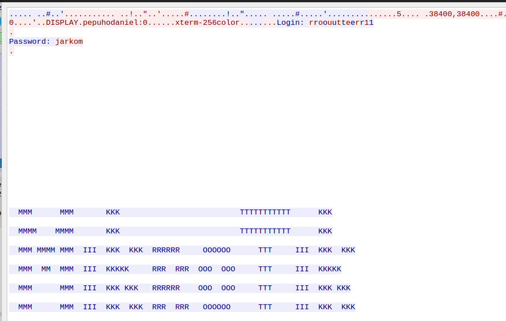

### 0.2 SSH (Secure Shell)

Imagine you are a developer working from home and need to update code on your company's server. With SSH, you can log into the server from your home computer, edit or upload code files, and run programs to ensure everything is working correctly, as if you were directly in front of the server.


#### So, what is SSH?

SSH is a protocol that allows you to access and manage a computer or server remotely and securely. You can perform various tasks, such as running programs, creating or deleting files, and transferring files to other servers. SSH ensures that all data sent and received is protected with encryption, making it more secure than older methods like Telnet.

The SSH protocol operates using a client-server model. The connection involves an SSH client (the user's computer) connecting to an SSH server (the remote server).

The latest version of SSH is [SSH v2](https://www.synopsys.com/software-integrity/security-testing/fuzz-testing/defensics/protocols/ssh2-server.html). SSH is considered more secure compared to Telnet.

To connect using SSH, you would use the following command:
```
ssh username@host or
ssh username@host -p 2224
```

### 0.3 Netcat (nc)

Imagine you want to test if a server can receive data from your computer. With Netcat, you can send a message to the server and see if it responds. This is useful for checking network connections or debugging applications.


```
echo "Hello, Server!" | nc example.com 1234
```
This command will send the message "Hello, Server!" to the server at example.com on port 1234.

#### So, what is Netcat?

Netcat (or nc) is a command-line utility that reads and writes data through network connections, using TCP or UDP protocols. It is one of the most powerful tools for network troubleshooting and system administration, and is considered a multifunctional tool.

The syntax for Netcat is as follows:
```
nc [options] host port
```
By default, Netcat will attempt to start a TCP connection to the specified host and port. If you want to make a UDP connection, use the -u option.

### 0.4 Ping

Imagine you send a short message to a computer or server and wait for a reply. If the response comes back quickly, it means the network connection is good and the device is reachable. If there is no reply or the response is slow, there might be an issue with the connection or the device. Ping helps you determine if the network is functioning properly.

#### So, what is Ping?

Ping stands for Packet Internet Network Groper. Simply put, ping is a command used to check the status and availability of a host in a network.

The basic principle of ping is similar to using sonar to measure the depth of the sea. A signal is sent out, and the time it takes to return is used to make measurements.


source: [https://www.niagahoster.co.id/blog/apa-itu-ping/](https://www.niagahoster.co.id/blog/apa-itu-ping/)

Here’s how to perform a ping:

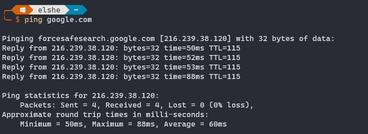

With the command above, you will get the following information:
+ Reply is the response from the host, along with the IP address information. The default command ideally gives four replies, but you might also see "Request Timed Out (RTO)" indicating no reply was received within the ping timeout period.
+ Bytes is the amount of data sent. For Windows, this is usually 32 bytes.
+ Time is the duration of the response from the host, measured in milliseconds (ms). A good ping time is under 100ms, especially for online gaming which requires low latency.
+ TTL (Time To Live) is the duration a data packet can stay in the network, recorded in seconds. Typically, TTL is set around 64 seconds.

### 0.5 Traceroute

To visualize this, imagine sending a letter to someone in another city and wanting to know which post offices the letter passes through before reaching its destination. Traceroute works in a similar way by showing every "stop" (hop) your data packet traverses from your computer to the destination server.

```
traceroute google.com
```

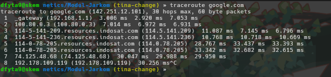

#### What is Traceroute?

**Traceroute** is a network diagnostic tool used to track the path (route) taken by data packets from a source computer to a destination host. It works by sending packets incrementally with an increasing **TTL** (Time To Live) value (starting at 1); consequently, each router (hop) along the path replies with a *"TTL Exceeded"* message once the packet's TTL reaches zero. Based on these replies, traceroute can map out every hop traversed.

With Traceroute, you can see:
+ **Hop number**: the sequence of points (routers) the packet passes through, starting from 1.
+ **Hostname/IP**: the IP address or hostname of each hop.
+ **RTT (Round Trip Time)**: the round-trip travel time for the packet to reach that hop; usually displayed as three attempts (in ms).
+ **Timeout (`* * *`)**: indicates that the hop did not provide a reply within the specified time limit (this could be due to a firewall blocking ICMP, not necessarily a broken network connection).

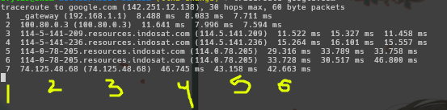

Traceroute is highly useful for identifying exactly where a connection is experiencing bottlenecks or failures, particularly when troubleshooting connectivity issues with a server. The basic usage of Traceroute is as follows:
```
traceroute [hostname/ip]
```

Some commonly used options:
```
traceroute -n [hostname/ip]              # displays hops only as IP addresses, without DNS resolution
traceroute -m [maximum] [hostname/ip]   # specifies the maximum number of hops to trace
traceroute -I [hostname/ip]              # uses ICMP ECHO instead of UDP for probe packets
```

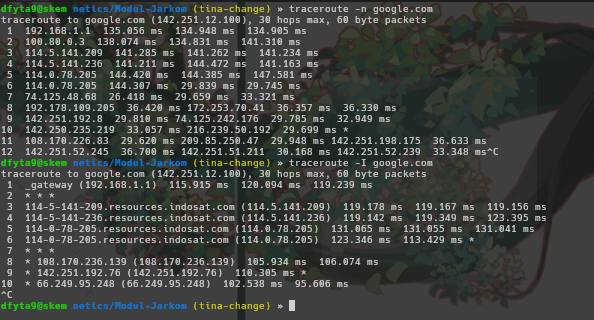

### 0.6 MTR

Imagine sending a packet to a destination server, but it fails to arrive within a reasonable timeframe. You want to pinpoint where the issue lies—whether it is in your local network, with your ISP, or at the destination server itself. MTR allows you to visualize the entire "route" the packet takes, as well as the connection quality at each point (hop) along the way.

```
mtr google.com
```

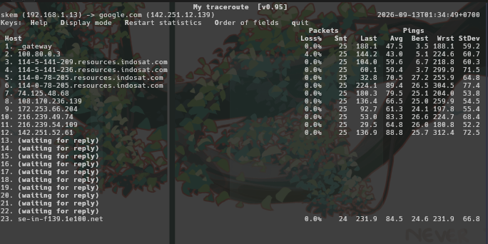

#### What is MTR?

**MTR** (short for **My Traceroute**) is a network diagnostic tool that combines the functions of **ping** and **traceroute** into one. While ping simply indicates whether a destination host is reachable and traceroute shows the path (hops) a packet takes, MTR performs both tasks continuously (in real-time) and displays performance statistics for every hop along the route.

With MTR, you can view:
+ **Host**: The IP address or hostname of each hop (point) the packet passes through on its way to the destination.
+ **Loss%**: Th


e percentage of packets lost at each hop.
+ **Snt**: The number of packets sent to that hop.
+ **Last, Avg, Best, Worst**: Latency values ​​(transit time)—specifically the last, average, fastest, and slowest times—for packets reaching that hop.
+ **StDev**: The standard deviation of latency, indicating the stability of the connection at that hop.

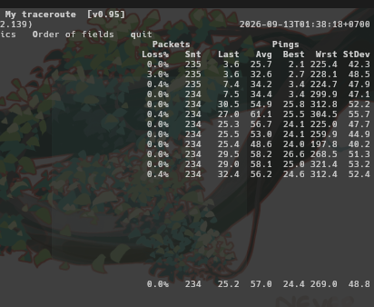

Because MTR displays data continuously (rather than just once, like a standard traceroute), it is highly useful for identifying exactly which hop is causing packet loss or high latency within a network. The basic usage of MTR is as follows:
```
mtr [hostname/ip]
```

Some commonly used options:
```
mtr -r [hostname/ip]            # report mode: results are displayed once after a set number of packets are sent (not real-time)
mtr -c [count] [hostname/ip]    # specifies the number of packets (cycles) sent to each hop
mtr -n [hostname/ip]            # displays hops as IP addresses only, without DNS resolution
```

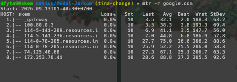

## 1. IP and Port Concepts

### 1.1 IP Concept

Have you ever wondered how the internet knows that when you type google.com, you are directed to Google's website and not another site? Actually, the internet doesn't understand the name google.com directly. Instead, it uses an IP address to determine where to send the data. For example, google.com is actually linked to the IP address 8.8.8.8.

#### What is IP?

Imagine you have neighbors, and you distinguish your house from their houses using an address. An IP address is like a home address. Each device, such as a computer or smartphone, has its own address in the network. When you send something, like a letter or data, you need the recipient's address so that your delivery reaches the correct place. Similarly, an IP address ensures that data sent over the internet reaches the right device.


IP stands for Internet Protocol. So, an IP address or Internet Protocol address is the address used by the Internet Protocol to identify any device connected to a network, whether it is the internet or a local network.

Types of IP addresses:
#### a. IPv4

IPv4 is the most commonly used IP address, with a length of 32 bits and four sections (octets) separated by dots. Each octet's value ranges from 0 to 255. IPv4 stands for Internet Protocol version 4.

With this setup, it can be estimated that there are about 4.3 billion different IPv4 addresses worldwide.

Examples of IPv4 addresses include:

+ 169.89.131.246
+ 192.0.2.146
+ 01.102.103.104

Because it is the most widely used, almost all systems can handle IPv4 routing without issues. Additionally, IPv4 addresses support most network topologies due to their simple prefixes. Data in IPv4 address packets is also well-encrypted to ensure secure communication between networks.

#### b. IPv6

IPv6 is a newer version of the IP address designed to replace IPv4 due to the limited number of available IPv4 addresses.

While IPv4 has a length of 32 bits, IPv6 has a length of 128 bits. This means there are about 340 undecillion (a number with 66 zeros!) different IPv6 addresses.

IPv6 addresses are written in a series of 16-bit hexadecimal digits and letters, separated by colons. Therefore, you will encounter letters from A to F in this type of IP address.

Here are examples of IPv6 addresses:

+ 2001:3FFE:9D38:FE75:A95A:1C48:50DF:6AB8
+ 2001:0db8:85a3:0000:0000:8a2e:0370:7334
+ 2001:db8:3333:4444:CCCC:DDDD:EEEE
With IPv6, routing becomes more efficient because it allows Internet Service Providers to minimize the size of routing tables. IPv6 also uses Internet Protocol Security (IPsec), so you don't have to worry about authentication, data confidentiality, and integrity.

Additionally, IPv6 does not have an IP checksum, making packet processing more efficient, and supports multicast. As a result, data can be sent to multiple destinations simultaneously, saving network bandwidth.

### 1.2 Port Allocation

When you visit a building, you give the receptionist the apartment number you want to go to so they can direct you to the right place. Similarly, in a network, when you send data, you need to specify a port number so the data reaches the correct application or service on the computer or server.


#### So, what is a Port?

A port is a way that allows a computer to handle multiple connections and programs simultaneously on a network. Each port is associated with a specific application or service. For example, ports help the computer distinguish between incoming email and web pages because they use different ports.

To ensure compatibility, ports have a standardized system across all networked devices. Each port is identified by a 16-bit (two-byte) number called a Port Number.

**Logical Port**

A logical port is a pathway used by applications to connect with other computers over a TCP/IP network. One example is connecting a computer to the internet. Ports play a crucial role in computer networking.

Based on their numbering, logical ports are divided into three categories. Some ports are registered with the Internet Assigned Numbers Authority (IANA), while others are not. Here's the breakdown:

+ Well-known ports: Ranging from 0 – 1023. These are recognized or system ports. They always represent the same network services and are assigned by IANA.
+ Registered ports: Ranging from 1024 – 49151. These ports are known and registered with IANA but are not permanently assigned, allowing them to use the same port number.
+ Dynamically assigned ports: Ranging from 49152 – 65535. These ports are assigned by the operating system or application to serve requests from users as needed.

Here are some examples of commonly used logical ports and their functions:
+ Port 20 & 21 (FTP): A protocol used for transferring data within a network.
+ Port 22 (SSH): Used to send data over the network in encrypted form. It can be used for tasks that can be accessed remotely, such as connecting to a host or server.
+ Port 23 (TELNET): A port for connecting remote computers and servers. Its function is similar to SSH, but TELNET does not encrypt the connection.
+ Port 25 (SMTP): Ensures secure communication of emails between SMTP servers.
+ Port 53 (DNS): Serves as an IP address translator for each host.
+ Port 67 & 68 (DHCP): Dynamic Host Configuration Protocol assigns information related to IP addresses.
+ Port 80 (HTTP/Web Server): Enables browsers to connect to web pages.
+ Port 443 (HTTPS): Connects clients to the internet but with added security features that HTTP port 80 lacks. Port 443 encrypts network packets before transferring them.
+ Port 143 (IMAP): Internet Message Access Protocol, or IMAP, is a protocol for accessing emails from the server.

## 2. Basic Network Topology

Basic network topology refers to the physical as well as logical structure that determines how nodes connect to each other and communicate. We will simulate and learn the fundamental steps of building a computer network, starting from a direct connection between two nodes (point-to-point), network performance testing, using a switch, up to configuring IP addresses automatically.

### 2.1 How do nodes connect?

Basically, nodes in a network can communicate with each other if they have an IP address and are in the same network segment. In this first stage, we will connect two nodes directly (Point-to-Point) and configure the IP addresses statically so that both nodes can recognize each other and send data packets.

#### 2.1.1 Via console

1. Create a new project in GNS3, add 2 netics-pc nodes and connect the two nodes with a link (using the eth0 interface on both nodes)

   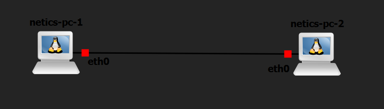

2. Start both nodes, open the console, then set the IP address and interface on each node.

  On **netics-pc-1**:
```
ip addr add 192.168.100.101/24 dev eth0
ip link set eth0 up
```

  On **netics-pc-2**:
```
ip addr add 192.168.100.102/24 dev eth0
ip link set eth0 up
```

3. Confirm the new IP address by running **ip -br addr**

   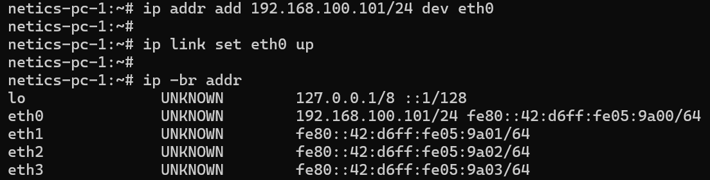
   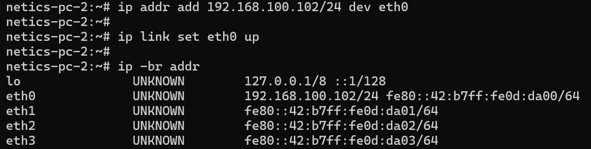

4. Verify that the two nodes are connected by pinging one node from the other node.

   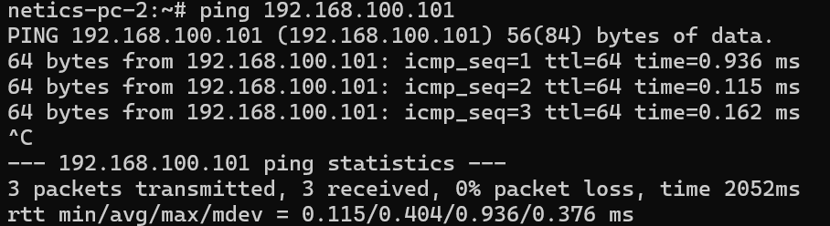
<br>

#### 2.1.2 Via "edit network config"

1. Right-click on the node -> **Configure** -> **Edit Network Configuration**. Then fill in with the following configuration:

  On **netics-pc-1**:
```
auto eth0
iface eth0 inet static
    address 192.168.100.101
    netmask 255.255.255.0
```

  On **netics-pc-2**:
```
auto eth0
iface eth0 inet static
    address 192.168.100.102
    netmask 255.255.255.0
```

2. After you click Save, this configuration will not take effect immediately. You have to restart the node (right-click -> Stop, then right-click -> Start) so that the node can read its configuration file again during the boot process.

<br>

### 2.2 How do you find the transfer capacity between nodes?

Once the nodes are connected, we will measure how large the maximum interface capacity is and the actual transfer speed (throughput) between them. We do this using the **ethtool** utility to check the node's capacity limit and **iperf3** to test the actual traffic load.

#### 2.2.1 Using **iperf3**

1. To find out the interface capacity, use the command **ethtool [interface]**

   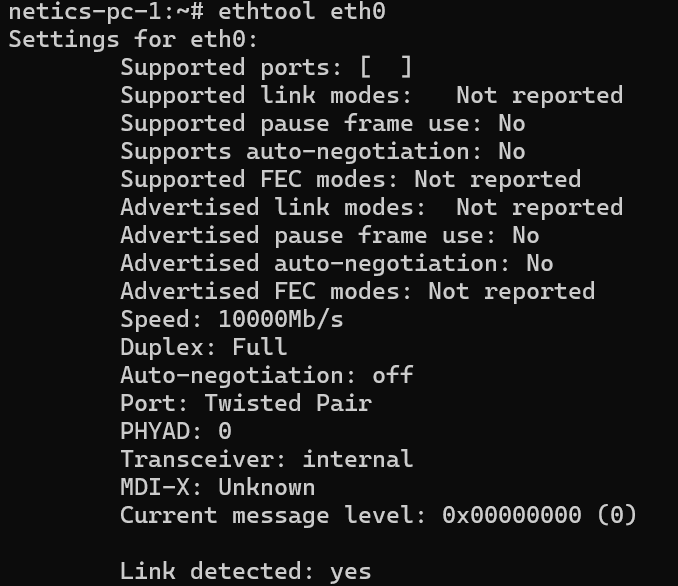

The output shows a capacity speed of 10 Gbps

2. We will run a performance test with iperf3

iPerf3 is a tool for measuring the maximum active bandwidth that can be achieved on an IP network.

On **netics-pc-1**:
```
iperf3 -s
```

**-s** means running the node in server mode. The node will listen, waiting for incoming traffic data from the client node.

On **netics-pc-2**:
```
iperf3 -c <ip-netics-pc-1> -u -b 10G
```
**-c** means running the node in client mode to start the test toward the server. **-u** tells iPerf3 to use the UDP protocol. **-b 10G** targets a data transmission speed of 10 Gigabits/second.

Test results:

   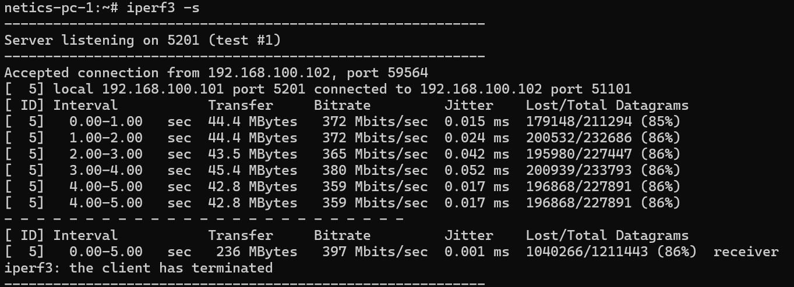

   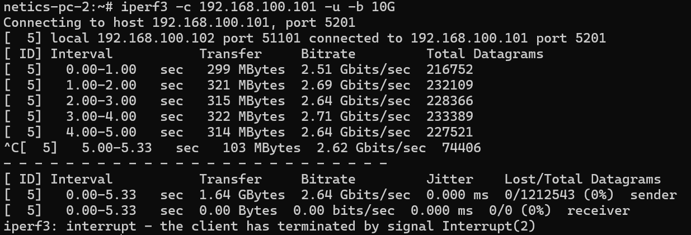

Based on the images, iperf3 reports that the actual traffic successfully generated by **netics-pc-2** (sender) reaches an average of 2.64 Gbps, while **netics-pc-1** (receiver) can only receive data at an average speed of 397 Mbps with a very high packet loss rate, namely 86%. This result is far below the nominal interface capacity of 10 Gbps. This clearly proves that the nominal capacity of a network interface does not always reflect its actual throughput. Real throughput is influenced by many factors, such as the CPU processing capability of the virtual node, protocol overhead, as well as the system workload running the simulation.

<br>

### 2.3 Connecting Multiple Nodes Using a Bridge

Previously, we connected two nodes directly (Point-to-Point). However, what if we want to connect three or more nodes into the same network? We can no longer rely only on a direct connection. We need a **bridge**.

#### 2.3.1 Basic Bridge Configuration

1. Add 1 new node that will act as a switch (let's name it **netics-pc-bridge**). Connect **netics-pc-1** to eth0 on **netics-pc-bridge** and **netics-pc-2** to eth1 on **netics-pc-bridge**

   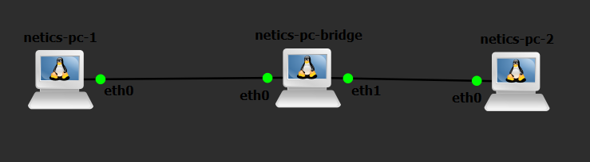

2. Test the connection and trace the route using the **mtr** command from **netics-pc-1** to **netics-pc-2**

On **netics-pc-1**:
```
mtr 192.168.100.102
```

  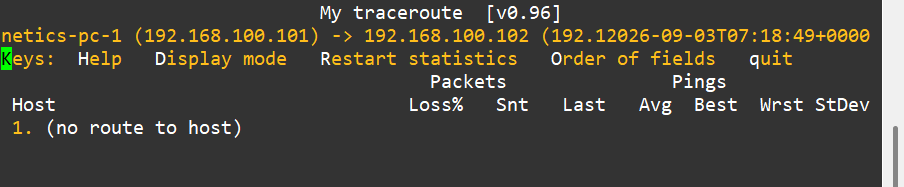

At this stage, the test will fail (No route to host). There is no reply yet because **netics-pc-bridge**, which is in the middle, has not been configured to forward data packets.

3. We will create the bridge configuration on **netics-pc-bridge**. Open the console on **netics-pc-bridge**, then run the following command to make it an ethernet bridge

On **netics-pc-bridge**:
```
ip -br addr                    # check interface: eth0 and eth1 are present
brctl addbr br0
brctl addif br0 eth0
brctl addif br0 eth1
brctl show
ip link set br0 up
```

  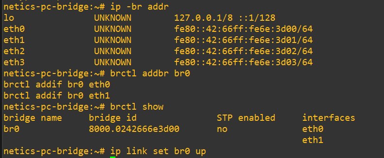

4. Re-run the route test from **netics-pc-1** to **netics-pc-2** as in step 2.

  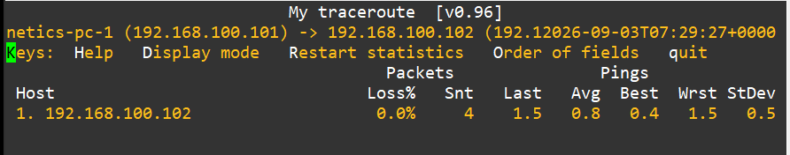

The connection now succeeds because the bridge interface on **netics-pc-bridge** is active and works to forward data packets between the two nodes.

<br>

### 2.4 Network Simulation
In a real network, ideal conditions without obstacles rarely happen. We are often faced with problems such as packet loss or limited network capacity (bandwidth). Therefore, we will simulate these disturbances without having to use real network hardware.

#### 2.4.1 Packet Loss Simulation

In this experiment, we will simulate a situation where 10% of sent packets are lost or damaged during the journey.

1. Simulate a *packet loss* of 10% on both interfaces on **netics-pc-bridge**

On **netics-pc-bridge**:
```
tc qdisc replace dev eth1 root netem loss 10%
tc qdisc replace dev eth0 root netem loss 10%
```

2. Run the test using **mtr** from **netics-pc-1** to **netics-pc-2** to see the effect of packet loss.

**mtr** before the packet loss simulation:

  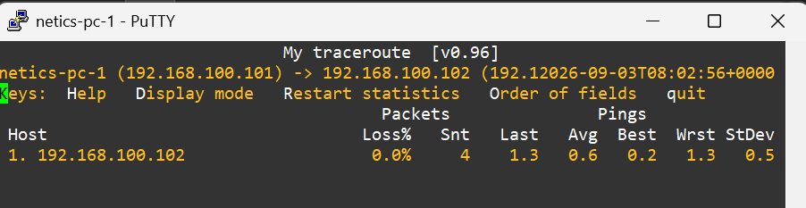

**mtr** after the packet loss simulation:

  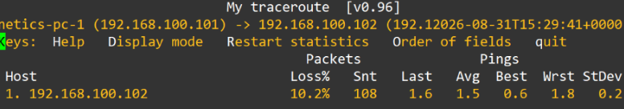

The mtr result shows an increase in packet loss from 0% to 10.2% after the packet loss experiment was applied to the bridge.
<br>

#### 2.4.2 Throughput Limitation Simulation

In this experiment, we will simulate a situation where the network bandwidth/capacity is limited. The limitation is done on the bridge side because this node is on the path traversed by all traffic between the sender and receiver. This simulates real conditions, where bandwidth limitations are usually applied to connecting nodes such as switches or routers, not to each individual end node.

1. Run iperf3 -s on netics-pc-1, then if iperf3 client with a target speed of 100 Mbps on netics-pc-2.

On **netics-pc-1**:
```
iperf3 -s
```

On **netics-pc-2**:
```
iperf3 -c 192.168.100.101 -u -b 100M
```

2. Limit the speed (bitrate) to 50 Mbps on both interfaces on **netics-pc-3**

On **netics-pc-3**:
```
tc qdisc replace dev eth0 root tbf rate 50mbit burst 64k limit 64k
tc qdisc replace dev eth1 root tbf rate 50mbit burst 64k limit 64k
```

To reset the limitation, run:
```
tc qdisc del dev eth0 root
tc qdisc del dev eth1 root
```

3. Observe the traffic data test results to see the effect of the throughput limitation.

**netics-pc-2 (client):**

  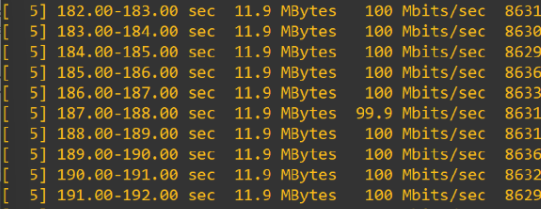

**netics-pc-1 (server):**

  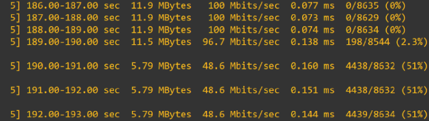

Even though the client keeps sending data at 100 Mbps, the actual speed received by the server drops to around 48.6 Mbps. This proves that the 50 Mbps bandwidth limitation works, where the network automatically drops data packets that exceed the capacity limit.

<br>

### 2.5 Switching from a Bridge to a Switch
Previously, we used the **netics-pc** node configured manually as a bridge to connect several nodes. Although bridge and switch both work at Layer 2 (Data Link) and forward packets based on MAC Addresses, in practice we more often use a Switch.

Why use a Switch instead of a Bridge?
1. **Port Capacity**: A bridge usually only connects two or a few network segments, while a Switch is designed to have more ports to connect many nodes at once.
2. **Performance**: A physical switch uses special hardware (ASIC) to process and forward data packets very quickly, while a bridge configuration burdens the CPU.
3. **Ease**: In a simulated environment (such as GNS3) as well as the real world, an unmanaged switch can be used directly without manual configuration (such as the long brctl or ip link commands).

#### 2.5.1 Simple Switch Topology
1. Create the following topology.

   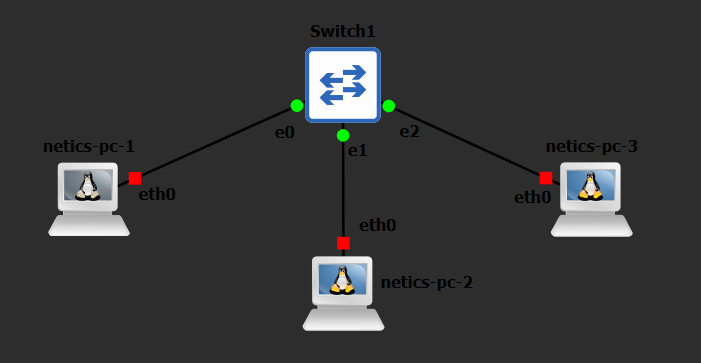

2. Configure the IP Addresses on the three nodes in the same subnet through the Edit Network Configuration menu.

On **netics-pc-1**:
```
auto eth0
iface eth0 inet static
    address 192.168.100.101
    netmask 255.255.255.0
```

On **netics-pc-2**:
```
auto eth0
iface eth0 inet static
    address 192.168.100.102
    netmask 255.255.255.0
```

On **netics-pc-3**:
```
auto eth0
iface eth0 inet static
    address 192.168.100.103
    netmask 255.255.255.0
```
<br>

#### 2.5.2 Simulating Packet Forwarding on a Switch

The way a Switch works is very smart. The switch automatically recognizes and records the identity (MAC Address) of each node connected to it, then stores them in a memory list called the **MAC Address Table**.

To simulate how the Switch forwards packets, do the following test:

1. Open the console on **netics-pc-1** and ping **netics-pc-3**.
```
ping -c 4 192.168.100.103
```

   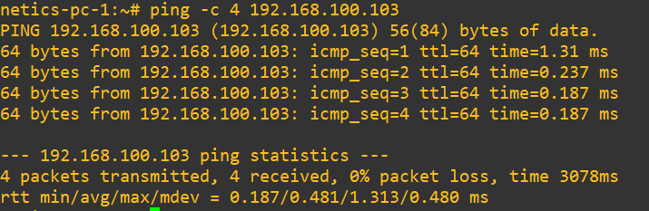

When the first ping is sent, the Switch doesn't know the destination location yet. Therefore, the switch broadcasts (ARP message) to all active ports. Once the target node replies, the Switch immediately records the MAC Address along with its port position in the **MAC Address Table**. Using this information, for the second packet and onwards, the switch no longer broadcasts to all nodes, but directly sends the packet to the destination node only.

<br>

### 2.6 Automatic IP Configuration with DHCP

So far, we have always configured IP Addresses manually (Static IP). On a large network scale, this method is certainly inefficient and prone to IP conflicts. Therefore, we use DHCP (Dynamic Host Configuration Protocol) so that the nodes (clients) can get network configuration automatically from the server.

The DHCP mechanism in providing IP is known as DORA:

- Discover: The client broadcasts a message to the whole network to look for the DHCP server.
- Offer: The DHCP server that receives the request offers an IP address from the pool (collection of available IPs).
- Request: The client formally requests the offered IP.
- Acknowledge: The server confirms and grants the IP lease to the client.

We will use programs that are commonly used for DHCP configuration:

1. **udhcpd**: As the DHCP Server (IP provider).
2. **udhcpc**: As the DHCP Client (IP requester).

#### 2.6.1 DHCP Server Configuration (udhcpd)

We will reuse the same Switch topology as **sub-chapter 2.5** above. Make **netics-pc-1** the **DHCP Server**, while the other nodes will become **DHCP Clients**.

   

1. Make sure **netics-pc-1** already has a static IP (e.g., 192.168.100.101/24).
```
ip addr add 192.168.100.101/24 dev eth0
```

2. Create an empty file that will be used by the system as storage for the IP lease records:
```
touch /etc/dhcpd.leases
```

3. Create the DHCP configuration file at **/etc/dhcpd.conf**. We will use the IP allocation from **.150** to **.155**:
```
echo "start 192.168.100.150
end 192.168.100.155
interface eth0
max_leases 5
pidfile /etc/dhcpd.pid
lease_file /etc/dhcpd.leases
option subnet 255.255.255.0" > /etc/dhcpd.conf
```

4. Run the DHCP server application so it runs on the main screen (foreground):
```
udhcpd -f /etc/dhcpd.conf
```
<br>

#### 2.6.2 DHCP Client Configuration
We will change the configuration on **netics-pc-2** and **netics-pc-3** so that they directly request IP configuration automatically when the nodes start.

1. Right-click on the node -> Configure -> Edit Network Configuration and uncomment the following sections:

On **netics-pc-2**:
```
auto eth0
iface eth0 inet dhcp
    hostname netics-pc-2
```

On **netics-pc-3**:
```
auto eth0
iface eth0 inet dhcp
    hostname netics-pc-3
```

Make sure that the static IP configuration has been commented out again so that we can get the DHCP IP instead of a static IP.

2. Save and restart the node so that the system reads the new configuration during boot. The client will automatically get the DHCP IP.

   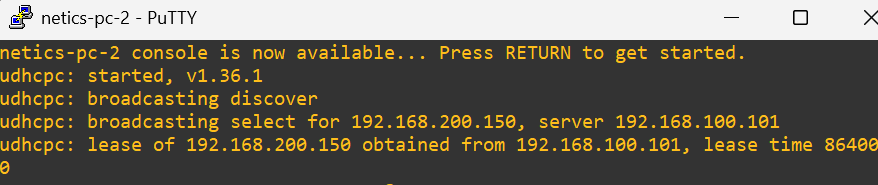
   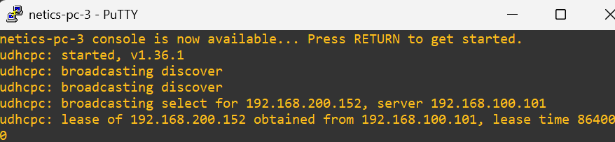
<br>

#### 2.6.3 Manual DHCP Client Configuration
This scenario simulates a condition when a node is not configured to request IP automatically at startup (e.g., a newly installed node). We will request the IP manually on **netics-pc-2**.

1. Open the console on **netics-pc-2**. Check the current IP address (make sure there is only a link local address, no IP from the network yet):
```
ip -br addr
```

2. Run the DHCP client manually to request an IP address on the **eth0** interface and let the process run in the background (-b):
```
udhcpc -i eth0 -b
```

   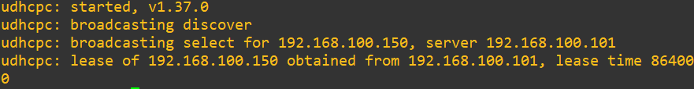

3. After that, check the client IP again, it should have gotten an IP from DHCP.

<br>

### 2.7 DHCP Server configuration using kea-dhcp4

In sub-chapter 2.6, the DHCP Server and DHCP Client are on the same network. This section covers DHCP in more depth, from its concepts to implementing a DHCP Server with `kea-dhcp4` and a DHCP Relay on a topology with a router.

#### 2.7.1 DHCP Concepts

##### What is DHCP?

**Dynamic Host Configuration Protocol (DHCP)** is a protocol based on a _client-server_ architecture that is used to simplify the allocation of `IP Address`es within a network. DHCP will automatically lease an `IP Address` to the _host_ requesting it.

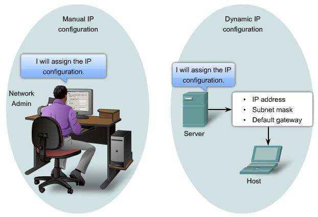

Without DHCP, the network administrator would have to enter the `IP Address` of each computer on a network manually. However, if DHCP is installed on the network, all computers connected to the network will automatically receive an `IP Address` from the `DHCP Server`.

##### Bootstrap Protocol and Dynamic Host Configuration Protocol

Besides DHCP, there is another protocol that also simplifies the allocation of `IP Address`es in a network, namely `Bootstrap Protocol (BOOTP)`. The difference between `BOOTP` and DHCP lies in their configuration process, as follows.

| BOOTP                                                                                                       | DHCP                                                                                                                                                     |
| ----------------------------------------------------------------------------------------------------------- | -------------------------------------------------------------------------------------------------------------------------------------------------------- |
| The network administrator configures a _mapping_ of the _client_'s `MAC Address` to a specific `IP Address`. | The _Server_ leases an `IP Address` and other configurations for a certain period of time. This protocol was designed based on how `BOOTP` works. |

##### DHCP Message Header

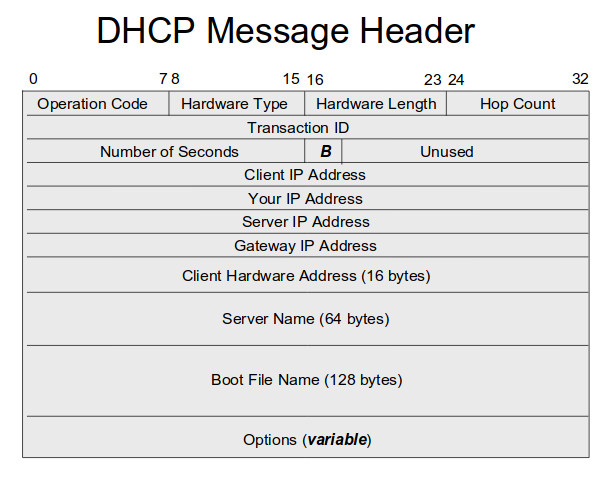

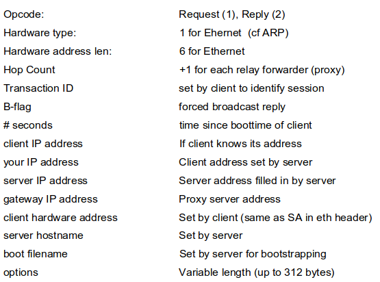

##### How DHCP Works

DHCP works by involving two parties, namely the **Server** and **Client**, as follows.

1. **DHCP Server** provides a service that can give `IP Address`es and other parameters to all _clients_ requesting them.
2. **DHCP Client** is a _client_ machine running _client_ software that allows it to communicate with the `DHCP Server`.
   `DHCP Server` generally has a set of distributed `IP Address`es called a `DHCP Pool`. Each _client_ will lease one for a period of time determined by DHCP itself (in the configuration, this is called _leasing time_). When the period expires, the client will request a new `IP Address` or renew it. This is why the client's `IP Address` is dynamic.

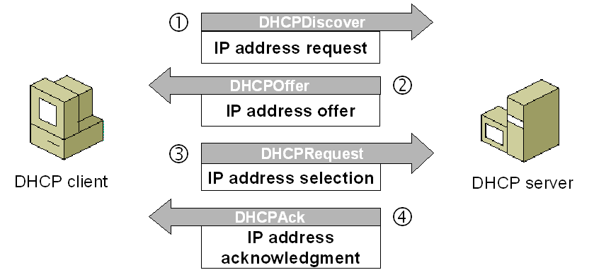

There are 5 stages in the DHCP `IP Address` leasing process, as follows.

1. **DHCPDISCOVER**: The _Client_ sends a _broadcast_ request to find an active `DHCP Server`. The `DHCP Server` uses UDP port 67 to receive broadcasts from clients on port 68.
2. **DHCPOFFER**: The `DHCP Server` offers an `IP Address` (and other configurations, if any) to the _client_. The offered `IP Address` is one of the addresses available in the `DHCP Pool` on the corresponding `DHCP Server`.
3. **DHCPREQUEST**: The _Client_ accepts the offer and agrees to lease the `IP Address` from the `DHCP Server`.
4. **DHCPACK**: The DHCP server accepts the _client_'s `IP Address` request by sending an `ACKnoledgment` packet containing confirmation of the `IP Address` and other information. Then, the _client_ initializes by binding the `IP Address`, and the _client_ can operate on the network. The `DHCP Server` records the lease.
5. **DHCPRELEASE**: The _Client_ stops leasing the `IP Address` (when the lease expires or it receives `DHCPNAK`).

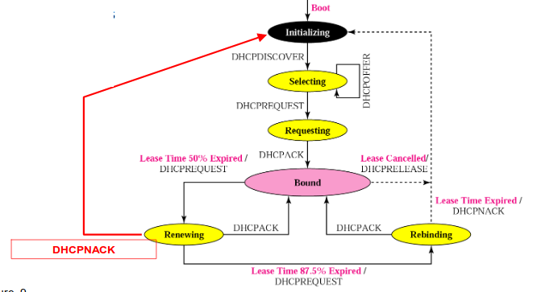

Furthermore, you can watch or view visualizations of how DHCP works from various sources to improve your understanding. One of them is the following video [https://youtu.be/S43CFcpOZSI](https://youtu.be/S43CFcpOZSI).

##### DHCP Relay

Previously, it was mentioned that DHCP involves two parties, namely `DHCP Server` and `DHCP Client`. This section discusses another party involved in the `IP Address` leasing process, namely `DHCP Relay`. What is `DHCP Relay`?

###### A. DHCP Relay Concept

`DHCP Relay` is a network device (in the most common scenario, this network device is a `router`) that acts as an intermediary or (_forwarder_) between a `DHCP Client` and a `DHCP Server` that are not on the same network segment. `DHCP Relay` receives a _request_ from the `DHCP Client` and forwards it to the `DHCP Server`. Conversely, `DHCP Relay` receives a _response_ from the `DHCP Server` and forwards it to the `DHCP Client`. With `DHCP Relay`, the `DHCP Client` and `DHCP Server` do not need to be on the same network segment.

> Some of you may think, after reading the first sentence of the `DHCP Relay` explanation, that `DHCP Relay` has the same role as a switch. Well, that understanding is incorrect!

The placement of `DHCP Relay` in a network can be illustrated as follows.

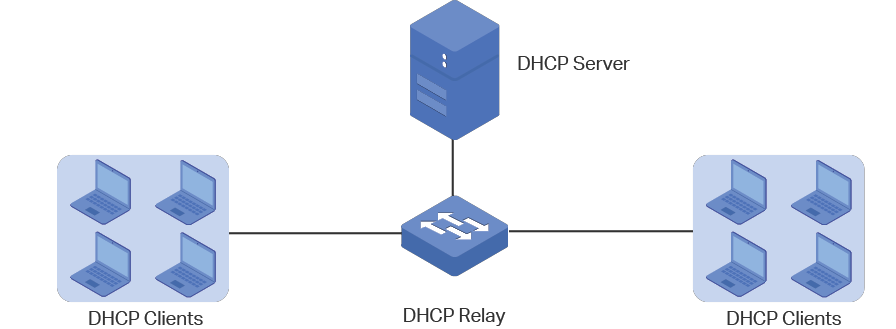

As a _forwarder_, the way DHCP works with `DHCP Relay` involved is the same as described previously, but with some adjustments. In short, it works as follows.

- `DHCP Relay` will receive `DHCPDISCOVER` from `DHCP Client`, then forward it to `DHCP Server`.
- `DHCP Server` will send `DHCPOFFER` to `DHCP Relay`, then `DHCP Relay` will forward it to `DHCP Client`.
- `DHCP Relay` will also forward `DHCPREQUEST` from `DHCP Client` to `DHCP Server`, then `DHCP Server` will send `DHCPACK` to `DHCP Relay`, and `DHCP Relay` will forward it to `DHCP Client`.
- `DHCP Relay` will also forward `DHCPRELEASE` from `DHCP Client` to `DHCP Server`, then `DHCP Server` will send `DHCPNAK` to `DHCP Relay`, and `DHCP Relay` will forward it to `DHCP Client`.

> Surely you are familiar with that term? Yes, the term is similar to the _handshake_ process in the TCP protocol!

###### B. Why is DHCP Relay Needed?

There are several reasons why `DHCP Relay` is needed, as follows.

- Allows the `DHCP Server` to serve `DHCP Clients` that are outside the local network segment. Without `DHCP Relay`, DHCP can only operate within a single local network segment.
- Saves `IP Address`. With `DHCP Relay`, only one `DHCP Server` is needed to serve many network segments. Without `DHCP Relay`, each network segment requires its own `DHCP Server`.
- Simplifies network management. The network administrator only needs to configure and manage a single `DHCP Server`, rather than each one individually.
- Improves network security by limiting `DHCP Server` access to `DHCP Relay` only.

##### DHCP Lease Time

`DHCP Lease Time` is the amount of time allocated by the `DHCP Server` when an `IP Address` is leased to a _client_ computer. In short, after this lease period ends, the `IP Address` can be leased again by the same _client_ computer, or the _client_ may receive another `IP Address` if the previously leased `IP Address` is being used by another _client_ computer.

###### A. Lease Time in DHCP

`DHCP Lease Time` determines how long a DHCP _client_ can use the `IP Address` allocated by the `DHCP Server`. There are several types of _lease time_ in DHCP, as follows.

- Infinite Lease Time

  Simply put, the _client_ gets the right to use a specific `IP Address` forever or until the _lease_ is manually cancelled by the administrator. This type of _lease time_ is usually applied to _static_ `IP Address` _assignment_ on devices such as _servers_, _routers_, _switches_, _printers_, and other important devices. The advantage is that the _client_ will always receive the same `IP Address` even after a _restart_ or _reconnect_. However, it can potentially waste `IP Address`es if the allocated `IP Address` is not used.

- Finite Lease Time

  With this type of _lease time_, _client_ can only use `IP Address` for a certain period of time (hours, days, weeks). After the _lease expires_, _client_ must _request_ a new `IP Address` from the `DHCP server`. This type of _lease time_ is generally used for _clients_ such as computers, laptops, and _smartphones_. The advantage is that `IP Address` can be reused, _client_ receives a new `IP Address` periodically. However, it may cause connection interruptions during _renew lease_.

- Dynamic Lease Time

  `DHCP Server` automatically determines the _lease time_ based on _availability_ `IP Address` and _request client_. This can result in a _lease time_ ranging from very short to long depending on `IP Address` availability. Its advantage is that it provides administrators with flexibility in managing `IP Address`es.

###### B. The Importance of Lease Time Configuration

Some reasons why configuring DHCP lease time is important are as follows.

- Ensures the availability of `IP Address` by limiting usage per _client_ to a specific period of time.
- Prevents a _single_ _client_ from monopolizing a particular `IP Address` for a long period; `IP Address` it can be used by another _client_ after it _expires_.
- Provides _clients_ with new `IP Address`es periodically from the `IP Address` _pool_ for security & performance reasons.
- Allows the `DHCP Server` to reclaim unused or _inactive_ `IP Address`es and redistribute them to other _clients_ that need them.
- Helps administrators _troubleshoot_ network problems related to the _client_'s `IP Address`.

#### 2.7.2 Topology and Initial Configuration

After understanding the concepts, how do we implement them? For the implementation, we will use the following topology.

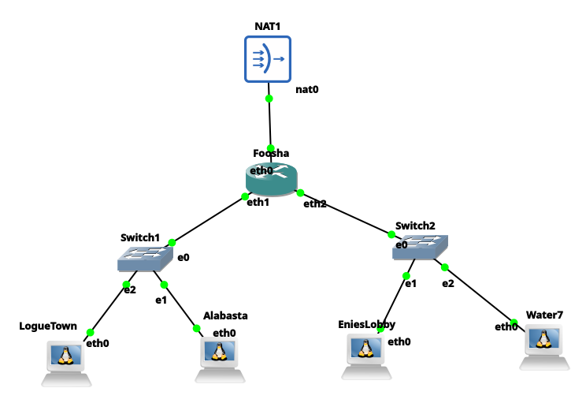

In this case, we configure the IP Address of each node as follows:

```
Foosha eth0:  from NAT cloud (192.168.122.x)
Foosha eth1:  10.40.1.1/24      (Loguetown and Alabasta side)
Foosha eth2:  10.40.2.1/24      (EniesLobby and Water7 side)

EniesLobby:   10.40.2.2/24, gateway 10.40.2.1   (static, DHCP Server)
Loguetown:    DHCP (pool 10.40.1.10 - 10.40.1.100)
Alabasta:     DHCP (pool 10.40.1.10 - 10.40.1.100)
Water7:       DHCP (pool 10.40.2.20 - 10.40.2.100, fixed address in 2.7.8)
```

The software used in this module:

| Role | Software | Node |
| ----- | --------------- | ---- |
| DHCP Server | `kea-dhcp4` (ISC Kea) | EniesLobby |
| DHCP Relay | `dhcp-helper` | Foosha |
| DHCP Client | `udhcpc` (included with busybox) | Loguetown, Alabasta, Water7 |

`kea-dhcp4` replaces `isc-dhcp-server` (`dhcpd`), and `dhcp-helper` replaces `isc-dhcp-relay`. Kea only functions as a DHCP Server and does not include a relay, so the relay is run using a separate program.

The nodes in this module use Alpine Linux, which does not have `rc-service`. Therefore, the programs are run directly from the command line, and at boot they are run from `/root/init.sh` (see [2.7.10](#2710-keeping-the-configuration-after-restart)).

##### Initial Configuration

1. Configure the network interface on **Foosha**:
```
auto eth0
iface eth0 inet dhcp

auto eth1
iface eth1 inet static
    address 10.40.1.1
    netmask 255.255.255.0

auto eth2
iface eth2 inet static
    address 10.40.2.1
    netmask 255.255.255.0
```

2. Enable routing and NAT on **Foosha** so that clients can access the internet:
```sh
sysctl -w net.ipv4.ip_forward=1
iptables -t nat -A POSTROUTING -s 10.40.0.0/16 -o eth0 -j MASQUERADE
```

3. Configure `/etc/network/interfaces` on **EniesLobby**. The gateway must be specified because replies to clients on `10.40.1.0/24` must return through Foosha:
```
auto lo
iface lo inet loopback

auto eth0
iface eth0 inet static
    address 10.40.2.2
    netmask 255.255.255.0
    gateway 10.40.2.1
```

Then configure DNS so that the node can download packages:

```sh
echo "nameserver 8.8.8.8" > /etc/resolv.conf
```

#### 2.7.3 Kea-DHCP Server Installation

In this topology, we will use **EniesLobby** as the DHCP Server. Therefore, we need to _install_ **kea-dhcp4** on **EniesLobby** by following these steps.

1. Update the _package lists_ on **EniesLobby** with the following command.

```
apk update
```

2. _Install_ **kea-dhcp4** on **EniesLobby**.

```
apk add kea-dhcp4
```

3. Make sure **kea-dhcp4** has been _installed_ with the command.

```
kea-dhcp4 -V
```

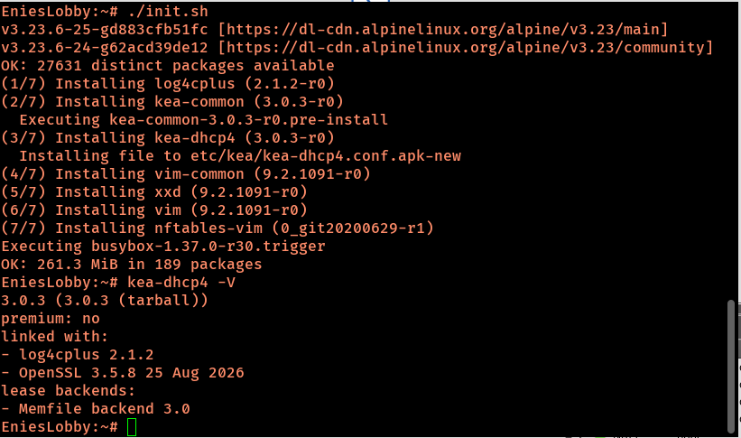

#### 2.7.4 DHCP Server Configuration

The steps to perform after installation are as follows.

##### A. Determining the _Interface_ to Be Provided with DHCP Service

###### A.1. Open the _Interface_ Configuration _File_

Please edit the configuration _file_ at `/etc/kea/kea-dhcp4.conf`

```sh
nano /etc/kea/kea-dhcp4.conf
```

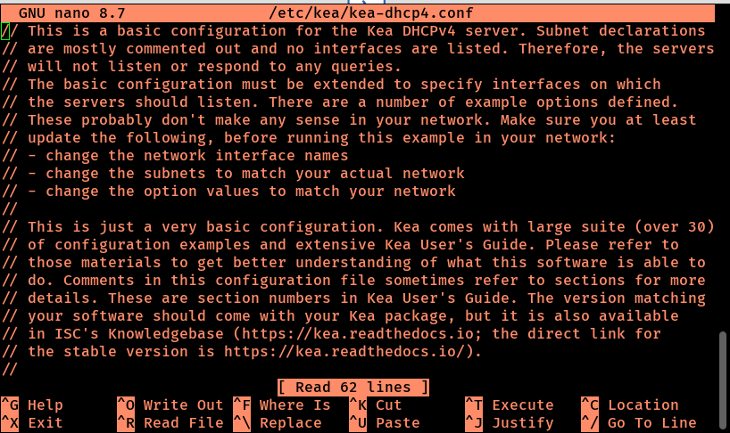

###### A.2. Determine the _Interface_

Observe the topology that has been created. Interface on **EniesLobby** that points to the switch is `eth0`, so we choose interface `eth0` to be provided with DHCP service. In Kea, this is configured in the `interfaces-config`:

```json
"interfaces-config": {
  "interfaces": ["eth0"]
}
```

##### B. Configuring `kea-dhcp4`

There are many things that can be configured, including the following.

- Range IP
- DNS Server
- Netmask Information
- Default Gateway
- etc.

###### B.1. Open the DHCP Configuration _File_

The configuration is done in the same file, namely `/etc/kea/kea-dhcp4.conf`.

###### B.2. Add the Configuration _Script_

Parameters in `isc-dhcp-server` are mapped to Kea as follows:

| **No** | **ISC dhcpd** | **Kea (`kea-dhcp4.conf`)** | **Description** |
| ------ | ------------- | -------------------------- | -------------- |
| 1 | `INTERFACES=` | `"interfaces-config": { "interfaces": ["eth0"] }` | The interface that receives DHCP requests. |
| 2 | `subnet 'NID' netmask 'Netmask'` | `"subnet": "NID/prefix"` | The subnet Network ID in CIDR notation, for example `10.40.1.0/24`. Kea selects the subnet based on the relay address (or interface) where the request arrives. |
| 3 | `range 'Start_IP' 'End_IP'` | `"pools": [{ "pool": "Start_IP - End_IP" }]` | The IP range distributed dynamically. More than one pool is allowed. |
| 4 | `option routers 'IP_Gateway'` | `{ "name": "routers", "data": "IP_Gateway" }` | The gateway IP given to the client. |
| 5 | `option domain-name-servers 'DNS'` | `{ "name": "domain-name-servers", "data": "DNS" }` | The DNS given to the client. |
| 6 | `option broadcast-address` | (automatic) | Kea calculates the broadcast address itself. |
| 7 | `default-lease-time 'Time'` | `"valid-lifetime": Time` | IP lease duration in seconds. |
| 8 | `max-lease-time 'Time'` | `"max-valid-lifetime": Time` | Maximum lease duration in seconds. |
| 9 | `host X { hardware ethernet ...; fixed-address ...; }` | `"reservations": [{ "hw-address": "...", "ip-address": "..." }]` | Fixed address for a specific host (see 2.7.8). |

**About NID:** NID is the Network ID of the interface facing the client, with the host portion set to 0. For example, if the router interface for a subnet has the IP `10.40.1.1/24`, then the subnet is `10.40.1.0/24`. **NB: The correct way to calculate NID will be explained in module 4.**

In this example, we use `8.8.8.8` as the DNS. Replace the entire contents of `/etc/kea/kea-dhcp4.conf` on **EniesLobby** with the following configuration. This configuration serves two subnets: `10.40.2.0/24` directly (Water7 is on the same segment as the server), and `10.40.1.0/24` through the relay on Foosha.

```json
{
  "Dhcp4": {
    "interfaces-config": {
      "interfaces": ["eth0"]
    },
    "lease-database": {
      "type": "memfile",
      "persist": true,
      "name": "/var/lib/kea/kea-leases4.csv"
    },
    "valid-lifetime": 600,
    "max-valid-lifetime": 7200,
    "subnet4": [
      {
        "id": 1,
        "subnet": "10.40.1.0/24",
        "pools": [
          { "pool": "10.40.1.10 - 10.40.1.100" }
        ],
        "option-data": [
          { "name": "routers", "data": "10.40.1.1" },
          { "name": "domain-name-servers", "data": "192.168.122.1" }
        ]
      },
      {
        "id": 2,
        "subnet": "10.40.2.0/24",
        "pools": [
          { "pool": "10.40.2.20 - 10.40.2.100" }
        ],
        "option-data": [
          { "name": "routers", "data": "10.40.2.1" },
          { "name": "domain-name-servers", "data": "192.168.122.1" }
        ]
      }
    ]
  }
}
```

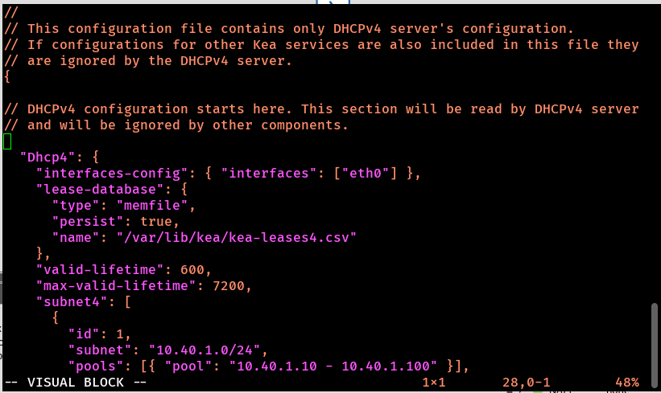

###### B.3. Run `kea-dhcp4`

First check that the configuration file has no errors:

```sh
kea-dhcp4 -t /etc/kea/kea-dhcp4.conf
```

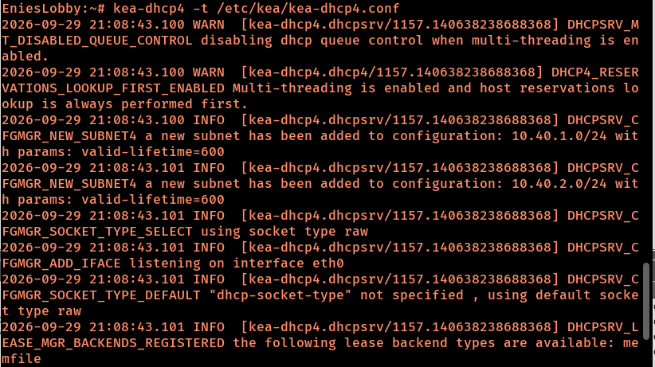

Correct output displays both subnets and has no `ERROR` lines. The `WARN` line about multi-threading is normal, as shown in the image above.

Create the directories required by Kea, then run it. For the first test, run it in the *foreground* with debug mode so that we can see each DISCOVER, OFFER, REQUEST, and ACK:

```sh
mkdir -p /var/lib/kea /run/kea
kea-dhcp4 -d -c /etc/kea/kea-dhcp4.conf
```

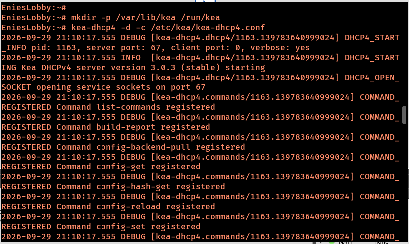

Press `Ctrl+C` to stop it. To run it in the *background*:

```sh
kill $(pidof kea-dhcp4) 2>/dev/null
kea-dhcp4 -c /etc/kea/kea-dhcp4.conf > /root/kea.log 2>&1 &
```

#### 2.7.5 DHCP Relay Configuration

When the DHCP Server is on a different subnet from the DHCP client, we need `DHCP Relay`. Therefore, the following steps must be performed on the device designated as the `DHCP Relay` (usually a _router_). Therefore, _router_ **Foosha** will be the DHCP Relay. The steps to perform are as follows.

##### A. Installation

First, we need to install the relay program on **Foosha**.

```sh
apk update
apk add dhcp-helper
```

##### B. Configuring `dhcp-helper`

`dhcp-helper` is configured through command-line options. Run it on **Foosha**:

```sh
dhcp-helper -n -s 10.40.2.2 -i eth1
```

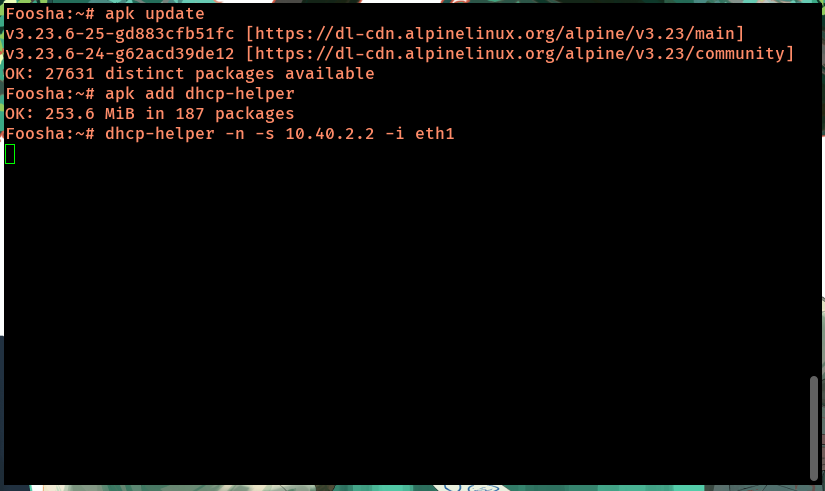

- `-s 10.40.2.2` is the DHCP Server IP address. In this case, it is the IP address of **EniesLobby**. What is its IP address?
- `-i eth1` is the interface that listens for client requests. Its value must match the interface connected to the clients. In this case, **Foosha** has interface `eth1`, which is connected to the Loguetown and Alabasta clients. If there is more than one interface connected to clients, repeat the option: `-i eth1 -i eth3`.
- `-n` makes the relay run in the *foreground* so that we can see error messages. Remove this option to run it as a daemon in the *background*.

Water7 does not need to be served through the relay because it is on the same segment as the DHCP Server.

> **Note:** each additional client subnet also requires a corresponding `subnet4` block in the Kea configuration on the server, covering the Foosha interface address on that subnet.

##### C. Configuring IP Forwarding

Make sure IP Forwarding is enabled on **Foosha**:

```sh
sysctl -w net.ipv4.ip_forward=1
```

To keep it enabled after restart, also add the following line to `/etc/sysctl.conf`:

```
net.ipv4.ip_forward=1
```

> What is `IP Forwarding`? `IP Forwarding` is a feature that allows a _router_ to forward packets from one network to another. A _Router_ has at least two network _interfaces_; for example, _interface_ A is connected to network A and _interface_ B is connected to network B. When an IP packet enters from network A destined for network B, the _router_ will forward the packet from _interface_ A to _interface_ B, and vice versa.

Congratulations 🎉, the `DHCP Relay` configuration is complete!

#### 2.7.6 DHCP Client Configuration

After configuring the _server_, we also need to configure the _client_ _interface_ so it can receive service from the `DHCP Server`. In this topology, the example _clients_ are **Alabasta**, **Loguetown**, and **Water7**.

##### A. Configuring the _Client_

###### A.1. Check Alabasta's IP with `ip a`

From the previous configuration, **Alabasta** was assigned the static `IP Address` 10.40.1.3.

###### A.2. Shut Down the Alabasta Node and Open the Network Configuration from GNS3

_Comment_ or delete the old configuration (the static `IP Address` configuration)

Then add the following configuration.

```
auto eth0
iface eth0 inet dhcp
```

###### A.3. Start the Alabasta Node

Start the Alabasta node again. When you open the Alabasta console, the DHCP IP Lease from EniesLobby should appear automatically.

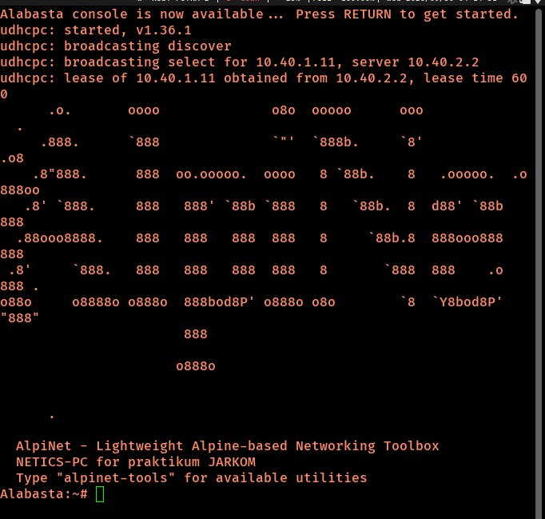

or use the command `udhcpc -i eth0`

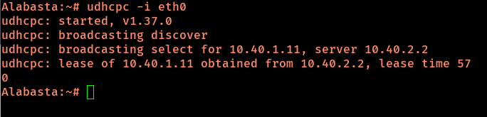

##### B. Testing

Check **Alabasta**'s `IP Address` again by running `ip a`.

Also check whether **Alabasta** has received the `DNS Server` according to the `DHCP Server` configuration. Check `/etc/resolv.conf` using the following command. You can also check by pinging `google.com`

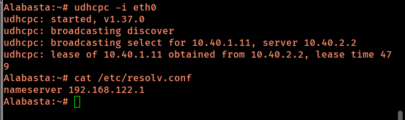

If **Alabasta**'s `IP Address` and nameserver have changed according to the configuration provided by DHCP and it can successfully ping `google.com`, congratulations! You have succeeded! 🎉🎉

**Description**:

- If **Alabasta**'s IP has not changed yet, don't panic. Please _restart_ the _node_ through the GNS3 page.
- If it still has not changed, don't ask right away. Check all the configurations you have made again; there may be a typo.

##### C. Repeat the Steps Above on the Loguetown and Water7 Clients

- Client **Loguetown** and **Water7**.

Once an `IP Address` has been leased to a client, that `IP Address` will not be given to another _client_. As a result, no _client_ receives the same `IP Address`.

#### 2.7.7 Leasing Times

In this section, we will see for ourselves how lease time works. We will shorten the lease on subnet `10.40.1.0/24` to 2 minutes.

##### A. Change the Lease Time on the Server

On **EniesLobby**, edit `/etc/kea/kea-dhcp4.conf` and add `valid-lifetime` and `max-valid-lifetime` to the `10.40.1.0/24` subnet block. Subnet-level settings override the global settings:

```json
{
  "id": 1,
  "subnet": "10.40.1.0/24",
  "valid-lifetime": 120,
  "max-valid-lifetime": 600,
  "pools": [
    { "pool": "10.40.1.10 - 10.40.1.100" }
  ],
  "option-data": [
    { "name": "routers", "data": "10.40.1.1" },
    { "name": "domain-name-servers", "data": "192.168.122.1, 8.8.8.8, 8.8.4.4" }
  ]
}
```

- `valid-lifetime` is the default lease time (in seconds). This value is used if the client does not request a specific time.
- `max-valid-lifetime` is the upper limit if the client requests a longer lease.

Check and restart Kea:

```sh
kea-dhcp4 -t /etc/kea/kea-dhcp4.conf
kill $(pidof kea-dhcp4) 2>/dev/null
kea-dhcp4 -c /etc/kea/kea-dhcp4.conf > /root/kea.log 2>&1 &
```

##### B. Observe on the Client

On **Alabasta**, request an IP address and observe the output:

```sh
udhcpc -i eth0 -f
```

The output shows the received lease time, for example `lease of 10.40.1.x obtained ... lease time 120`. Let it run for more than one minute. At half of the lease period (about 60 seconds), `udhcpc` will send a renewal (*renew*) request directly to the server.

On **EniesLobby**, view the lease records:

```sh
cat /var/lib/kea/kea-leases4.csv
```

The `expire` column shows when the lease expires (in epoch format), and its value increases each time the client renews.

You can also force a renewal or release the lease manually:

```sh
kill -USR1 $(pidof udhcpc)     # renew
kill -USR2 $(pidof udhcpc)     # release
```

When finished, restore the lease time values to their original settings (remove the two lines in the subnet block, or change them to `600` and `7200`), then restart Kea.

#### 2.7.8 Fixed Address

> **Case Study**:
>
> It turns out that Franky's ship parked in **Water7**, besides being a _client_, will also be used as the _server_ for a ship trading application, which would make things difficult if its `IP Address` kept changing every time **Water7** connected to the internet. Therefore, **Water7** needs a fixed `IP Address` that does not change.

The problem Franky faces is that Water7's IP address keeps changing. Therefore, the requirement is a fixed `IP address`. Therefore, the solution offered is a DHCP Server feature that can "lease" an `IP Address` permanently to a _host_, namely **Fixed Address**. In this case, **Water7** will receive a fixed `IP Address`, namely `10.40.2.13`.

##### A. Configuring the `DHCP Server` on EniesLobby

###### A.1. Open the `kea-dhcp4` Configuration File

Open and edit `/etc/kea/kea-dhcp4.conf` on **EniesLobby**.

First, find out Water7's hardware address. Run `ip a` on **Water7**, look at the interface connected to the switch (`eth0`), then copy the value after `link/ether`.

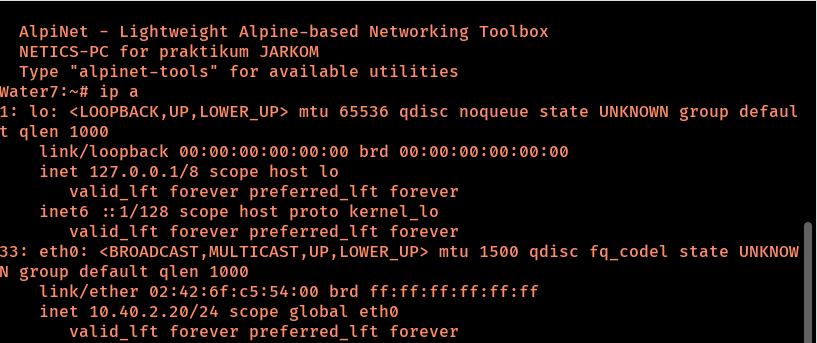

###### A.2. Add the Following Script

Add the `reservations` list to subnet `10.40.2.0/24` (the subnet with `id` 2):

```json
{
  "id": 2,
  "subnet": "10.40.2.0/24",
  "pools": [
    { "pool": "10.40.2.20 - 10.40.2.100" }
  ],
  "option-data": [
    { "name": "routers", "data": "10.40.2.1" },
    { "name": "domain-name-servers", "data": "192.168.122.1, 8.8.8.8, 8.8.4.4" }
  ],
  "reservations": [
    {
      "hw-address": "aa:bb:cc:dd:ee:ff",
      "ip-address": "10.40.2.13"
    }
  ]
}
```

Replace `aa:bb:cc:dd:ee:ff` with the Water7 hardware address you copied.

**Explanation**:

- `hw-address` is the MAC address of the Water7 interface.
- `ip-address` is the IP address that is always leased to **Water7**.

###### A.3. Restart `kea-dhcp4` on EniesLobby

```sh
kea-dhcp4 -t /etc/kea/kea-dhcp4.conf
kill $(pidof kea-dhcp4) 2>/dev/null
kea-dhcp4 -c /etc/kea/kea-dhcp4.conf > /root/kea.log 2>&1 &
```

##### B. Configuring the `DHCP Client`

###### B.1. Configure the Water7 Network Interface

The network interface can be accessed through the network configuration in the GNS3 application on the **Water7** node.

###### B.2. Add the Following Configuration

```
auto eth0
iface eth0 inet dhcp
    hwaddress ether aa:bb:cc:dd:ee:ff
```

Use the same MAC address as the one in the reservation. The hardware address needs to be *set* in `/etc/network/interfaces` so that the hwaddress does not change when the GNS3 project is shut down or exported.

###### B.3. Restart the Water7 Node

Restart the Water7 node from the GNS3 page, or run:

```sh
kill -USR2 $(pidof udhcpc)
ifdown eth0; ifup eth0
```

or

```
udhcpc -i eth0
```

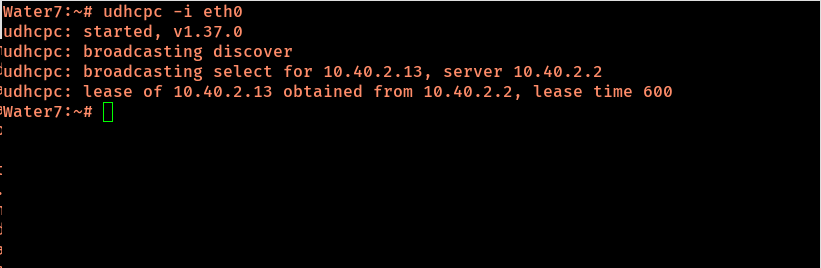

##### C. Testing

Check **Water7**'s IP with `ip a`.

```sh
ip a
```

The **Water7** IP should now have changed to **10.40.2.13**, according to the fixed address provided by the DHCP Server.

#### 2.7.9 Testing the DHCP Configuration on the Topology

After completing the configurations above, you can verify whether the DHCP Server works by following these steps:

1. Shut down all nodes through the GNS3 page
2. Start all nodes again
3. Run `ip a` on each node

If all client node IPs change according to the range configured on the DHCP Server (Loguetown and Alabasta from `10.40.1.10 - 10.40.1.100`) and **Water7** continues to receive IP `10.40.2.13`, then the DHCP Server configuration is successful. All clients should also be able to `ping google.com`.

To view the leases recorded on the server, run the following on **EniesLobby**:

```sh
cat /var/lib/kea/kea-leases4.csv
```

#### 2.7.10 Keeping the Configuration After Restart

On the Alpine appliance in GNS3, only `/etc`, `/etc/network`, and `/root` are persistent. This means the configuration files above remain after a restart, but packages installed with `apk add` will be lost. The solution is to save the packages in `/root` while there is an internet connection, then reinstall them at boot through a script called from `/root/init.sh`.

> The commands below assume `/root/init.sh` is run at boot. First, view its contents with `cat /root/init.sh` and make sure the script does not reset your network configuration. Add the invocation line only once.

##### A. EniesLobby (DHCP Server)

Create `/root/boot.sh`:

```sh
cat > /root/boot.sh <<'EOF'
#!/bin/sh
exec >>/root/boot.log 2>&1

apk update
apk add kea-dhcp4

mkdir -p /var/lib/kea /run/kea
kill $(pidof kea-dhcp4) 2>/dev/null
kea-dhcp4 -t /etc/kea/kea-dhcp4.conf && \
  kea-dhcp4 -c /etc/kea/kea-dhcp4.conf >/root/kea.log 2>&1 &
EOF

chmod +x /root/boot.sh
echo 'sh /root/boot.sh &' >> /root/init.sh
```

You can also place the kea-dhcp4 configuration in the `/root` folder and, by modifying the `init.sh` script, copy the configuration file to `/etc/kea/kea-dhcp4.conf`.

##### B. Foosha (Router, NAT, Relay)

Create `/root/boot.sh`:

```sh
cat > /root/boot.sh <<'EOF'
#!/bin/sh
exec >>/root/boot.log 2>&1

apk update
apk add dhcp-helper

sysctl -w net.ipv4.ip_forward=1
iptables -t nat -A POSTROUTING -s 10.40.0.0/16 -o eth0 -j MASQUERADE

kill $(pidof dhcp-helper) 2>/dev/null
dhcp-helper -s 10.40.2.2 -i eth1
EOF

chmod +x /root/boot.sh
echo 'sh /root/boot.sh &' >> /root/init.sh
```

##### C. Client

Clients do not require additional packages or a boot script. `udhcpc` is already included in busybox, and `/etc/network/interfaces` is persistent, so `iface eth0 inet dhcp` is applied again at every boot.

After restarting, read `/root/boot.log` on the node to see what the boot script did.

#### 2.7.11 Troubleshooting

If a client does not receive an IP address, find out where its request stops. Check from the server side first.

1. **Test the server without the relay.** On **EniesLobby**, run Kea in the foreground (`kea-dhcp4 -d -c /etc/kea/kea-dhcp4.conf`), then run `udhcpc -i eth0 -f -n` on **Water7**. Water7 is on the same segment as the server, so the relay is not involved.
   - If Water7 receives an IP address, the server is working and the problem is in the relay path.
   - If Kea does not display DISCOVER, make sure EniesLobby's `eth0` really has `10.40.2.2` (`ip a`) and that Water7 is connected to the same switch.
2. **Check the relay.** On **Foosha**, check `ip a` (`eth1` must have `10.40.1.1`), `cat /proc/sys/net/ipv4/ip_forward` (must be `1`), and `ps | grep dhcp-helper`. Run the relay in the foreground (`-n`) to see error messages.
3. **Observe the packets.** On Foosha, run `apk add tcpdump`, then run the following commands when a client requests an IP address:
```sh
tcpdump -ni eth1 port 67 or port 68
tcpdump -ni eth2 port 67 or port 68
```

You should see DISCOVER on `eth1`, the request forwarded to `10.40.2.2` on `eth2`, then the OFFER returning on `eth2` and then on `eth1`. The point where the trace stops indicates which part is having a problem.

4. **Check the subnet match.** If the request reaches Kea but receives no response, make sure there is a `subnet4` block covering the Foosha address on the interface facing the client (`10.40.1.1` is within `10.40.1.0/24`).
5. **Check the return route.** EniesLobby must have a default route through `10.40.2.1` (`ip route`), otherwise replies to clients through the relay will be lost.
6. **If `-i eth1` does not cause replies to reach the client**, try running the relay while excluding the NAT interface: `dhcp-helper -n -s 10.40.2.2 -e eth0`. As a result, Water7 requests on `eth2` will also be forwarded to the server, so the server may see duplicate requests. This is harmless in this lab.

<br>

## 3. Wire Crimping
In a computer network, communication occurs between one device to the other. For this to happen, of course there needs a medium. Although there is already wireless communication technology, wires still have a major role in network and can't be replaced. Therefore, in this module, we will learn how to crimp a type of network cable called UTP (Unshielded Twisted Pair).

### 3.1 Tools needed

To do wire crimping, the following tools are needed.

#### a. UTP Cable

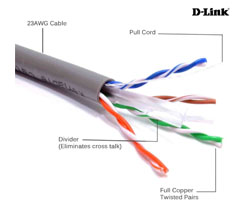

The base needed in this process.

#### b. RJ45

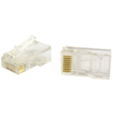

RJ45 is a the connector used to connect UTP cable to the devices.

#### c. Crimping Pliers


Crimping pliers or Crimpers are used to attach wires to RJ45.

#### d. LAN Tester

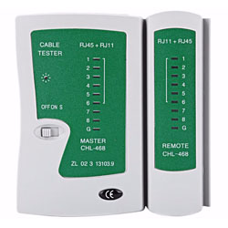

As the name suggests, this tool is used to check whether the cable we make is working properly or not.

### 3.2 Cable Configuration

  There are several types of cable configurations. Based on the color order, according to international standards, there are divided into __T568A__ and __T568B__.

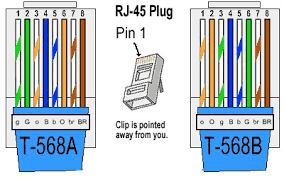

While from the cable installation, there are divided into :

#### a. __Straight-Through Cable__

  This type of cabling is used to connect two different types of devices connected to the network, namely DTE (data terminal equipment) devices to DCE (data circuit-terminating equipment) or vice versa. DTE devices are devices that generate digital data and act as source and destination for digital data, e.g. computers, microcomputers, terminals, printers. DCE is a device that receives and converts data to the appropriate telecommunications link, generally DCE is a network device such as routers, switches, modems.
  

  
  The installation rule is that each end of the cable must have the same color sequence. For example, if the one end uses a color arrangement based on the T568A rule, so does the other one.

#### b. __Crossover Cable__

  In contrast to the Straight-through cable, crossover cable is used to connect the same two types of devices connected to the network, i.e. DTE to DTE or DCE to DCE devices. For example, between computers and computers, routers and routers, routers and switches, computers and printers.

  
  
  The installation rules are also different from straight-through cables, crossover cables have different color sequences at both ends. However, this color difference should not be arbitrary, because these two ends also have a color order rule. In standard crossover cables, if one end of the Pin has a color arrangement according to the T568A rule, then the other end of the Pin must have a color order according to the T568B standard.

### 3.3 Crimping Steps

  1. Prepare the crimping needs (UTP cable, RJ45, crimping pliers, LAN tester)
  2. Strip the UTP cable shield
  3. Sort the cables according to the configuration needed (Straight/Cross/others).
  4. Cut the ends of the wires to flatten them out.
  5. Insert the end of the cable into the RJ45 and make sure it touches the end of the RJ45.
  6. Use crimpers to lock the UTP cable in the RJ45 (make sure the cable end is still attached to the RJ45 end when locking is done)
  7. Finally, use a LAN tester to make sure the cable is working properly.

  ### Crimping Straight Video

[](https://youtu.be/NL0F8bP8k7I)

## 4. Wireshark
Wireshark is a network packet analyzer application. The network packet analyzer will try to capture network packets and display the packet data as detailed as possible. A computer network is built with the aim of sending or receiving data between one end-point and another. Data is sent in the form of packets. The structure of a package consists of:

***1. Header***
The header section contains the address and other data carried by the packet. The structure of the header includes:

| Instructions | Description |  
|--  |---|
| Packet length | Some networks already have a fixed-length packet , while others rely on headers to contain this information |  
| Synchronization | Bits that help packets match the intended network |  
| Packet number | Shows the order of the total packets available |
| Protocol | On networks that carry more than one kind of information, this protocol indicates the type of packet being transmitted, e.g., e-mail, web page, or other. |  
| Destination address | Where is the packet sent |  
| Source Address | Where did the packet come from |  

***2. Payload***
Payload is also referred to the **body** of the packet. This is where the data that will be sent via the packet is located.

***3. Trailer***
A trailer, or sometimes called a ***footer***, contains a pair of bits that signal to the reciever that the packet has reached its end. It can also provide some sort of *error checking*.

### 4.1 Installation

For installation on Windows OS or macOS, you can download the installer on [this page](https://www.wireshark.org/download.html). For Linux OS, see the tutorial [here](https://linuxtechlab.com/install-wireshark-linux-centosubuntu/).
After the installation completed, run Wireshark as an **administrator** (Windows) or as a **root** (Linux).
Here's the initial view :


### 4.2 Filters
In Wireshark, there are 2 types of filters, i.e. ***Capture Filter*** and ***Display Filter***

#### 4.2.1 Capture Filter


 - Definition : Filtering packets to be captured. Packets that don't meet the criteria are allowed to pass without being captured.
 - The filter syntax can consist of 1 or more **primitives**.  Primitive itself usually consists of an **id** (number or name) which is preceded by 1 or more types of qualifiers. Keep in mind that a primitive cannot have 2 or more of similar qualifiers.
 - Type of qualifier :

| Qualifier | Description | Example |
|--|--|--|
| type | Specifies the type of id or name to be the filter value | host, net, port, portrange |
| dir | Specifies a particular transfer direction to and/or from id | src, dst, etc|
| proto | Specifies the protocol from id | tcp, udp, etc |

 - The filter syntax can contain operators, parentheses, negations ( `!` / `not` ), and conjunctions ( `&&` / `and` or `||` / `or` ). Conjunctions are used to connect 2 primitives in one syntax
 - Example capture filter syntax :

| Filter expression / Primitive(s) | Description |
|--|--|
| `host 10.151.36.1` | Captures all specific packets from/to address 10.151.36.1 |
| `src host 10.151.36.1` | Captures all specific packets from address 10.151.36.1 |
| `net 192.168.0.0/24` or `net 192.168.0.0 mask 255.255.255.0` | Captures all packets from/to subnet 192.168.0.0/24 |
| `dst net 192.168.0.0/24` | Captures all packets going to subnet 192.168.0.0/24 |
| `udp port 80` | Captures all packets with UDP protocol from/to port 80 |
| `tcp src port 22 or host 10.151.36.30` | Captures all packets with TCP protocol from port 22 or packets from/to address 10.151.36.30 |

 - Example of capture filter `host 10.151.36.1`


#### 4.2.2 Display Filter


 - Definition : Filtering packets to be displayed from a collection of packets that have been captured.

 - In general, the display filter syntax consists of  `[protocol] [field] [comparison operator] [value]`. A complete list of available **comparison operators** is shown in :

| English | Comparison Operator (C-like) | Description |
|---|---|---|
| eq | == | Equal |
| ne | != | Not equal |
| gt | > | Greater than |
| lt | < | Less than |
| ge | >= | Greater than or equal to |
| le | <= | Less than or equal to |
| contains |  | Protocol, field or slice contains a value |
| matches | ~ | Protocol or text field matches a **regular expression** |
| bitwise_and | & | Bitwise AND operator|

 - The display filter can be combined with ***logical operator***.

| Logical Operator | Description |
|---|---|
| `and` or `&&` | logical AND |
| `or` | logical OR |
| `xor` or `^^` | logical XOR |
| `not` or `!` | logical NOT |
| `[...]` | substring operator |
| `in` | membership operator |

 - Some example on Display Filter :

| Filter expression | Keterangan |
|---|---|
| `tcp.port == 443` | Displays all packets with TCP protocol from/to port 443 |
| `ip.src == 192.168.0.1 or ip.dst == 192.168.0.1` | Displays all packets from address 192.168.0.1 or packets to address 192.168.0.1 |
| `http.request.uri constains "login"` | Display all packets with HTTP protocol whose URI contains "login" string.

 - As an example of display filter `tcp.port == 80`, the result is as follows :


### 4.3 Export Packet Capture Data

 1. After having the packet, select File on the menu bar -> Export Objects -> (select the desired protocol), in this case, the HTTP protocol is selected.

 2. Select the packet to be exported. In this case, the packet that load images from a particular site is selected. Then click Save and provide the file name, path, and extension if needed.

 3. File exported successfully.


### 4.4 Wireshark Usage on FTP Server

Run the wireshark application before connect to the FTP server.

#### 4.4.1 Connect to Server

##### a. Windows

For windows, we will use FileZilla. For an experiment on the server, we used Filezilla Server and Filezilla Client on the client side. Here, we can set both server and client on the same device or use different devices (as long as they are connected to a computer network).

###### FTP Server Creation on Filezilla Server

1. Open Filezilla Server (can be accessed through the Filezilla Server desktop application or XAMPP by starting the Filezilla module and click the Admin button). If a pop up "Connect to Server" appears, just click Ok and the following display will appear.


2. Click Edit menu -> Users. In the Users column on the most right position, add a new user by clicking Add and entering the FTP username. Here are the results after adding the user (in this case, added the user "coba"). If you want to use a password, check the "Password" box and enter your password.


3. After the user is created. Then enter the shared folder settings to configure the folder to be shared or remotely via FTP. On the Users column, select user, and on the Shared folders column, click the "Add" button to add a directory. Next, we can set the permission for the user selected on the shared folder by checking the boxes in the Files and Directories sections.


FTP Server was created successfully.

#### 4.4.2 Client Connection

##### a. Using Filezilla client

Open FileZilla and enter *Host* , *Username* , *Password* , and *Port* of the server that we will connect to. Then, click Quickconnect to make a connection.


##### b. Using Linux command

`$ ftp [Host ip]`
Enter username and password, then run like using CLI.

When the capture results are available, the data will appear as shown below:


| Command | Descripton |
|---|---|
| USER | Username used to login to the FTP server |
| PWD | Password used to login to the FTP server |)

#### 4.4.3 Upload Files

##### a. Using Filezilla client
While using FileZilla client, drag files from Local site and drop on Remote site.

| Command | Description |
|---|---|
| STOR | Uploading files to FTP server |

##### b. Using Linux command
Upload command on Linux
```
$ put [full path file]
```

When the capture results are available, the data will appear as shown below:


#### 4.4.4 Download Files

##### a. Using Filezilla client
While using FileZilla client, drag files from Remote site and drop on Local site.

| Command | Decription |
|---|---|
| RETR | Downloading a file from an FTP server |

##### b. Using Linux command
Download command on Linux
```
$ get [filename]
```

When the capture results are available, the data will appear as shown below:


## Excercise

1. What is the difference between capture filter and display filter in wireshark based on captured packets?
2. What is the difference between `ip.dst` filter and `ip.dst_host` filter?
3. Do a `ping` on `1.1.1.1` (cloudflare dns server), apply a display filter that shows the packets in question, then find out what protocol is used!
4. Go to `http://example.com/index.html` page and get the source file `index.html` using wireshark!
5. Create a DHCP configuration so that Loguetown and Alabasta receive IPs in the ranges `10.40.1.69 - 10.40.1.70` and `10.40.1.200 - 10.40.1.225` with the following conditions: every 2 minutes, the client's IP changes along with its DNS. However, the client must still be able to access the internet at all times.
   *Hint: a subnet can have more than one entry in `pools`, and the lease duration is configured with `valid-lifetime` (in seconds).*


## Reference
+ https://nyengnyeng.com/macam-macam-kabel-jaringan-komputer/
+ http://haidirhmc.blogspot.com/2011/12/urutan-warna-kabel-lan-atau-kabel-t568a.html
+ https://www.nesabamedia.com/pengertian-dan-fungsi-kabel-utp/
+ https://www.berguruit.com/2017/09/cara-crimping-kabel-lan-rj45-yang-baik.html
+ https://www.wireshark.org/docs/wsug_html_chunked/ChapterIntroduction.html
+ https://www.wireshark.org/docs/wsug_html_chunked/ChCapCaptureFilterSection.html
+ https://www.wireshark.org/docs/wsug_html_chunked/ChWorkBuildDisplayFilterSection.html
+ https://computer.howstuffworks.com/question5251.htm]
+ https://www.comparitech.com/net-admin/difference-between-straight-through-crossover-rollover-cables/
+ https://www.indowebsite.co.id/kb/cara-mengaktifkan-ftp-pada-localhost-atau-xammp/
+ https://kea.readthedocs.io/en/latest/arm/dhcp4-srv.html
+ https://www.isc.org/kea/
+ https://thekelleys.org.uk/dhcp-helper/
+ https://busybox.net/downloads/BusyBox.html#udhcpc
+ http://www.tcpipguide.com/free/t_DHCPGeneralOperationandClientFiniteStateMachine.htm
