# Crimping dan Wireshark

## Daftar Isi
- [0. Basic Command Line Tools untuk Koneksi pada Jaringan](#0-basic-command-line-tools-untuk-koneksi-pada-jaringan)
  - [0.1 telnet](#01-telnet)
  - [0.2 ssh](#02-ssh-secure-shell)
  - [0.3 nc](#03-netcat-nc)
  - [0.4 ping](#04-ping)
  - [0.5 traceroute](#05-traceroute)
  - [0.6 mtr](#06-mtr)
- [1. Konsep IP dan Port](#1-konsep-ip-dan-port)
  - [1.1 Konsep IP](#11-konsep-ip)
  - [1.2 Alokasi Port](#12-alokasi-port)
- [2. Topologi Jaringan Dasar](#2-topologi-jaringan-dasar)
  - [2.1 Bagaimana node terhubung?](#21-bagaimana-node-terhubung)
    - [2.1.1 Melalui console](#211-melalui-console)
    - [2.1.2 Melalui "edit network config"](#212-melalui-edit-network-config)
  - [2.2 Bagaimana mengetahui kapasitas transfer antar nodes?](#22-bagaimana-mengetahui-kapasitas-transfer-antar-nodes)
    - [2.2.1 Menggunakan iperf3](#221-menggunakan-iperf3)
  - [2.3 Menghubungkan Banyak Node Menggunakan Bridge](#23-menghubungkan-banyak-node-menggunakan-bridge)
    - [2.3.1 Konfigurasi Dasar Bridge](#231-konfigurasi-dasar-bridge)
  - [2.4 Simulasi Jaringan](#24-simulasi-jaringan)
    - [2.4.1 Simulasi Packet Loss](#241-simulasi-packet-loss)
    - [2.4.2 Simulasi Pembatasan Throughput](#242-simulasi-pembatasan-throughput)
  - [2.5 Beralih dari Bridge ke Switch](#25-beralih-dari-bridge-ke-switch)
    - [2.5.1 Topologi Sederhana Switch](#251-topologi-sederhana-switch)
    - [2.5.2 Simulasi Meneruskan Paket pada Switch](#252-simulasi-meneruskan-paket-pada-switch)
  - [2.6 Konfigurasi IP Otomatis dengan DHCP](#26-konfigurasi-ip-otomatis-dengan-dhcp)
    - [2.6.1 Konfigurasi DHCP Server (udhcpd)](#261-konfigurasi-dhcp-server-udhcpd)
    - [2.6.2 Konfigurasi DHCP client](#262-konfigurasi-dhcp-client)
    - [2.6.3 Konfigurasi DHCP client manual](#263-konfigurasi-dhcp-client-manual)
  - [2.7 Konfigurasi DHCP Server menggunakan kea-dhcp4](#27-konfigurasi-dhcp-server-menggunakan-kea-dhcp4)
    - [2.7.1 Konsep DHCP](#271-konsep-dhcp)
    - [2.7.2 Topologi dan Konfigurasi Awal](#272-topologi-dan-konfigurasi-awal)
    - [2.7.3 Instalasi Kea-DHCP Server](#273-instalasi-kea-dhcp-server)
    - [2.7.4 Konfigurasi DHCP Server](#274-konfigurasi-dhcp-server)
    - [2.7.5 Konfigurasi DHCP Relay](#275-konfigurasi-dhcp-relay)
    - [2.7.6 Konfigurasi DHCP Client](#276-konfigurasi-dhcp-client)
    - [2.7.7 Leasing Times](#277-leasing-times)
    - [2.7.8 Fixed Address](#278-fixed-address)
    - [2.7.9 Menguji Konfigurasi DHCP pada Topologi](#279-menguji-konfigurasi-dhcp-pada-topologi)
    - [2.7.10 Menjaga Konfigurasi Setelah Restart](#2710-menjaga-konfigurasi-setelah-restart)
    - [2.7.11 Troubleshooting](#2711-troubleshooting)
- [3. Wire Crimping](#3-wire-crimping)
  - [3.1 Peralatan yang dibutuhkan](#31-peralatan-yang-dibutuhkan)
  - [3.2 Jenis-jenis Konfigurasi Kabel UTP](#32-konfigurasi-kabel)
  - [3.3 Langkah-Langkah](#33-langkah-langkah)
- [4. Wireshark](#4-wireshark)
  - [4.1 Instalasi](#41-instalasi)
  - [4.2 Filters](#42-filters)
  - [4.3 Export data hasil packet capture](#43-export-data-hasil-paket-capture)
  - [4.4 Penggunaan Wireshark pada FTP Server](#44-penggunaan-wireshark-pada-ftp-server)
- [5. Termshark](#5-termshark)
  - [5.1 Instalasi](#51-instalasi-termshark)
  - [5.2 Penggunaan](#52-penggunaan-termshark)

## 0. Basic Command Line Tools untuk Koneksi pada Jaringan

### 0.1 Telnet

Bayangkan Anda ingin memastikan bahwa sebuah situs web dapat diakses melalui port 80 (yang biasanya digunakan untuk HTTP). Dengan Telnet, Anda bisa mengetik perintah:

```
telnet google.com 80
```
Jika Telnet terhubung, artinya situs tersebut aktif dan port 80 terbuka, memungkinkan komunikasi. Ini adalah cara sederhana untuk memeriksa apakah suatu layanan di server (seperti web) dapat dijangkau dari komputer Anda.

#### Jadi, apa itu Telnet?

Telnet (Telecommunication Network) adalah protokol jaringan yang memungkinkan kita terhubung dan berinteraksi dengan komputer lain dari jarak jauh melalui jaringan, seperti internet atau LAN (Local Area Network). Dengan Telnet, kita bisa mengakses file dan data di komputer lain, seolah-olah kita sedang duduk langsung di depan komputer tersebut.

Fungsi utama Telnet adalah untuk login ke komputer lain (host/server) dari jarak jauh dan mengelolanya. Ini bisa sangat berguna, misalnya untuk administrasi sistem atau perbaikan jarak jauh.

Namun, Telnet memiliki kelemahan serius dalam hal keamanan. Informasi seperti nama pengguna dan password dikirim dalam bentuk teks biasa (unencrypted) seperti pada gambar di bawah, yang membuatnya mudah disadap oleh pihak lain di jaringan. Karena itu, penggunaan Telnet sudah mulai digantikan oleh protokol yang lebih aman seperti SSH.
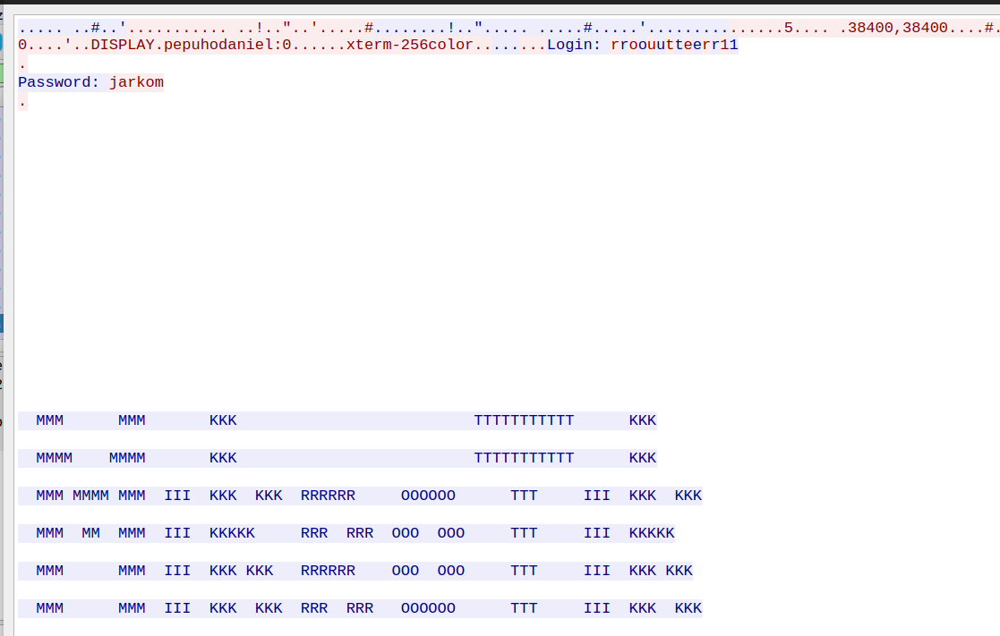

### 0.2 SSH (Secure Shell)

Bayangkan Anda seorang pengembang yang bekerja dari rumah dan perlu memperbarui kode di server perusahaan. Dengan SSH, Anda bisa masuk ke server dari komputer Anda di rumah, mengedit atau mengupload file kode, dan menjalankan program untuk memastikan semuanya bekerja dengan baik, seolah-olah Anda berada di depan server tersebut secara langsung.


#### Jadi, apa itu SSH?

SSH adalah sebuah protokol yang memungkinkan Anda mengakses dan mengelola komputer atau server dari jarak jauh dengan aman. Anda bisa melakukan berbagai tugas, seperti menjalankan program, membuat atau menghapus file, dan mentransfer file ke server lain. SSH memastikan bahwa semua data yang dikirim dan diterima terlindungi dengan enkripsi, sehingga lebih aman daripada metode lama seperti Telnet.

Cara kerja protokol SSH adalah dengan menerapkan model client-server. Koneksi yang terjadi adalah SSH client (komputer yang digunakan pengguna) melakukan koneksi ke SSH server (server remote yang dituju).

SSH saat ini versi terbarunya yaitu [SSH v2](https://www.synopsys.com/software-integrity/security-testing/fuzz-testing/defensics/protocols/ssh2-server.html). SSH bisa dikatan lebih secure dibandingan Telnet.

Cara melakukan koneksi dengan SSH adalah sebagai berikut:
```
ssh username@host or
ssh username@host -p 2224
```

### 0.3 Netcat (nc)

Bayangkan Anda ingin menguji apakah sebuah server dapat menerima data dari komputer Anda. Dengan Netcat, Anda bisa mengirim pesan ke server dan melihat apakah server merespons. Ini berguna untuk memeriksa koneksi jaringan atau debug aplikasi.

```
echo "Hello, Server!" | nc example.com 1234
```
Ini akan mengirimkan pesan "Hello, Server!" ke server di example.com pada port 1234.

#### Jadi, apa itu Netcat?

Netcat (atau nc) adalah utilitas baris perintah yang membaca dan menulis data melalui koneksi jaringan, menggunakan protokol TCP atau UDP. Perintah ini adalah salah satu alat yang paling kuat dalam jaringan dan persenjataan administrator sistem dan dianggap sebagai alat multi fungsi.

Sintaks dari netcat sendiri adalah sebagai berikut:
```
nc [options] host port
```
Secara default, Netcat akan mencoba untuk memulai koneksi TCP ke host dan port yang ditentukan. Jika Anda ingin membuat koneksi UDP, gunakan opsi -u.

### 0.4 Ping

Bayangkan Anda mengirimkan pesan singkat ke komputer atau server dan menunggu balasan. Jika balasan datang dengan cepat, berarti koneksi jaringan baik dan perangkat tersebut dapat dijangkau. Jika tidak ada balasan atau lambat, mungkin ada masalah dengan koneksi atau perangkat tersebut. Ping membantu Anda mengetahui apakah jaringan berfungsi dengan baik.

#### Jadi, apa itu Ping?

Ping merupakan singkatan dari Packet Internet Network Groper. Secara sederhana, ping adalah perintah untuk mengecek status dan keberadaan host dalam sebuah jaringan internet.

Prinsip utama ping adalah seperti penggunaan sonar untuk mengukur kedalaman laut. Jadi, sebuah sinyal dikirimkan ke dasar, lalu lamanya waktu kembali ke atas menjadi dasar perhitungannya.

Berikut merupakan cara melakukan ping:

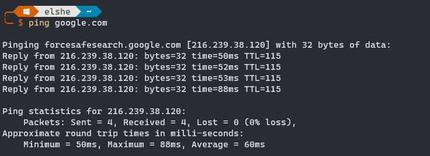

Dengan perintah di atas, Anda akan mendapatkan informasi sebagai berikut:
+ Reply adalah balasan dari host yang diikuti oleh informasi alamat IP. Perintah default di atas, idealnya akan memberikan empat balasan (reply). Namun, bisa saja muncul Request Timed Out (RTO) yang artinya tidak ada balasan sesuai waktu tunggu dari ping tersebut.
+ Bytes adalah jumlah data yang dikirimkan. Untuk Windows, umumnya adalah 32 bytes.
+ Time adalah lamanya waktu respon dari host, yang dihitung dengan satuan ms, atau millisecond. Waktu ping yang bagus adalah di bawah 100ms, terutama kalau penggunaannya untuk game online yang menuntut ping yang rendah.
+ TTL (Time To Live) merupakan durasi sebuah paket data dapat berada di jaringan, yang dicatat dalam hitungan detik. Umumnya, TTL diatur pada kisaran ideal 64 detik.

### 0.5 Traceroute

Analoginya, bayangkan ketika kamu hendak mengirim surat ke seseorang di kota lain, dan kamu ingin tahu kantor pos mana saja yang dilalui surat tersebut sebelum sampai ke tujuan. Traceroute bekerja seperti itu dengan menunjukkan setiap "titik singgah" (hop) yang dilalui paket data Anda dari komputer menuju server tujuan.

```
traceroute google.com
```

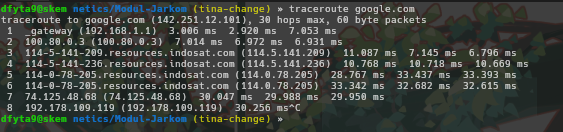 

#### Apa itu Traceroute?

**Traceroute** adalah alat diagnosa jaringan yang digunakan untuk melacak jalur (rute) yang dilalui paket data dari komputer sumber menuju host tujuan. Traceroute bekerja dengan mengirimkan paket secara bertahap dengan nilai **TTL** (Time To Live) yang terus bertambah (dimulai dari 1), sehingga setiap router (hop) di sepanjang jalur akan membalas dengan pesan _"TTL Exceeded"_ begitu TTL paket mencapai nol. Dari balasan inilah traceroute bisa memetakan setiap hop yang dilewati.

Dengan Traceroute, Anda bisa melihat:
+ **Hop number**: urutan titik (router) yang dilalui paket, dimulai dari 1.
+ **Hostname/IP**: alamat IP atau nama host dari setiap hop.
+ **RTT (Round Trip Time)**: waktu tempuh pulang-pergi paket ke hop tersebut, biasanya ditampilkan tiga kali percobaan (dalam ms).
+ **Timeout (`* * *`)**: menandakan hop tersebut tidak memberikan balasan dalam batas waktu tertentu (bisa karena firewall memblokir ICMP, bukan berarti jaringan putus).

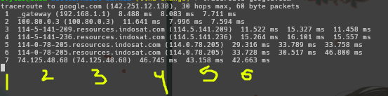 

Traceroute sangat berguna untuk mengidentifikasi di titik mana sebuah koneksi mengalami hambatan atau kegagalan, terutama saat troubleshooting masalah konektivitas ke suatu server.

Cara penggunaan dasar Traceroute adalah sebagai berikut:
```
traceroute [hostname/ip]
```

Beberapa opsi yang umum digunakan:
```
traceroute -n [hostname/ip]              # menampilkan hop hanya dalam bentuk IP address, tanpa resolusi DNS
traceroute -m [maksimum] [hostname/ip]   # menentukan jumlah maksimum hop yang akan dilacak
traceroute -I [hostname/ip]              # menggunakan ICMP ECHO alih-alih UDP untuk paket probe
```

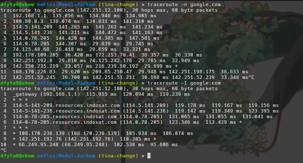 

### 0.6 MTR

Bayangkan Anda mengirim paket ke sebuah server tujuan, namun paket tersebut tidak sampai dalam waktu yang wajar. Anda ingin tahu di titik mana masalahnya terjadi, apakah di jaringan lokal Anda, di ISP, atau di server tujuan itu sendiri. MTR membantu melihat seluruh "rute" yang dilalui paket, sekaligus kualitas koneksi di setiap titik (hop) yang dilewati.

```
mtr google.com
```

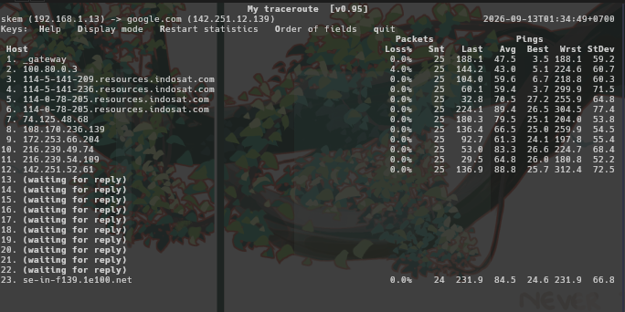 

#### Definisi Formal MTR?

**MTR** adalah alias dari **My Traceroute** adalah alat diagnosa jaringan yang menggabungkan fungsi **ping** dan **traceroute** menjadi satu. Jika ping hanya memberi tahu apakah host tujuan bisa dijangkau dan traceroute hanya menunjukkan jalur (hop) yang dilalui paket, MTR melakukan keduanya secara terus-menerus (real-time) dan menampilkan statistik performa untuk setiap hop di sepanjang rute.

Dengan MTR, Anda bisa melihat:
+ **Host**: alamat IP atau hostname dari setiap hop (titik) yang dilalui paket menuju tujuan.
+ **Loss%**: persentase paket yang hilang pada masing-masing hop.
+ **Snt**: jumlah paket yang telah dikirim ke hop tersebut.
+ **Last, Avg, Best, Worst**: nilai latency (waktu tempuh) terakhir, rata-rata, tercepat, dan terlambat dari paket ke hop tersebut.
+ **StDev**: standar deviasi dari latency, untuk melihat seberapa stabil koneksi di hop tersebut.

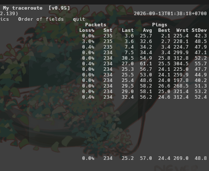 

Karena MTR menampilkan data secara _contionus_ (bukan hanya sekali seperti traceroute biasa), MTR sangat berguna untuk mengidentifikasi hop mana yang menjadi penyebab packet loss atau latency tinggi dalam sebuah jaringan.

Cara penggunaan dasar MTR adalah sebagai berikut:
```
mtr [hostname/ip]
```

Beberapa opsi yang umum digunakan:
```
mtr -r [hostname/ip]            # laporan (report) yaitu hasil ditampilkan sekali setelah sejumlah paket terkirim, tidak real-time
mtr -c [jumlah] [hostname/ip]   # menentukan jumlah paket (cycle) yang dikirim ke tiap hop
mtr -n [hostname/ip]            # menampilkan hop hanya dalam bentuk IP address, tanpa resolusi DNS
```

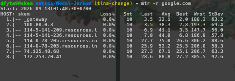 

## 1. Konsep IP dan Port

### 1.1 Konsep IP

Apakah Anda pernah bertanya-tanya bagaimana internet tahu bahwa saat Anda mengetik google.com, Anda akan dibawa ke situs web Google dan bukan ke situs lain? Sebenarnya, internet tidak memahami nama google.com secara langsung. Sebaliknya, internet menggunakan alamat IP untuk mengetahui ke mana harus mengirimkan data. Misalnya, google.com sebenarnya terhubung ke alamat IP 8.8.8.8.

#### Apa itu IP?
Bayangkan Anda mempunyai tetangga, cara Anda membedakan rumah Anda dengan rumah tetangga adalah dengan menggunakan alamat. Alamat IP seperti alamat rumah. Setiap perangkat, seperti komputer atau ponsel, memiliki alamat rumahnya sendiri di jaringan. Saat Anda mengirimkan sesuatu, seperti surat atau data, Anda perlu alamat rumah penerima agar kiriman Anda sampai ke tempat yang benar. Begitu juga dengan alamat IP: saat Anda mengirim data melalui internet, alamat IP memastikan data tersebut sampai ke perangkat yang tepat.


IP adalah singkatan dari Internet Protocol, atau dalam bahasa Indonesia berarti Protokol Internet. Jadi, IP address atau internet protocol address adalah alamat protokol internet (alamat IP) yang mengidentifikasi segala perangkat yang terhubung ke jaringan, baik jaringan internet pada umumnya maupun lokal.

Jenis-jenis alamat IP:
#### a. IPv4

IPv4 adalah alamat IP yang paling umum digunakan, dengan panjang 32-bit dan empat bagian (oktet) yang dipisahkan oleh titik. Nilai setiap oktet berkisar dari 0 – 255. Kepanjangan IPv4 yaitu Internet Protocol version 4.

Dengan kemungkinan ini, bisa disimpulkan bahwa saat ini ada sekitar 4,3 miliar alamat IPv4 yang berbeda di seluruh dunia.

Contoh IPv4 adalah seperti berikut:

+ 169.89.131.246
+ 192.0. 2.146
+ 01.102.103.104

Karena merupakan yang paling banyak digunakan, saat ini hampir semua sistem pasti bisa menangani routing IPv4 tanpa masalah. Selain itu, alamat IPv4 mendukung mayoritas topologi jaringan karena prefiksnya yang sederhana. Data dalam address packet IPv4 juga dienkripsi dengan baik untuk memastikan komunikasi yang aman antar jaringan.

#### b. IPv6

IPv6 adalah versi IP address yang lebih baru dari IPv4, dimaksudkan untuk menggantikan IPv4 karena variasi IPv4 yang kini mulai terbatas.

Kalau IPv4 memiliki panjang 32 bit, panjang IPv6 mencapai 128 bit. Artinya, ada sekitar 340 undecillion (angka di belakang digit pertamanya ada 66!) alamat IPv6 yang berbeda.

IPv6 ditulis dalam rangkaian digit heksadesimal 16 bit dan huruf, dipisahkan oleh titik dua. Jadi, pada jenis IP address ini, Anda akan menjumpai huruf dari A sampai F.

Berikut adalah contoh IPv6:

+ 2001:3FFE:9D38:FE75:A95A:1C48:50DF:6AB8
+ 2001:0db8:85a3:0000:0000:8a2e:0370:7334
+ 2001:db8:3333:4444:CCCC:DDDD:EEEE:FFFF
Dengan IPv6, routing akan menjadi lebih efisien karena memungkinkan penyedia layanan internet meminimalkan ukuran tabel routing. IPv6 juga menggunakan Internet Protocol Security (IPsec), jadi Anda tidak perlu cemas dengan autentikasi, kerahasiaan, dan integritas data.

Terlebih lagi, IPv6 tidak memiliki IP checksum sehingga pemrosesan packet menjadi lebih efisien, dan mendukung multicast. Hasilnya, transmisi data pun bisa dikirim ke beberapa tujuan sekaligus sehingga akan menghemat bandwidth jaringan.

### 1.2 Alokasi Port

Saat Anda mengunjungi gedung, Anda memberi tahu nomor apartemen yang ingin Anda tuju agar resepsionis bisa mengarahkan Anda ke tempat yang tepat. Begitu juga dengan port dalam jaringan: saat Anda mengirimkan data, Anda perlu menyebutkan nomor port agar data sampai ke aplikasi atau layanan yang tepat di komputer atau server.


#### Jadi, apa itu Port?

Port adalah cara yang memungkinkan komputer untuk menangani beberapa koneksi dan program secara bersamaan di jaringan. Setiap port terhubung dengan aplikasi atau layanan tertentu. Misalnya, port membantu komputer membedakan antara email dan halaman web yang masuk, karena mereka menggunakan port yang berbeda.

Untuk meningkatkan kompatibilitas, port sudah memiliki sistem standardisasi di semua perangkat yang terhubung ke jaringan. Setiap port memiliki identitas dalam bentuk angka 16-bit (dua byte) yang disebut sebagai Port Number.

**Logical Port**

Logical port adalah jalur yang digunakan oleh aplikasi untuk menghubungkan dengan komputer lain melalui jaringan TCP/IP. Salah satu contohnya adalah mengkoneksikan komputer dengan internet. Port ini berperan penting dalam jaringan komputer.

Dilihat dari penomorannya, logical port terbagi menjadi tiga jenis. Ada jenis port yang terdaftar di Internet Assigned Numbers Authority (IANA), dan ada yang tidak, berikut pembagiannya:

+ Well-known port: berkisar dari 0 – 1023. Ini merupakan port yang dikenali atau port sistem. Port ini selalu merepresentasikan layanan jaringan yang sama dan ditetapkan oleh IANA.
+ Registered port: berkisar dari 1024 – 49151. Port ini diketahui dan terdaftar di IANA tetapi tidak dialokasikan secara permanen, sehingga dapat menggunakan port number yang sama.
+ Dynamically assigned port: berkisar dari 49152 – 65535. Port ini ditetapkan oleh sistem operasi atau aplikasi yang digunakan untuk melayani request dari pengguna sesuai dengan kebutuhan.

Berikut ini beberapa contoh logical port yang sering digunakan beserta fungsinya:
+ Port 20 & 21 (FTP), adalah protokol yang berguna dalam mentransfer data di dalam suatu jaringan.
+ Port 22 (SSH), berfungsi mengirimkan data melalui jaringan dalam bentuk terenkripsi. Dapat digunakan untuk menjalankan fungsi atau tugas yang bisa diakses dari jarak jauh, misalnya menghubungkan ke host atau server.
+ Port 23 (TELNET), port untuk menghubungkan komputer dan server jarak jauh. Fungsinya mirip dengan SSH, hanya saja port 23 TELNET tidak menggunakan enkripsi pada koneksinya.
+ Port 25 (SMTP), berfungsi memastikan pengiriman email melalui jaringan dikomunikasikan dengan aman antara sesama SMTP server.
+ Port 53 (DNS), berfungsi sebagai penerjemah alamat IP pada setiap host.
+ Port 67 & 68 (DHCP), atau Dynamic Host Configuration Protocol berfungsi untuk menetapkan informasi terkait alamat IP.
+ Port 80 (HTTP/ Web Server), memungkinkan browser terhubung ke halaman web.
+ Port 443 (HTTPS),  berguna untuk menghubungkan klien ke internet, namun dengan fitur keamanan tambahan yang tidak dimiliki port HTTP 80. Port 443 mengenkripsi paket jaringan sebelum mentransfernya.
+ Port 143 (IMAP), Internet Message Access Protocol atau IMAP adalah protokol untuk mengakses email dari server.

<br>

## 2. Topologi Jaringan Dasar

Topologi jaringan dasar merujuk pada struktur fisik maupun logis yang menentukan bagaimana node-node saling terhubung dan berkomunikasi. Kita akan mensimulasikan dan mempelajari langkah fundamental dalam membangun jaringan komputer, mulai dari koneksi langsung antar dua nodes (point-to-point), pengujian performa jaringan, penggunaan switch, hingga mengatur alokasi alamat IP secara otomatis.

### 2.1 Bagaimana node terhubung?

Pada dasarnya, node dalam jaringan dapat saling berkomunikasi jika memiliki alamat IP dan berada dalam segmen jaringan yang sama. Pada tahap awal ini, kita akan menghubungkan dua node secara langsung (Point-to-Point) dan mengonfigurasi IP Address secara statis agar keduanya dapat saling mengenali dan mengirim paket data.

#### 2.1.1 Melalui console

1. Buatlah project baru pada GNS3, tambahkan 2 buah node **netics-pc** dan hubungkan kedua node melalui link (menggunakan interface eth0 pada kedua node)

   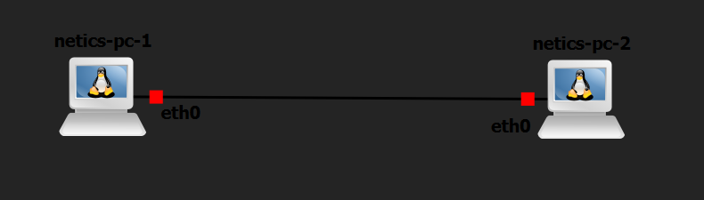

2. Start kedua node, buka console, lalu set IP address dan interface pada masing-masing node.

  Di netics-pc-1:
```
ip addr add 192.168.100.101/24 dev eth0
ip link set eth0 up
```

  Di netics-pc-2:
```
ip addr add 192.168.100.102/24 dev eth0
ip link set eth0 up
```

3. Konfirmasi IP address yang baru dengan menjalankan **ip -br addr**

   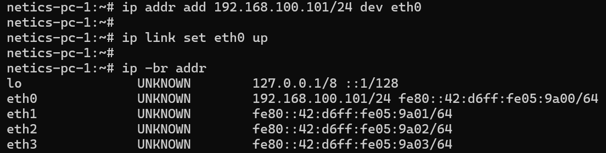
   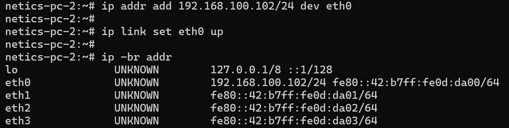

4. Verifikasi kedua node terhubung dengan ping salah satu node dari node lain

   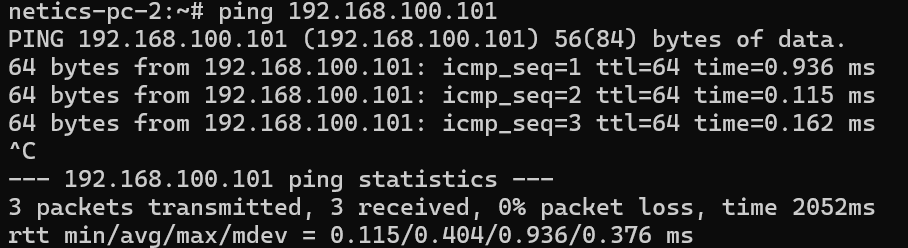
<br>

#### 2.1.2 Melalui "edit network config"

1. Klik kanan pada node -> **Configure** -> **Edit Network Configuration**. Lalu isi dengan konfigurasi berikut:

  Di **netics-pc-1**:
```
auto eth0
iface eth0 inet static
    address 192.168.100.101
    netmask 255.255.255.0
```

  Di **netics-pc-2**:
```
auto eth0
iface eth0 inet static
    address 192.168.100.102
    netmask 255.255.255.0
```

2. Setelah Anda klik Save, konfigurasi ini tidak akan langsung aktif. Anda harus merestart node tersebut (klik kanan -> Stop, lalu klik kanan -> Start) supaya node bisa membaca ulang file konfigurasinya saat proses booting.

<br>

### 2.2 Bagaimana mengetahui kapasitas transfer antar nodes?

Setelah node terhubung, kita akan mengukur seberapa besar kapasitas maksimal interface dan kecepatan transfer riil (throughput) di antara keduanya. Kita lakukan menggunakan utilitas **ethtool** untuk mengecek batas kapasitas node dan **iperf3** untuk menguji pengiriman beban traffic data secara aktual.

#### 2.2.1 Menggunakan **iperf3**

1. Untuk mengetahui kapasitas interface, gunakan command **ethtool [interface]**

   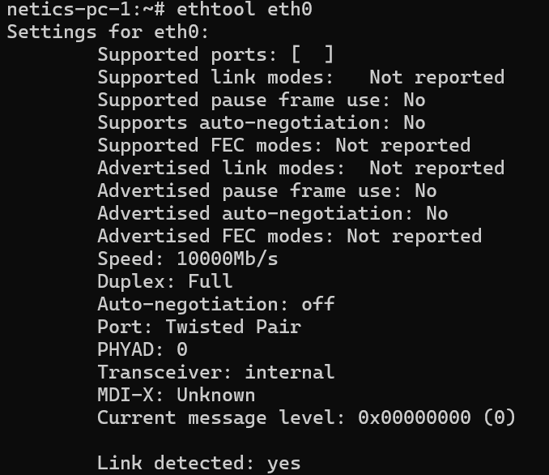

Output menunjukkan kecepatan maksimum sebesar 10 Gbps


2. Kita akan melakukan uji coba performa dengan **iperf3**

iperf3 adalah alat untuk pengukuran aktif bandwidth maksimum yang dapat dicapai pada jaringan IP.

Di **netics-pc-1**:
```
iperf3 -s
```

**-s** artinya menjalankan node dalam mode server. Node akan listening menunggu traffic data masuk dari node client

Di **netics-pc-2**:
```
iperf3 -c <ip-netics-pc-1> -u -b 10G
```
**-c** artinya menjalankan node dalam mode client untuk memulai tes ke arah server. **-u** untuk memerintahkan iPerf3 untuk menggunakan protokol UDP. **-b 10G** untuk menargetkan kecepatan pengiriman data sebesar 10 Gigabit/detik

Hasil pengujian:

   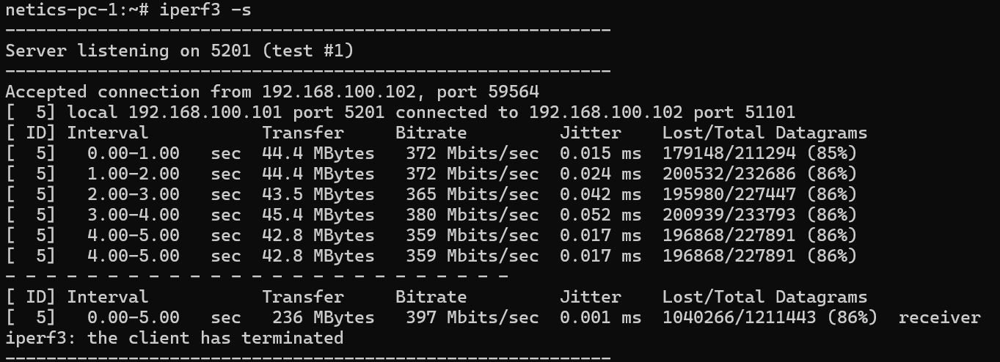

   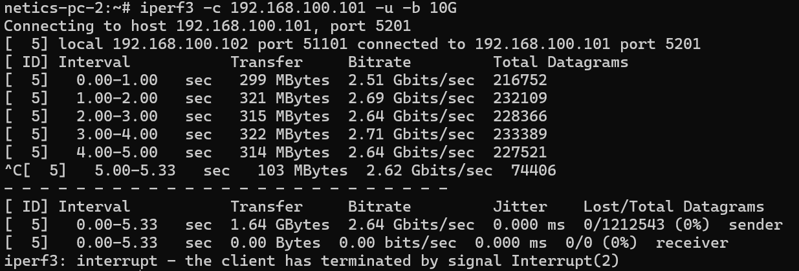

Berdasarkan gambar, iperf3 melaporkan bahwa traffic riil yang berhasil dibangkitkan oleh **netics-pc-2** (sender) mencapai rata-rata 2.64 Gbps, sementara **netics-pc-1** (receiver) hanya mampu menerima aliran data pada kecepatan rata-rata 397 Mbps dengan tingkat kehilangan data (packet loss) yang sangat tinggi, yakni sebesar 86%. Angka pencapaian ini berada jauh di bawah kapasitas nominal interface sebesar 10 Gbps. Hal ini secara jelas membuktikan bahwa kapasitas nominal suatu interface jaringan tidak selalu mencerminkan throughput aktualnya. Throughput riil dipengaruhi oleh banyak faktor, seperti kemampuan pemrosesan CPU pada node virtual, overhead protokol, serta beban kerja sistem yang menjalankan simulasi.

<br>

### 2.3 Menghubungkan Banyak Node Menggunakan Bridge

Sebelumnya, kita telah menghubungkan dua nodes secara langsung (Point-to-Point). Namun, bagaimana jika kita ingin menghubungkan tiga nodes atau lebih ke dalam satu jaringan yang sama? Kita tidak bisa lagi hanya menggunakan koneksi langsung. Kita membutuhkan **bridge**

#### 2.3.1 Konfigurasi Dasar Bridge

1. Tambahkan 1 node baru yang akan bertindak sebagai switch (misal kita beri nama **netics-pc-bridge**). Hubungkan **netics-pc-1** ke eth0 pada **netics-pc-bridge** dan **netics-pc-2** ke eth1 pada **netics-pc-bridge**

   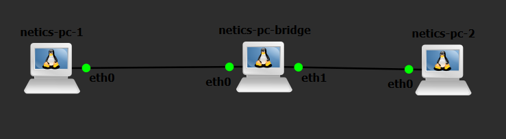

2. Lakukan pengujian koneksi dan pelacakan rute menggunakan perintah **mtr** dari **netics-pc-1** ke **netics-pc-2**

Di **netics-pc-1**:
```
mtr 192.168.100.102
```

  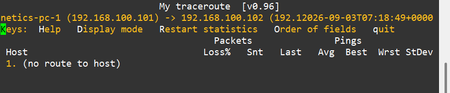

Pada tahap ini, pengujian akan gagal (No route to host). Belum ada reply karena **netics-pc-bridge** yang berada di tengah belum dikonfigurasi untuk meneruskan paket data.

3. Kita akan membuat konfigurasi bridge pada **netics-pc-bridge**. Buka console pada **netics-pc-bridge**, lalu jalankan command berikut untuk menjadikannya sebagai ethernet bridge

Di **netics-pc-bridge**:
```
ip -br addr                    # cek interface: terdapat eth0 dan eth1
brctl addbr br0
brctl addif br0 eth0
brctl addif br0 eth1
brctl show
ip link set br0 up
```

  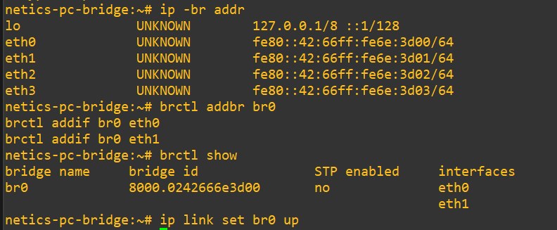

4. Jalankan ulang pengujian rute dari **netics-pc-1** ke **netics-pc-2** seperti pada langkah ke-2.

  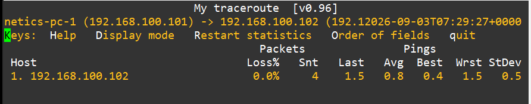

Koneksi kini berhasil karena antarmuka bridge pada **netics-pc-bridge** telah aktif dan berfungsi untuk meneruskan paket data antara kedua nodes.

<br>

### 2.4 Simulasi Jaringan
Dalam jaringan nyata, kondisi ideal tanpa hambatan jarang terjadi. Seringkali kita dihadapkan pada masalah seperti packet loss atau keterbatasan kapasitas jaringan (bandwidth). Untuk itu, kita akan mensimulasikan gangguan-gangguan ini tanpa harus menggunakan perangkat keras jaringan sungguhan.

#### 2.4.1 Simulasi Packet Loss

Pada percobaan ini, kita akan mensimulasikan situasi di mana 10% paket yang dikirim mengalami kehilangan atau kerusakan selama perjalanan.

1. Lakukan simulasi *packet loss* sebesar 10% pada kedua interface di **netics-pc-bridge**

Di **netics-pc-bridge**:
```
tc qdisc replace dev eth1 root netem loss 10%
tc qdisc replace dev eth0 root netem loss 10%
```

2. Lakukan pengujian menggunakan **mtr** dari **netics-pc-1** ke **netics-pc-2** untuk melihat efek dari packet loss.

**mtr** sebelum simulasi packet loss:

  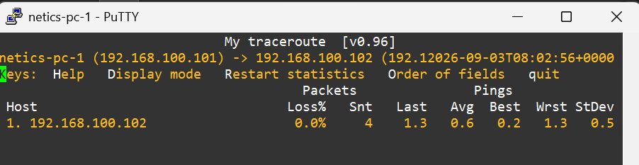

**mtr** setelah simulasi packet loss:

  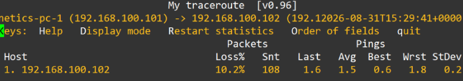

Hasil mtr menunjukkan peningkatan packet loss dari 0% menjadi 10.2% setelah percobaan packet loss diterapkan pada bridge.
<br>

#### 2.4.2 Simulasi Pembatasan Throughput

Pada percobaan ini, kita akan mensimulasikan situasi di mana bandwidth/kapasitas jaringan dibatasi. Pembatasan dilakukan di sisi bridge karena node ini berada di jalur yang dilalui seluruh traffic antara sender dan receiver. Hal ini mensimulasikan kondisi nyata, di mana pembatasan bandwidth biasanya diterapkan pada node penghubung seperti switch atau router, bukan pada masing-masing node.

1. Jalankan iperf3 -s di netics-pc-1, lalu iperf3 client dengan target speed 100 Mbps di netics-pc-2.

Di netics-pc-1:
```
iperf3 -s
```

Di netics-pc-2:
```
iperf3 -c 192.168.100.101 -u -b 100M
```

2. Lakukan pembatasan kecepatan (bitrate) menjadi 50 Mbps pada kedua interface di **netics-pc-3**

Di netics-pc-3:
```
tc qdisc replace dev eth0 root tbf rate 50mbit burst 64k limit 64k
tc qdisc replace dev eth1 root tbf rate 50mbit burst 64k limit 64k
```

Untuk mereset limitasi gunakan:
```
tc qdisc del dev eth0 root
tc qdisc del dev eth1 root
```

3. Perhatikan hasil pengujian traffic data untuk melihat efek dari pembatasan throughput.

**netics-pc-2 (client):**

  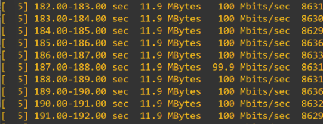

**netics-pc-1 (server):**

  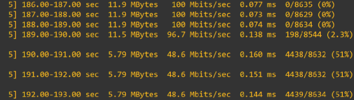

Meskipun client terus mengirimkan data dengan kecepatan 100 Mbps, kecepatan aktual yang diterima oleh server turun menjadi sekitar 48,6 Mbps. Hal ini membuktikan bahwa pembatasan bandwidth 50 Mbps berhasil, di mana jaringan secara otomatis mendrop paket data yang melebihi batas kapasitas.

<br>

### 2.5 Beralih dari Bridge ke Switch
Sebelumnya, kita menggunakan node **netics-pc** yang dikonfigurasi secara manual sebagai Bridge untuk menghubungkan beberapa node. Meskipun bridge dan switch sama-sama bekerja di Layer 2 (Data Link) dan meneruskan paket berdasarkan MAC Address, pada praktiknya kita lebih sering menggunakan Switch.

Mengapa menggunakan Switch daripada Bridge?
1. **Kapasitas Port**: Bridge biasanya hanya menghubungkan dua atau sedikit segmen jaringan, sedangkan Switch didesain memiliki port yang lebih banyak untuk menghubungkan banyak node sekaligus.
2. **Kinerja**: Switch fisik menggunakan perangkat keras khusus (ASIC) untuk memproses dan meneruskan paket data dengan sangat cepat, sementara konfigurasi bridge membebani kerja CPU.
3. **Kemudahan**: Dalam simulated environment (seperti GNS3) maupun dunia nyata, sebuah unmanaged switch bisa langsung digunakan tanpa perlu melakukan konfigurasi manual (seperti perintah brctl atau ip link yang panjang).

#### 2.5.1 Topologi Sederhana Switch
1. Buatlah topologi seperti berikut.

   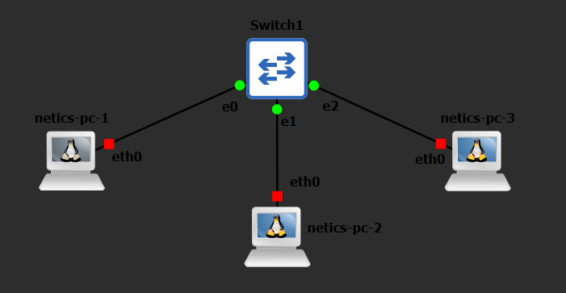

2. Konfigurasikan IP Address pada ketiga node dalam satu subnet yang sama melalui menu Edit Network Configuration.

Di **netics-pc-1**:
```
auto eth0
iface eth0 inet static
    address 192.168.100.101
    netmask 255.255.255.0
```

Di **netics-pc-2**:
```
auto eth0
iface eth0 inet static
    address 192.168.100.102
    netmask 255.255.255.0
```

Di **netics-pc-3**:
```
auto eth0
iface eth0 inet static
    address 192.168.100.103
    netmask 255.255.255.0
```
<br>

#### 2.5.2 Simulasi Meneruskan Paket pada Switch

Cara kerja Switch sangat pintar. Switch ini otomatis mengenali dan mencatat identitas (MAC Address) dari setiap node yang terhubung kepadanya, lalu menyimpannya ke dalam sebuah daftar memori bernama **MAC Address Table**

Untuk menyimulasikan bagaimana Switch meneruskan paket, lakukan pengujian berikut:

1. Buka console di **netics-pc-1** dan lakukan ping ke **netics-pc-3**.
```
ping -c 4 192.168.100.103
```

   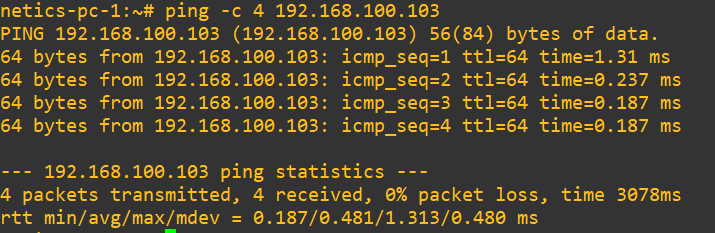

Saat ping pertama dikirim, Switch belum mengetahui lokasi tujuan. Oleh karena itu, switch melakukan broadcast (pesan ARP) ke semua port aktif. Begitu node target membalas, Switch langsung mencatat MAC Address beserta posisi portnya ke dalam **MAC Address Table**. Menggunakan informasi ini, pengiriman paket kedua dan seterusnya, switch tidak lagi melakukan broadcast ke semua node, melainkan langsung mengirim paket ke node tujuan saja.

<br>

### 2.6 Konfigurasi IP Otomatis dengan DHCP

Sejauh ini, kita selalu mengonfigurasi IP Address secara manual (Static IP). Dalam skala jaringan yang besar, cara ini tentu tidak efisien dan rentan terjadi tabrakan IP (IP conflict). Oleh karena itu, kita menggunakan DHCP (Dynamic Host Configuration Protocol) agar node (client) bisa mendapatkan konfigurasi jaringan secara otomatis dari server.

Mekanisme DHCP dalam memberikan IP dikenal dengan sebutan DORA:

- Discover: Client mengirim pesan broadcast ke seluruh jaringan untuk mencari DHCP server.
- Offer: DHCP server yang menerima permintaan akan menawarkan sebuah alamat IP dari pool (kumpulan IP yang tersedia).
- Request: Client secara resmi meminta IP yang ditawarkan tersebut.
- Acknowledge: Server mengonfirmasi dan memberikan hak sewa (lease) IP tersebut kepada client.

Kita akan menggunakan program yang umum digunakan untuk konfigurasi DHCP:

1. **udhcpd**: Sebagai DHCP Server (Pemberi IP).
2. **udhcpc**: Sebagai DHCP Client (Penerima/Peminta IP).

#### 2.6.1 Konfigurasi DHCP Server (udhcpd)

Kita akan memanfaatkan topologi Switch yang sama seperti **sub-bab 2.5** di atas. Jadikan **netics-pc-1** sebagai **DHCP Server**, sementara node lainnya akan menjadi **DHCP Client**.

   

1. Pastikan **netics-pc-1** sudah memiliki IP statis (misal: 192.168.100.101/24).
```
ip addr add 192.168.100.101/24 dev eth0
```

2. Buat file kosong yang akan digunakan oleh sistem sebagai tempat penyimpanan catatan peminjaman (lease) IP:
```
touch /etc/dhcpd.leases
```

3. Buat file konfigurasi DHCP ke file **/etc/dhcpd.conf**. Kita akan menggunakan alokasi IP dari **.150** hingga **.155**:
```
echo "start 192.168.100.150
end 192.168.100.155
interface eth0
max_leases 5
pidfile /etc/dhcpd.pid
lease_file /etc/dhcpd.leases
option subnet 255.255.255.0" > /etc/dhcpd.conf
```

4. Jalankan aplikasi DHCP server agar berjalan di layar utama (foreground):
```
udhcpd -f /etc/dhcpd.conf
```
<br>

#### 2.6.2 Konfigurasi DHCP client
Kita akan mengubah konfigurasi pada **netics-pc-2** dan **netics-pc-3** agar langsung meminta konfigurasi IP secara otomatis pada saat node menyala.

1. Klik kanan pada node -> Configure -> Edit Network Configuration dan uncomment bagian berikut:

Di **netics-pc-2**:
```
auto eth0
iface eth0 inet dhcp
    hostname netics-pc-2
```

Di **netics-pc-3**:
```
auto eth0
iface eth0 inet dhcp
    hostname netics-pc-3
```

Pastikan bahwa konfigurasi IP statisnya telah dicomment kembali agar kita bisa mendapat IP DHCP, bukan IP statis.

2. Save dan restart node tersebut agar sistem membaca konfigurasi baru saat booting. Client akan otomatis mendapat IP DHCP.

   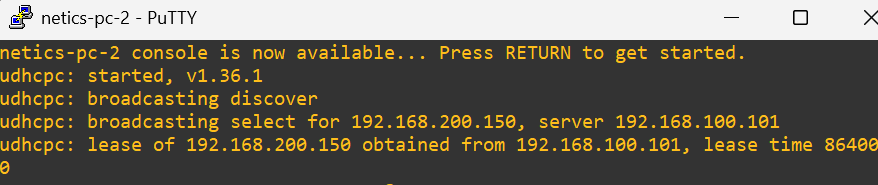
   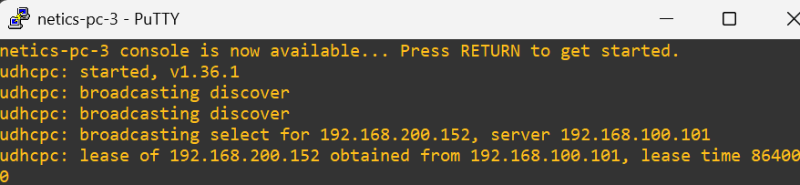
<br>

#### 2.6.3 Konfigurasi DHCP client manual
Skenario ini mensimulasikan kondisi ketika suatu node tidak diset untuk meminta IP secara otomatis saat startup (misalnya node yang baru dipasang). Kita akan meminta IP secara manual pada **netics-pc-2**.

1. Buka console **netics-pc-2**. Cek IP address yang ada saat ini (pastikan hanya ada link local, belum ada IP dari jaringan):
```
ip -br addr
```

2. Jalankan DHCP client secara manual untuk meminta IP address pada interface **eth0** dan biarkan prosesnya berjalan di background (-b):
```
udhcpc -i eth0 -b
```

   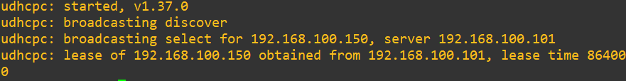

3. Setelah itu cek kembali IP client, seharusnya sudah mendapatkan IP dari DHCP.

<br>

### 2.7 Konfigurasi DHCP Server menggunakan kea-dhcp4

Pada sub-bab 2.6, DHCP Server dan DHCP Client berada dalam satu jaringan yang sama. Pada bagian ini, DHCP dibahas lebih dalam, mulai dari konsepnya hingga implementasi DHCP Server menggunakan `kea-dhcp4` dan DHCP Relay pada topologi dengan router.

#### 2.7.1 Konsep DHCP

##### Apa itu DHCP?

**Dynamic Host Configuration Protocol (DHCP)** adalah protokol berbasis arsitektur _client-server_ yang dipakai untuk memudahkan pengalokasian `IP Address` dalam satu jaringan. DHCP secara otomatis akan meminjamkan `IP Address` kepada _host_ yang memintanya.

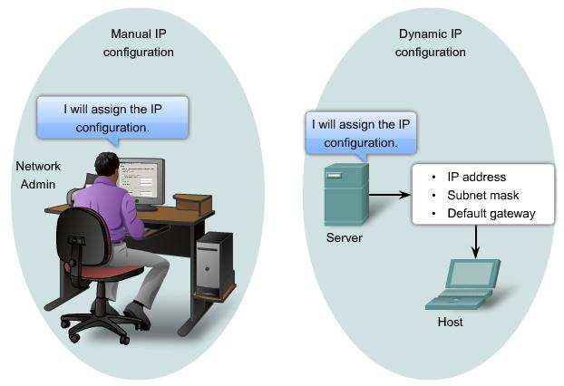

Tanpa DHCP, administrator jaringan harus memasukkan `IP Address` masing-masing komputer dalam suatu jaringan secara manual. Namun jika DHCP dipasang di jaringan, maka semua komputer yang tersambung ke jaringan akan mendapatkan `IP Address` secara otomatis dari `DHCP Server`.

##### Bootstrap Protocol dan Dynamic Host Configuration Protocol

Selain DHCP, terdapat protokol lain yang juga memudahkan pengalokasian `IP Address` dalam suatu jaringan, yaitu `Bootstrap Protocol (BOOTP)`. Perbedaan `BOOTP` dan DHCP terletak pada proses konfigurasinya, sebagai berikut.

| BOOTP                                                                                                       | DHCP                                                                                                                                                     |
| ----------------------------------------------------------------------------------------------------------- | -------------------------------------------------------------------------------------------------------------------------------------------------------- |
| Administrator jaringan melakukan konfigurasi _mapping_ `MAC Address` _client_ dengan `IP Address` tertentu. | _Server_ akan melakukan peminjaman `IP Address` dan konfigurasi lainnya dalam rentang waktu tertentu. Protokol ini dibuat berdasarkan cara kerja `BOOTP` |

##### DHCP Message Header

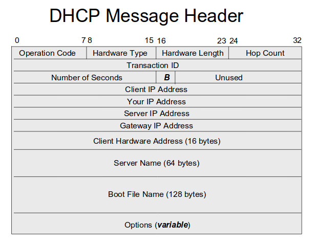

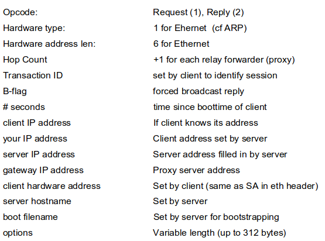

##### Cara Kerja DHCP

DHCP bekerja dengan melibatkan dua pihak yakni **Server** dan **Client** sebagai berikut.

1. **DHCP Server** memberikan suatu layanan yang dapat memberikan `IP Address` dan parameter lainnya kepada semua _client_ yang memintanya.
2. **DHCP Client** adalah mesin _client_ yang menjalankan perangkat lunak _client_ yang memungkinkan mereka untuk dapat berkomunikasi dengan `DHCP Server`.
   `DHCP Server` umumnya memiliki sekumpulan `IP Address` yang didistribusikan yang disebut `DHCP Pool`. Setiap _client_ akan meminjamnya untuk rentan waktu yang ditentukan oleh DHCP sendiri (dalam konfigurasi, yang disebut dengan _leasing time_). Jika masa waktu habis, maka client akan meminta `IP Address` yang baru atau memperpanjangnya. Itulah sebabnya `IP Address` client menjadi dinamis.

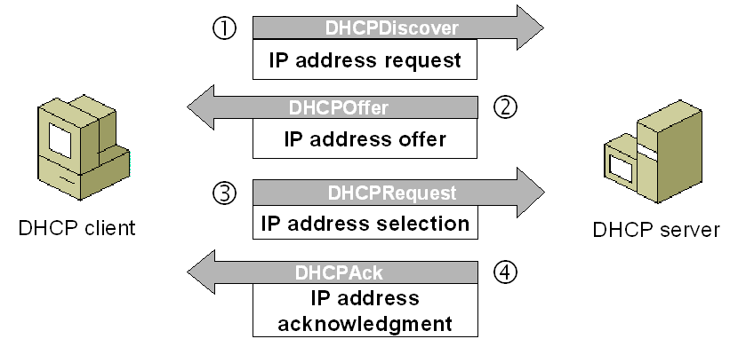

Terdapat 5 tahapan yang dilakukan dalam proses peminjaman `IP Address` pada DHCP, yaitu sebagai berikut.

1. **DHCPDISCOVER**: _Client_ menyebarkan request secara _broadcast_ untuk mencari `DHCP Server` yang aktif. `DHCP Server` menggunakan UDP port 67 untuk menerima broadcast dari client melalui port 68.
2. **DHCPOFFER**: `DHCP Server` menawarkan `IP Address` (dan konfigurasi lainnya apabila ada) kepada _client_. `IP Address` yang ditawarkan adalah salah satu alamat yang tersedia dalam `DHCP Pool` pada `DHCP Server` yang bersangkutan.
3. **DHCPREQUEST**: _Client_ menerima tawaran dan menyetujui peminjaman `IP Address` tersebut kepada `DHCP Server`.
4. **DHCPACK**: DHCP server menyetujui permintaan `IP Address` dari _client_ dengan mengirimkan paket `ACKnoledgment` berupa konfirmasi `IP Address` dan informasi lain. Kemudian, _client_ melakukan inisialisasi dengan mengikat (_binding_) `IP Address` tersebut dan _client_ dapat bekerja pada jaringan tersebut. `DHCP Server` akan mencatat peminjaman yang terjadi.
5. **DHCPRELEASE**: _Client_ menghentikan peminjaman `IP Address` (apabila waktu peminjaman habis atau menerima `DHCPNAK`).

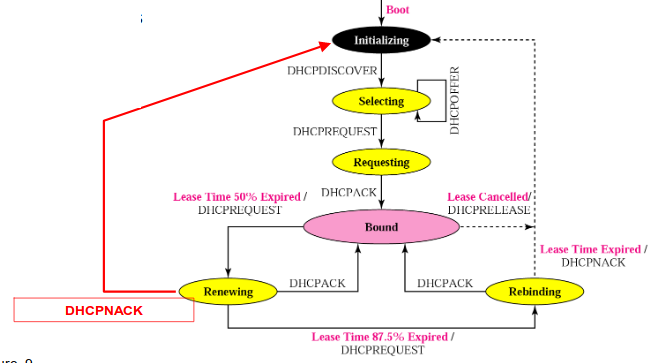

Lebih lanjut, kalian dapat menonton atau melihat visualisasi kerja dari DHCP di berbagai sumber untuk menambah pemahaman. Salah satunya, adalah pada video berikut [https://youtu.be/S43CFcpOZSI](https://youtu.be/S43CFcpOZSI).

##### DHCP Relay

Sebelumnya, telah disebutkan bahwa DHCP melibatkan dua pihak, yaitu `DHCP Server` dan `DHCP Client`. Pada bagian ini, dibahas satu pihak lain yang juga terlibat dalam proses peminjaman `IP Address`, yaitu `DHCP Relay`. Apa itu `DHCP Relay`?

###### A. Konsep DHCP Relay

`DHCP Relay` adalah perangkat jaringan (dengan skenario paling umum perangkat jaringan tersebut adalah `router`) yang berfungsi sebagai perantara atau penerus (_forwarder_) antara `DHCP Client` dan `DHCP Server` yang tidak berada dalam satu segmen jaringan yang sama. `DHCP Relay` menerima _request_ dari `DHCP Client` lalu meneruskannya ke `DHCP Server`. Begitu juga sebaliknya, `DHCP Relay` menerima _response_ dari `DHCP Server` lalu meneruskannya ke `DHCP Client`. Dengan adanya `DHCP Relay`, maka `DHCP Client` dan `DHCP Server` tidak perlu berada dalam satu segmen jaringan yang sama.

> Beberapa dari kalian saat membaca kalimat pertama dari penjelasan `DHCP Relay` mungkin akan berfikir bahwa `DHCP Relay` memiliki peran yang sama seperti switch. Nah, maka pemahaman itu adalah salah, ya!

Penempatan `DHCP Relay` dalam suatu jaringan bisa diilustrasikan seperti berikut.

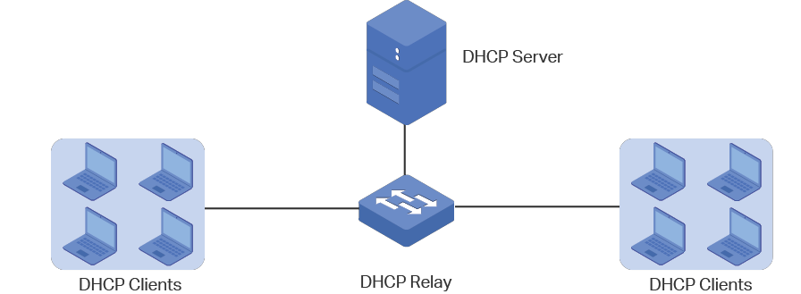

Sebagai _forwarder_, cara atau tahapan kerja DHCP dengan pelibatan `DHCP Relay` akan sama seperti yang telah dijelaskan sebelumnya, tetapi dengan beberapa penyesuaian. Singkatnya seperti berikut.

- `DHCP Relay` akan menerima `DHCPDISCOVER` dari `DHCP Client`, kemudian meneruskannya ke `DHCP Server`.
- `DHCP Server` akan mengirimkan `DHCPOFFER` kepada `DHCP Relay`, kemudian `DHCP Relay` akan meneruskannya ke `DHCP Client`.
- `DHCP Relay` juga akan meneruskan `DHCPREQUEST` dari `DHCP Client` ke `DHCP Server`, kemudian `DHCP Server` akan mengirimkan `DHCPACK` kepada `DHCP Relay`, dan `DHCP Relay` akan meneruskannya ke `DHCP Client`.
- `DHCP Relay` juga akan meneruskan `DHCPRELEASE` dari `DHCP Client` ke `DHCP Server`, kemudian `DHCP Server` akan mengirimkan `DHCPNAK` kepada `DHCP Relay`, dan `DHCP Relay` akan meneruskannya ke `DHCP Client`.

> Tentu kalian tidak asing dengan istilah tersebut? Ya, istilah tersebut mirip dengan proses _handshake_ pada protokol TCP!

###### B. Mengapa DHCP Relay diperlukan?

Ada beberapa alasan mengapa `DHCP Relay` diperlukan, yaitu sebagai berikut.

- Memungkinkan `DHCP Server` melayani `DHCP Client` yang berada di luar segmen jaringan lokal. Tanpa `DHCP Relay`, DHCP hanya dapat bekerja dalam satu segmen jaringan lokal.
- Menghemat `IP Address`. Dengan `DHCP Relay`, hanya dibutuhkan satu `DHCP Server` untuk melayani banyak segmen jaringan. Tanpa `DHCP Relay`, setiap segmen jaringan memerlukan `DHCP Server` masing-masing.
- Memudahkan manajemen jaringan. Administrator jaringan cukup melakukan konfigurasi dan manajemen pada satu `DHCP Server` saja, tidak perlu satu-satu.
- Meningkatkan keamanan jaringan dengan membatasi akses `DHCP Server` hanya dari `DHCP Relay`.

##### DHCP Lease Time

`DHCP Lease Time` adalah waktu yang dialokasikan oleh `DHCP Server` ketika sebuah `IP Address` dipinjamkan kepada komputer _client_. Singkatnya, setelah waktu pinjam ini selesai, maka `IP Address` tersebut dapat dipinjam lagi oleh komputer _client_ yang sama atau komputer _client_ tersebut mendapatkan `IP Address` lain jika `IP Address` yang sebelumnya dipinjam, dipergunakan oleh komputer _client_ lain.

###### A. Lease Time dalam DHCP

`DHCP Lease Time` menentukan berapa lama _client_ DHCP dapat menggunakan `IP Address` yang dialokasikan oleh `DHCP Server`. Ada beberapa jenis _lease time_ dalam DHCP, sebagai berikut.

- Infinite Lease Time

  Sederhananya, _client_ mendapatkan hak untuk menggunakan `IP Address` tertentu selamanya atau hingga _lease_ dibatalkan secara manual oleh administrator. Biasanya, jenis _lease time_ ini diterapkan untuk _static_ `IP Address` _assignment_ pada perangkat seperti _server_, _router_, _switch_, _printer_, dan perangkat penting lain. Kelebihannya, _client_ akan selalu mendapatkan `IP Address` yang sama meskipun dilakukan _restart_ atau _reconnect_. Tetapi, akan berpotensi menimbulkan pemborosan `IP Address` jika `IP Address` yang telah dialokasikan tidak digunakan.

- Finite Lease Time

  Pada _lease time_ jenis ini, _client_ hanya bisa menggunakan `IP Address` selama periode waktu tertentu (jam, hari, minggu). Setelah _lease expired_, _client_ harus _request_ `IP Address` baru dari `DHCP server`. Umumnya, jenis _lease time_ ini digunakan untuk _client_ seperti komputer, laptop, dan _smartphone_. Kelebihannya, `IP Address` bisa didaur ulang, _client_ mendapat `IP Address` baru secara berkala. Tetapi, berpotensi adanya interupsi koneksi saat _renew lease_.

- Dynamic Lease Time

  `DHCP Server` secara otomatis menentukan lama _lease time_ berdasarkan _availability_ `IP Address` dan _request client_. Hal itu akhirnya mengakibatkan _lease time_ bisa sangat pendek hingga lama tergantung ketersediaan `IP Address`. Kelebihannya, tentu memberikan fleksibilitas pengelolaan `IP Address` bagi administrator.

###### B. Pentingnya Pengaturan Lease Time

Beberapa alasan mengapa pengaturan lease time DHCP itu penting adalah sebagai berikut.

- Memastikan ketersediaan `IP Address` dengan membatasi pemakaian per _client_ dalam jangka waktu tertentu saja.
- Mencegah _single_ _client_ mendominasi `IP Address` tertentu dalam jangka panjang, `IP Address` bisa digunakan _client_ lain setelah _expired_.
- Memberikan _client_ `IP Address` baru secara berkala dari _pool_ `IP Address` untuk alasan keamanan & performa.
- Memungkinkan `DHCP Server` menarik kembali (_reclaim_) `IP Address` yang tidak terpakai atau _inactive_ untuk kemudian didistribusikan ulang ke _client_ lain yang membutuhkan.
- Membantu administrator _troubleshooting_ masalah jaringan yang terkait dengan `IP Address` _client_.

#### 2.7.2 Topologi dan Konfigurasi Awal

Setelah memahami konsep, lalu bagaimana implementasinya? Untuk implementasi, kita akan menggunakan topologi berikut.

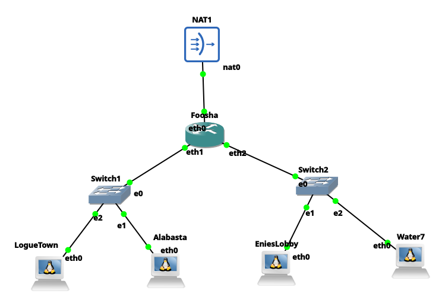

Pada kasus ini kita mengatur IP Address setiap node sebagai berikut:

```
Foosha eth0:  dari NAT cloud (192.168.122.x)
Foosha eth1:  10.40.1.1/24      (sisi Loguetown dan Alabasta)
Foosha eth2:  10.40.2.1/24      (sisi EniesLobby dan Water7)

EniesLobby:   10.40.2.2/24, gateway 10.40.2.1   (statis, DHCP Server)
Loguetown:    DHCP (pool 10.40.1.10 - 10.40.1.100)
Alabasta:     DHCP (pool 10.40.1.10 - 10.40.1.100)
Water7:       DHCP (pool 10.40.2.20 - 10.40.2.100, fixed address pada 2.7.8)
```

Perangkat lunak yang digunakan pada modul ini:

| Peran | Perangkat lunak | Node |
| ----- | --------------- | ---- |
| DHCP Server | `kea-dhcp4` (ISC Kea) | EniesLobby |
| DHCP Relay | `dhcp-helper` | Foosha |
| DHCP Client | `udhcpc` (bawaan busybox) | Loguetown, Alabasta, Water7 |

`kea-dhcp4` menggantikan `isc-dhcp-server` (`dhcpd`), dan `dhcp-helper` menggantikan `isc-dhcp-relay`. Kea hanya berfungsi sebagai DHCP Server dan tidak memiliki relay, sehingga relay dijalankan dengan program terpisah.

Node pada modul ini menggunakan Alpine Linux yang tidak memiliki `rc-service`. Oleh karena itu, program dijalankan langsung dari command line, dan saat boot dijalankan dari `/root/init.sh` (lihat [2.7.10](#2710-menjaga-konfigurasi-setelah-restart)).

##### Konfigurasi Awal

1. Konfigurasi network interface pada **Foosha**:
```
auto eth0
iface eth0 inet dhcp

auto eth1
iface eth1 inet static
    address 10.40.1.1
    netmask 255.255.255.0

auto eth2
iface eth2 inet static
    address 10.40.2.1
    netmask 255.255.255.0
```

2. Aktifkan routing dan NAT pada **Foosha** agar client dapat mengakses internet:
```sh
sysctl -w net.ipv4.ip_forward=1
iptables -t nat -A POSTROUTING -s 10.40.0.0/16 -o eth0 -j MASQUERADE
```

3. Konfigurasi `/etc/network/interfaces` pada **EniesLobby**. Gateway wajib diisi karena balasan untuk client di `10.40.1.0/24` harus kembali melalui Foosha:
```
auto lo
iface lo inet loopback

auto eth0
iface eth0 inet static
    address 10.40.2.2
    netmask 255.255.255.0
    gateway 10.40.2.1
```

Lalu atur DNS agar node dapat mengunduh paket:

```sh
echo "nameserver 8.8.8.8" > /etc/resolv.conf
```

#### 2.7.3 Instalasi Kea-DHCP Server

Pada topologi ini, kita akan menjadikan **EniesLobby** sebagai DHCP Server. Oleh sebab itu, kita harus meng-_install_ **kea-dhcp4** di **EniesLobby** dengan melakukan langkah-langkah sebagai berikut.

1. Update _package lists_ di **EniesLobby** dengan perintah sebagai berikut.

```
apk update
```

2. _Install_ **kea-dhcp4** di **EniesLobby**.

```
apk add kea-dhcp4
```

3. Pastikan **kea-dhcp4** telah ter-_install_ dengan perintah.

```
kea-dhcp4 -V
```

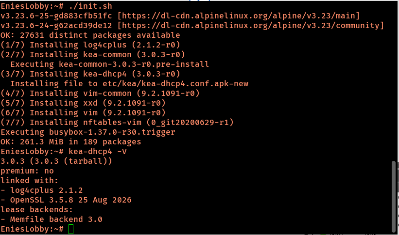

#### 2.7.4 Konfigurasi DHCP Server

Langkah-langkah yang harus dilakukan setelah instalasi adalah sebagai berikut.

##### A. Menentukan _Interface_ yang akan Diberi Layanan DHCP

###### A.1. Buka _File_ Konfigurasi _Interface_

Silakan edit _file_ konfigurasi di `/etc/kea/kea-dhcp4.conf`

```sh
nano /etc/kea/kea-dhcp4.conf
```

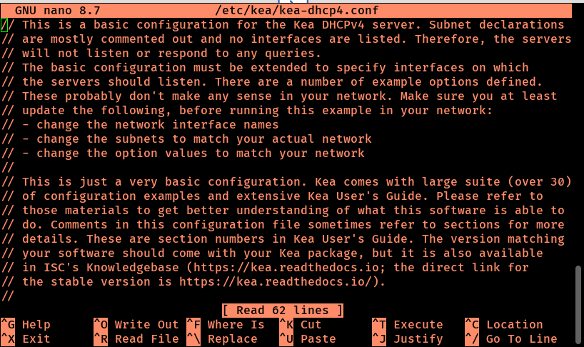

###### A.2. Tentukan _Interface_

Perhatikan topologi yang sudah dibuat. Interface pada **EniesLobby** yang mengarah ke switch adalah `eth0`, sehingga kita memilih interface `eth0` untuk diberi layanan DHCP. Pada Kea, hal ini diatur pada bagian `interfaces-config`:

```json
"interfaces-config": {
  "interfaces": ["eth0"]
}
```

##### B. Melakukan Konfigurasi pada `kea-dhcp4`

Ada banyak hal yang dapat dikonfigurasi, antara lain sebagai berikut.

- Range IP
- DNS Server
- Informasi Netmask
- Default Gateway
- dll.

###### B.1. Buka _File_ Konfigurasi DHCP

Konfigurasi dilakukan pada file yang sama, yaitu `/etc/kea/kea-dhcp4.conf`.

###### B.2. Tambahkan _Script_ Konfigurasi

Parameter pada `isc-dhcp-server` dipetakan ke Kea sebagai berikut:

| **No** | **ISC dhcpd** | **Kea (`kea-dhcp4.conf`)** | **Keterangan** |
| ------ | ------------- | -------------------------- | -------------- |
| 1 | `INTERFACES=` | `"interfaces-config": { "interfaces": ["eth0"] }` | Interface yang menerima permintaan DHCP. |
| 2 | `subnet 'NID' netmask 'Netmask'` | `"subnet": "NID/prefix"` | Network ID subnet dalam notasi CIDR, misalnya `10.40.1.0/24`. Kea memilih subnet berdasarkan alamat relay (atau interface) tempat permintaan datang. |
| 3 | `range 'Start_IP' 'End_IP'` | `"pools": [{ "pool": "Start_IP - End_IP" }]` | Rentang IP yang dibagikan secara dinamis. Boleh lebih dari satu pool. |
| 4 | `option routers 'IP_Gateway'` | `{ "name": "routers", "data": "IP_Gateway" }` | IP gateway yang diberikan ke client. |
| 5 | `option domain-name-servers 'DNS'` | `{ "name": "domain-name-servers", "data": "DNS" }` | DNS yang diberikan ke client. |
| 6 | `option broadcast-address` | (otomatis) | Kea menghitung alamat broadcast sendiri. |
| 7 | `default-lease-time 'Waktu'` | `"valid-lifetime": Waktu` | Lama peminjaman IP dalam detik. |
| 8 | `max-lease-time 'Waktu'` | `"max-valid-lifetime": Waktu` | Lama peminjaman maksimum dalam detik. |
| 9 | `host X { hardware ethernet ...; fixed-address ...; }` | `"reservations": [{ "hw-address": "...", "ip-address": "..." }]` | Fixed address untuk host tertentu (lihat 2.7.8). |

**Tentang NID:** NID adalah Network ID dari interface yang menghadap client, dengan bagian host bernilai 0. Contohnya, jika interface router untuk sebuah subnet memiliki IP `10.40.1.1/24`, maka subnet-nya adalah `10.40.1.0/24`. **NB: Cara menghitung NID yang benar akan dijelaskan pada modul 4.**

Pada contoh ini kita menggunakan `8.8.8.8` sebagai DNS. Ganti seluruh isi `/etc/kea/kea-dhcp4.conf` pada **EniesLobby** dengan konfigurasi berikut. Konfigurasi ini melayani dua subnet: `10.40.2.0/24` secara langsung (Water7 satu segmen dengan server), dan `10.40.1.0/24` melalui relay di Foosha.

```json
{
  "Dhcp4": {
    "interfaces-config": {
      "interfaces": ["eth0"]
    },
    "lease-database": {
      "type": "memfile",
      "persist": true,
      "name": "/var/lib/kea/kea-leases4.csv"
    },
    "valid-lifetime": 600,
    "max-valid-lifetime": 7200,
    "subnet4": [
      {
        "id": 1,
        "subnet": "10.40.1.0/24",
        "pools": [
          { "pool": "10.40.1.10 - 10.40.1.100" }
        ],
        "option-data": [
          { "name": "routers", "data": "10.40.1.1" },
          { "name": "domain-name-servers", "data": "192.168.122.1" }
        ]
      },
      {
        "id": 2,
        "subnet": "10.40.2.0/24",
        "pools": [
          { "pool": "10.40.2.20 - 10.40.2.100" }
        ],
        "option-data": [
          { "name": "routers", "data": "10.40.2.1" },
          { "name": "domain-name-servers", "data": "192.168.122.1" }
        ]
      }
    ]
  }
}
```

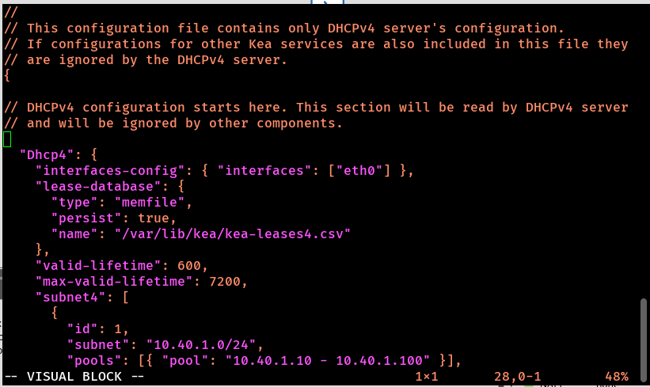

###### B.3. Jalankan `kea-dhcp4`

Periksa dahulu apakah file konfigurasi tidak memiliki kesalahan:

```sh
kea-dhcp4 -t /etc/kea/kea-dhcp4.conf
```

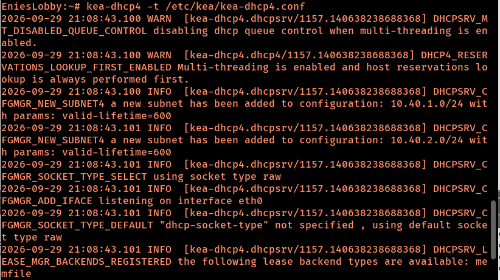

Keluaran yang benar menampilkan kedua subnet dan tidak memiliki baris `ERROR`. Baris `WARN` tentang multi-threading adalah hal yang normal. Seperti gambar diatas

Buat direktori yang dibutuhkan Kea, lalu jalankan. Untuk percobaan pertama, jalankan di *foreground* dengan mode debug agar kita dapat melihat setiap DISCOVER, OFFER, REQUEST, dan ACK:

```sh
mkdir -p /var/lib/kea /run/kea
kea-dhcp4 -d -c /etc/kea/kea-dhcp4.conf
```

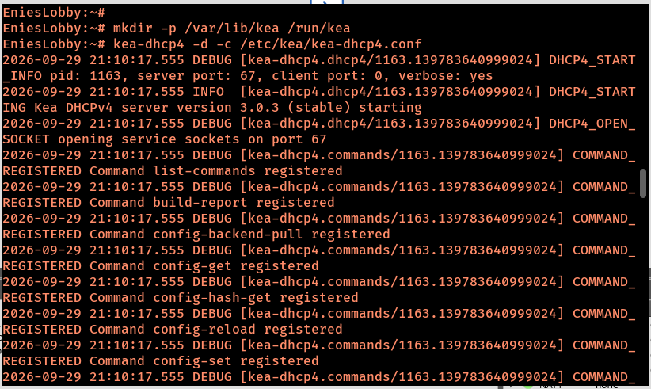

Tekan `Ctrl+C` untuk menghentikannya. Untuk menjalankannya di *background*:

```sh
kill $(pidof kea-dhcp4) 2>/dev/null
kea-dhcp4 -c /etc/kea/kea-dhcp4.conf > /root/kea.log 2>&1 &
```

#### 2.7.5 Konfigurasi DHCP Relay

Ketika DHCP Server berada pada subnet yang berbeda dengan DHCP client, maka kita akan membutuhkan `DHCP Relay`. Maka dari itu, langkah-langkah berikut harus dilakukan pada perangkat yang dijadikan sebagai `DHCP Relay` (umumnya pada _router_). Oleh karena itu, _router_ **Foosha** akan menjadi DHCP Relay. Langkah-langkah yang harus dilakukan adalah sebagai berikut.

##### A. Melakukan Instalasi

Pertama, kita perlu meng-install program relay pada **Foosha**.

```sh
apk update
apk add dhcp-helper
```

##### B. Melakukan Konfigurasi pada `dhcp-helper`

`dhcp-helper` dikonfigurasi lewat opsi command line. Jalankan pada **Foosha**:

```sh
dhcp-helper -n -s 10.40.2.2 -i eth1
```

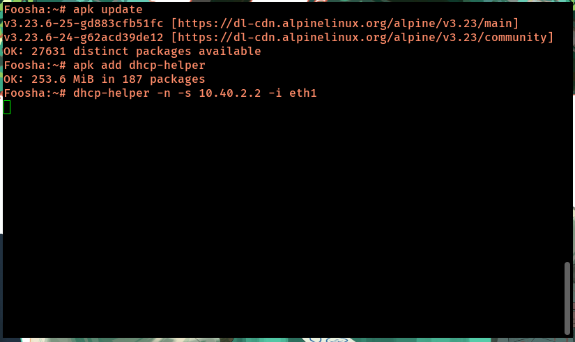

- `-s 10.40.2.2` adalah alamat IP DHCP Server. Pada kasus ini, yaitu alamat IP **EniesLobby**. Berapa alamat IP-nya?
- `-i eth1` adalah interface yang mendengarkan permintaan client. Nilainya harus sesuai dengan interface yang terhubung ke client. Pada kasus ini, **Foosha** memiliki interface `eth1` yang terhubung ke client Loguetown dan Alabasta. Jika ada lebih dari satu interface yang terhubung ke client, ulangi opsinya: `-i eth1 -i eth3`.
- `-n` membuat relay berjalan di *foreground* agar kita dapat melihat pesan error. Hapus opsi ini untuk menjalankannya sebagai daemon di *background*.

Water7 tidak perlu dilayani lewat relay karena berada satu segmen dengan DHCP Server.

> **Catatan:** setiap subnet client tambahan juga memerlukan blok `subnet4` yang sesuai pada konfigurasi Kea di server, yang mencakup alamat interface Foosha pada subnet tersebut.

##### C. Melakukan Konfigurasi IP Forwarding

Pastikan IP Forwarding aktif pada **Foosha**:

```sh
sysctl -w net.ipv4.ip_forward=1
```

Agar tetap aktif setelah restart, tambahkan juga baris berikut pada `/etc/sysctl.conf`:

```
net.ipv4.ip_forward=1
```

> Apa itu `IP Forwarding`? `IP Forwarding` adalah fitur yang memungkinkan _router_ untuk meneruskan paket dari suatu jaringan ke jaringan lainnya. _Router_ memiliki minimal dua _interface_ jaringan, misal _interface_ A terhubung ke jaringan A dan _interface_ B terhubung ke jaringan B. Ketika ada paket IP masuk dari jaringan A menuju ke jaringan B, maka _router_ akan meneruskan (_forward_) paket tersebut dari _interface_ A ke _interface_ B. Demikian pula sebaliknya.

Selamat 🎉, konfigurasi `DHCP Relay` telah selesai!

#### 2.7.6 Konfigurasi DHCP Client

Setelah mengonfigurasi _server_, kita juga perlu mengonfigurasi _interface_ _client_ supaya bisa mendapatkan layanan dari `DHCP Server`. Di dalam topologi ini, contoh _client_-nya adalah **Alabasta**, **Loguetown**, dan **Water7**.

##### A. Mengonfigurasi _Client_

###### A.1. Periksa IP Alabasta dengan `ip a`

Dari konfigurasi sebelumnya, **Alabasta** telah diberikan `IP Address` statis 10.40.1.3.

###### A.2. Matikan Node Alabasta dan Buka Konfigurasi Network dari GNS3

_Comment_ atau hapus konfigurasi yang lama (konfigurasi `IP Address` statis)

Lalu tambahkan konfigurasi berikut.

```
auto eth0
iface eth0 inet dhcp
```

###### A.3. Start Node Alabasta

Silahkan start lagi node Alabasta dan seharusnya saat membuka console dari Alabasta, akan terlihat secara otomatis DHCP IP Lease dari EniesLobby

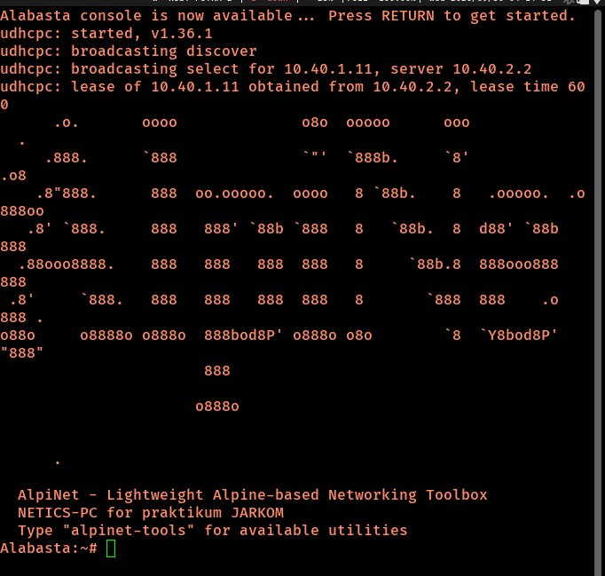

atau menggunakan command `udhcpc -i eth0`

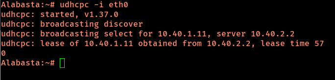

##### B. Testing

Cek kembali `IP Address` **Alabasta** dengan menjalankan `ip a`.

Periksa juga apakah **Alabasta** sudah mendapatkan `DNS Server` sesuai konfigurasi di `DHCP Server`. Periksa `/etc/resolv.conf` dengan menggunakan perintah sebagai berikut. Selain itu, kalian juga bisa melakukan pemeriksaan dengan melakukan ping kepada `google.com`

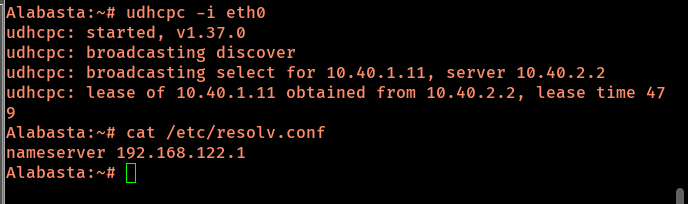

Bila `IP Address` dan nameserver **Alabasta** telah berubah sesuai dengan konfigurasi yang diberikan oleh DHCP dan berhasil melakukan ping ke `google.com`, maka selamat kalian telah berhasil! 🎉🎉

**Keterangan**:

- Jika IP **Alabasta** masih belum berubah, jangan panik. Silakan _restart_ kembali _node_ melalui halaman GNS3.
- Jika masih belum berubah juga, jangan buru-buru bertanya. Coba periksa lagi semua konfigurasi yang telah kalian lakukan, mungkin terdapat kesalahan penulisan.

##### C. Lakukan Kembali Langkah di Atas pada Client Loguetown dan Water7

- Client **Loguetown** dan **Water7**.

Setelah `IP Address` dipinjamkan ke sebuah client, maka `IP Address` tersebut tidak akan diberikan ke _client_ lain. Buktinya, tidak ada _client_ yang mendapatkan `IP Address` yang sama.

#### 2.7.7 Leasing Times

Pada bagian ini kita akan melihat sendiri bagaimana lease time bekerja. Kita akan memperpendek lease pada subnet `10.40.1.0/24` menjadi 2 menit.

##### A. Ubah Lease Time pada Server

Pada **EniesLobby**, edit `/etc/kea/kea-dhcp4.conf` dan tambahkan `valid-lifetime` dan `max-valid-lifetime` pada blok subnet `10.40.1.0/24`. Pengaturan pada tingkat subnet menimpa pengaturan global:

```json
{
  "id": 1,
  "subnet": "10.40.1.0/24",
  "valid-lifetime": 120,
  "max-valid-lifetime": 600,
  "pools": [
    { "pool": "10.40.1.10 - 10.40.1.100" }
  ],
  "option-data": [
    { "name": "routers", "data": "10.40.1.1" },
    { "name": "domain-name-servers", "data": "192.168.122.1, 8.8.8.8, 8.8.4.4" }
  ]
}
```

- `valid-lifetime` adalah lease time default (dalam detik). Nilai ini dipakai jika client tidak meminta waktu tertentu.
- `max-valid-lifetime` adalah batas atas jika client meminta lease yang lebih lama.

Periksa dan restart Kea:

```sh
kea-dhcp4 -t /etc/kea/kea-dhcp4.conf
kill $(pidof kea-dhcp4) 2>/dev/null
kea-dhcp4 -c /etc/kea/kea-dhcp4.conf > /root/kea.log 2>&1 &
```

##### B. Amati pada Client

Pada **Alabasta**, minta alamat IP dan perhatikan keluarannya:

```sh
udhcpc -i eth0 -f
```

Keluarannya menampilkan lease time yang diterima, misalnya `lease of 10.40.1.x obtained ... lease time 120`. Biarkan berjalan lebih dari satu menit. Pada separuh masa lease (sekitar 60 detik), `udhcpc` akan mengirim permintaan perpanjangan (*renew*) langsung ke server.

Pada **EniesLobby**, lihat catatan peminjaman:

```sh
cat /var/lib/kea/kea-leases4.csv
```

Kolom `expire` menunjukkan waktu (dalam format epoch) kapan lease habis, dan nilainya bertambah setiap kali client melakukan perpanjangan.

Kamu juga dapat memaksa perpanjangan atau melepas lease secara manual:

```sh
kill -USR1 $(pidof udhcpc)     # renew
kill -USR2 $(pidof udhcpc)     # release
```

Setelah selesai, kembalikan nilai lease time seperti semula (hapus dua baris di blok subnet, atau ubah ke `600` dan `7200`), lalu restart Kea.

#### 2.7.8 Fixed Address

> **Studi Kasus**:
>
> Ternyata kapal milik Franky yang diparkir di **Water7** selain menjadi _client_, juga akan digunakan sebagai _server_ suatu aplikasi jual beli kapal, sehingga akan menyulitkan jika `IP Address`nya berganti-ganti setiap **Water7** terhubung ke jaringan internet. Oleh karena itu, **Water7** membutuhkan `IP Address` yang tetap dan tidak berganti-ganti.

Masalah yang dihadapi oleh Franky adalah IP address dari Water7 yang berganti-ganti. Sehingga, requirementnya adalah `IP address` yang tetap. Oleh karena itu, solusi yang dapat ditawarkan adalah dengan fitur dari DHCP Server, yaitu layanan untuk "menyewakan" `IP Address` secara tetap pada suatu _host_, yakni **Fixed Address**. Dalam kasus ini, **Water7** akan mendapatkan `IP Address` tetap, yaitu `10.40.2.13`.

##### A. Konfigurasi `DHCP Server` di EniesLobby

###### A.1. Buka File Konfigurasi `kea-dhcp4`

Buka dan edit file `/etc/kea/kea-dhcp4.conf` pada **EniesLobby**.

Sebelumnya, cari tahu hardware address Water7. Jalankan `ip a` pada **Water7**, lihat interface yang terhubung ke switch (`eth0`), lalu salin nilai setelah `link/ether`.

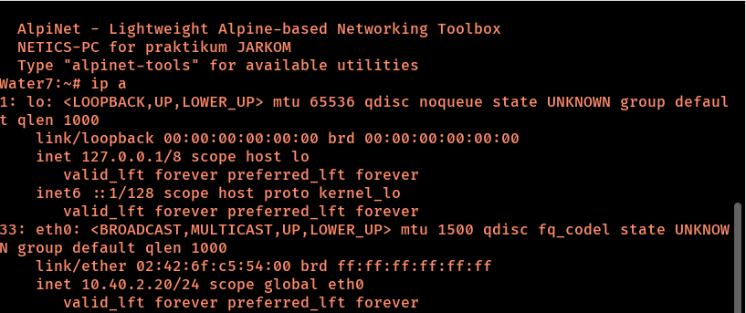

###### A.2. Tambahkan Script Berikut

Tambahkan daftar `reservations` pada subnet `10.40.2.0/24` (subnet dengan `id` 2):

```json
{
  "id": 2,
  "subnet": "10.40.2.0/24",
  "pools": [
    { "pool": "10.40.2.20 - 10.40.2.100" }
  ],
  "option-data": [
    { "name": "routers", "data": "10.40.2.1" },
    { "name": "domain-name-servers", "data": "192.168.122.1, 8.8.8.8, 8.8.4.4" }
  ],
  "reservations": [
    {
      "hw-address": "aa:bb:cc:dd:ee:ff",
      "ip-address": "10.40.2.13"
    }
  ]
}
```

Ganti `aa:bb:cc:dd:ee:ff` dengan hardware address Water7 yang sudah disalin.

**Penjelasan**:

- `hw-address` adalah MAC address interface Water7.
- `ip-address` adalah alamat IP yang selalu dipinjamkan kepada **Water7**.

###### A.3. Restart `kea-dhcp4` pada EniesLobby

```sh
kea-dhcp4 -t /etc/kea/kea-dhcp4.conf
kill $(pidof kea-dhcp4) 2>/dev/null
kea-dhcp4 -c /etc/kea/kea-dhcp4.conf > /root/kea.log 2>&1 &
```

##### B. Konfigurasi `DHCP Client`

###### B.1. Konfigurasi Network Interface Water7

Network interface dapat diakses pada konfigurasi network pada aplikasi GNS3 di node **Water7**.

###### B.2. Tambah Konfigurasi Berikut

```
auto eth0
iface eth0 inet dhcp
    hwaddress ether aa:bb:cc:dd:ee:ff
```

Gunakan MAC address yang sama dengan yang ada di reservation. Hardware address perlu di-*set* pada `/etc/network/interfaces` agar hwaddress tidak berubah ketika project GNS3 dimatikan atau di-export.

###### B.3. Restart Node Water7

Restart node Water7 dari halaman GNS3, atau jalankan:

```sh
kill -USR2 $(pidof udhcpc)
ifdown eth0; ifup eth0
```

atau

```
udhcpc -i eth0
```

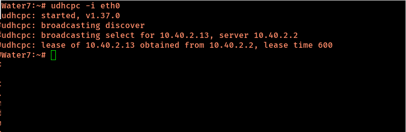

##### C. Testing

Periksa IP **Water7** dengan `ip a`.

```sh
ip a
```

IP **Water7** seharusnya sudah berubah menjadi **10.40.2.13**, sesuai fixed address yang diberikan oleh DHCP Server.

#### 2.7.9 Menguji Konfigurasi DHCP pada Topologi

Setelah melakukan banyak konfigurasi di atas, kamu dapat memastikan apakah DHCP Server berhasil dengan beberapa langkah berikut:

1. Matikan semua node melalui halaman GNS3
2. Nyalakan kembali semua node
3. Jalankan `ip a` pada setiap node

Jika semua IP node client berubah sesuai rentang yang dikonfigurasi pada DHCP Server (Loguetown dan Alabasta dari `10.40.1.10 - 10.40.1.100`) dan **Water7** tetap mendapat IP `10.40.2.13`, maka konfigurasi DHCP Server berhasil. Semua client juga seharusnya dapat melakukan `ping google.com`.

Untuk melihat lease yang tercatat di server, jalankan pada **EniesLobby**:

```sh
cat /var/lib/kea/kea-leases4.csv
```

#### 2.7.10 Menjaga Konfigurasi Setelah Restart

Pada appliance Alpine di GNS3, hanya `/etc`, `/etc/network`, dan `/root` yang bersifat persisten. Artinya file konfigurasi di atas tetap ada setelah restart, tetapi paket yang di-install dengan `apk add` akan hilang. Solusinya, simpan paket di `/root` selagi ada koneksi internet, lalu install ulang saat boot lewat script yang dipanggil dari `/root/init.sh`.

> Perintah di bawah mengasumsikan `/root/init.sh` dijalankan saat boot. Lihat isinya dengan `cat /root/init.sh` terlebih dahulu dan pastikan script tersebut tidak mengatur ulang konfigurasi jaringanmu. Tambahkan baris pemanggilan hanya satu kali.

##### A. EniesLobby (DHCP Server)

Buat `/root/boot.sh`:

```sh
cat > /root/boot.sh <<'EOF'
#!/bin/sh
exec >>/root/boot.log 2>&1

apk update
apk add kea-dhcp4

mkdir -p /var/lib/kea /run/kea
kill $(pidof kea-dhcp4) 2>/dev/null
kea-dhcp4 -t /etc/kea/kea-dhcp4.conf && \
  kea-dhcp4 -c /etc/kea/kea-dhcp4.conf >/root/kea.log 2>&1 &
EOF

chmod +x /root/boot.sh
echo 'sh /root/boot.sh &' >> /root/init.sh
```

Kamu juga bisa menaruh konfigurasi dari kea-dhcp4 di folder `/root` dan dengan memodifikasi script `init.sh` bisa melakukan copy dan paste file config nya ke direktori `/etc/kea/kea-dhcp4.conf`

##### B. Foosha (Router, NAT, Relay)

Buat `/root/boot.sh`:

```sh
cat > /root/boot.sh <<'EOF'
#!/bin/sh
exec >>/root/boot.log 2>&1

apk update
apk add dhcp-helper

sysctl -w net.ipv4.ip_forward=1
iptables -t nat -A POSTROUTING -s 10.40.0.0/16 -o eth0 -j MASQUERADE

kill $(pidof dhcp-helper) 2>/dev/null
dhcp-helper -s 10.40.2.2 -i eth1
EOF

chmod +x /root/boot.sh
echo 'sh /root/boot.sh &' >> /root/init.sh
```

##### C. Client

Client tidak memerlukan paket tambahan maupun script boot. `udhcpc` sudah ada di busybox, dan `/etc/network/interfaces` bersifat persisten sehingga `iface eth0 inet dhcp` diterapkan kembali setiap boot.

Setelah restart, baca `/root/boot.log` pada node untuk melihat apa yang dikerjakan script boot-nya.

#### 2.7.11 Troubleshooting

Jika client tidak mendapat alamat IP, cari tahu di mana permintaannya terhenti. Periksa dari sisi server terlebih dahulu.

1. **Uji server tanpa relay.** Pada **EniesLobby**, jalankan Kea di foreground (`kea-dhcp4 -d -c /etc/kea/kea-dhcp4.conf`), lalu jalankan `udhcpc -i eth0 -f -n` pada **Water7**. Water7 berada satu segmen dengan server, sehingga relay tidak terlibat.
   - Jika Water7 mendapat alamat IP, server berfungsi dan masalahnya ada di jalur relay.
   - Jika Kea tidak menampilkan DISCOVER, pastikan `eth0` EniesLobby benar-benar memiliki `10.40.2.2` (`ip a`) dan Water7 terhubung ke switch yang sama.
2. **Periksa relay.** Pada **Foosha**, periksa `ip a` (`eth1` harus memiliki `10.40.1.1`), `cat /proc/sys/net/ipv4/ip_forward` (harus `1`), dan `ps | grep dhcp-helper`. Jalankan relay di foreground (`-n`) untuk melihat pesan error.
3. **Amati paket.** Pada Foosha, jalankan `apk add tcpdump`, lalu jalankan perintah berikut saat client meminta alamat IP:
```sh
tcpdump -ni eth1 port 67 or port 68
tcpdump -ni eth2 port 67 or port 68
```

Kamu seharusnya melihat DISCOVER pada `eth1`, permintaan yang diteruskan ke `10.40.2.2` pada `eth2`, lalu OFFER kembali pada `eth2` dan kemudian pada `eth1`. Titik di mana jejaknya berhenti menunjukkan bagian mana yang bermasalah.

4. **Periksa kecocokan subnet.** Jika permintaan sampai ke Kea tetapi tidak dibalas, pastikan ada blok `subnet4` yang mencakup alamat Foosha pada interface yang menghadap client (`10.40.1.1` berada di dalam `10.40.1.0/24`).
5. **Periksa rute balik.** EniesLobby harus memiliki default route melalui `10.40.2.1` (`ip route`), jika tidak balasan untuk client yang melalui relay akan hilang.
6. **Jika `-i eth1` tidak membuat balasan sampai ke client**, coba jalankan relay dengan mengecualikan interface NAT: `dhcp-helper -n -s 10.40.2.2 -e eth0`. Dampaknya, permintaan Water7 di `eth2` juga ikut diteruskan ke server sehingga server bisa melihat permintaan ganda. Hal ini tidak berbahaya pada lab ini.

<br>

## 3. Wire Crimping
Dalam jaringan komputer, terjadi komunikasi antara satu perangkat dengan perangkat lainnya. Komunikasi itu tentu membutuhkan suatu media. Walaupun sudah ada teknologi komunikasi nirkabel, peran kabel dalam jaringan masih penting dan belum tergantikan. Oleh karena itu dalam modul kali ini, kita akan belajar cara melakukan _crimping_ pada salah satu jenis kabel jaringan yang bernama kabel UTP (_Unshielded Twisted Pair_).

### 3.1 Peralatan yang dibutuhkan
Untuk melakukan _wire crimping_ kita membutuhkan peralatan di bawah ini:
#### a. Kabel UTP
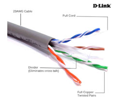

Bahan utama dari proses ini.
#### b. RJ45
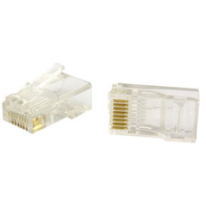

RJ45 adalah konektor yang akan menghubungkan kabel UTP dengan perangkat.
#### c. Tang Crimping


Tang ini digunakan untuk memasangkan kabel pada RJ45.
#### d. LAN Tester
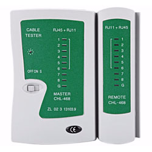

Seperti namanya, alat ini digunakan untuk memeriksa apakah kabel yang kita buat berfungsi dengan baik atau tidak.
### 3.2 Konfigurasi Kabel
Ada beberapa macam konfigurasi kabel. Dari urutan warnanya yang sesuai standar internasional dapat dibagi menjadi __T568A__ dan __T568B__.

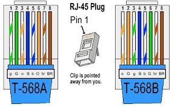

Sedangkan dari pemasangannya dibagi menjadi
#### a. __Kabel Straight-Through__
  Jenis pengkabelan ini digunakan untuk menyambungkan dua tipe perangkat berbeda yang tersambung ke jaringan, yakni perangkat DTE (data terminal equipment) ke DCE (data circuit-terminating equipment) atau sebaliknya. Perangkat DTE adalah perangkat yang melakukan generate data digital dan bertindak sebagai source dan destination untuk data digital, contohnya adalah komputer, mikrokomputer, terminal, printer. DCE adalah perangkat yang menerima dan mengkonversi data ke link telekomunikasi yang sesuai, umumnya DCE adalah perangkat jaringan seperti router, switch, modem.


  Aturan pemasangannya adalah bahwa tiap ujung kabel harus memiliki urutan warna yang sama. Misal ujung yang satu menggunakan susunan warna berdasarkan aturan T568A maka begitu juga ujung lainnya.

#### b. __Kabel Crossover__
Berkebalikan dengan kabel Straight-through, pengkabelan ini digunakan untuk menyambungkan dua tipe perangkat yang sama yang tersambung ke jaringan, yakni perangkat DTE ke DTE atau DCE ke DCE. Misalnya antara komputer dengan komputer, router dengan router, router dengan switch, komputer dengan printer.

  

  Aturan pemasangannya pun berbeda dengan kabel jenis straight-trough, kabel jenis Crossover memiliki urutan warna yang berbeda dikedua ujungnya. Tapi, perbedaan warna ini tidak boleh sembarangan, karena kedua ujung ini juga memiliki aturan urutan warna. Pada kabel jenis Crossover standar, jika salah satu ujung Pin memiliki susunan warna berdasarkan aturan T568A, maka ujung Pin yang lain harus memiliki urutan warna berdasarkan standar T568B.

### 3.3 Langkah-Langkah
1. Siapkan keperluan crimping (kabel UTP, RJ45, tang crimping, LAN tester)
2. Kupas pelindung kabel UTP
3. Urutkan kabel sesuai konfigurasi yang diinginkan (Straight/Cross/yang lainnya).
4. Potong ujung kabel untuk meratakannya.
5. Masukkan ujung kabel tersebut ke RJ45 dan pastikan menyentuh ujung RJ45.
6. Gunakan tang crimping untuk mengunci kabel UTP dalam RJ45 (pastikan ujung kabel masih menempel dengan ujung RJ45 saat penguncian dilakukan)
7. Terakhir, gunakan LAN tester untuk memastikan kabel yang anda buat bekerja dengan baik.

### Video crimping Straight

[](https://youtu.be/NL0F8bP8k7I)

## 4. Wireshark
Wireshark adalah sebuah aplikasi penganalisa paket jaringan. Penganalisa paket jaringan akan mencoba menangkap paket jaringan dan mencoba untuk menampilkan data paket sedetail mungkin.
Sebuah jaringan komputer dibangun dengan tujuan mengirimkan atau menerima data antara satu end-point dengan end-point lainnya. Data dikirim dalam bentuk paket-paket. Struktur sebuah paket terdiri dari :

***1. Header***
Bagian header berisi alamat dan data lainnya yang dibawa oleh paket. Struktur dari header meliputi :

| Intruksi | Keterangan |
|--  |---|
| Panjang paket | Beberapa jaringan sudah memiliki panjang paket yang baku (*fixed-length*), sementara yang lain bergantung pada header untuk memuat informasi ini |
| Sinkronisasi | Beberapa bit yang membantu paket mencocokkan jaringan yang dimaksud |
| Nomor paket | Menunjukkan urutan dari total paket yang ada |
| Protokol | Pada jaringan yang membawa lebih dari satu macam informasi, protokol ini menunjukkan jenis paket yang ditransmiskan: e-mail, halaman web, atau yang lain |
| Alamat tujuan | Ke mana paket dikirimkan |
| Alamat asal | Dari mana paket dikirimkan |

***2. Payload***
Payload juga disebut sebagai ***body*** dari paket. Pada bagian inilah data yang akan dikirimkan lewat paket berada

***3. Trailer***
trailer, kadang-kadang disebut ***footer***, biasanya memuat sepasang bit yang memberi sinyal pada perangkat penerima bahwa paket sudah mencapai ujungnya. trailer juga bisa memuat semacam *error checking*.

### 4.1 Instalasi
Instalasi untuk OS WIndows atau macOS bisa mengunduh installer pada [ laman ini](https://www.wireshark.org/download.html). Untuk OS linux dapat melihat tutorialnya [di sini](https://linuxtechlab.com/install-wireshark-linux-centosubuntu/).
Setelah melakukan instalasi , jalankan Wireshark sebagai **administrator** (WIndows) atau **root** (linux)
Berikut tampilan awalnya :


### 4.2 Filters
Dalam Wireshark terdapat 2 jenis filter yaitu ***Capture Filter*** dan ***Display Filter***

#### 4.2.1 Capture Filter


 - Definisi : Memilah paket yang akan ditangkap (captured). Paket yang tidak memenuhi kriteria dibiarkan lewat tanpa ditangkap
 - Sintaks filter dapat terdiri dari 1 atau lebih **primitive**. primitive sendiri biasanya terdiri dari sebuah **id** (bilangan atau nama) yang didahului oleh 1 atau lebih jenis qualifier. Perlu diingat bahwa dalam 1 primitive tidak boleh ada 2 atau lebih qualifier sejenis
 - Jenis qualifier :

| Qualifier | Keterangan | Contoh |
|--|--|--|
| type | Menentukan jenis id atau nama yang menjadi nilai filter | host, net, port, portrange |
| dir | Menentukan direction atau arah dari id | src, dst, dan lain-lain |
| proto | Menentukan protokol dari id | tcp, udp, dan lain-lain |

 - Sintaks filter dapat memuat operator, tanda kurung, negasi ( `!` / `not` ), dan kongjungsi ( `&&` / `and` atau `||` / `or` ). Kongjungsi digunakan untuk menghubungkan 2 primitive dalam satu sintaks
 - Contoh sintaks capture filter :

| Filter expression / Primitive(s) | Keterangan |
|--|--|
| `host 10.151.36.1` | Menangkap semua paket yang spesifik menuju ke atau berasal dari alamat 10.151.36.1 |
| `src host 10.151.36.1` | Menangkap semua paket yang spesifik berasal dari alamat 10.151.36.1 |
| `net 192.168.0.0/24` atau `net 192.168.0.0 mask 255.255.255.0` | Menangkap semua paket yang berasal dari atau menuju ke subnet 192.168.0.0/24 |
| `dst net 192.168.0.0/24` | Menangkap semua paket yang menuju ke subnet 192.168.0.0/24 |
| `udp port 80` | Menangkap semua paket dengan protokol UDP yang menuju ke atau berasal dari port 80 |
| `tcp src port 22 or host 10.151.36.30` | Menangkap semua paket dengan protokol TCP yang berasal dari port 22 atau semua paket yang berasal dari atau menuju ke alamat 10.151.36.30 |

 - Contoh capture filter `host 10.151.36.1`


#### 4.2.2 Display Filter

 - Definisi : Memilah paket yang akan ditampilkan dari kumpulan paket yang sudah ditangkap
 - Secara umum sintaks display filter terdiri dari `[protokol] [field] [comparison operator] [value]`. Berikut ini daftar ***comparison operator*** yang tersedia :

| English | Comparison Operator (C-like) | Indonesia |
|---|---|---|
| equal | == | Sama dengan |
| inequality | != | Tidak sama dengan |
| greater than | > | Lebih besar dari |
| less than | < | Lebih kecil dari |
| greater than or equal than | >= | Lebih besar dari atau sama dengan |
| less than or equal to | <= | Lebih kecil dari atau sama dengan |
| contains |  | Protokol atau field mengandung nilai tertentu |
| matches | ~ | Protokol atau field cocok dengan *regular expression* |
| bitwise_and | & | Membandingkan nilai bit sebuah field |

 - Pada display filter bisa menggabungkan 2 filter expression dengan ***logical operator***

| Logical Operator | Keterangan |
|---|---|
| `and` atau `&&` | logical AND |
| `or` | logical OR |
| `xor` atau `^^` | logical XOR |
| `not` atau `!` | logical NOT |
| `[...]` | substring operator |
| `in` | membership operator |

 - Contoh penggunaan display filter :

| Filter expression | Keterangan |
|---|---|
| `tcp.port == 443` | Menampilkan semua paket dengan protokol TCP yang menuju ke atau berasal dari port 443 |
| `ip.src == 192.168.0.1 or ip.dst == 192.168.0.1` | Menampilkan semua paket yang berasal dari alamat 192.168.0.1 atau menuju ke alamat 192.168.0.1 |
| `http.request.uri constains "login"` | Menampilkan semua paket dengan protokol HTTP yang URI nya mengandung string "login" |

 - Contoh display filter `tcp.port == 80`, berikut hasilnya :


### 4.3 Export data hasil paket capture

 1. Setelah memiliki packet, pilih pada menu bar File -> Export Objects -> (protokol yang diinginkan). Pada contoh ini dipilih protokol HTTP

 2. Pilih paket yang akan di-export. Pada contoh ini dipilih paket yang memuat gambar dari situs tertentu tertentu. lalu klik Save dan berikan nama file, path, beserta ekstensinya jika diperlukan.

 3. File berhasil di-export


### 4.4 Penggunaan Wireshark pada FTP Server
Jalankan aplikasi wireshark sebelum *connect* ke server FTP yang dituju.
#### 4.4.1 Connect ke Server
##### a. Windows
Untuk pengguna windows kita akan menggunakan bantuan **FileZilla**. Untuk percobaan di server, di sini menggunakan Filezilla Server dan untuk client menggunakan Filezilla Client. Nantinya server dan clientnya bisa komputer yang sama atau berbeda (asal terhubung ke jaringan komputer).

###### Pembuatan Server FTP di Filezilla Server
1. Buka Filezilla Server (bisa melalui aplikasi Filezilla Server desktop atau XAMPP dengan start module Filezilla dan klik tombol Admin). Jika muncul pop up "Connect to Server" langsung saja klik Ok. Muncul tampilan berikut.


2. Klik menu Edit->Users. Di kolom Users paling kanan, tambahkan user baru dengan cara klik Add dan isikan nama user FTP nya. Berikut hasil setelah menambah user (di sini ditambah user "coba"). Jika ingin menggunakan password, centang "Password" dan masukkan password yang diinginkan.


3. Setelah user terbuat, berikutnya masuk ke setting shared folder untuk menentukan folder yang akan dishare atau diremote dengan FTP. Pada kolom Users, pilih user, dan pada kolom Shared folders, klik tombol "Add" untuk menambah direktori. Berikutnya bisa diatur akses yang akan dimiliki oleh user tersebut terhadap shared folder yang dipilih pada kotak-kotak centang pada kolom Files dan Directories.


Server untuk FTP berhasil dibuat.

#### 4.4.2 Koneksi dari Client

##### a. Menggunakan Filezilla client
Buka FileZilla dan masukkan *Host*, *Username*, *Password*, dan *Port* dari server yang akan disambungkan. Bila sudah yakin, klik *Quickconnect* untuk menyambungkan.


##### b. Menggunakan command Linux
`$ ftp [Host ip]`
Masukkan username dan password, kemudian jalankan seperti CLI

Saat hasil capture dari Wireshark dilihat, akan muncul data di bawah ini:


| Perintah | Keterangan |
|---|---|
| USER | Username yang digunakan untuk login ke FTP server |
| PWD | Password yang digunakan untuk login ke FTP server |)

#### 4.4.3 Upload File
##### a. Menggunakan Filezilla client
Untuk FileZilla drag file dari Local site lalu drop di Remote site

| Perintah | Keterangan |
|---|---|
| STOR | Meng-upload file ke FTP server |

##### b. Menggunakan command Linux
Command upload untuk linux
```
$ put [full path file]
```

Saat hasil capture dilihat akan muncul data dibawah ini :


#### 4.4.4 Download File
##### a. Menggunakan Filezilla client
Untuk Filezilla drag file dari Remote site ke Local site

| Perintah | Keterangan |
|---|---|
| RETR | Men-download suatu file dari FTP server |

##### b. Menggunakan command Linux
Command download untuk linux
```
$ get [nama file]
```

Saat hasil capture dilihat akan muncul data dibawah ini :


## 5. Termshark
Jika sebelumnya kita sudah menggunakan Wireshark, sekarang kita akan menggunakan tools bernama **Termshark**. Pada dasarnya, Termshark merupakan wrapper dari tshark yang memungkinkan kita untuk menganalisis lalu lintas jaringan melalui terminal tanpa memerlukan GUI. Fitur-fitur pada Termshark mirip dengan Wireshark. Banyak command-command Wireshark yang juga bisa digunakan pada Termshark.

### 5.1 Instalasi Termshark
Termshark merupakan binary standalone yang dapat di download langsung pada GitHub [Termshark Releases](https://github.com/gcla/termshark/releases). Pada saat penulisan modul ini, versi paling terbaru dari Termshark merupakan versi *v2.4.0*, atau menggunakan package manager seperti `apt`:
```sh
sudo apt install termshark
```

### 5.2 Penggunaan Termshark
Untuk menggunakan Termshark, kita dapat menjalankan perintah berikut di terminal:
```sh
$ termshark
```
Maka akan muncul tampilan seperti berikut:


Secara default, Termshark akan melakukan packet capture pada interface eth0.

Termshark juga dapat melakukan packet capture pada interface lain dengan menggunakan opsi `-i` diikuti dengan nama interface yang diinginkan.
```sh
$ termshark -i [nama_interface]
```


Termshark juga dapat melakukan inspeksi file pcap/pcapng dengan menggunakan opsi `-r` diikuti dengan nama file yang ingin dianalisis.
```sh
$ termshark -r [nama_file.pcap]
```
Kita juga dapat melakukan filtering packet seperti pada Wireshark, command-command yang digunakan sangat mirip dengan Wireshark. Kalian bisa refer command-command yang ada pada section [4.2 Filters](#42-filters) di atas.

Disini kita akan mencoba untuk melakukan request ke http://example.com dan hanya filter traffic http:

```sh
#!/bin/bash
while true; do
  curl -s http://example.com >/dev/null 2>&1
  sleep 10
done &
```
Jalankan script diatas lalu buka **Termshark** dan filter dengan `http`.

Maka akan terlihat traffic http ke http://example.com


Untuk petunjuk penggunaan lebih lengkap, kita bisa merujuk ke [dokumentasi Termshark](https://github.com/gcla/termshark/blob/master/docs/UserGuide.md).

## Latihan
1. Apakah perbedaan capture filter dan display filter pada wireshark berdasarkan paket yang ditangkap?
2. Apa perbedaan filter `ip.dst` dengan `ip.dst_host`
3. Lakukan `ping` pada `1.1.1.1` (server dns cloudflare), terapkan display filter yang menampilkan paket-paket yang bersangkutan, lalu carilah apa protokol yang digunakan!
4. Buka halaman `http://example.com/index.html` dan dapatkan source file `index.html` nya mengunakan wireshark!
5. Buatlah konfigurasi DHCP sehingga Loguetown dan Alabasta mendapatkan IP pada rentang `10.40.1.69 - 10.40.1.70` dan `10.40.1.200 - 10.40.1.225` dengan ketentuan sebagai berikut: setiap 2 menit, IP pada client berubah begitu juga dengan DNS-nya. Namun, client harus tetap dapat menggunakan internet setiap saat.
   *Petunjuk: satu subnet dapat memiliki lebih dari satu entri pada `pools`, dan lama lease diatur dengan `valid-lifetime` (dalam detik).*


## Referensi
+ https://nyengnyeng.com/macam-macam-kabel-jaringan-komputer/
+ http://haidirhmc.blogspot.com/2011/12/urutan-warna-kabel-lan-atau-kabel-t568a.html
+ https://www.nesabamedia.com/pengertian-dan-fungsi-kabel-utp/
+ https://www.berguruit.com/2017/09/cara-crimping-kabel-lan-rj45-yang-baik.html
+ https://www.wireshark.org/docs/wsug_html_chunked/ChapterIntroduction.html
+ https://www.wireshark.org/docs/wsug_html_chunked/ChCapCaptureFilterSection.html
+ https://www.wireshark.org/docs/wsug_html_chunked/ChWorkBuildDisplayFilterSection.html
+ https://computer.howstuffworks.com/question5251.htm]
+ https://www.comparitech.com/net-admin/difference-between-straight-through-crossover-rollover-cables/
+ https://www.indowebsite.co.id/kb/cara-mengaktifkan-ftp-pada-localhost-atau-xammp/
+ https://github.com/gcla/termshark
+ https://kea.readthedocs.io/en/latest/arm/dhcp4-srv.html
+ https://www.isc.org/kea/
+ https://thekelleys.org.uk/dhcp-helper/
+ https://busybox.net/downloads/BusyBox.html#udhcpc
+ http://www.tcpipguide.com/free/t_DHCPGeneralOperationandClientFiniteStateMachine.htm
