# Modul 3 Jaringan Komputer

## Daftar Isi

- [0. TCP vs UDP](#0-tcp-vs-udp)
  - [0.1 Pengertian TCP vs UDP](#01-pengertian-tcp-vs-udp)
  - [0.2 Three-way Handshake Protokol TCP](#02-three-way-handshake-protokol-tcp)
  - [0.3 Sequence Number dan ACK Number](#03-sequence-number-dan-ack-number)
  - [0.4 Retransmisi dan ACK Duplikat](#04-retransmisi-dan-ack-duplikat)
  - [0.5 TCP Congestion Control](#05-tcp-congestion-control)
- [1. Tools Analisis dan Simulasi Jaringan](#1-tools-analisis-dan-simulasi-jaringan)
  - [1.0 Persiapan Topologi](#10-persiapan-topologi)
  - [1.1 iperf3 (Client dan Server)](#11-iperf3-client-dan-server)
  - [1.2 tcpdump](#12-tcpdump)
  - [1.3 Network Simulation dengan tc qdisc](#13-network-simulation-dengan-tc-qdisc)
    - [a. Syntax Dasar `tc qdisc`](#a-syntax-dasar-tc-qdisc)
    - [b. `tc qdisc add`](#b-tc-qdisc-add)
    - [c. `tc qdisc replace`](#c-tc-qdisc-replace)
    - [d. `tc qdisc del`](#d-tc-qdisc-del)
    - [e. `tc qdisc show`](#e-tc-qdisc-show)
  - [1.4 TCP Metrics dan Algoritma Congestion Control](#14-tcp-metrics-dan-algoritma-congestion-control)
  - [1.5 Wireshark dan termshark](#15-wireshark-dan-termshark)
- [2. Static Routing](#2-static-routing)
  - [2.1 OSI Model dan TCP/IP Model](#21-osi-model-dan-tcpip-model)
  - [2.2 Pengertian](#22-pengertian)
  - [2.3 Implementasi](#23-implementasi)
  - [2.4 Troubleshooting](#24-troubleshooting)
  - [2.5 Referensi](#25-referensi)

## 0. TCP vs UDP

### 0.1 Pengertian TCP vs UDP


TCP dan UDP dapat diibaratkan proses dalam transfer barang:

- **Transmission Control Protocol (TCP)** merupakan protokol _transport_ yang bersifat _connection-oriented_. Artinya, sebelum data dikirim, kedua pihak harus sepakat dulu untuk membangun koneksi.

  Setiap paket yang dikirimkan akan dipastikan sampai ke tujuan. Apabila terdapat paket yang hilang di tengah jalan, misalnya karena gangguan jaringan, maka paket akan dikirim ulang dari awal. TCP banyak digunakan untuk transfer/_download file_ karena sifatnya yang _reliable_.

- **User Datagram Protocol (UDP)** merupakan protokol _transport_ yang bersifat _connectionless_. UDP langsung mengirimkan data tanpa membuat koneksi, tidak membutuhkan konfirmasi dari _host_ tujuan, dan tidak mengirimkan ulang paket yang gagal. Sehingga, UDP lebih unggul dalam kecepatan transfer data dan banyak digunakan untuk _streaming_, _video game_, dan lain-lain.

### 0.2 Three-way Handshake Protokol TCP

Seperti yang kita tahu, TCP membutuhkan persetujuan terlebih dahulu ketika akan memulai koneksi dengan _host_ lain. Proses kesepakatan ini disebut _three-way handshake_. Proses ini akan memastikan kedua _host_ siap untuk berkomunikasi dan akan mencegah terjadinya kehilangan paket, serta saling bertukar **Initial Sequence Number (ISN)**. ISN merupakan nomor urut awal yang akan digunakan untuk menomori data yang dikirim.

Berikut proses dari _three-way handshake_ yang terjadi antara _host_ 1 sebagai _client_ dan _host_ 2 sebagai _server_:


1. _Client_ mengirim paket dengan _flag_ `SYN` ke _server_ untuk me-_request_ koneksi dan nomor urut awal secara acak, misalnya `seq = m`.
2. _Server_ membalas dengan _flag_ `SYN-ACK` untuk menerima _request_ koneksi. _Server_ mengirimkan nomor urut awal miliknya sendiri (`seq = n`) sekaligus mengonfirmasi `SYN` dari _client_ (`ack = m + 1`).
3. _Client_ mengonfirmasi `SYN` dari _server_ (`ack = n + 1`) dan membalas lagi dengan `ACK` untuk memulai transfer paket. Setelah tahap ini, status koneksi menjadi _established_ dan data sudah bisa dikirimkan.

### 0.3 Sequence Number dan ACK Number

TCP memperlakukan data sebagai aliran _byte_ (_byte stream_), di mana setiap _byte_ memiliki nomornya masing-masing. Ada dua _field_ pada _header_ TCP yang digunakan untuk melacak nomor tersebut, yaitu:

- _Sequence number_ (`seq`): nomor _byte_ pertama dari data yang dibawa oleh _segment_ tersebut.
- _Acknowledgment number_ (`ack`): nomor _byte_ selanjutnya yang ditunggu oleh penerima. Apabila penerima mengirim `ack = N`, berarti seluruh _byte_ sebelum `N` sudah diterima.

Hubungan `SEQ` dan `ACK` dapat dituliskan sebagai berikut:

```
ack = seq yang diterima + panjang data (len)
```

Terdapat pengecualian dari rumus di atas, yaitu paket dengan flag SYN atau FIN dianggap membawa 1 byte data meskipun sebenarnya tidak membawa data apa pun (len = 0). Oleh karena itu, sequence number setelah SYN atau FIN tetap dianggap bertambah 1, seolah-olah len = 1.

Contohnya pada proses three-way handshake di bagian [0.2](#02-three-way-handshake-protokol-tcp): client mengirim SYN dengan seq = m. Walaupun paket SYN ini tidak membawa data, server tetap membalas dengan ack = m + 1 dan bukan ack = m, karena SYN-nya sendiri dihitung sebagai 1 byte. Hal yang sama berlaku untuk FIN saat koneksi ditutup, apabila sender mengirim FIN dengan seq = x, maka balasan ACK-nya adalah ack = x + 1.

### 0.4 Retransmisi dan ACK Duplikat

Ketika mengirimkan paket, terdapat kemungkinan bahwa paket tersebut akan mengalami _packet loss_ karena masalah koneksi internet dan lain sebagainya. Pada TCP, apabila sebuah paket hilang, hal ini dapat dideteksi melalui dua cara, yaitu _Retransmission Timeout_ dan _Duplicate ACK_.

- **Retransmission Timeout (RTO)**

  Setiap kali mengirimkan _segment_, _sender_ akan menjalankan sebuah _timer_. Apabila `ACK` untuk _segment_ tersebut tidak diterima sampai _timer_ habis, _segment_ dianggap hilang dan akan dikirim ulang. Nilai RTO dihitung berdasarkan _Round Trip Time_ (RTT), yaitu waktu yang dibutuhkan paket untuk pergi dan kembali. Semakin lambat dan tidak stabil jaringan, semakin besar pula nilai RTO-nya.

- **Fast Retransmit (Duplicate ACK)**

  Menunggu _timer_ habis tentu membutuhkan waktu yang cukup lama. Maka dari itu, TCP memiliki mekanisme lain yang lebih cepat. Misalnya _segment_ `seq=101` hilang, namun _segment_ setelahnya (`201`, `301`, `401`) berhasil diterima. Karena _byte_ `101` belum diterima, penerima akan terus membalas dengan `ACK` yang sama, yaitu `ACK 101`. `ACK` yang dikirim berulang ini disebut _duplicate ACK_ (dup `ACK`).

  Ketika _sender_ menerima 3 _duplicate ACK_, _segment_ tersebut dianggap hilang dan langsung dikirim ulang tanpa menunggu RTO habis. Mekanisme ini disebut _fast retransmit_.

### 0.5 TCP Congestion Control

Apabila setiap _sender_ mengirimkan data secepat mungkin, jaringan akan dipenuhi oleh paket dan terjadi kemacetan (_congestion_). Kemacetan ini menyebabkan banyak paket hilang dan harus dikirim ulang, sehingga jaringan menjadi semakin padat. Untuk mencegah hal tersebut, TCP memiliki mekanisme yang disebut _congestion control_.

_Congestion control_ bekerja dengan mengatur nilai _congestion window_ atau `cwnd`, yaitu jumlah data yang boleh dikirim tanpa harus menunggu `ACK`. Semakin besar `cwnd`, semakin cepat pengiriman data. Selain `cwnd`, terdapat juga _slow start threshold_ atau `ssthresh`, yaitu batas yang menandai kapan `cwnd` harus berhenti naik dua kali lipat dan dimulai perlahan.

Nilai `cwnd` dan `ssthresh` diatur oleh algoritma _congestion control_, yang paling klasik adalah **TCP Reno**. Algoritma TCP Reno bekerja lewat empat fase berikut:

- **Slow start**: nilai `cwnd` dimulai dari nilai kecil, kemudian bertambah dua kali lipat setiap RTT (1, 2, 4, 8, dan seterusnya).
- **Congestion avoidance**: setelah `cwnd` mencapai nilai `ssthresh`, pertambahan `cwnd` menjadi 1 _segment_ setiap RTT.
- **Fast recovery**: terjadi ketika pengirim menerima 3 dup `ACK`. Nilai `ssthresh` diturunkan menjadi setengah dari `cwnd`, kemudian `cwnd` diatur sama dengan nilai `ssthresh` yang baru dan proses berlanjut ke fase _congestion avoidance_.
- **Timeout**: terjadi ketika RTO habis. Nilai `ssthresh` diturunkan menjadi setengah dari `cwnd`, kemudian `cwnd` dikembalikan ke 1 dan proses dimulai kembali dari fase _slow start_.

Selain Reno, terdapat beberapa algoritma _congestion control_ lain yang disediakan oleh Linux:

| Algoritma | Penjelasan |
| --- | --- |
| Reno | Algoritma _congestion control_ klasik. Nilai `cwnd` bertambah 1 _segment_ setiap RTT dan diturunkan menjadi setengahnya ketika terjadi _packet loss_. |
| CUBIC | Algoritma bawaan Linux. Pertambahan `cwnd` dihitung menggunakan fungsi kubik terhadap waktu sejak _packet loss_ terakhir. Ketika terjadi _packet loss_, `cwnd` diturunkan menjadi sekitar 70% dari nilai sebelumnya. |
| BBR | Algoritma yang tidak bergantung pada _packet loss_. BBR mengukur _bandwidth_ maksimum dan RTT minimum, kemudian menyesuaikan kecepatan _sender_ berdasarkan hasil pengukuran tersebut. |

## 1. Tools Analisis dan Simulasi Jaringan

Setelah memahami teori di atas, kita akan mencoba mengamati perilaku TCP dan UDP secara langsung. Pada bagian ini, kita akan menggunakan beberapa _tools_ berikut.

| Tool | Fungsi |
| --- | --- |
| `iperf3` | Mengukur _throughput_ antara dua _node_ |
| `tcpdump` | Menangkap paket yang melewati sebuah _interface_ |
| `tc qdisc` | Mensimulasikan kondisi jaringan, seperti _delay_, _packet loss_, dan pembatasan _bandwidth_ |
| `ip tcp_metrics` dan `sysctl` | Mengatur perilaku TCP pada _kernel_ |
| Wireshark / termshark | Menganalisis hasil _capture_ paket |

### 1.0 Persiapan Topologi

Buatlah topologi berikut pada GNS3 menggunakan _node_ **netics-pc**.

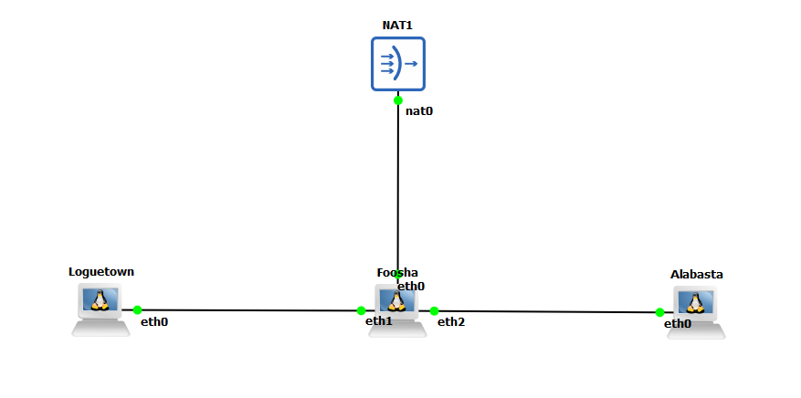

<!-- TODO-SCREENSHOT: topologi Loguetown - Foosha - Alabasta + NAT di GNS3 (netics-pc baru), dengan interface label ditampilkan -->

Kemudian, isi _network configuration_ pada setiap _node_ seperti berikut. Sesuaikan `[Prefix IP]` dengan Prefix IP kalian masing-masing.

- **Foosha** (_router_)

  ```
  auto eth0
  iface eth0 inet dhcp

  auto eth1
  iface eth1 inet static
  	address [Prefix IP].1.1
  	netmask 255.255.255.0

  auto eth2
  iface eth2 inet static
  	address [Prefix IP].2.1
  	netmask 255.255.255.0
  ```

- **Loguetown** (_client_)

  ```
  auto eth0
  iface eth0 inet static
  	address [Prefix IP].1.2
  	netmask 255.255.255.0
  	gateway [Prefix IP].1.1
  ```

- **Alabasta** (_server_)

  ```
  auto eth0
  iface eth0 inet static
  	address [Prefix IP].2.2
  	netmask 255.255.255.0
  	gateway [Prefix IP].2.1
  ```

Setelah semua _node_ dijalankan, aktifkan _IP forwarding_ dan NAT pada **Foosha** agar Loguetown dan Alabasta dapat saling terhubung dan dapat mengakses internet.

```sh
sysctl -w net.ipv4.ip_forward=1
iptables -t nat -A POSTROUTING -o eth0 -j MASQUERADE -s [Prefix IP].0.0/16
cat /etc/resolv.conf
```

Lalu, pada **Loguetown** dan **Alabasta**, isi _nameserver_ dengan IP DNS yang ada pada `/etc/resolv.conf` milik Foosha.

```sh
echo nameserver [IP DNS] > /etc/resolv.conf
```

Paket yang dibutuhkan pada bagian ini adalah `iperf3`, `tcpdump`, `iproute2`, `tshark`, dan `termshark`. Paket-paket ini bisa dicek menggunakan _command_ di bawah untuk melihat apakah sudah tersedia secara bawaan pada _appliance_ netics-pc.

### 1.1 iperf3 (Client dan Server)

`iperf3` merupakan _tool_ yang digunakan untuk mengukur _throughput_ atau kecepatan pengiriman data antara dua _node_. `iperf3` menggunakan arsitektur _client-server_, di mana _server_ akan menunggu koneksi, sedangkan _client_ akan mengirimkan data selama beberapa detik.

```sh
command -v iperf3 tcpdump tc ip tshark termshark
```

#### Menjalankan Server

Jalankan perintah berikut pada Alabasta.

```sh
iperf3 -s
```

#### Menjalankan Client

Jalankan perintah berikut pada Loguetown.

```sh
iperf3 -c 10.40.2.2 -t 5
```

Hasil pada _server_ Alabasta:  


Hasil pada _client_ Loguetown:  


### 1.2 tcpdump

`tcpdump` merupakan _tool_ yang digunakan untuk menangkap dan menampilkan paket yang melewati sebuah _interface_. Karena semua trafik antara Loguetown dan Alabasta melewati Foosha, kita dapat menjalankan `tcpdump` pada Foosha untuk melihat komunikasi kedua _node_ tersebut dengan mengamati proses _three-way handshake_.

1. Pada Alabasta, jalankan _server_ TCP sederhana pada _port_ 9999 menggunakan _command_ `nc` (netcat).

   ```sh
   nc -l -p 9999
   ```

2. Pada Foosha, jalankan `tcpdump` pada _interface_ yang terhubung ke Alabasta.

   ```sh
   tcpdump -i eth2 -nn port 9999
   ```

3. Pada Loguetown, hubungkan ke Alabasta lalu ketikkan sebuah pesan.

   ```sh
   nc 10.40.2.2 9999
   halo dari Loguetown
   ```

4. Pada Alabasta, pesan dari Loguetown akan muncul. Ketikkan balasan `halo dari Alabasta`, lalu tekan `Ctrl+C` untuk menutup koneksi.

Berikut adalah _output_ `tcpdump` pada Foosha.  


#### Opsi dan Filter yang Sering Digunakan

| Opsi | Fungsi |
| --- | --- |
| `-i <iface>` | _Interface_ yang akan ditangkap (`-i any` untuk semua _interface_) |
| `-n` / `-nn` | Tidak mengubah IP menjadi nama _host_ (`-nn` juga tidak mengubah _port_ menjadi nama layanan) |
| `-c <n>` | Berhenti setelah menangkap n paket |
| `-w <file>` | Menyimpan hasil _capture_ ke _file_ `.pcap` |
| `-r <file>` | Membaca _file_ `.pcap` |
| `-s <byte>` | Hanya menyimpan n _byte_ pertama dari setiap paket |
| `-S` | Menampilkan _sequence number_ absolut |
| `-v`, `-vv` | Menampilkan detail yang lebih lengkap |
| `-A` / `-X` | Menampilkan isi paket dalam bentuk ASCII / hex dan ASCII |

Filter dapat dituliskan di akhir perintah dan dapat digabungkan menggunakan `and`, `or`, dan `not`.

```sh
tcpdump -i eth2 -nn host 10.40.2.2
tcpdump -i eth2 -nn tcp port 5201
tcpdump -i eth2 -nn udp
tcpdump -i eth2 -nn icmp
tcpdump -i eth2 -nn 'tcp[tcpflags] & tcp-syn != 0'
tcpdump -i eth2 -nn -c 100 -w /root/iperf.pcap port 5201
```

### 1.3 Network Simulation dengan tc qdisc

Jaringan dapat mengalami _delay_, _bandwidth_ yang terbatas, dan _packet loss_. Untuk mengamati perilaku TCP pada kondisi tersebut, kondisi jaringan dapat disimulasikan dengan `tc` (_traffic control_).

`tc` bekerja dengan memasang _queueing discipline_ (qdisc) pada sebuah _interface_. Qdisc adalah aturan antrean yang dilalui setiap paket sebelum keluar dari _interface_. Dengan qdisc, paket dapat ditunda, dibuang, atau dibatasi kecepatannya.

Pada modul ini, kita akan menggunakan dua jenis qdisc, yaitu:

- **netem** (_network emulator_): untuk menambahkan _delay_, _jitter_, _packet loss_, duplikasi, korupsi, dan pengacakan urutan paket.
- **tbf** (_token bucket filter_): untuk membatasi _bandwidth_.

#### a. Syntax Dasar `tc qdisc`

```
tc qdisc <add|replace|change|del|show> dev <interface> root <jenis qdisc> <parameter>
```

- `dev <interface>`: _interface_ yang akan diatur, misalnya `eth2`.
- `root`: qdisc dipasang sebagai qdisc utama pada _interface_ tersebut.
- `<jenis qdisc>`: jenis qdisc yang digunakan, misalnya `netem` atau `tbf`.

#### b. `tc qdisc add`

`tc qdisc add` digunakan untuk memasang qdisc baru pada sebuah _interface_. Sebelum itu, cek kondisi awal _interface_ terlebih dahulu.

```
foosha:~# tc qdisc show dev eth2
qdisc fq_codel 0: root refcnt 2 limit 10240p flows 1024 quantum 1514 target 5ms interval 100ms memory_limit 32Mb ecn drop_batch 64
```

`fq_codel` di atas adalah qdisc _default_ yang otomatis terpasang meskipun belum pernah di-_add_ secara manual. Sebelum _delay_ dipasang, lakukan dulu `ping` dari Loguetown ke Alabasta sebagai pembanding.

```sh
ping -c 5 10.40.2.2
```

Selanjutnya, pada Foosha, pasang _delay_ sebesar 100 ms menggunakan netem.

```sh
tc qdisc add dev eth2 root netem delay 100ms
```

Ulangi `ping` yang sama dari Loguetown.

```sh
ping -c 5 10.40.2.2
```


Beberapa parameter juga dapat digabungkan dalam satu perintah.

```sh
# Foosha
tc qdisc add dev eth2 root netem delay 50ms 10ms loss 2%
```


Untuk membatasi _bandwidth_, kita juga dapat menggunakan tbf.

```
foosha:~# tc qdisc add dev eth2 root tbf rate 20mbit burst 32kbit latency 400ms
foosha:~# tc qdisc show dev eth2
qdisc tbf 8001: root refcnt 3 rate 20Mbit burst 4Kb lat 400ms
```

- `rate`: batas kecepatan.
- `burst`: jumlah data yang boleh dikirim sekaligus.
- `latency`: waktu maksimal paket boleh menunggu di antrean sebelum dibuang.

Jalankan kembali `iperf3` dari Loguetown seperti pada bagian [1.1](#11-iperf3-client-dan-server). Berikut adalah hasil `iperf3` dari Loguetown setelah _bandwidth_ dibatasi menjadi 20 Mbit/s.

#### c. `tc qdisc replace`

`tc qdisc replace` digunakan untuk mengganti qdisc yang sudah terpasang. Apabila belum ada qdisc yang terpasang, qdisc baru akan dibuat.

```
foosha:~# tc qdisc replace dev eth2 root tbf rate 5mbit burst 32kbit latency 400ms
foosha:~# tc qdisc show dev eth2
qdisc tbf 8001: root refcnt 3 rate 5Mbit burst 4Kb lat 400ms
```

Selain `replace`, terdapat juga `tc qdisc change` yang digunakan untuk mengubah parameter qdisc yang sudah terpasang, misalnya dari `delay 100ms` menjadi `delay 200ms`. Perintah `change` akan gagal apabila belum ada qdisc yang terpasang. Untuk mengganti jenis qdisc dari tbf ke netem, dapat digunakan `replace`.

#### d. `tc qdisc del`

`tc qdisc del` digunakan untuk menghapus qdisc pada sebuah _interface_.

```
foosha:~# tc qdisc del dev eth2 root
foosha:~# tc qdisc show dev eth2
qdisc fq_codel 0: root refcnt 2 limit 10240p flows 1024 quantum 1514 target 5ms interval 100ms memory_limit 32Mb ecn drop_batch 64
```

Setelah qdisc dihapus, _interface_ akan kembali ke qdisc _default_-nya (`fq_codel`), bukan menjadi tanpa qdisc sama sekali.

#### e. `tc qdisc show`

`tc qdisc show` digunakan untuk melihat qdisc yang terpasang.

```sh
tc qdisc show
tc qdisc show dev eth2
tc -s qdisc show dev eth2
```

### 1.4 TCP Metrics dan Algoritma Congestion Control

Terdapat dua pengaturan _kernel_ Linux yang perlu diperhatikan, yaitu TCP metrics dan algoritma _congestion control_.

#### `ip tcp_metrics` dan `tcp_no_metrics_save`

Setiap kali koneksi TCP ditutup, Linux akan menyimpan beberapa informasi mengenai _host_ tujuan, seperti RTT, `cwnd`, dan `ssthresh`. Informasi ini akan digunakan sebagai nilai awal saat membuat koneksi baru ke _host_ yang sama. Fitur ini berguna untuk mempercepat koneksi, namun dapat memengaruhi hasil percobaan karena hasil pengujian kedua akan dipengaruhi oleh pengujian pertama.

Informasi yang tersimpan dapat dilihat menggunakan perintah berikut pada Loguetown.

```
loguetown:~# ip tcp_metrics show
10.40.2.2 age 0.004sec cwnd 1155 reordering 300 rtt 16443us rttvar 29586us source 10.40.1.2
```

Untuk menghapus semua informasi yang tersimpan, gunakan perintah berikut.

```
loguetown:~# ip tcp_metrics flush
loguetown:~# ip tcp_metrics show
loguetown:~#
```

Kemudian, nonaktifkan penyimpanan TCP metrics agar informasi tersebut tidak tersimpan kembali.

```
loguetown:~# sysctl -w net.ipv4.tcp_no_metrics_save=1
net.ipv4.tcp_no_metrics_save = 1
```

Setelah pengaturan di atas diterapkan, `ip tcp_metrics show` akan tetap kosong meskipun `iperf3` dijalankan kembali.

| Perintah | Fungsi |
| --- | --- |
| `ip tcp_metrics show` | Menampilkan TCP metrics yang tersimpan |
| `ip tcp_metrics flush` | Menghapus semua TCP metrics yang tersimpan |
| `ip tcp_metrics delete <IP>` | Menghapus TCP metrics untuk IP tertentu |
| `sysctl -w net.ipv4.tcp_no_metrics_save=1` | Menonaktifkan penyimpanan TCP metrics (`0` untuk mengaktifkan kembali) |

> Lakukan `flush` dan atur `tcp_no_metrics_save=1` pada _client_ dan _server_ sebelum melakukan percobaan.

#### `sysctl net.ipv4.tcp_congestion_control`

Algoritma _congestion control_ yang digunakan dapat dilihat dan diganti menggunakan `sysctl`.

```
loguetown:~# sysctl net.ipv4.tcp_available_congestion_control
net.ipv4.tcp_available_congestion_control = reno bbr cubic
loguetown:~# sysctl net.ipv4.tcp_congestion_control
net.ipv4.tcp_congestion_control = cubic
loguetown:~# sysctl -w net.ipv4.tcp_congestion_control=reno
net.ipv4.tcp_congestion_control = reno
loguetown:~# sysctl -w net.ipv4.tcp_congestion_control=cubic
net.ipv4.tcp_congestion_control = cubic
```

- `tcp_available_congestion_control` menampilkan algoritma yang tersedia pada _kernel_.
- `tcp_congestion_control` menampilkan algoritma yang sedang digunakan.

Algoritma _congestion control_ berjalan pada sisi pengirim. Pada pengujian `iperf3` biasa, pengirim data adalah Loguetown, sehingga algoritma yang perlu diganti adalah algoritma pada Loguetown. Selain menggunakan `sysctl`, kalian juga dapat menggunakan opsi `iperf3 -C reno` untuk satu kali pengujian.

> Algoritma yang tersedia bergantung pada _kernel_ GNS3 VM, karena semua _node_ netics-pc menggunakan _kernel_ yang sama. Apabila muncul pesan `sysctl: setting key "net.ipv4.tcp_congestion_control": Operation not permitted`, berarti algoritma tersebut tidak termasuk dalam `net.ipv4.tcp_allowed_congestion_control` pada _kernel host_.

### 1.5 Wireshark dan termshark

#### Capture Langsung dari Link GNS3

GNS3 dapat menangkap paket pada sebuah _link_ dan langsung membukanya pada Wireshark di komputer kalian. Pastikan Wireshark sudah ter-_install_ pada komputer kalian.

1. Klik kanan pada _link_ antara Foosha dan Alabasta.
2. Pilih _Start capture_, lalu pilih sisi _link_ yang ingin ditangkap.
3. Wireshark akan terbuka dan menampilkan paket yang sedang di-_capture_.
4. Untuk menghentikan _capture_, klik kanan pada _link_ tersebut, lalu pilih _Stop capture_.


Untuk tutorial lengkapnya bisa dilihat pada video berikut: [dokumentasi packet capture wireshark](/Modul-3/images/12-capture-ws.mp4)

[](https://github.com/user-attachments/assets/c377eba0-dfaf-4f8e-9987-69c3b0997a50)

Referensi : 
- [Wireshark Download](https://www.wireshark.org/download.html)
- [Wireshark + GNS3 Integration](https://gns3.com/step-by-step-setup-wireshark-gns3-integration)

#### termshark

**termshark** merupakan aplikasi dengan tampilan mirip Wireshark yang berjalan pada terminal. termshark membutuhkan `tshark`, yaitu Wireshark versi _command line_ yang sudah kita _install_ pada Loguetown.

```sh
# capture packets
termshark -i eth0

# membuka file hasil tcpdump
tcpdump -i eth0 -nn -w /root/iperf.pcap port 5201
termshark -r /root/iperf.pcap
```

Tampilan termshark terdiri dari tiga bagian, yaitu daftar paket, detail paket, dan isi paket dalam bentuk hex. Beberapa tombol dasar pada termshark adalah sebagai berikut.

| Tombol | Fungsi |
| --- | --- |
| Kolom filter di bagian atas + `Enter` | Menerapkan _display filter_ |
| `Tab` / tombol panah | Berpindah bagian dan memilih paket |
| `?` | Menampilkan bantuan |
| `q` | Keluar |

#### Display Filter

_Display filter_ pada Wireshark dan termshark menggunakan format yang sama. Berikut adalah beberapa _display filter_ yang dapat digunakan pada modul ini.

| Filter | Keterangan |
| --- | --- |
| `ip.addr == 10.40.2.2` | Paket dari atau ke 10.40.2.2 |
| `tcp.port == 5201` | Trafik iperf3 |
| `udp` | Paket UDP |
| `tcp.flags.syn == 1` | Paket SYN dan SYN-ACK |
| `tcp.flags.fin == 1` | Paket FIN |
| `tcp.analysis.retransmission` | _Segment_ yang dikirim ulang |
| `tcp.analysis.fast_retransmission` | _Retransmission_ yang terjadi karena _duplicate_ ACK |
| `tcp.analysis.duplicate_ack` | _Duplicate ACK_ |
| `tcp.analysis.flags` | Semua anomali TCP |

#### Contoh Analisis Retransmission dan Duplicate ACK

## 2. Static Routing

Setelah kita memahami bagaimana cara jaringan komputer di dunia bekerja pada umumnya, perangkat-perangkat yang digunakan untuk mendukung terjadinya komunikasi di internet, protokol yang dipatuhi, dan lain-lainnya, maka kita akan masuk ke dalam konsep yang tak kalah penting dan akan sering kita temui, yaitu **Routing**.

### 2.1 OSI Model dan TCP/IP Model

Pada Modul 2, kita sudah mempelajari bahwa komunikasi jaringan dibagi menjadi beberapa _layer_. Ada 2 model yang umum digunakan, yaitu OSI Model yang terdiri dari 7 lapisan dan TCP/IP Model yang terdiri dari 4 lapisan. Pada TCP/IP Model, _Layer_ 5 sampai _Layer_ 7 digabung menjadi _Application Layer_, sedangkan _Layer_ 1 dan _Layer_ 2 digabung menjadi _Network Access Layer_.


Materi pada modul ini berkaitan dengan dua lapisan berikut.

| Layer | Materi |
| --- | --- |
| _Transport Layer_ (Layer 4) | TCP dan UDP, _port_, _three-way handshake_, dan _congestion control_ |
| _Network Layer_ (Layer 3) | IP Address dan _routing_ |

_Router_ bekerja pada _Layer_ 3 dan akan membaca IP tujuan pada sebuah paket, lalu menentukan ke mana paket tersebut harus diteruskan.

### 2.2 Pengertian

Jika IP Address bisa kita ibaratkan sebuah alamat rumah, maka sekarang mari kita bayangkan kita sedang berada di suatu perumahan, katakanlah perumahan A. Di perumahan ini, penduduknya mengikuti aturan alamat rumah yang sama, yaitu huruf A diikuti oleh angka. Misal, tetanggamu yang bernama Bapak Hassan memiliki alamat rumah A-17, Ibu Rumrowi memiliki alamat rumah A-32, dan seterusnya. Sebagai penduduk setempat, kamu kenal dengan mereka dan tahu bagaimana cara mengunjungi rumah mereka tanpa bantuan orang lain.

Suatu hari, kamu diberi tugas untuk mengirimkan makanan ke alamat rumah B-03. Namun, kamu tidak kenal alamat ini karena tidak diawali oleh huruf A seperti biasanya. Maka dari itu, kamu menghubungi kantor pos perumahan dengan alamat A-01 (yang mana kamu tahu letaknya) dan meminta bantuan mereka untuk mengirimkan makanan tersebut. Sebagai kantor pos, mereka memiliki data alamat di seluruh kota, sehingga mereka tahu di mana letak rumah B-01 ini dan ke mana harus memberikan makanan tersebut. Jadi, kamu cukup pergi ke A-01 dan menyerahkan makanan tersebut yang memiliki tujuan B-01. Sisanya akan diurus oleh kantor pos.

Konsep _routing_ kurang lebih sama seperti ilustrasi di atas. Pada hakikatnya, _routing_ merupakan suatu proses yang menentukan jalur terbaik untuk mengirimkan suatu paket/data dari satu jaringan ke jaringan lainnya. Umumnya, hal ini dilakukan oleh _Router_, di mana mereka bertanggung jawab untuk meneruskan paket dari satu segmen jaringan ke segmen lainnya. _Router_ melakukan proses penentuan jalur ini berdasarkan data yang mereka punya, yaitu _Routing Table_ yang berisikan informasi mengenai cara untuk bisa menuju suatu segmen jaringan, sekalipun itu terlihat jauh.

Bila mengacu pada ilustrasi di atas, kamu dan seluruh tetanggamu bisa dianggap sebagai _host_ dan perumahanmu dianggap sebagai suatu _subnet_ (kita akan mendalami ini di Modul 4). Kemudian, kantor pos bisa dianggap sebagai _Router_ dan data alamat di seluruh kota yang mereka miliki bisa dianggap sebagai _Routing Table_.

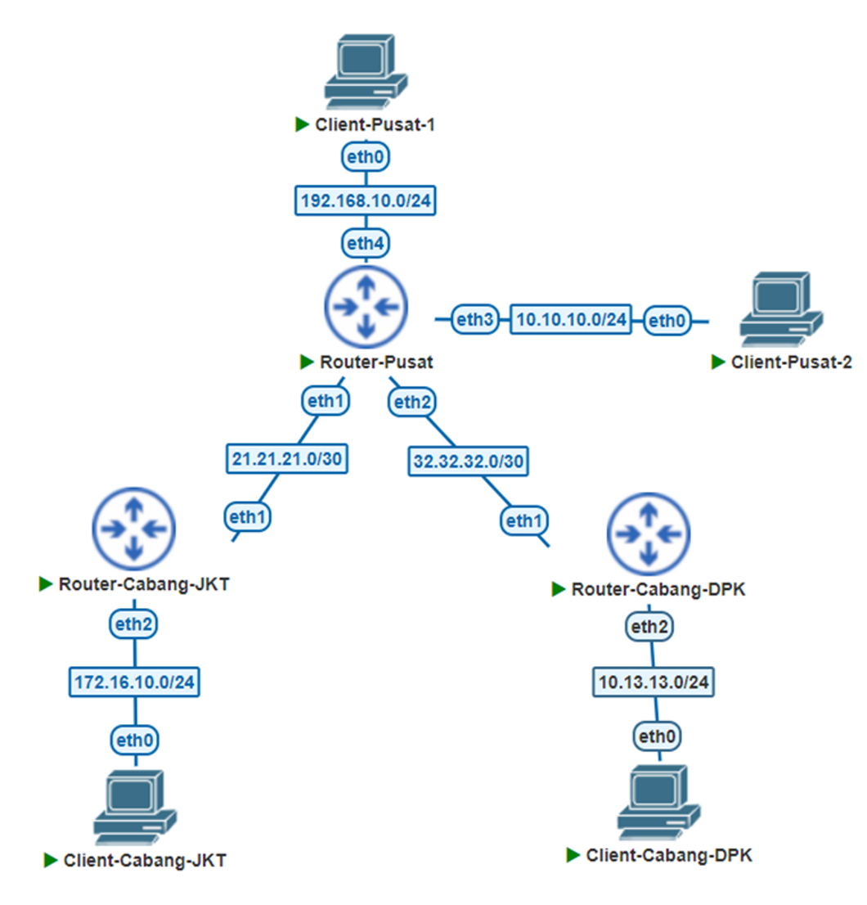

Berdasarkan bagaimana cara _Router_ memperoleh informasi terkait _Routing Table_-nya, _Routing_ bisa dibagi menjadi 2 kategori, yaitu **Static Routing** dan **Dynamic Routing**. Untuk Dynamic Routing akan dibahas secara sekilas pada Modul 4, sedangkan Static Routing akan kita pelajari pada modul ini.

Pada Static Routing, seorang (atau tim) _network administrator_ bertanggung jawab untuk mengisi _Routing Table_ pada setiap _Router_. Jika menggunakan analogi kantor pos, pemerintah bertanggung jawab untuk memberi tahu seluruh kantor pos yang ada mengenai kantor pos lainnya dan bagaimana cara suatu kantor pos menghubungi kantor pos lain ataupun perumahan lain. Hal ini cukup sederhana apabila dilakukan pada suatu jaringan dengan jumlah _Router_ dan segmen jaringan yang sedikit, namun akan bertambah sulit dan melelahkan seiring bertambahnya jumlah dan kompleksitas jaringan. Tak hanya itu, apabila ada segmen jaringan baru, seluruh _Router_ harus diberi tahu mengenai hal ini yang tentunya sangat tidak efisien dan akan menghabiskan banyak waktu.

Namun, karena kita akan menggunakan topologi sederhana yang tidak banyak berubah dengan segmen jaringan yang sedikit, maka Static Routing dapat mempermudah kita karena kita akan memiliki kontrol penuh terhadap topologi kita. Selanjutnya, kita akan mencoba melakukannya di dalam GNS3.

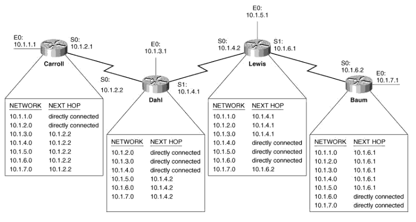

### 2.3 Implementasi

Tentu saja kita akan dapat lebih mudah memahaminya dengan langsung melakukan implementasi. Untuk itu, kita akan menggunakan topologi seperti berikut:

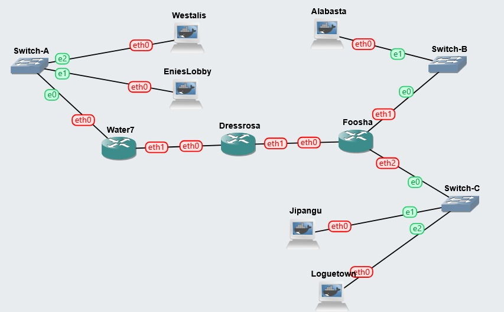

Kemudian, pembagian IP Address untuk kasus ini adalah sebagai berikut:

```
# Kompleks A: 10.40.1.X
eth0 Water7: 10.40.1.1
EniesLobby: 10.40.1.2
Westalis: 10.40.1.3

# Kompleks Jalanan Kiri: 10.40.2.X
eth1 Water7: 10.40.2.1
eth0 Dressrosa: 10.40.2.2

# Kompleks Jalanan Kanan: 10.40.3.X
eth1 Dressrosa: 10.40.3.1
eth0 Foosha: 10.40.3.2

# Kompleks B: 10.40.4.X
eth1 Foosha: 10.40.4.1
Alabasta: 10.40.4.2

# Kompleks C: 10.40.5.X
eth2 Foosha: 10.40.5.1
Jipangu: 10.40.5.2
Loguetown: 10.40.5.3
```

Untuk kasus ini, set semua _netmask_ menjadi `255.255.255.0` dahulu (penjelasan lebih lanjut ada di Modul 4). Kemudian, untuk semua _host_ (semua _node_ kecuali Water7, Dressrosa, dan Foosha), set _gateway_-nya menjadi IP Address _Router_ yang terhubung. Misal, EniesLobby dan Water7 terhubung pada eth0 Water7, maka _gateway_ untuk mereka berdua adalah `10.40.1.1`. Lalu, set _gateway_ untuk _router_ sebagai berikut:

```
# kosongi gateway untuk interface eth0 Water7 dan interface eth1 & eth2 Foosha
eth1 Water7: 10.40.2.2
eth0 Foosha: 10.40.3.1
# kosongi juga gateway Dressrosa untuk semua interface
```

#### 2.3.1 Sebelum Routing

Apabila sudah selesai melakukan konfigurasi, lakukan tes konektivitas dengan melakukan _ping_ antar-_node_ di dalam segmen jaringan (kompleks) yang sama. Misal, pastikan **Westalis** bisa melakukan _ping_ ke **EniesLobby** dan **Water7**, **Dressrosa** bisa melakukan _ping_ ke **Foosha**, dan lain-lain.

> Kiat: Tidak perlu masuk ke seluruh _node_. Cukup masuk ke **Water7** dan **Foosha** dan _ping_ semua perangkat yang terhubung dengannya, karena pada umumnya _ping_ bersifat simetris (apabila _host_ A bisa melakukan _ping_ ke _host_ B, berlaku pula sebaliknya) kecuali ada konfigurasi tambahan seperti _Firewall_ atau NAT.

Sekarang, silakan kalian coba melakukan _ping_ antar-kompleks dengan jarak yang cukup jauh. Contohnya **Dressrosa** (`10.40.3.1`) ke **Alabasta** (`10.40.4.2`). Seharusnya, kalian akan mendapatkan _output_ seperti berikut.

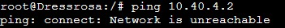

atau

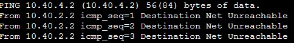

Kalian mungkin tidak mendapat _output_ sama persis seperti di atas (bahkan _hang_ ketika melakukan _ping_). Namun, pada hakikatnya hasilnya adalah sama, yaitu tidak bisa melakukan _ping_.

> Jika melakukan _ping_ antar-kompleks yang masih berdekatan dan terhubung ke _router_ yang sama (misalnya kompleks B dan kompleks C), ada kemungkinan komunikasi _ping_ masih tetap dapat dilakukan.

Maka dari itu, kita akan memberi tahu _router_ bagaimana cara mencapai kompleks lain.

#### 2.3.2 Proses Routing

Cara yang pertama cukup sederhana, yaitu hanya memberi tahu **Dressrosa** tentang bagaimana cara mencapai semua segmen jaringan. Untuk itu, kita akan menggunakan perintah berikut:

```
ip route add <SUBNET TUJUAN>/<NETMASK> via <GATEWAY>
```

Penjelasan:

- **SUBNET TUJUAN** berisi NID atau segmen jaringan yang akan dituju. Di kasus kita, 3 oktet pertama berisi IP kompleks dan oktet terakhir berisi `0`. Penjelasan lebih detail akan kita telusuri di Modul 4.
- **NETMASK** untuk kasus kita akan diisi `24` saja.
- **GATEWAY** berisi IP Address dari _router_ untuk menuju ke segmen jaringan tersebut.

Misal:

```
ip route add 10.40.5.0/24 via 10.40.3.2
```

Ketika kita menjalankan perintah di atas pada **Dressrosa**, kita seolah-olah memberi tahu dia bahwa, "Halo Dressrosa, kalau ada paket dengan IP Address tujuan di kompleks C (`10.40.5.X`), maka cara meraihnya adalah dengan melewati `10.40.3.2` (yaitu **Foosha**)".

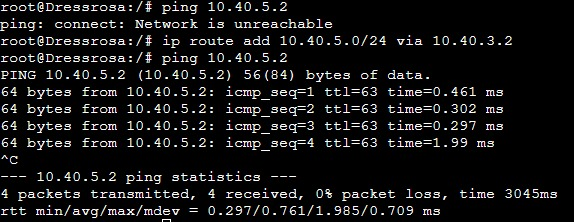

Sebelum menjalankan perintah di atas, Dressrosa belum tahu cara mencapai kompleks C (`10.40.5.X`). Maka dari itu, dia mengatakan bahwa jaringan tersebut tidak dapat diraih (`Network is unreachable`). Setelah kita beri tahu, maka sekarang dia memiliki informasi cara menuju segmen jaringan tersebut. Sehingga, dia dan perangkat luar yang terhubung secara langsung dengan dia (dalam kasus ini, **Water7**) bisa menghubungi alamat yang berada di segmen jaringan tersebut.

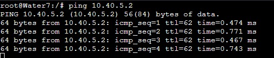

Namun, kompleks A masih belum bisa melakukan _ping_ kepada kompleks C. Walaupun paket yang dikirimkan dari kompleks A (`10.40.1.X`) bisa sampai pada kompleks C (`10.40.5.X`) karena semua _router_ sudah tahu jalannya, mereka masih belum tahu cara meraih kompleks A untuk balasannya. Maka dari itu, kita perlu memberi tahu **Dressrosa** lagi mengenai cara meraih kompleks A dengan menjalankan perintah berikut:

```
ip route add 10.40.1.0/24 via 10.40.2.1
```

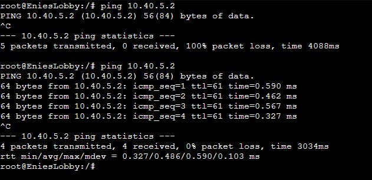

Seperti pada gambar, awalnya **EniesLobby** sebagai penduduk kompleks A tidak dapat menghubungi kompleks C. Setelah kita jalankan perintah di atas pada **Dressrosa**, EniesLobby dapat melakukan _ping_ ke kompleks C.

> Lakukan hal yang sama untuk kompleks B. Apakah kalian tahu _command_ yang digunakan dan di _node_ apa?

#### 2.3.3 Setelah Routing

Mungkin sembari melakukan implementasi, ada beberapa pertanyaan yang muncul di benak kalian, seperti:

- _Mengapa hanya **Dressrosa** yang dikonfigurasi, sedangkan ada 3 router?_
- _Apakah berarti **Water7** dan **Foosha** tahu cara meraih semua kompleks yang ada? Bagaimana bisa?_
- _Apa yang akan terjadi apabila ada kompleks baru yang ditambahkan, seperti mungkin kompleks D di `10.40.6.X`?_

Potongan _puzzle_ terakhir yang membuat ini semua terjadi dan bisa menjawab kalian adalah **Default Gateway**.

Sederhananya, Default Gateway bisa diibaratkan sebagai orang yang kalian tanya (jika mengikuti ilustrasi awal, maka diibaratkan kantor pos perumahan) ketika tidak tahu arah. Ketika ada paket dengan tujuan yang asing, alih-alih menyerah dan membuangnya, kita cukup kirimkan paket tersebut ke Default Gateway. Hal inilah yang terjadi pada implementasi di atas dan mengapa hanya **Dressrosa** yang dikonfigurasi.

**Studi Kasus: Ping dari EniesLobby ke Jipangu**

Jalankan _command_ di bawah ini di **EniesLobby**:

```
mtr 10.40.5.2
```

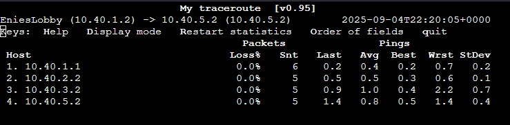

Melalui `mtr`, kita bisa mengetahui paket yang kita kirimkan melalui _node_ mana saja. Perintah ini mirip seperti `traceroute`. Untuk kasus ini, kita ingin mencari tahu jalur mana yang ditempuh paket dari **EniesLobby** (`10.40.1.3`) ke **Jipangu** (`10.40.5.2`). Penjelasan alur rute yaitu sebagai berikut:

1. Pertama, karena IP Address tujuan (yaitu `10.40.5.2`) tidak berada pada segmen jaringan yang sama, **EniesLobby** tidak tahu bagaimana cara mengirimkannya. Namun karena dia memiliki Default Gateway yaitu **Water7**, maka dia cukup mengirimkan paket tersebut ke sana (yaitu `10.40.1.1`).
2. Hal yang sama dialami oleh **Water7**. Dia sebenarnya juga tidak tahu bagaimana cara mengirimkan paket ini, namun karena dia juga memiliki Default Gateway yaitu **Dressrosa**, maka dia akan mengirimkannya ke sana (yaitu `10.40.2.2`).
3. Tidak seperti EniesLobby dan Water7, **Dressrosa** tahu bagaimana cara meraih segmen jaringan dari tujuan paket ini. Menurut data yang dia punya (atau _Routing Table_-nya), untuk meraih paket tersebut dia harus mengirimkannya ke **Foosha**, yaitu `10.40.3.2`.
4. Terakhir, karena **Foosha** terhubung secara langsung dengan **Jipangu**, maka paket bisa langsung dikirimkan ke tujuan, yaitu `10.40.5.2`.

> Seandainya **Water7** dan **Foosha** tidak memiliki Default Gateway, maka kita harus menjalankan perintah `ip route add` untuk mengisi _Routing Table_ mereka seperti apa yang kita lakukan pada **Dressrosa**.

#### 2.3.4 Routing Table

Alangkah baiknya apabila kita tutup dengan penjelasan singkat mengenai komponen terakhir pada perjalanan kita, yaitu **Routing Table**.

Routing Table adalah suatu struktur data yang menyimpan informasi mengenai cara meraih suatu segmen jaringan. Biasanya, di dalam suatu Routing Table terdapat informasi mengenai segmen jaringan tujuan, _next hop_ atau _gateway_-nya, _network interface_ yang digunakan, dan informasi tambahan.

Mari kita lihat Routing Table pada **Dressrosa** dengan:

```
ip route show
```

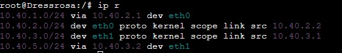

- `10.40.1.0/24 via 10.40.2.1 dev eth0`: Untuk meraih segmen jaringan `10.40.1.0/24`, maka kirim paket ke `10.40.2.1` melalui _interface_ `eth0`.
- `10.40.2.0/24 dev eth0 proto kernel scope link src 10.40.2.2`: Segmen jaringan `10.40.2.0/24` terhubung secara langsung melalui _interface_ `eth0`. IP milik **Dressrosa** sendiri pada hubungan ini adalah `10.40.2.2`.

> Bisakah kalian menerjemahkan sisanya?

### 2.4 Troubleshooting

Apabila kalian sudah melakukan konfigurasi pada _router_ namun masih belum bisa melakukan _ping_, ada kemungkinan _router_ kalian tidak mau meneruskan paket (_packet forwarding_ dinonaktifkan).

Untuk mengeceknya, bisa menjalankan:

```
cat /proc/sys/net/ipv4/ip_forward
```

`1` berarti _packet forwarding_ aktif dan `0` berarti nonaktif. Untuk mengaktifkannya, bisa menjalankan:

```
sysctl -w net.ipv4.ip_forward=1
```

atau dengan memastikan `net.ipv4.ip_forward=1` ada (biasanya di-_comment_) di dalam `/etc/sysctl.conf`. Restart dengan:

```
sysctl -p
```

### 2.5 Referensi

- https://www.geeksforgeeks.org/computer-networks/open-systems-interconnection-model-osi/
- https://www.tutorialspoint.com/data_communication_computer_network/computer_network_models.htm
- https://www.geeksforgeeks.org/computer-networks/computer-network-models/
- https://www.lifewire.com/layers-of-the-osi-model-illustrated-818017
- https://www.avg.com/en/signal/tcp-vs-udp

1. [Web Server](Web%20server/README.md)
2. [DNS (Domain Name System)](DNS/README.md)
3. [Reverse Proxy](Reverse%20Proxy/README.md)
