# Module 4 Computer Networks

## Table of Contents

- [0. MikroTik-CHR Installation on GNS3](#0-mikrotik-chr-installation-on-gns3)
  - [0.1 Introduction to MikroTik CHR RouterOS](#01-introduction-to-mikrotik-chr-routeros)
    - [0.1.1 RouterOS](#011-routeros)
    - [0.1.2 MikroTik-CHR](#012-mikrotik-chr)
    - [0.1.3 MikroTik Routerboard](#013-mikrotik-routerboard)
  - [0.2 Installation on Windows (GNS3 VM)](#02-installation-on-windows-gns3-vm)
  - [0.3 Installation on MacOS (GNS3 VM + GNS3 Web UI)](#03-installation-on-macos-gns3-vm--gns3-web-ui)
  - [0.4 Creating a Simple Topology](#04-creating-a-simple-topology)
  - [0.5 Saving Configuration on MikroTik-CHR](#05-saving-configuration-on-mikrotik-chr)
    - [0.5.1 Export to Binary File](#051-export-to-binary-file)
    - [0.5.2 Export to Raw Text or Readable File](#052-export-to-raw-text-or-readable-file)
    - [0.5.3 How to Export Configuration Outside GNS3 Using WinBox](#053-how-to-export-configuration-outside-gns3-using-winbox)
    - [0.5.4 How to Export Configuration Outside GNS3 Using SFTP](#054-how-to-export-configuration-outside-gns3-using-sftp)
- [1. Subnetting](#1-subnetting)
  - [1.1 Introduction to Subnetting](#11-introduction-to-subnetting)
  - [1.2 Getting to Know IP Address](#12-getting-to-know-ip-address)
    - [1.2.1 What Can Be Known?](#121-what-can-be-known)
    - [1.2.2 IPv4](#122-ipv4)
    - [1.2.3 Netmask and Prefix](#123-netmask-and-prefix)
    - [1.2.4 Network ID, Broadcast Address, and Available Hosts](#124-network-id-broadcast-address-and-available-hosts)
    - [1.2.5 Public IP and Private IP](#125-public-ip-and-private-ip)
  - [1.3 Subnet Calculation](#13-subnet-calculation)
    - [1.3.1 Classful](#131-classful)
    - [1.3.2 Classless / CIDR](#132-classless--cidr)
    - [1.3.3 Subnet Calculator](#133-subnet-calculator)
  - [1.4 Supernetting](#14-supernetting)
  - [1.5 Implementation](#15-implementation)
- [2. Static Routing (Continued)](#2-static-routing-continued)
  - [2.1 Multi-hop Routing](#21-multi-hop-routing)
  - [2.2 Route Summarization and Longest Prefix Match](#22-route-summarization-and-longest-prefix-match)
    - [2.2.1 Route Summarization](#221-route-summarization)
    - [2.2.2 Longest Prefix Match](#222-longest-prefix-match)
  - [2.3 Routing Loop and TTL](#23-routing-loop-and-ttl)
    - [2.3.1 Routing Loop](#231-routing-loop)
    - [2.3.2 TTL and Traceroute](#232-ttl-and-traceroute)
  - [2.4 Implementation](#24-implementation)
- [3. Dynamic Routing](#3-dynamic-routing)
  - [3.1 Introduction to Dynamic Routing](#31-introduction-to-dynamic-routing)
  - [3.2 Routing Protocol Classification](#32-routing-protocol-classification)
    - [3.2.1 Based on Algorithm](#321-based-on-algorithm)
    - [3.2.2 Based on Region](#322-based-on-region)
  - [3.3 Dynamic Routing Protocols](#33-dynamic-routing-protocols)
    - [3.3.1 RIP](#331-rip)
    - [3.3.2 OSPF](#332-ospf)
  - [3.4 Redundancy and Failover](#34-redundancy-and-failover)
  - [3.5 Routing Convergence](#35-routing-convergence)
  - [3.6 Implementation](#36-implementation)

## 0. MikroTik-CHR Installation on GNS3

### 0.1 Introduction to MikroTik CHR RouterOS

#### 0.1.1 RouterOS

**RouterOS** is a Linux-based operating system developed by **MikroTik**, a company from Latvia operating in the field of networking devices.
RouterOS is specifically designed to turn a computer or hardware device into a router, switch, firewall, bandwidth manager, up to a reliable wireless access point.
RouterOS provides advanced network features such as:

- Routing (static, dynamic (OSPF, BGP, RIP))
- Firewall and NAT
- VPN (PPTP, L2TP, SSTP, OpenVPN, WireGuard)
- Bandwidth management (Queue, Simple Queue, Queue Tree)
- Hotspot and User Manager
- Wireless networking
- VLAN and bridging

RouterOS is usually run on physical hardware made by MikroTik called a **RouterBoard**.
However, MikroTik also provides a special version that can be run virtually, namely **Cloud Hosted Router (CHR)**.

[MikroTik RouterOS](https://mikrotik.com/software)

#### 0.1.2 MikroTik-CHR

**MikroTik CHR (Cloud Hosted Router)** is a special version of RouterOS for installation on virtualization or cloud platforms such as:

- VMware
- VirtualBox
- Hyper-V
- KVM/QEMU
- **GNS3** (Graphical Network Simulator-3)
- Proxmox
- Cloud services such as AWS, Google Cloud, Azure, DigitalOcean

CHR comes in the form of a virtual image (`.vmdk`, `.vhdx`, `.ova`, `.img`, `.qcow2`, and other formats) so that it does not require physical RouterBoard hardware to run it.
For GNS3, MikroTik-CHR can be installed directly using a `.gns3a` file for GNS3 users on the Windows or Linux platform, while for MacOS or machines with `arm` architecture there are extra steps needed to run MikroTik-CHR in a GNS3 VM.

[MikroTik CHR](https://mikrotik.com/download/chr)

MikroTik here will replace the role of `netics-pc`, which previously ran static routing conventionally using the built-in `iproute2` package. It will be used in Module 4 and the Final Module (5)

#### 0.1.3 MikroTik Routerboard

<MikroTik routerboard image>

### 0.2 Installation on Windows (GNS3 VM)

[Download the mikrotik .gns3a file](https://drive.google.com/file/d/1kqDN8RMiHSxHr3uo3VvenUwJfmkuQgV-/view?usp=drive_link)
<br>
[Download the mikrotik .img file](https://drive.google.com/file/d/1uztXyqvXNClr8QMizV5MJVc8uw3jUax3/view?usp=drive_link)

1. Download both files above and make sure both are in the same directory

2. Select the menu **File → New Template**.

   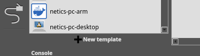

2. Select the option **Import an appliance file**, then select the file **mikrotik-chr-7.24.6.gns3a** that was downloaded previously.

   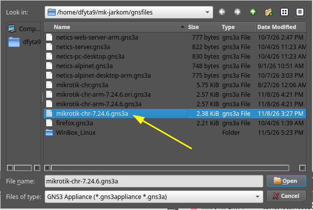

3. Select the option **Install appliance on a remote server**.

    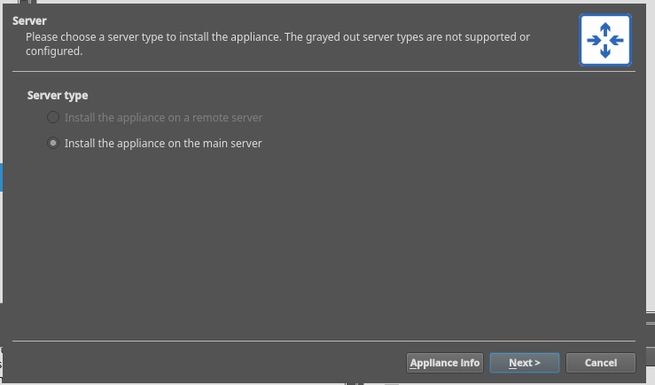

   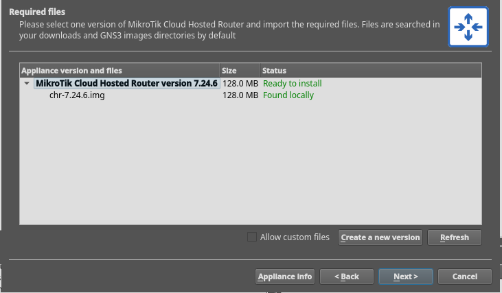
   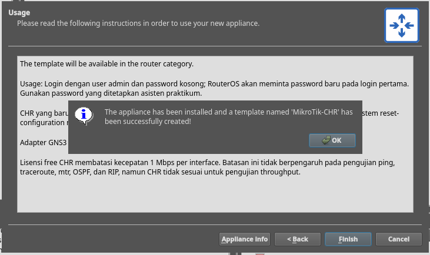

4. Make sure you have opened a new or existing project, then drag and drop the newly installed appliance into GNS
   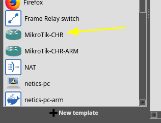
   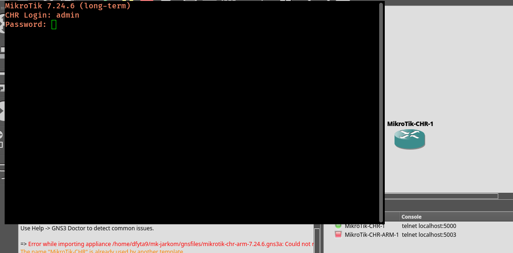

5. To log in to RouterOS, for those using Windows/Linux, the Username is `admin` and the password is left blank (press enter when prompted for a password)
   
   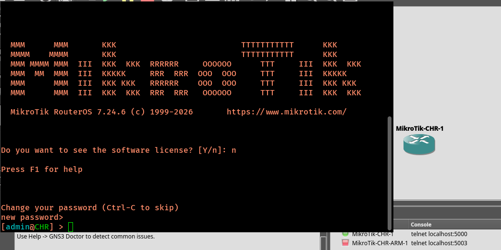

6. To shut down the MikroTik node, the recommended command is to run `/system shutdown` in the RouterOS terminal and press the `y` key
   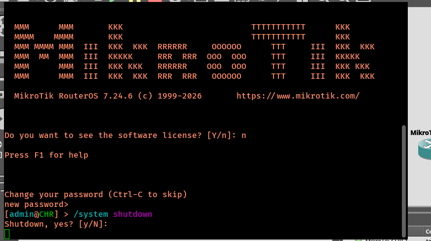

### 0.3 Installation on MacOS (GNS3 VM + GNS3 Web UI)

[Download the mikrotik arm .qcow2 file](https://drive.google.com/file/d/1LWXCE8xQ3Tj17AtX6222ADaNYxU2IJAs/view?usp=sharing)
<br>

1. Download both files above and make sure both are in the same directory

2. Then copy the .qcow2 file into the GNS3 VM using `scp` with the following steps (using a terminal, and make sure the VM is already on):

- Open a terminal on mac, and type the following command, adjusting the qcow2 file path that was downloaded previously
```
scp [QCOW2 FILE PATH] gns3@[YOUR GNS3 IP]:/opt/gns3/images/QEMU/
```

- Then open a shell inside the GNS3 VM and run the command below
```
sudo chown gns3:gns3 /opt/gns3/images/QEMU/chr-7.24.6-arm64-clean.qcow2
```

3. Then you can follow the video tutorial below to set up MikroTik CHR

[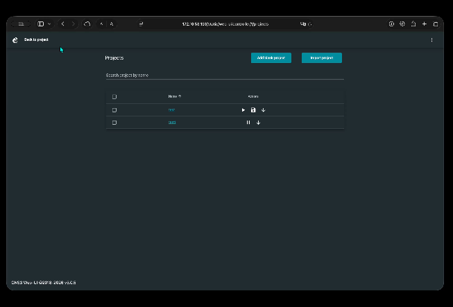](https://drive.google.com/file/d/1PnNqDhqVFj3J7xPkYc-8gqH53oGwuEJ8/view?usp=sharing)

- Fill in the option field during installation
```
-machine virt,accel=tcg -cpu cortex-a72 -bios /usr/share/qemu-efi-aarch64/QEMU_EFI.fd  -boot order=c   -display none   -serial stdio   -monitor none
```

### 0.4 Creating a Simple Topology

1. Create a topology like the image below, with the node named `Kazdel` using the `MikroTik-CHR` that was installed previously, while the others besides `Kazdel` still use the `netics-pc` appliance.

   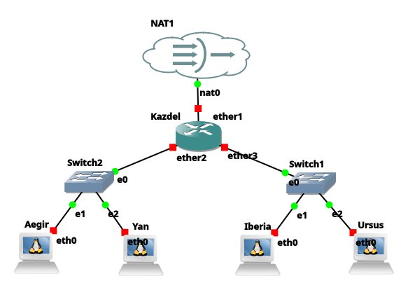

2. Use the change hostname feature to rename the nodes.

3. Then set up the network on the client nodes first (Aegir, Yan, Iberia and Ursus), which can be done using the `edit config` feature by right-clicking the node and changing the default network configuration

   - Aegir
     ```
        auto eth0
        iface eth0 inet static
            address 10.254.1.2
            netmask 255.255.255.0
            gateway 10.254.1.1
     ```

   - Yan
     ```
        auto eth0
        iface eth0 inet static
            address 10.254.1.3
            netmask 255.255.255.0
            gateway 10.254.1.1
     ```

   - Iberia
     ```
        auto eth0
        iface eth0 inet static
            address 10.254.2.2
            netmask 255.255.255.0
            gateway 10.254.2.1
     ```

   - Ursus
     ```
        auto eth0
        iface eth0 inet static
            address 10.254.2.3
            netmask 255.255.255.0
            gateway 10.254.2.1
     ```

4. Restart or run all nodes including the Router that has not been configured yet, because the router configuration will be done through the RouterOS terminal belonging to MikroTik.

5. On `Kazdel`, enter the console, and use the username `admin` with a blank password (press enter), **Note: for those using the ARM/MAC image, the password is `admin`**

   If asked to change the password, just press Enter or Ctrl+C so that the password does not change and stays default
   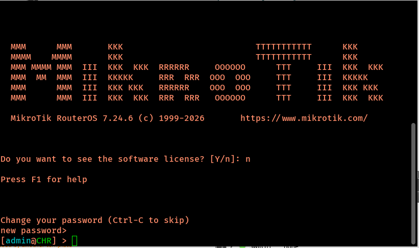

   Then change the hostname of the Router to `Kazdel` so that it is not plain `CHR`, which is the default value and cannot be set automatically from the GNS3 interface, using
   ```
    /system identity set name=Kazdel
   ```

   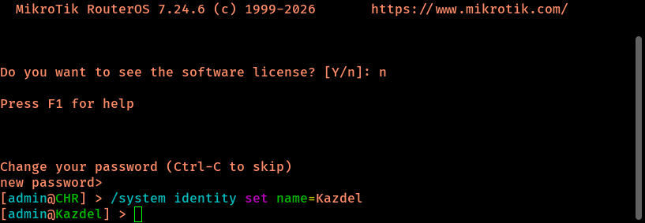


6. Configure the IP address on `Kazdel` and the connection to NAT

   Configure the connection to NAT as follows:
   ```
    # Connect to NAT as WAN by setting up dhcp-client on ether1
    /ip dhcp-client add interface=ether1 add-default-route=yes use-peer-dns=no disabled=no

    # Equivalent to using iptables -t nat -j MASQUERADE -A POSTROUTING
    /ip firewall nat add chain=srcnat out-interface=ether1 action=masquerade  
   ```

   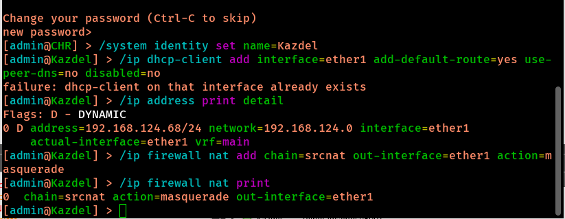

   Then set the IP address for ether2 and ether3:
   ```
    # Configure ether2 with IP address on subnet 10.254.1.0/24
    /ip address add address=10.254.1.1/24 interface=ether2

    # Configure ether3 with IP address on subnet 10.254.2.0/24
    /ip address add address=10.10.2.1/24 interface=ether3

    # Configure the default DNS for node Kazdel
    /ip dns set servers=1.1.1.1,8.8.8.8 allow-remote-requests=yes
   ``` 

   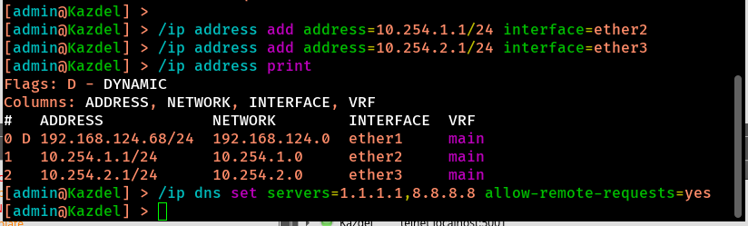

7. Then try running a ping test on `Kazdel` and a client PC (one of Aegir, Yan, Ursus, or Iberia)

   For Kazdel, use `/ping count=N [IP address]`, where N is the number of pings to be tested and IP address is the IP that you want to test ping to

   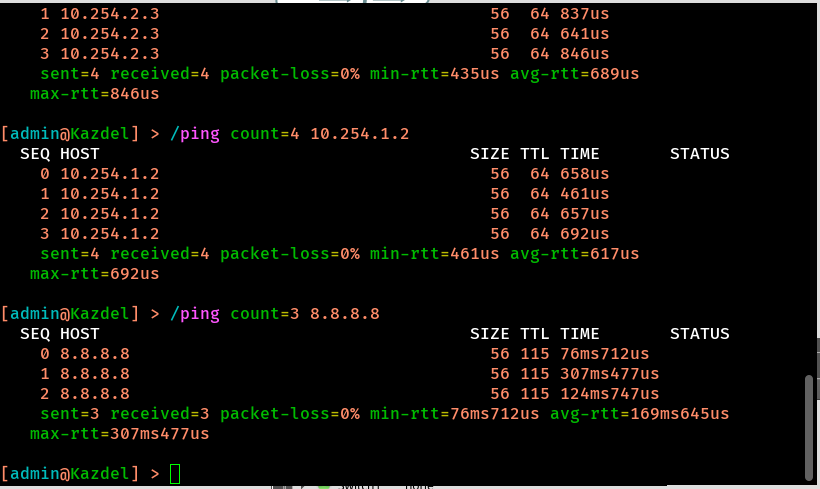
   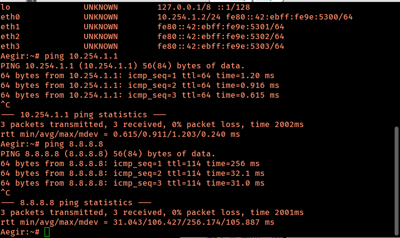
    
8. To be able to ping google.com from the client, add a nameserver to the `/etc/resolv.conf` file as shown below:
   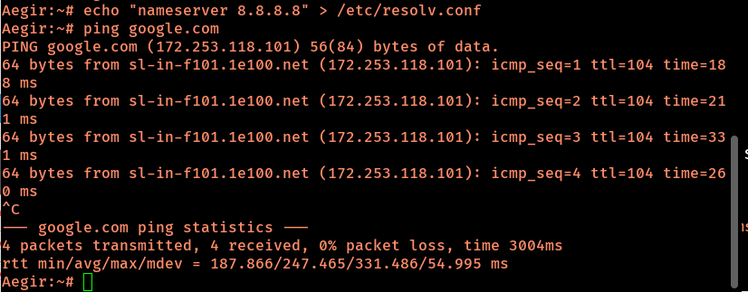


**Note:** The `MikroTik-CHR` node is generally used as a virtual networking device for routing, firewall, NAT, and other network services via RouterOS. Meanwhile, for general-purpose networking node needs, `netics-pc` based on Linux can be used by adding various packages as needed, such as `frr` for dynamic routing, `kea-dhcp4/udhcpd` for DHCP services, `bind9/dnsmasq` for DNS, and `nftables/iptables` for firewall.

### 0.5 Saving Configuration on MikroTik-CHR

> [!TIP]
> *By default, MikroTik-CHR will automatically save the last configuration and it will persist when the node is powered back on.*

#### 0.5.1 Export to Binary File

For preservation purposes, you can use the following command:
```
/system backup save name=[Backup Name]

# to display the backup files that have been saved
/file print
```

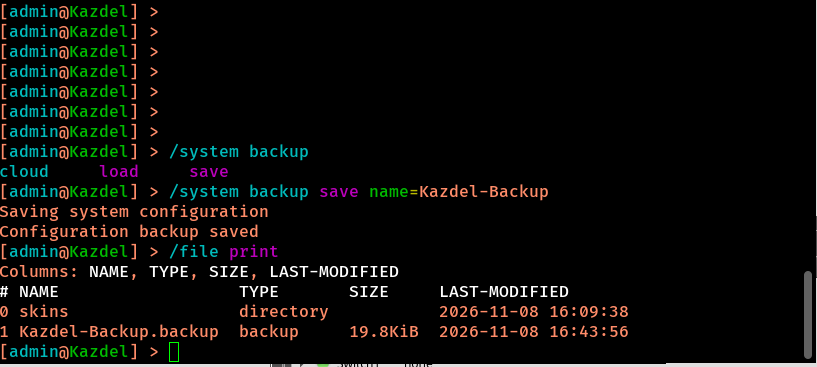 

And to restore, use
```
/system backup load name=[Backup Name]
```

MikroTik-CHR will give a prompt to restart the node, press the `y` key on the keyboard, MikroTik-CHR will restart and the configuration will be loaded
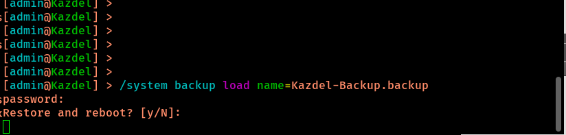 
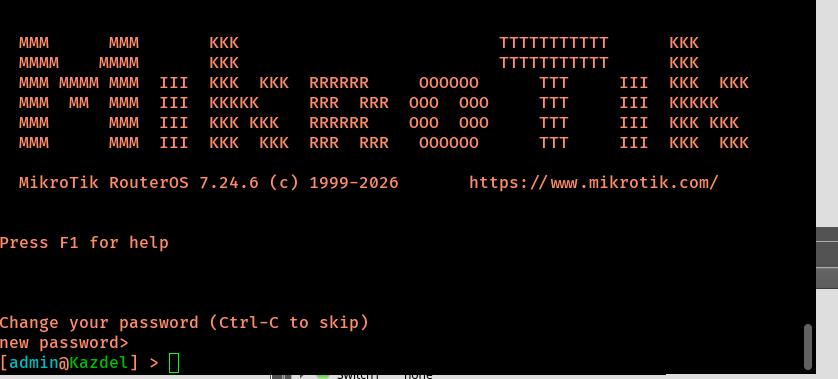

#### 0.5.2 Export to Raw Text or Readable File

Besides exporting to a binary form, you can also export to a readable file format using the command:
```
/export file=[File Name]

# if you want to display the entire configuration directly in the terminal
/export
```

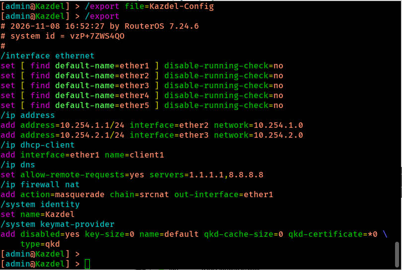 

the command `/export file=` will produce a file with the extension `.rsc`
    
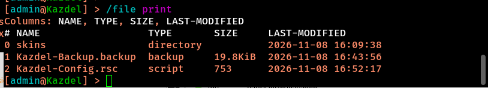 

And to restore a configuration with the `.rsc` file type, use the command:
```
/import file-name=[File Name]
```

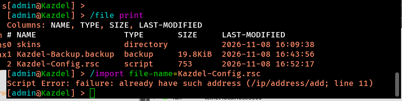 

**Note:** The error above is indeed expected, because the configuration being imported is exactly the same as the current configuration, which causes the configuration to stack and raise an error (changes from the import are not applied).

#### 0.5.3 How to Export Configuration Outside GNS3 Using WinBox

[Download Winbox Official v4.5](https://mikrotik.com/download/winbox) 

The configuration file exported on MikroTik-CHR will remain inside the node itself; to be able to export that backup file outside the node, or export it outside GNS3, an additional application is needed, namely `WinBox`

- Download WinBox using the link above, then open WinBox while the `MikroTik-CHR` node is still running. In the WinBox interface, the node `Kazdel` will be detected as shown below, then click the Kazdel option and click the Connect button on the left side, or simply double-click the `Kazdel` row

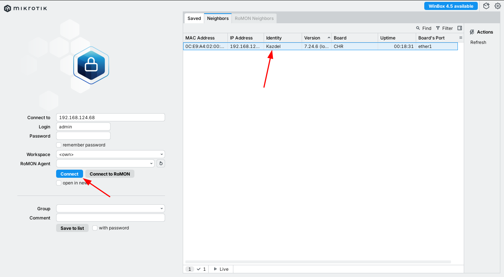 

- If there is a notice to change the password, just click `Cancel`

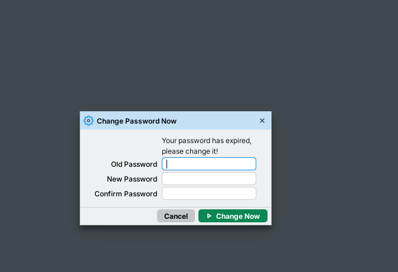

- After entering the MikroTik-CHR interface in Desktop or Web UI version, click on the `Files` menu in the sidebar beside it

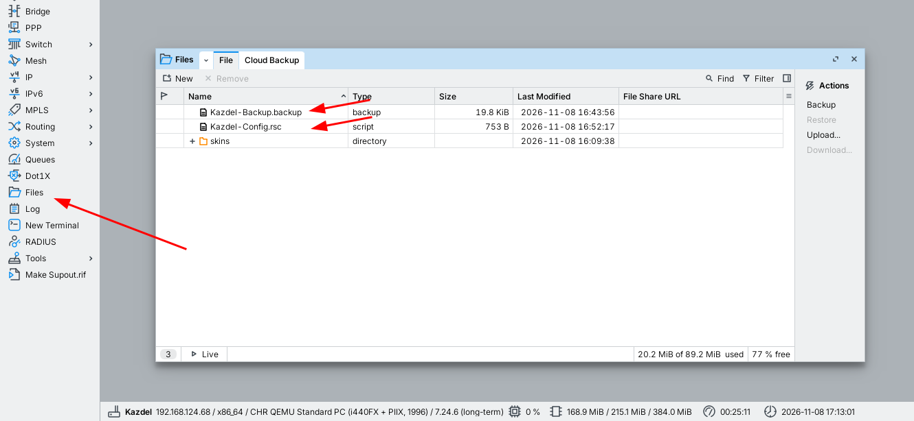

- Then select the file you want to download by clicking it once and clicking the download button on the right side, and a file explorer will open to choose where to save the file

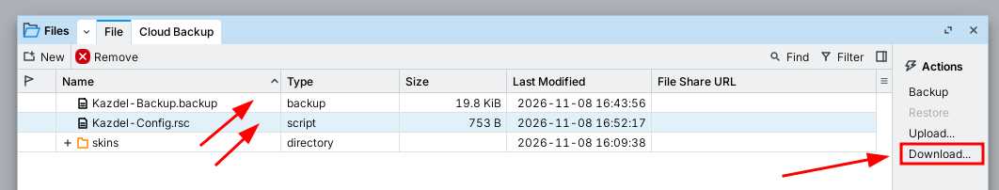
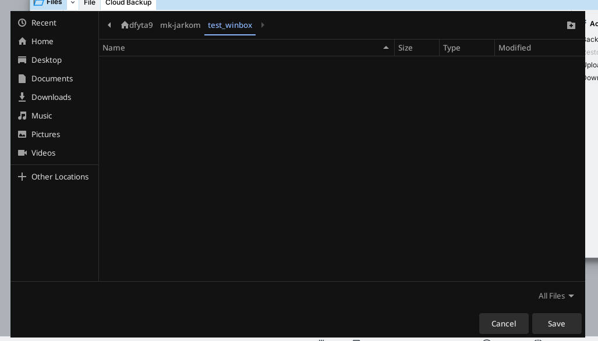

#### 0.5.4 How to Export Configuration Outside GNS3 Using SFTP

This method does not require WinBox, you just need to verify whether the SSH service is running on the `MikroTik` node

```
/ip service print
```

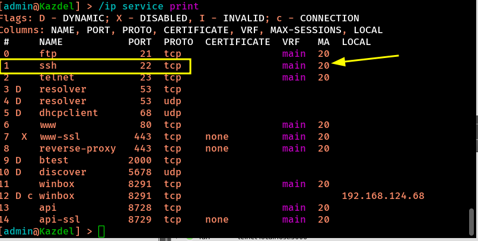 

Then using any SFTP client, use the command `ls` to list and `get` to download a file
```
ls
get <file name>
```

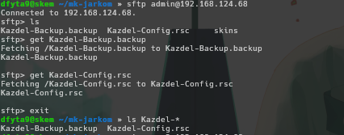 

To find out which IP should be used to connect to the MikroTik node, in this case `Kazdel`, use the command `/ip address print` and use the IP given on ether1, which is connected directly to NAT

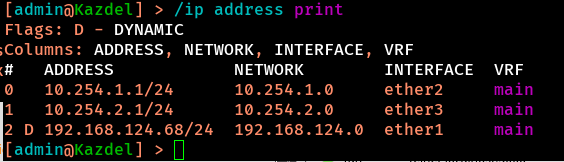

## 1. Subnetting

### 1.1 Introduction to Subnetting

#### 1.1.1 What is Subnetting?

Imagine a large network like a housing complex with many houses inside it. To keep things more organized, the complex is divided into several small blocks.

In computer networking, a division process like this is called subnetting, which is a way of dividing one large IP network into several smaller networks by increasing the prefix length (netmask). For example, the network `192.168.1.0/24` can be divided into four subnets:

1. `192.168.1.0/26`
2. `192.168.1.64/26`
3. `192.168.1.128/26`
4. `192.168.1.192/26`

A **Subnet** is a sub-network of a larger network. With subnets, we can manage a network better.

#### 1.1.2 Why is Subnetting Needed?

Suppose all computers in the Informatics Department building are on the same single network. As a result:

- Every broadcast packet (a packet sent to all hosts at once) is received by every computer in the building, even those not concerned.
- Access between laboratories is hard to restrict, because all computers are on the same network.

With subnetting, each laboratory gets its own subnet, for example:

1. LP Laboratory: `10.151.34.0/24`
2. AJK Laboratory: `10.151.36.0/24`

Benefits of subnetting:

- Reduces the size of the broadcast domain: broadcasts from Lab LP are only received by computers in Lab LP.
- Allows setting its own security policy: for example a router can allow or block access from Lab AJK to Lab LP.
- Improves routing efficiency: the router only needs to know one subnet per laboratory, instead of every single computer's address.

A **broadcast domain** is a network area reached by broadcast packets. Broadcast packets are not forwarded by routers, so each subnet has its own broadcast domain.

### 1.2 Getting to Know IP Address

An IP Address is a unique address given to identify a host connected to a network.

#### 1.2.1 What Can Be Known?

From an IP Address written together with its prefix, we can obtain the following 5 pieces of information:

1. **IP Address**: the address belonging to the host itself.
2. **Netmask**: determines which part of the IP Address indicates the subnet and which part indicates the host.
3. **Network ID (NID)**: the IP Address that is the identity of a subnet.
4. **Broadcast Address**: the IP Address used to send a broadcast message to all hosts within a subnet.
5. **Available Hosts**: the range of IP Addresses that can be used by hosts within a subnet.

The first two pieces of information are directly visible from how the address is written, while the remaining three need to be calculated. We will discuss them one by one.

#### 1.2.2 IPv4

- IPv4 (_Internet Protocol version 4_) is the version of IP Address discussed in this module.
- An IPv4 Address consists of 32 binary bits which, when written, are converted into decimal numbers.
- The 32 bits are divided into 4 octets (each octet contains 8 bits) separated by dots. Example: `10.151.36.5`.

```
decimal :     10    .    151    .     36    .      5
binary  : 0000 1010 . 1001 0111 . 0010 0100 . 0000 0101
          \_______/   \_______/   \_______/   \_______/
           octet 1     octet 2     octet 3     octet 4
```

##### IPv4 Header

Every IPv4 packet sent through a network carries a **header**, which is the part at the beginning of the packet containing information to deliver that packet to its destination. The minimum size of an IPv4 header is 20 bytes. The structure of the IPv4 header is as follows (each row contains 32 bits):

```
 0       4      8               16    19        24            31
┌───────┬───────┬───────────────┬───────────────────────────────┐
│Version│  IHL  │Type of Service│          Total Length         │
├───────┴───────┴───────────────┼─────┬─────────────────────────┤
│         Identification        │Flags│     Fragment Offset     │
├───────────────┬───────────────┼─────┴─────────────────────────┤
│  Time to Live │    Protocol   │        Header Checksum        │
├───────────────┴───────────────┴───────────────────────────────┤
│                         Source Address                        │
├───────────────────────────────────────────────────────────────┤
│                      Destination Address                      │
├───────────────────────────────────────────────┬───────────────┤
│                    Options                    │    Padding    │
└───────────────────────────────────────────────┴───────────────┘
```

| Field               | Size     | Function                                                                                                                      |
| ------------------- | -------- | --------------------------------------------------------------------------------------------------------------------------- |
| Version             | 4 bit    | The IP version used. For IPv4 the value is `4`                                                                             |
| IHL                 | 4 bit    | _Internet Header Length_, i.e. the length of the header in units of 32 bits (4 bytes). Its minimum value is `5` (5 × 4 bytes = 20 bytes)    |
| Type of Service     | 8 bit    | A marker for packet priority. Currently divided into DSCP (6 bits) for quality of service and ECN (2 bits) for congestion notification |
| Total Length        | 16 bit   | The length of the entire packet (header + data) in bytes, maximum 65,535 bytes                                                      |
| Identification      | 16 bit   | The packet's identity number, used to reassemble a packet that was split (fragmentation)                                  |
| Flags               | 3 bit    | Fragmentation settings, namely DF (_Don't Fragment_) and MF (_More Fragments_)                                                |
| Fragment Offset     | 13 bit   | The position of a packet fragment within the original packet                                                             |
| Time to Live (TTL)  | 8 bit    | The limit on the number of routers a packet may pass through. Its value decreases by 1 every time it passes a router, and the packet is dropped once it reaches `0` |
| Protocol            | 8 bit    | The protocol carried inside the packet, for example `1` for ICMP, `6` for TCP, and `17` for UDP                             |
| Header Checksum     | 16 bit   | A value to check whether the header was corrupted during transmission                                                                  |
| Source Address      | 32 bit   | The IP Address of the packet sender                                                                                                    |
| Destination Address | 32 bit   | The IP Address of the packet's destination                                                                                                      |
| Options             | variable | Rarely used additional options. If present, Padding is added so the header length remains a multiple of 32 bits                  |


#### 1.2.3 Netmask and Prefix

A **Subnet mask (netmask)** is a 32-bit-long combination of numbers that functions to divide an IP into subnets and determine the usable IP Address range within a subnet. Bits with a value of `1` in the netmask are always at the front, followed by bits with a value of `0` after them.

A netmask can also be written briefly in the form of a **prefix**, which is the number of bits with a value of `1` in the netmask written after the IP. For example, `10.151.36.5/24` means the IP `10.151.36.5` with netmask `255.255.255.0`, because the first 24 bits of that netmask have the value `1`.

A **Wildcard** is the opposite of a netmask, where bit `1` in the netmask is changed to `0` and bit `0` is changed to `1`.

The following table shows a list of prefixes along with the netmask, wildcard, number of addresses (Addresses), and the number of Available Hosts.

| Prefix | Netmask           | Wildcard        | Addresses  | Available Hosts |
| ------ | ----------------- | --------------- | ---------- | --------------- |
| /32    | `255.255.255.255` | `0.0.0.0`       | 1          | NA              |
| /31    | `255.255.255.254` | `0.0.0.1`       | 2          | NA              |
| /30    | `255.255.255.252` | `0.0.0.3`       | 4          | 2               |
| /29    | `255.255.255.248` | `0.0.0.7`       | 8          | 6               |
| /28    | `255.255.255.240` | `0.0.0.15`      | 16         | 14              |
| /27    | `255.255.255.224` | `0.0.0.31`      | 32         | 30              |
| /26    | `255.255.255.192` | `0.0.0.63`      | 64         | 62              |
| /25    | `255.255.255.128` | `0.0.0.127`     | 128        | 126             |
| /24    | `255.255.255.0`   | `0.0.0.255`     | 256        | 254             |
| /23    | `255.255.254.0`   | `0.0.1.255`     | 512        | 510             |
| /22    | `255.255.252.0`   | `0.0.3.255`     | 1,024      | 1,022           |
| /21    | `255.255.248.0`   | `0.0.7.255`     | 2,048      | 2,046           |
| /20    | `255.255.240.0`   | `0.0.15.255`    | 4,096      | 4,094           |
| /19    | `255.255.224.0`   | `0.0.31.255`    | 8,192      | 8,190           |
| /18    | `255.255.192.0`   | `0.0.63.255`    | 16,384     | 16,382          |
| /17    | `255.255.128.0`   | `0.0.127.255`   | 32,768     | 32,766          |
| /16    | `255.255.0.0`     | `0.0.255.255`   | 65,536     | 65,534          |
| /15    | `255.254.0.0`     | `0.1.255.255`   | 131,072    | 131,070         |
| /14    | `255.252.0.0`     | `0.3.255.255`   | 262,144    | 262,142         |
| /13    | `255.248.0.0`     | `0.7.255.255`   | 524,288    | 524,286         |
| /12    | `255.240.0.0`     | `0.15.255.255`  | 1,048,576  | 1,048,574       |
| /11    | `255.224.0.0`     | `0.31.255.255`  | 2,097,152  | 2,097,150       |
| /10    | `255.192.0.0`     | `0.63.255.255`  | 4,194,304  | 4,194,302       |
| /9     | `255.128.0.0`     | `0.127.255.255` | 8,388,608  | 8,388,606       |
| /8     | `255.0.0.0`       | `0.255.255.255` | 16,777,216 | 16,777,214      |

> **Available Hosts = Addresses - 2**, because the first address is used as the Network ID and the last address as the Broadcast Address.


#### 1.2.4 Network ID, Broadcast Address, and Available Hosts

Example scenario: Find the Network ID (NID), Broadcast Address, and the range of IP Addresses from an address `10.151.36.5/24`!

Solution: The preliminary information obtained from `10.151.36.5/24` is

```
    1. IP : 10.151.36.5
    2. Netmask : 255.255.255.0 (/24)
    3. Network ID?
    4. Broadcast Address?
    5. Available Hosts?
```

Below is an explanation of how to find the NID, Broadcast Address, and Available Hosts:

##### Network ID

Network ID (NID) is the first address of a subnet. The way to find it is by performing an **AND** operation between the IP and the netmask.

1. Convert the IP into binary form (per octet, each 8 bits).

   ```
   IP      :     10    .    151    .     36    .      5
   bit     : 0000 1010 . 1001 0111 . 0010 0100 . 0000 0101
   ```

2. Convert the netmask into binary form. Netmask /24 means the first 24 bits have the value `1` and the rest have the value `0`.

   ```
   netmask :    255    .    255    .    255    .      0
   bit     : 1111 1111 . 1111 1111 . 1111 1111 . 0000 0000
   ```

3. Perform an AND operation on the IP and netmask, bit by bit. In an AND operation, the result is `1` only if both bits are `1`.

   ```
   AND table:
   0 AND 0 = 0
   0 AND 1 = 0
   1 AND 0 = 0
   1 AND 1 = 1
   ```

   ```
   IP      : 0000 1010 . 1001 0111 . 0010 0100 . 0000 0101
   netmask : 1111 1111 . 1111 1111 . 1111 1111 . 0000 0000
   ------------------------------------------------------- AND
   NID     : 0000 1010 . 1001 0111 . 0010 0100 . 0000 0000
   NID     :     10    .    151    .     36    .      0
   ```

So, the Network ID of `10.151.36.5/24` is **`10.151.36.0`**.

The part of the IP that meets bit `1` in the netmask (the network part) stays the same, while the part that meets bit `0` (the host part) becomes all `0`. That is why the NID always has host bits with a value of all `0`.

##### Broadcast Address

Broadcast Address is the last address of a subnet. The way to find it is by performing an **OR** operation between the IP and the wildcard.

1. Convert the IP into binary form.

   ```
   IP      :     10    .    151    .     36    .      5
   bit     : 0000 1010 . 1001 0111 . 0010 0100 . 0000 0101
   ```

2. Convert the netmask into binary form, then flip each bit (`1` becomes `0` and `0` becomes `1`). The result is the wildcard. This value is the same as the **Wildcard** column in the table in the [Netmask and Prefix](#123-netmask-and-prefix) section.

   ```
   netmask  :    255    .    255    .    255    .      0
   bit      : 1111 1111 . 1111 1111 . 1111 1111 . 0000 0000
   wildcard : 0000 0000 . 0000 0000 . 0000 0000 . 1111 1111
   wildcard :      0    .      0    .      0    .    255
   ```

3. Perform an OR operation on the IP and wildcard, bit by bit. In an OR operation, the result is `1` if either or both bits are `1`.

   ```
   OR table:
   0 OR 0 = 0
   0 OR 1 = 1
   1 OR 0 = 1
   1 OR 1 = 1
   ```

   ```
   IP        : 0000 1010 . 1001 0111 . 0010 0100 . 0000 0101
   wildcard  : 0000 0000 . 0000 0000 . 0000 0000 . 1111 1111
   --------------------------------------------------------- OR
   broadcast : 0000 1010 . 1001 0111 . 0010 0100 . 1111 1111
   broadcast :     10    .    151    .     36    .    255
   ```

So, the Broadcast Address of `10.151.36.5/24` is **`10.151.36.255`**.

Opposite of the NID, the network part stays the same, while the host part becomes all `1`. That is why the Broadcast Address always has host bits with a value of all `1`.

##### Available Hosts

Available Hosts is the range of IP Addresses that can be given to hosts (PC, server, router, etc.) within a subnet. The way to find it is by looking at which bits in the netmask have the value `0`.

1. Convert the IP and netmask into binary form.

   ```
   IP      :     10    .    151    .     36    .      5
   bit     : 0000 1010 . 1001 0111 . 0010 0100 . 0000 0101

   netmask :    255    .    255    .    255    .      0
   bit     : 1111 1111 . 1111 1111 . 1111 1111 . 0000 0000
             \_____________________________/   \_______/
                   network part (24 bits)      host part
                                                 (8 bits)
   ```

2. Pay attention to each bit in the netmask:

   - Bit `1` indicates the network part, so the bit at the same position in the IP Address must not change.
   - Bit `0` indicates the host part, so the bit at the same position in the IP Address may be either `0` or `1`.

   Because the last 8 bits of the netmask have the value `0`, the last 8 bits of the IP Address may change, ranging from `0000 0000` up to `1111 1111`. So the IP range in this subnet is:

   ```
   0000 1010 . 1001 0111 . 0010 0100 . 0000 0000   --> 10.151.36.0
                        up to
   0000 1010 . 1001 0111 . 0010 0100 . 1111 1111   --> 10.151.36.255
   \_____________________________/   \_______/
           must not change            IP range
   ```

3. From that range, the first IP is already used as the Network ID and the last IP is already used as the Broadcast Address, so neither can be given to a host.

   ```
   10.151.36.0             --> Network ID (cannot be used by a host)
   10.151.36.1   - .254    --> Available Hosts
   10.151.36.255           --> Broadcast Address (cannot be used by a host)
   ```

   So, the Available Hosts of `10.151.36.5/24` are **`10.151.36.1` up to `10.151.36.254`**.

4. The number of available hosts can be calculated with the following formula, where `n` is the number of host bits (number of `0` bits in the netmask):

   ```
   Number of hosts = 2^n - 2
               = 2^8 - 2
               = 256 - 2
               = 254 hosts
   ```

   The `- 2` in the formula above comes from the Network ID and Broadcast Address. This result matches the **Available Hosts** column in the table in the [Netmask and Prefix](#123-netmask-and-prefix) section for /24.

#### 1.2.5 Public IP and Private IP

IP Address is divided into 2 types, namely:

- **Public IP**: an IP Address used in the global internet network, its characteristic being that the IP Address can be accessed directly through the internet.
- **Private IP**: an IP Address used (recognized) and only accessible within a local network.

Private IP ranges:

- `10.0.0.0/8` (`10.0.0.0` - `10.255.255.255`)
- `172.16.0.0/12` (`172.16.0.0` - `172.31.255.255`)
- `192.168.0.0/16` (`192.168.0.0` - `192.168.255.255`)

Most addresses outside the Private IP ranges above are Public IP, except for a few special ranges such as `127.0.0.0/8` (loopback) and `169.254.0.0/16` (link-local).

A Private IP cannot be used directly on the internet. For a host with a Private IP to access the internet, the router needs to translate that Private IP into a Public IP using NAT (_Network Address Translation_).

### 1.3 Subnet Calculation

There are two IP allocation/division methods known in networking, namely Classful and Classless.

#### 1.3.1 Classful

IP division using this method is based on the Class division of the IP Address. Each subnet will be given a size or netmask that can accommodate the number of hosts contained in that subnet. The following table shows the Classes found in the Classful method.

| Class         | IP Address Range                | Netmask               | Number of Blocks | IP Addresses per Block |
| ------------- | ------------------------------- | --------------------- | ----------- | ------------------- |
| A             | `0.0.0.0` - `127.255.255.255`   | `255.0.0.0` (/8)      | 128         | 16,777,216          |
| B             | `128.0.0.0` - `191.255.255.255` | `255.255.0.0` (/16)   | 16,384      | 65,536              |
| C             | `192.0.0.0` - `223.255.255.255` | `255.255.255.0` (/24) | 2,097,152   | 256                  |
| D (Multicast) | `224.0.0.0` - `239.255.255.255` | -                     | -           | -                    |
| E (Reserved)  | `240.0.0.0` - `255.255.255.255` | -                     | -           | -                    |

For example:

- If we need 250 IP Addresses, then we would use an address block from Class C.
- If we need more IP Addresses, i.e. 60,000, then we could use an address block from Class B.
- If that is still insufficient, we could use an address block from Class A.

An example of applying IP division with the Classful method is as follows.

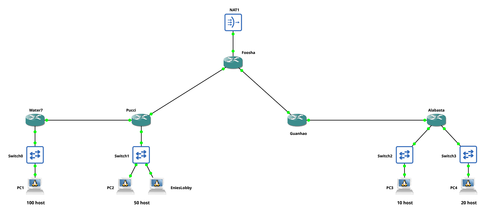

Suppose we have a network topology like the image above, with the number of hosts needed by each LAN listed below it. The 50 hosts on LAN PC2 already includes EniesLobby, which is the DHCP Server that will be configured in [Implementation chapter 2](#enieslobby). Then, determine the number of subnets contained in that topology.

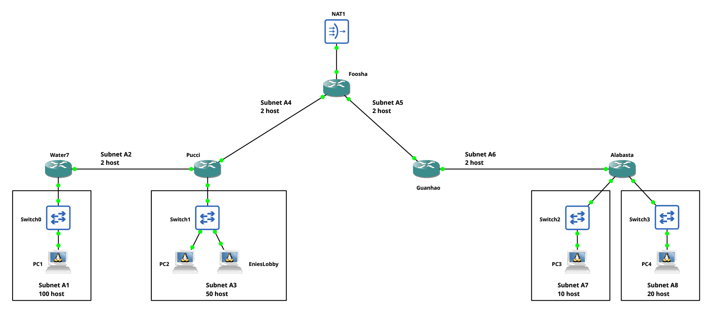

There are 8 subnets inside the topology, namely 4 subnets connected to a switch (marked with a box) and 4 subnets between routers (marked with a label near their link).

With the Classful technique, every subnet will have a /24 netmask because the number of hosts in each subnet is no more than 254 (the Available Hosts of /24). A possible IP division for the topology above is as follows.

| Subnet | Network ID    | Netmask         | Broadcast Address |
| ------ | ------------- | --------------- | ----------------- |
| A1     | `192.168.1.0` | `255.255.255.0` | `192.168.1.255`   |
| A2     | `192.168.2.0` | `255.255.255.0` | `192.168.2.255`   |
| A3     | `192.168.3.0` | `255.255.255.0` | `192.168.3.255`   |
| A4     | `192.168.4.0` | `255.255.255.0` | `192.168.4.255`   |
| A5     | `192.168.5.0` | `255.255.255.0` | `192.168.5.255`   |
| A6     | `192.168.6.0` | `255.255.255.0` | `192.168.6.255`   |
| A7     | `192.168.7.0` | `255.255.255.0` | `192.168.7.255`   |
| A8     | `192.168.8.0` | `255.255.255.0` | `192.168.8.255`   |

However, what if we only need 300 addresses? Using Class C would not be enough, but using Class B would waste a huge number of addresses, i.e. more than 60,000 addresses would be wasted.

We could use two Class C blocks (enough for 512 IP Addresses). This method can indeed be done, and is commonly done.

But what if we need 25,000 IP Addresses? With this method, we would need 99 Class C blocks (25,000 ÷ 254 hosts per block). If using a Class B block, more than 40,000 IP Addresses would still be wasted.

Because it is very inefficient, a much better IP allocation technique was invented, namely Classless Inter-Domain Routing, commonly known as **CIDR**.

#### 1.3.2 Classless / CIDR

In the Classless method, IP division is no longer tied to the 3 Classes above. With this method, IP can be allocated according to the needs of each subnet. The Classless method is formally implemented through CIDR and governed by RFC 4632 (previously RFC 1518/1519). With this method, then:

- If we need 250 IPs, we can use a subnet of size /24
- If we need 300 IPs, we can use a subnet of size /23
- If we need 500 IPs, we can also use a subnet of size /23
- If we need 25,000 IPs, we can use a subnet of size /17
- If we need 250,000 IPs, we can use a subnet of size /14

This method can make IP division far more flexible and the number of wasted IP Addresses becomes much, much smaller.

Within Classless itself, there are 2 ways to perform subnetting or create subnets, namely FLSM and VLSM.

##### FLSM (Fixed Length Subnet Masking)

**Fixed Length Subnet Masking (FLSM)** is a network division technique in which every subnet has the same size or number of hosts.

For example, if you have a network address with prefix /24 and want to divide it into 4 subnets, then each subnet will get an equally sized portion, namely a /26 prefix.

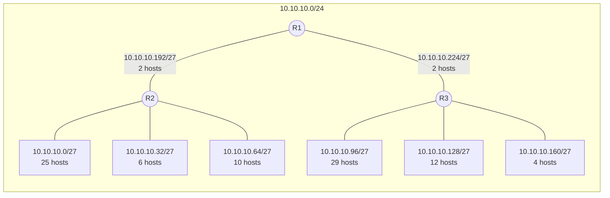

For example, you are given the address `10.10.10.0/24` and have a topology like the one above, with the number of hosts for each subnet listed below its address. The prefix for FLSM is determined using the following steps:

1. Count the number of subnets. The topology above has 8 subnets, namely 6 LANs and 2 router-to-router links.
2. Find the additional number of bits `n` such that 2<sup>n</sup> ≥ number of subnets. Because 2<sup>3</sup> = 8, 3 additional bits are needed, so the prefix becomes /24 + 3 = /27.
3. Make sure that prefix is sufficient for the subnet with the most hosts. The largest subnet needs 29 hosts + 1 router = 30 IPs, and /27 has 30 Available Hosts, so it is sufficient. If it is not sufficient, a larger root block is needed.
4. Divide the address evenly with a block size of 32 addresses: `10.10.10.0`, `.32`, `.64`, `.96`, `.128`, `.160`, `.192`, and `.224`.

A subnet with prefix /27 contains 32 IPs, but only 30 can be used, because the first IP is used as the Network ID and the last IP is used as the Broadcast Address.

But what if you have 2 subnets, where the first subnet needs 25,000 IPs but the second subnet only needs 500 IPs? If using the FLSM rule, both subnets must have a size of /17. This size is sufficient for the first subnet, but too large and wasteful for the second subnet.

The same problem arises every time there is a 3rd, 4th, and so on subnet with different needs. Because of that, another technique is used, namely VLSM.

##### VLSM (Variable Length Subnet Masking)

Unlike FLSM, **Variable Length Subnet Masking (VLSM)** is a subnetting technique in which every subnet can have a different size.

The main point of using the VLSM technique is to make IP division within a network more efficient, because the size of the netmask will be adjusted to the number of hosts that need an IP Address in each subnet.

So, in the VLSM technique, the netmask will be given according to the number of IP Addresses needed by that subnet.

As an example of its application, we will use a topology like the Classful method example.

1. Determine the number of IP Addresses needed by each subnet and label the netmask based on the number of IPs needed.

   - Subnets connected to a switch (LAN): number of IPs = number of hosts + 1 for the router interface (gateway).
   - Router-to-router subnets: just 2 IPs are enough, one for each router interface.

   | Subnet    | Number of IPs (host + router) | Netmask |
   | --------- | ------------------------- | ------- |
   | A1        | 101                       | /25     |
   | A2        | 2                         | /30     |
   | A3        | 51                        | /26     |
   | A4        | 2                         | /30     |
   | A5        | 2                         | /30     |
   | A6        | 2                         | /30     |
   | A7        | 11                        | /28     |
   | A8        | 21                        | /27     |
   | **Total** | **192**                   | **/24** |

   The root netmask is determined from the total block size of all subnets: 128 (/25) + 64 (/26) + 32 (/27) + 16 (/28) + 4 × 4 (/30) = 256 addresses. This number fits exactly into one /24 block, so the IP division starts from netmask /24.

   > The number of IPs needed (192) is not yet enough to determine the root, because every subnet uses one whole block according to its netmask. For example, A1, which needs 101 IPs, still uses a /25 block containing 128 addresses.

2. The large subnet formed has NID `192.168.1.0` with netmask /24. Calculate the IP division based on that NID and netmask using a tree like the one below.

   ```mermaid
   flowchart TD
       n0["192.168.1.0 / 24"]
       n1["192.168.1.0 / 25"]
       n0 --> n1
       n2["192.168.1.128 / 25"]
       n0 --> n2
       n3["192.168.1.0 / 26"]
       n1 --> n3
       n4["192.168.1.64 / 26"]
       n1 --> n4
       n5["192.168.1.0 / 27"]
       n3 --> n5
       n6["192.168.1.32 / 27"]
       n3 --> n6
       n7["192.168.1.0 / 28"]
       n5 --> n7
       n8["192.168.1.16 / 28"]
       n5 --> n8
       n9["192.168.1.0 / 29"]
       n7 --> n9
       n10["192.168.1.8 / 29"]
       n7 --> n10
       n11["192.168.1.0 / 30"]
       n9 --> n11
       n12["192.168.1.4 / 30"]
       n9 --> n12
       n13["192.168.1.8 / 30"]
       n10 --> n13
       n14["192.168.1.12 / 30"]
       n10 --> n14
   ```

3. Carry out subnetting using that tree to divide the IP according to the needs of each existing subnet.

   ```mermaid
   flowchart TD
       n0["192.168.1.0 / 24"]
       n1["192.168.1.0 / 25"]
       n0 --> n1
       n2["192.168.1.128 / 25<br/>A1 = 100 hosts"]
       n0 --> n2
       n3["192.168.1.0 / 26"]
       n1 --> n3
       n4["192.168.1.64 / 26<br/>A3 = 50 hosts"]
       n1 --> n4
       n5["192.168.1.0 / 27"]
       n3 --> n5
       n6["192.168.1.32 / 27<br/>A8 = 20 hosts"]
       n3 --> n6
       n7["192.168.1.0 / 28"]
       n5 --> n7
       n8["192.168.1.16 / 28<br/>A7 = 10 hosts"]
       n5 --> n8
       n9["192.168.1.0 / 29"]
       n7 --> n9
       n10["192.168.1.8 / 29"]
       n7 --> n10
       n11["192.168.1.0 / 30<br/>A2 = 2 hosts"]
       n9 --> n11
       n12["192.168.1.4 / 30<br/>A4 = 2 hosts"]
       n9 --> n12
       n13["192.168.1.8 / 30<br/>A5 = 2 hosts"]
       n10 --> n13
       n14["192.168.1.12 / 30<br/>A6 = 2 hosts"]
       n10 --> n14
       classDef dipakai fill:#d4edda,stroke:#28a745,color:#155724
       class n2,n4,n6,n8,n11,n12,n13,n14 dipakai
   ```

   From that tree, the following IP division is obtained.

   | Subnet | Network ID      | Netmask           | Broadcast Address |
   | ------ | --------------- | ----------------- | ----------------- |
   | A1     | `192.168.1.128` | `255.255.255.128` | `192.168.1.255`   |
   | A2     | `192.168.1.0`   | `255.255.255.252` | `192.168.1.3`     |
   | A3     | `192.168.1.64`  | `255.255.255.192` | `192.168.1.127`   |
   | A4     | `192.168.1.4`   | `255.255.255.252` | `192.168.1.7`     |
   | A5     | `192.168.1.8`   | `255.255.255.252` | `192.168.1.11`    |
   | A6     | `192.168.1.12`  | `255.255.255.252` | `192.168.1.15`    |
   | A7     | `192.168.1.16`  | `255.255.255.240` | `192.168.1.31`    |
   | A8     | `192.168.1.32`  | `255.255.255.224` | `192.168.1.63`    |

#### 1.3.3 Subnet Calculator

Subnet calculation can be done manually using a tree like in the VLSM example above. The results of that manual calculation can be checked using an online **subnet calculator**.

The following example checks the subnet `192.168.1.64/27` using two subnet calculators.

##### calculator.net

Site: https://www.calculator.net/ip-subnet-calculator.html

1. Choose the netmask in the **Subnet** column, fill in the IP Address in the **IP Address** column, then click **Calculate**.

   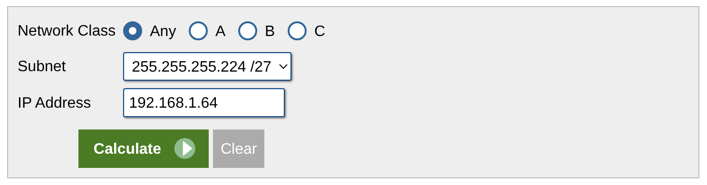

2. Compare the result with the manual calculation.

   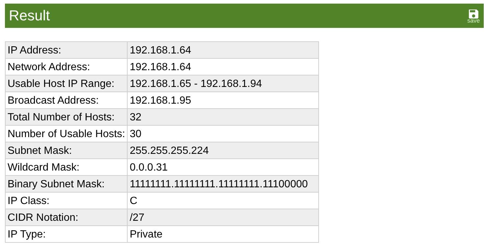

##### jodies.de

Site: https://jodies.de/ipcalc

1. Fill in the IP Address in the **Address** column and the prefix in the **Netmask** column, then click **Calculate**.

   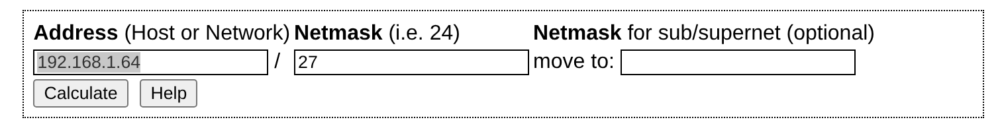

2. Compare the result with the manual calculation.

   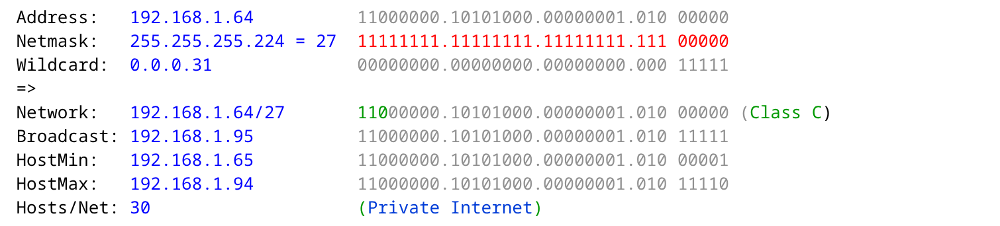

   Besides being shown in decimal form, the result is also shown in binary form. The space in that binary number separates the network part (left) and the host part (right).

The terms used by the two subnet calculators are slightly different from the terms in this module:

| This module         | calculator.net       | jodies.de         |
| ----------------- | -------------------- | ----------------- |
| Network ID        | Network Address      | Network           |
| Broadcast Address | Broadcast Address    | Broadcast         |
| Available Hosts   | Usable Host IP Range | HostMin - HostMax |
| Netmask           | Subnet Mask          | Netmask           |

### 1.4 Supernetting

Supernetting is the opposite of subnetting, namely a technique of merging several small networks (subnets) into one larger network by shortening the prefix length (increasing the number of host bits) of the network address.

In other words, if subnetting splits one large network into several small networks, then supernetting unites several consecutive small networks into one larger network block.

Supernetting has several purposes and benefits, among others as follows:

- Reduces the size of the routing table (more efficient on the router).
- Simplifies management of large networks.
- Used in route aggregation techniques on the internet (merging many prefixes into one routing table entry).

To do this, CIDR route aggregation can be used by following these steps:

1. Determine the subnets present in the topology and label the netmask for each subnet. An example can be seen in the following image.

   

2. Merge the subnets at the bottom-most part of the topology. "Bottom-most" means the subnet farthest from the internet (the NAT1 node).

   In this topology, the subnets that can be merged are A1 with A2, as well as A7 with A8. The merged subnets will form a larger subnet from the small subnets contained within it.

   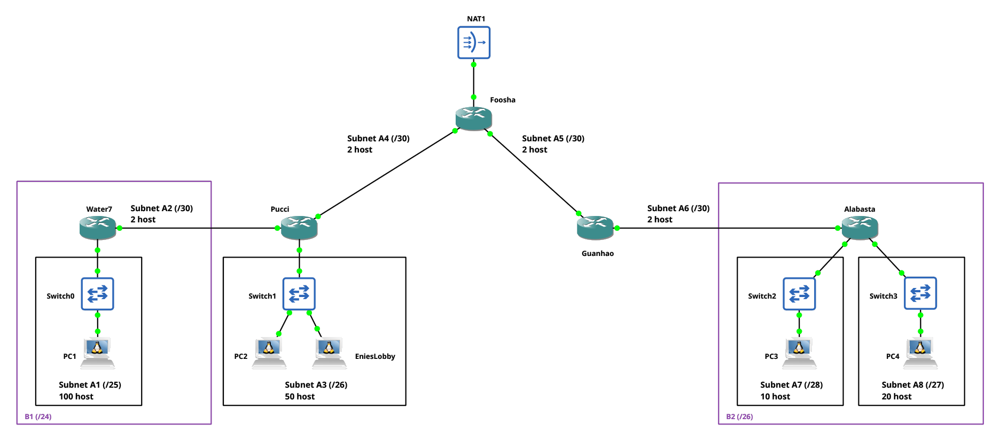

   Subnet B1 is the result of merging subnets A1 and A2, Subnet B2 is the result of merging subnets A7 and A8. The merged subnets are marked with a colored box.

   Why does B1 have netmask /24 and B2 have netmask /26? In supernetting, the merged subnet uses the largest prefix that is still large enough to contain all the merged subnets:

   - B1 = A1 (/25, 128 addresses) + A2 (/30, 4 addresses) = 132 addresses. This amount does not fit in /25 (128 addresses), but fits in /24 (256 addresses).
   - B2 = A8 (/27, 32 addresses) + A7 (/28, 16 addresses) = 48 addresses, so a /26 (64 addresses) is sufficient.

   In this example, the total of the other merged subnets is never larger than its largest subnet, so the result only needs to be 1 level above the largest subnet. If the total were larger, for example /25 + /25 + /30 (260 addresses), the result would become 2 levels above, namely /23.

   Then repeat that step until it becomes one large subnet covering the entire topology we have.

   The next merge: C1 = B1 + A3 (/23) and C2 = B2 + A6 (/25).

   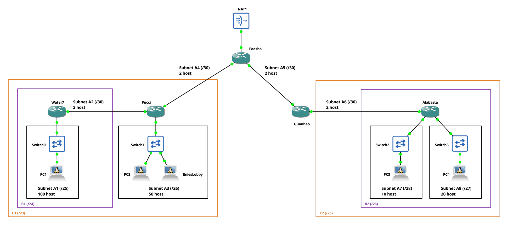

   The next merge: D1 = C1 + A4 (/22) and D2 = C2 + A5 (/24).

   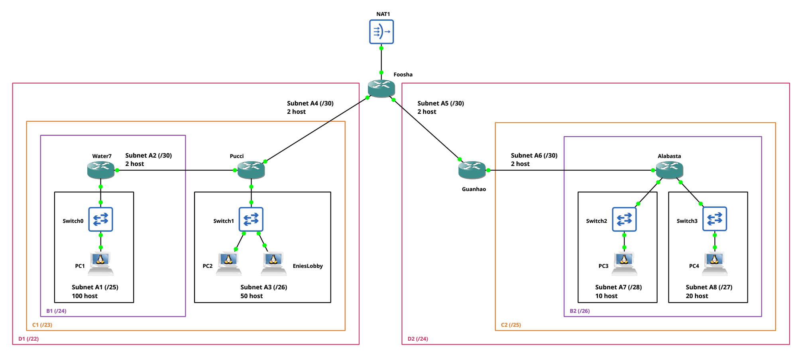

   The final merge: E1 = D1 + D2 (/21), which covers the entire topology's subnets.

   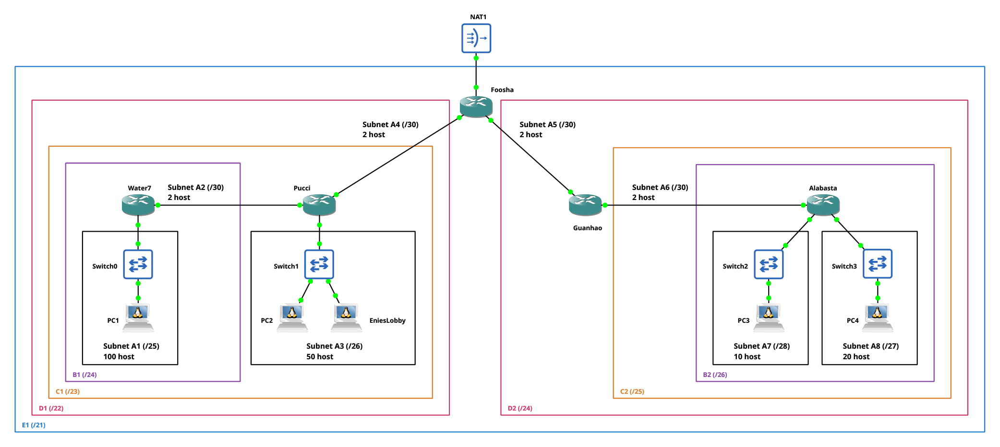

3. From the merging process that has been carried out, a large subnet with netmask /21 is obtained. This time the NID `192.168.0.0`, netmask `255.255.248.0` can be used.

4. Calculate the IP division with a tree based on the subnet merging that has been done.

   ```mermaid
   flowchart TD
       n0["192.168.0.0 / 21"]
       n1["192.168.0.0 / 22"]
       n0 --> n1
       n2["192.168.4.0 / 24"]
       n0 --> n2
       n3["192.168.0.0 / 23"]
       n1 --> n3
       n4["192.168.2.0 / 30<br/>A4 = 2 hosts"]
       n1 --> n4
       n5["192.168.0.0 / 24"]
       n3 --> n5
       n6["192.168.1.0 / 26<br/>A3 = 50 hosts"]
       n3 --> n6
       n7["192.168.0.0 / 25<br/>A1 = 100 hosts"]
       n5 --> n7
       n8["192.168.0.128 / 30<br/>A2 = 2 hosts"]
       n5 --> n8
       n9["192.168.4.0 / 25"]
       n2 --> n9
       n10["192.168.4.128 / 30<br/>A5 = 2 hosts"]
       n2 --> n10
       n11["192.168.4.0 / 26"]
       n9 --> n11
       n12["192.168.4.64 / 30<br/>A6 = 2 hosts"]
       n9 --> n12
       n13["192.168.4.0 / 27<br/>A8 = 20 hosts"]
       n11 --> n13
       n14["192.168.4.32 / 28<br/>A7 = 10 hosts"]
       n11 --> n14
       classDef dipakai fill:#d4edda,stroke:#28a745,color:#155724
       class n7,n8,n6,n4,n10,n12,n14,n13 dipakai
   ```

   > The difference between the VLSM tree and the supernetting tree is that when a subnet is derived, the netmask that is formed is adjusted to the subnet merging done previously.
   >
   > For example, from the large netmask /21, with the VLSM technique it would be split in two into /22 each. However, in the merging done previously, /21 was produced from merging /22 and /24, so the resulting subnets have netmask /22 and /24.

5. Based on the calculation, the following IP division is obtained.

   | Subnet | Network ID      | Netmask           | Broadcast Address |
   | ------ | --------------- | ----------------- | ----------------- |
   | A1     | `192.168.0.0`   | `255.255.255.128` | `192.168.0.127`   |
   | A2     | `192.168.0.128` | `255.255.255.252` | `192.168.0.131`   |
   | A3     | `192.168.1.0`   | `255.255.255.192` | `192.168.1.63`    |
   | A4     | `192.168.2.0`   | `255.255.255.252` | `192.168.2.3`     |
   | A5     | `192.168.4.128` | `255.255.255.252` | `192.168.4.131`   |
   | A6     | `192.168.4.64`  | `255.255.255.252` | `192.168.4.67`    |
   | A7     | `192.168.4.32`  | `255.255.255.240` | `192.168.4.47`    |
   | A8     | `192.168.4.0`   | `255.255.255.224` | `192.168.4.31`    |

If you use supernetting, the required IP block will become larger compared to using VLSM (in this example /21, while VLSM only needs /24). Even so, supernetting has two advantages:

- When a new subnet is added to the topology, there is no need to recalculate, because there is likely still an unused IP interval (_range_).
- Routing is more efficient, because generally the routing table owned is simpler compared to ordinary VLSM.

### 1.5 Implementation

In this section, the result of the subnet calculation will be applied in GNS3. MikroTik is used as the router, while netics-pc is used as the client.

#### Topology and Calculation

Create the following topology in GNS3:

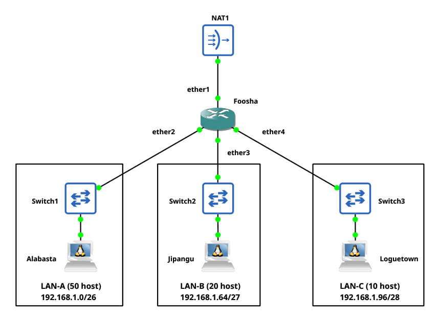

Router Foosha is connected to NAT1 through `ether1` to get internet access. Interfaces `ether2`, `ether3`, and `ether4` are each connected to one LAN through a switch.

Given the address `192.168.1.0/24` which must be divided among 3 LANs with the following host requirements:

| Subnet | Number of Hosts |
| ------ | ----------- |
| LAN-A  | 50          |
| LAN-B  | 20          |
| LAN-C  | 10          |

The subnet division is done using VLSM:

1. Sort the subnets from the largest host requirement to the smallest.
2. For each subnet, choose the smallest subnet (largest prefix) whose number of Available Hosts is sufficient for all hosts plus 1 address for the router (gateway).
3. Distribute the addresses in sequence, starting from `192.168.1.0`, using the following VLSM tree. The green boxes are the subnets used by the LAN.

   ```mermaid
   flowchart TD
       n0["192.168.1.0 / 24"]
       n1["192.168.1.0 / 25"]
       n0 --> n1
       n2["192.168.1.128 / 25"]
       n0 --> n2
       n3["192.168.1.0 / 26<br/>LAN-A = 51 hosts"]
       n1 --> n3
       n4["192.168.1.64 / 26"]
       n1 --> n4
       n5["192.168.1.64 / 27<br/>LAN-B = 21 hosts"]
       n4 --> n5
       n6["192.168.1.96 / 27"]
       n4 --> n6
       n7["192.168.1.96 / 28<br/>LAN-C = 11 hosts"]
       n6 --> n7
       n8["192.168.1.112 / 28"]
       n6 --> n8
       classDef dipakai fill:#d4edda,stroke:#28a745,color:#155724
       class n3,n5,n7 dipakai
   ```

The result of the division is as follows:

| Subnet | Requirement (host + router) | Prefix | Netmask           | Network ID     | Available Hosts                 | Broadcast Address |
| ------ | ------------------------- | ------ | ----------------- | -------------- | ------------------------------- | ----------------- |
| LAN-A  | 50 + 1 = 51               | /26  | `255.255.255.192` | `192.168.1.0`  | `192.168.1.1` - `192.168.1.62`  | `192.168.1.63`    |
| LAN-B  | 20 + 1 = 21               | /27  | `255.255.255.224` | `192.168.1.64` | `192.168.1.65` - `192.168.1.94` | `192.168.1.95`    |
| LAN-C  | 10 + 1 = 11               | /28  | `255.255.255.240` | `192.168.1.96` | `192.168.1.97` - `192.168.1.110` | `192.168.1.111`  |

From the table above, the first address of each subnet's Available Hosts is used for the router, and the next address is used for the client:

| Node      | Interface | IP Address       | Netmask           | Gateway        |
| --------- | --------- | --------------- | ------------------ | -------------- |
| Foosha    | `ether2`  | `192.168.1.1`   | `255.255.255.192` | -              |
| Foosha    | `ether3`  | `192.168.1.65`  | `255.255.255.224` | -              |
| Foosha    | `ether4`  | `192.168.1.97`  | `255.255.255.240` | -              |
| Alabasta  | `eth0`    | `192.168.1.2`   | `255.255.255.192` | `192.168.1.1`  |
| Jipangu   | `eth0`    | `192.168.1.66`  | `255.255.255.224` | `192.168.1.65` |
| Loguetown | `eth0`    | `192.168.1.98`  | `255.255.255.240` | `192.168.1.97` |

#### Foosha

Command typing in MikroTik can be auto-completed by pressing the `TAB` key.

1. Change the router's name (_identity_) to Foosha so it is not confused with other routers:

   ```
   /system identity set name=Foosha
   ```

   The terminal prompt will change from `[admin@CHR] >` to `[admin@Foosha] >`.

2. View the list of available interfaces:

   ```
   /interface print
   ```

   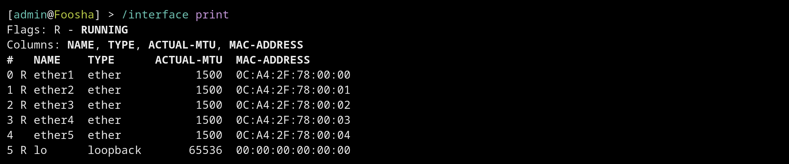

   The `R` flag (_running_) indicates the interface is already connected. `ether1` through `ether4` are already connected according to the topology, while `ether5` is unused.

3. Interface `ether1` is connected to NAT1. For Foosha to get an IP Address and internet access from NAT1, `ether1` must run a DHCP client. On MikroTik CHR, the DHCP client on `ether1` is already active by default. Check its status with:

   ```
   /ip dhcp-client print
   ```

   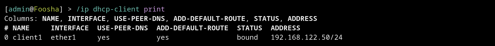

   The `STATUS` column has the value `bound`, meaning Foosha has already obtained an IP Address from NAT1 (in this example `192.168.122.50/24`, the result may differ).

   If the list is empty, add a DHCP client on `ether1`:

   ```
   /ip dhcp-client add interface=ether1 disabled=no
   ```

4. Check the DNS server used by Foosha:

   ```
   /ip dns print
   ```

   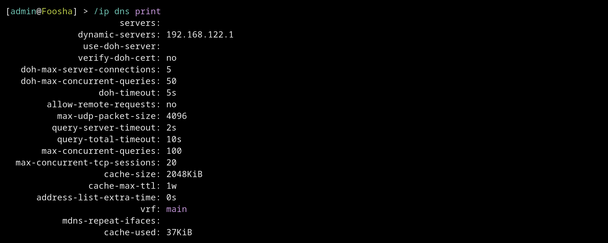

   The DNS server from NAT1 is obtained automatically via the DHCP client and appears in the `dynamic-servers` row. If you want to add a DNS server manually, use:

   ```
   /ip dns set servers=8.8.8.8
   ```

5. Test Foosha's internet connection:

   ```
   /ping google.com count=4
   ```

   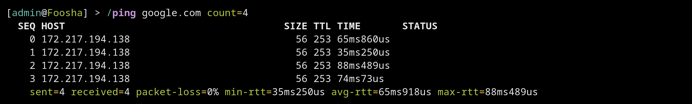

   The values `received=4` and `packet-loss=0%` mean Foosha is already connected to the internet.

6. Add an IP Address for each LAN interface according to the table in [Topology and Calculation](#topologi-dan-perhitungan). The IP Address is written together with its prefix.

   ```
   /ip address add address=192.168.1.1/26 interface=ether2 comment=LAN-A
   /ip address add address=192.168.1.65/27 interface=ether3 comment=LAN-B
   /ip address add address=192.168.1.97/28 interface=ether4 comment=LAN-C
   ```

7. Check the result with:

   ```
   /ip address print
   ```

   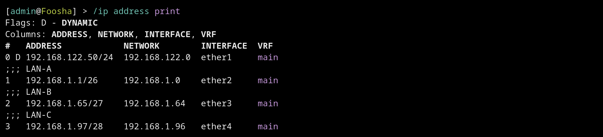

   Pay attention to the `NETWORK` column. MikroTik automatically calculates the Network ID from the IP Address and prefix entered, so its value should match the Network ID column in the calculation table. The row `192.168.122.50/24` with the `D` flag (_dynamic_) is the IP Address from the DHCP client on `ether1`.

   If an incorrect IP Address was entered, remove it with the following command, then re-add the correct IP Address:

   ```
   /ip address remove [find address="192.168.1.1/26"]
   ```

8. After the IP Address is added, MikroTik automatically knows how to reach those three subnets because it is directly connected to them. This can be seen in the routing table:

   ```
   /ip route print
   ```

   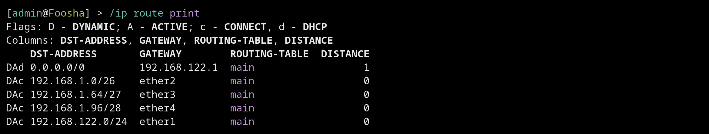

   A route with the `DAc` flag shows a subnet that is directly connected (_connected_) to Foosha.

   The route `0.0.0.0/0` with the `DAd` flag is the **default route**, i.e. the route used for all destination IPs that do not match any other route, same as the default gateway in Module 3. This route is obtained from the DHCP client, so packets heading to the internet are forwarded to NAT1 (`192.168.122.1`).

> Unlike the Linux router in Module 1 and Module 3, MikroTik does not need to enable IP forwarding with `sysctl -w net.ipv4.ip_forward=1`, because it is already active by default (`ip-forward: yes` in `/ip settings print`). MikroTik's configuration is also saved immediately when the command is run, so it remains after the router is restarted without needing a script like `/root/init.sh`.

#### Alabasta

Set the IP Address through **Edit config**, then restart the node for the configuration to be applied:

```
auto eth0
iface eth0 inet static
	address 192.168.1.2
	netmask 255.255.255.192
	gateway 192.168.1.1
```


Check the installed IP Address on the `inet` line:

```
ip a show eth0
```


#### Jipangu

Set the IP Address through **Edit config**, then restart the node for the configuration to be applied:

```
auto eth0
iface eth0 inet static
	address 192.168.1.66
	netmask 255.255.255.224
	gateway 192.168.1.65
```


Check the installed IP Address on the `inet` line:

```
ip a show eth0
```


#### Loguetown

Set the IP Address through **Edit config**, then restart the node for the configuration to be applied:

```
auto eth0
iface eth0 inet static
	address 192.168.1.98
	netmask 255.255.255.240
	gateway 192.168.1.97
```


Check the installed IP Address on the `inet` line:

```
ip a show eth0
```


#### Testing

1. From **Alabasta**, ping its gateway:

   ```
   ping -c 4 192.168.1.1
   ```

   

2. From **Alabasta**, ping a client in another subnet, namely Jipangu and Loguetown:

   ```
   ping -c 4 192.168.1.66
   ping -c 4 192.168.1.98
   ```

   

   The ping succeeds because the packet is sent to the gateway (Foosha), and Foosha knows how to reach every subnet directly connected to it.

3. From **Foosha**, ping all clients:

   ```
   /ping 192.168.1.2 count=4
   /ping 192.168.1.66 count=4
   /ping 192.168.1.98 count=4
   ```

   

4. From **Alabasta**, try pinging the internet:

   ```
   ping -c 4 8.8.8.8
   ```

   

   The ping fails (`100% packet loss`). The client cannot yet access the internet even though Foosha is already connected to NAT1. For the client to access the internet, additional NAT configuration is needed on Foosha.

## 2. Static Routing (Continued)

In Module 3, static routing was configured on Linux using `ip route add` on a topology with few routers. In this chapter, static routing is implemented on MikroTik on a larger topology, so a packet must pass through several routers before reaching its destination.

### 2.1 Multi-hop Routing

**Multi-hop routing** is the delivery of a packet that passes through more than one router before reaching its destination.

Each router does not know the entire path to the destination. The router only matches the packet's destination IP with its routing table, then forwards the packet to the next router (_next hop_). This step is repeated by every router the packet passes through (_hop-by-hop_).

For example, a packet from PC1 (LAN Water7) heading to PC4 (LAN Alabasta) passes through five routers:


The numbers 1 through 5 show the order of routers the packet passes through. A switch is not counted as a hop because a switch only forwards packets within a LAN, not performing routing.

There are two things that need attention for communication to succeed:

- **The outbound and return paths**: the router on the outbound path must know how to reach the destination subnet, and the router on the return path must know how to reach the source subnet. If either one is missing, the ping still fails even though the packet already reached the destination.
- **Default route**: routers at the edge of the topology, such as Water7 and Alabasta, only have one way out. A router like this only needs to be given one default route (`0.0.0.0/0`) to the router above it.

With this rule, the routes needed by each router are as follows:

| Router   | Destination Subnet   | Next hop |
| -------- | --------------------- | -------- |
| Foosha   | A1, A2, A3           | Pucci    |
| Foosha   | A6, A7, A8           | Guanhao  |
| Foosha   | Default (internet)   | NAT1     |
| Pucci    | A1                   | Water7   |
| Pucci    | Default              | Foosha   |
| Water7   | Default              | Pucci    |
| Guanhao  | A7, A8               | Alabasta |
| Guanhao  | Default              | Foosha   |
| Alabasta | Default              | Guanhao  |

A subnet that is directly connected to a router does not need to be added, because the router already knows it automatically.

### 2.2 Route Summarization and Longest Prefix Match

#### 2.2.1 Route Summarization

**Route summarization** is a technique of merging several routes into one route that covers all those subnets. The method is the same as supernetting: consecutive subnets are merged into one block with a shorter prefix.

In the table above, Foosha needs 6 routes. In fact, the subnets behind Pucci (A1, A2, A3) are already combined into D1, and the subnets behind Guanhao (A6, A7, A8) are already combined into D2.


Foosha's routing table before summarization:

| Destination Subnet         | Next hop |
| ------------------------- | -------- |
| `192.168.0.0/25` (A1)     | Pucci    |
| `192.168.0.128/30` (A2)   | Pucci    |
| `192.168.1.0/26` (A3)     | Pucci    |
| `192.168.4.64/30` (A6)    | Guanhao  |
| `192.168.4.32/28` (A7)    | Guanhao  |
| `192.168.4.0/27` (A8)     | Guanhao  |

Foosha's routing table after summarization:

| Destination Subnet     | Next hop |
| ----------------------- | -------- |
| `192.168.0.0/22` (D1)   | Pucci    |
| `192.168.4.0/24` (D2)   | Guanhao  |

Benefits of route summarization:

- A smaller routing table, making it easier to read and check.
- A new subnet within the same block does not need to be added one by one to other routers.

Requirements for route summarization:

- The subnets being merged must be consecutive and within one block, like the result of supernetting.
- All those subnets must be reachable through the same next hop.

> The block resulting from summarization may cover addresses that are not yet used. For example, D1 (`192.168.0.0/22`) also covers `192.168.3.0` through `192.168.3.255`, even though no subnet uses that address. Packets heading to this address are still forwarded by Foosha to Pucci.

#### 2.2.2 Longest Prefix Match

A destination IP can match more than one route. For example, after summarization Foosha has the following routes:

| Route              | Description                          |
| ------------------ | ------------------------------------ |
| `0.0.0.0/0`        | Default route to NAT1               |
| `192.168.4.0/24`   | D2, via Guanhao                     |
| `192.168.4.128/30` | A5, directly connected to Foosha    |

To choose a route, the router uses the **longest prefix match** rule: among all matching routes, the router chooses the route with the longest (most specific) prefix.

| Destination IP           | Matching routes  | Chosen route                                |
| ------------------------ | ---------------- | -------------------------------------------- |
| `192.168.4.130` (Guanhao) | /0, /24, /30     | `192.168.4.128/30`, directly connected       |
| `192.168.4.34` (PC3)     | /0, /24          | `192.168.4.0/24`, via Guanhao           |
| `8.8.8.8`                | /0               | `0.0.0.0/0`, via NAT1                   |

The default route (/0) matches every destination IP, but it always loses to any other more specific route. Because of that, the default route is only used if no other route matches.

If there are two routes with the same prefix, MikroTik chooses the route with the smallest `distance` value.

### 2.3 Routing Loop and TTL

#### 2.3.1 Routing Loop

A **routing loop** occurs when a packet circulates between two or more routers without ever reaching its destination. Each router thinks the other router is the way to the destination.


In the image above, a packet from PC1 heading to PC4 is forwarded by Foosha to Guanhao. The route on Guanhao mistakenly points back to Foosha, so the packet circulates between the two.

Common causes:

- **Wrong gateway**: Foosha forwards the packet to Guanhao, but the route on Guanhao actually points back to Foosha.
- **Summarization and default route**: Foosha forwards a packet heading to `192.168.3.10` to Pucci because that address is included in D1. Pucci does not have that subnet, so the packet is sent back to Foosha via the default route.

A circulating packet fills up the link between those routers. So that the packet does not circulate forever, IPv4 has a limit in the form of TTL.

#### 2.3.2 TTL and Traceroute

The TTL field in the [IPv4 Header](#ipv4-header) limits the number of routers a packet may pass through:

1. The sender fills TTL with an initial value, for example `64` on Linux and MikroTik.
2. Every router that forwards the packet decreases TTL by 1.
3. If TTL reaches `0`, the router drops the packet and sends an ICMP Time Exceeded message to the sender.

For example, when PC1 pings Water7 (its gateway), the reply from Water7 has `ttl=64` because it does not pass through any other router. When PC1 pings PC4, the reply from PC4 has `ttl=59` because it passes through five routers, namely Alabasta, Guanhao, Foosha, Pucci, and Water7.

In a routing loop, TTL keeps decreasing until it reaches `0`, so the ping shows the message `Time to live exceeded`.

Traceroute uses TTL to find out which routers a packet passes through:

1. Traceroute sends a packet with TTL `1`. The first router drops the packet and replies with Time Exceeded, so the address of the first router is revealed.
2. Traceroute sends a packet with TTL `2`, `3`, and so on. Each Time Exceeded reply reveals the next router.
3. The process stops once the packet reaches the destination.

If a routing loop occurs, the traceroute result shows the same router addresses alternating and repeating.

### 2.4 Implementation

In this section, the topology from [Supernetting](#14-supernetting) is configured in GNS3. MikroTik is used as the router, while netics-pc is used as the client.

#### Topology and IP Division

Create the following topology in GNS3:


The IP division follows the table resulting from [Supernetting](#14-supernetting). The `ether1` interface of every router always points to NAT1.

| Node     | Interface | Connected to  | Subnet | IP Address         |
| -------- | --------- | ------------- | ------ | ------------------- |
| Foosha   | `ether1`  | NAT1          | -      | DHCP               |
| Foosha   | `ether2`  | Pucci         | A4     | `192.168.2.1/30`   |
| Foosha   | `ether3`  | Guanhao       | A5     | `192.168.4.129/30` |
| Pucci    | `ether1`  | Foosha        | A4     | `192.168.2.2/30`   |
| Pucci    | `ether2`  | Water7        | A2     | `192.168.0.129/30` |
| Pucci    | `ether3`  | Switch1 (PC2, EniesLobby) | A3     | `192.168.1.1/26`   |
| Water7   | `ether1`  | Pucci         | A2     | `192.168.0.130/30` |
| Water7   | `ether2`  | Switch0 (PC1) | A1     | `192.168.0.1/25`   |
| Guanhao  | `ether1`  | Foosha        | A5     | `192.168.4.130/30` |
| Guanhao  | `ether2`  | Alabasta      | A6     | `192.168.4.65/30`  |
| Alabasta | `ether1`  | Guanhao       | A6     | `192.168.4.66/30`  |
| Alabasta | `ether2`  | Switch2 (PC3) | A7     | `192.168.4.33/28`  |
| Alabasta | `ether3`  | Switch3 (PC4) | A8     | `192.168.4.1/27`   |

EniesLobby is a DHCP Server with a static IP. PC1 through PC4 obtain an IP Address from EniesLobby via DHCP, with the following range (_pool_):

| Node       | Subnet | IP Address                               | Gateway        | DHCP Relay |
| ---------- | ------ | ------------------------------------------ | -------------- | ---------- |
| EniesLobby | A3     | `192.168.1.2/26` (static)                | `192.168.1.1`  | -          |
| PC1        | A1     | DHCP, `192.168.0.2` - `192.168.0.126`   | `192.168.0.1`  | Water7     |
| PC2        | A3     | DHCP, `192.168.1.3` - `192.168.1.62`    | `192.168.1.1`  | -          |
| PC3        | A7     | DHCP, `192.168.4.34` - `192.168.4.46`   | `192.168.4.33` | Alabasta   |
| PC4        | A8     | DHCP, `192.168.4.2` - `192.168.4.30`    | `192.168.4.1`  | Alabasta   |

Configuration of each router is done through the console, after logging in as in [MikroTik-CHR Installation on GNS3](#0-mikrotik-chr-installation-on-gns3).

> On Pucci, Water7, Guanhao, and Alabasta, the built-in DHCP client on `ether1` is not used because `ether1` is connected to another router, not to NAT1. Remove it with `/ip dhcp-client remove [find interface=ether1]`.

#### Foosha

Foosha has already obtained an IP and a default route from NAT1 via the DHCP client on `ether1`, as in [Foosha](#foosha) chapter 1.

1. Change the identity and add IP Addresses:

   ```
   /system identity set name=Foosha
   /ip address add address=192.168.2.1/30 interface=ether2 comment=A4
   /ip address add address=192.168.4.129/30 interface=ether3 comment=A5
   ```

2. Add routes to the subnets behind Pucci and Guanhao:

   ```
   /ip route add dst-address=192.168.0.0/25 gateway=192.168.2.2 comment=A1
   /ip route add dst-address=192.168.0.128/30 gateway=192.168.2.2 comment=A2
   /ip route add dst-address=192.168.1.0/26 gateway=192.168.2.2 comment=A3
   /ip route add dst-address=192.168.4.64/30 gateway=192.168.4.130 comment=A6
   /ip route add dst-address=192.168.4.32/28 gateway=192.168.4.130 comment=A7
   /ip route add dst-address=192.168.4.0/27 gateway=192.168.4.130 comment=A8
   ```

   `dst-address` is the destination subnet, while `gateway` is the next hop IP, namely the IP of the neighboring router on the subnet directly connected to Foosha.

3. Add NAT so that the subnets behind Foosha can access the internet:

   ```
   /ip firewall nat add chain=srcnat out-interface=ether1 action=masquerade
   ```

   This rule replaces the sender's IP with the IP of Foosha's `ether1` every time a packet goes out toward NAT1, so that the reply from the internet can return. This is the additional NAT configuration mentioned in [Testing](#pengujian) chapter 1.

4. Check the routing table:

   ```
   /ip route print
   ```

   

   A manually added route has the `s` (_static_) flag. The `A` (_active_) flag indicates that route is currently in use.

#### Pucci

1. Change the identity and add IP Addresses:

   ```
   /system identity set name=Pucci
   /ip address add address=192.168.2.2/30 interface=ether1 comment=A4
   /ip address add address=192.168.0.129/30 interface=ether2 comment=A2
   /ip address add address=192.168.1.1/26 interface=ether3 comment=A3
   ```

2. Add a default route to Foosha and a route to A1 via Water7:

   ```
   /ip route add dst-address=0.0.0.0/0 gateway=192.168.2.1
   /ip route add dst-address=192.168.0.0/25 gateway=192.168.0.130 comment=A1
   ```

3. Pucci does not get a DNS server from DHCP. Set the DNS server manually, then check the result:

   ```
   /ip dns set servers=8.8.8.8
   /ip dns print
   ```

   

   The `servers` row shows the newly set DNS server.

#### Water7

1. Change the identity and add IP Addresses:

   ```
   /system identity set name=Water7
   /ip address add address=192.168.0.130/30 interface=ether1 comment=A2
   /ip address add address=192.168.0.1/25 interface=ether2 comment=A1
   ```

2. Water7 only has one way out, namely Pucci, so one default route is enough:

   ```
   /ip route add dst-address=0.0.0.0/0 gateway=192.168.0.129
   ```

3. Set the DNS server:

   ```
   /ip dns set servers=8.8.8.8
   ```

#### Guanhao

1. Change the identity and add IP Addresses:

   ```
   /system identity set name=Guanhao
   /ip address add address=192.168.4.130/30 interface=ether1 comment=A5
   /ip address add address=192.168.4.65/30 interface=ether2 comment=A6
   ```

2. Add a default route to Foosha and routes to A7 and A8 via Alabasta:

   ```
   /ip route add dst-address=0.0.0.0/0 gateway=192.168.4.129
   /ip route add dst-address=192.168.4.32/28 gateway=192.168.4.66 comment=A7
   /ip route add dst-address=192.168.4.0/27 gateway=192.168.4.66 comment=A8
   ```

3. Set the DNS server:

   ```
   /ip dns set servers=8.8.8.8
   ```

#### Alabasta

1. Change the identity and add IP Addresses:

   ```
   /system identity set name=Alabasta
   /ip address add address=192.168.4.66/30 interface=ether1 comment=A6
   /ip address add address=192.168.4.33/28 interface=ether2 comment=A7
   /ip address add address=192.168.4.1/27 interface=ether3 comment=A8
   ```

2. Alabasta only has one way out, namely Guanhao, so one default route is enough:

   ```
   /ip route add dst-address=0.0.0.0/0 gateway=192.168.4.65
   ```

3. Set the DNS server:

   ```
   /ip dns set servers=8.8.8.8
   ```

#### EniesLobby

EniesLobby is a netics-pc acting as a DHCP Server for PC1 through PC4. The DHCP Server used is Kea, the same as in [Module 1](../Modul-1/README.md#27-konfigurasi-dhcp-server-menggunakan-kea-dhcp4).

1. Set the IP Address through **Edit config**, then restart the node for the configuration to be applied:

   ```
   auto eth0
   iface eth0 inet static
   	address 192.168.1.2
   	netmask 255.255.255.192
   	gateway 192.168.1.1
   	up echo nameserver 8.8.8.8 > /etc/resolv.conf
   ```

   

   EniesLobby uses a static IP because the DHCP Server's address must remain fixed. This address is also the one that the DHCP relay will later target.

2. On **EniesLobby**, install Kea, then check its version:

   ```
   apk update
   apk add kea-dhcp4
   kea-dhcp4 -V
   ```

   

   Installation requires internet access, which is already available via the default route on Pucci and NAT on Foosha.

3. On **EniesLobby**, replace the entire contents of `/etc/kea/kea-dhcp4.conf` with the following configuration:

   ```json
   {
     "Dhcp4": {
       "interfaces-config": {
         "interfaces": ["eth0"]
       },
       "lease-database": {
         "type": "memfile",
         "persist": true,
         "name": "/var/lib/kea/kea-leases4.csv"
       },
       "valid-lifetime": 600,
       "max-valid-lifetime": 7200,
       "option-data": [
         { "name": "domain-name-servers", "data": "8.8.8.8" }
       ],
       "subnet4": [
         {
           "id": 1,
           "subnet": "192.168.0.0/25",
           "pools": [ { "pool": "192.168.0.2 - 192.168.0.126" } ],
           "option-data": [ { "name": "routers", "data": "192.168.0.1" } ]
         },
         {
           "id": 2,
           "subnet": "192.168.1.0/26",
           "pools": [ { "pool": "192.168.1.3 - 192.168.1.62" } ],
           "option-data": [ { "name": "routers", "data": "192.168.1.1" } ]
         },
         {
           "id": 3,
           "subnet": "192.168.4.32/28",
           "pools": [ { "pool": "192.168.4.34 - 192.168.4.46" } ],
           "option-data": [ { "name": "routers", "data": "192.168.4.33" } ]
         },
         {
           "id": 4,
           "subnet": "192.168.4.0/27",
           "pools": [ { "pool": "192.168.4.2 - 192.168.4.30" } ],
           "option-data": [ { "name": "routers", "data": "192.168.4.1" } ]
         }
       ]
     }
   }
   ```

   - `subnet4` contains four client subnets, namely A1, A3, A7, and A8. Kea selects the subnet based on the relay address that forwarded the request, or based on the interface if the client is in the same subnet (A3).
   - Each pool starts from the second host, because the first host is used by the gateway. The A3 pool starts from `192.168.1.3` because `192.168.1.2` is used by EniesLobby.
   - `routers` is the gateway for each subnet. `domain-name-servers` is written outside `subnet4`, so it applies to all subnets.

4. On **EniesLobby**, check whether the configuration is correct:

   ```
   kea-dhcp4 -t /etc/kea/kea-dhcp4.conf
   ```

   

   All four subnets appear on the `DHCPSRV_CFGMGR_NEW_SUBNET4` line and there is no `ERROR` line. The `WARN` line about multi-threading is normal.

5. On **EniesLobby**, run Kea in the background:

   ```
   mkdir -p /var/lib/kea /run/kea
   kea-dhcp4 -c /etc/kea/kea-dhcp4.conf > /root/kea.log 2>&1 &
   ```

#### DHCP Relay

PC1, PC3, and PC4 are in a different subnet from EniesLobby. The client sends a DHCP request via broadcast, while a router does not forward broadcast to another subnet. Because of that, the router connected to the client's subnet must become a **DHCP relay**, i.e. an intermediary that forwards the client's request to the DHCP Server.

The concept of a DHCP relay is the same as [DHCP Relay](../Modul-1/README.md#dhcp-relay) in Module 1. The difference is that MikroTik already has a built-in DHCP relay, so there is no need to install `dhcp-helper` and enable IP forwarding.

Parameters used:

| Parameter      | Function                                                                                                       |
| -------------- | ---------------------------------------------------------------------------------------------------------- |
| `name`         | Relay name                                                                                                   |
| `interface`    | The interface connected to the client subnet. The relay receives DHCP broadcasts from this interface                  |
| `dhcp-server`  | The DHCP Server's IP Address, namely EniesLobby (`192.168.1.2`)                                                     |
| `local-address`| The router's IP Address on the client subnet. Kea uses this address to select the subnet, then sends the reply to this address |
| `disabled=no`  | Activates the relay, because a newly created relay is disabled by default                                                          |

1. On **Water7**, add a relay for A1, then check the result:

   ```
   /ip dhcp-relay add name=relay-A1 interface=ether2 dhcp-server=192.168.1.2 local-address=192.168.0.1 disabled=no
   /ip dhcp-relay print
   ```

   

   Without `disabled=no`, the relay appears with the `X` (_disabled_) flag and does not forward anything.

2. On **Alabasta**, add relays for A7 and A8, then check the result:

   ```
   /ip dhcp-relay add name=relay-A7 interface=ether2 dhcp-server=192.168.1.2 local-address=192.168.4.33 disabled=no
   /ip dhcp-relay add name=relay-A8 interface=ether3 dhcp-server=192.168.1.2 local-address=192.168.4.1 disabled=no
   /ip dhcp-relay print
   ```

   

   Alabasta needs two relays because it is connected to two client subnets.

Pucci does not need a relay, because PC2 is in the same subnet as EniesLobby.

> The reply from EniesLobby is sent to the relay's `local-address`, so EniesLobby must have a path to A1, A7, and A8. This path is already available from the static route created previously. If that route does not exist yet, the reply from EniesLobby will not reach the client.

#### PC1 through PC4

1. Set **PC1**, **PC2**, **PC3**, and **PC4** through **Edit config** with the same configuration, then restart the node for the configuration to be applied:

   ```
   auto eth0
   iface eth0 inet dhcp
   ```

   

   `inet dhcp` makes the PC request an IP Address, gateway, and DNS server from the DHCP Server when the node is powered on.

2. On each PC, check the obtained IP Address and gateway:

   ```
   ip -4 addr show eth0
   ip route
   ```

   - **PC1**:

     

   - **PC2**:

     

   - **PC3**:

     

   - **PC4**:

     

   | Node | IP Address        | Gateway        | Obtained via        |
   | ---- | ----------------- | -------------- | ------------------------- |
   | PC1  | `192.168.0.2/25`  | `192.168.0.1`  | Relay `relay-A1` (Water7) |
   | PC2  | `192.168.1.3/26`  | `192.168.1.1`  | Directly, without a relay     |
   | PC3  | `192.168.4.34/28` | `192.168.4.33` | Relay `relay-A7` (Alabasta) |
   | PC4  | `192.168.4.2/27`  | `192.168.4.1`  | Relay `relay-A8` (Alabasta) |

   In this test, each PC obtained the first address from its subnet's pool. Each PC's gateway also matches the `routers` set for that subnet.

3. On **EniesLobby**, view the list of leased IP Addresses (_lease_):

   ```
   cut -d, -f1,2,6 /var/lib/kea/kea-leases4.csv
   ```

   

   `cut` is used to display only the address, MAC address, and subnet columns. The `subnet_id` column corresponds to the `id` in `subnet4`, so it can be seen that each PC obtained an IP from its own subnet.

#### Multi-hop Testing

1. From **PC1**, ping its gateway (Water7):

   ```
   ping -c 4 192.168.0.1
   ```

   

   The reply from Water7 has `ttl=64` because it does not pass through any other router.

2. From **PC1**, ping PC4:

   ```
   ping -c 4 192.168.4.2
   ```

   

   The reply from PC4 passes through five routers, so its TTL decreases from `64` to `ttl=59`.

3. From **PC1**, view the path the packet takes:

   ```
   traceroute 192.168.4.2
   ```

   

   The result shows five routers before reaching PC4, namely Water7 (`192.168.0.1`), Pucci (`192.168.0.129`), Foosha (`192.168.2.1`), Guanhao (`192.168.4.130`), and Alabasta (`192.168.4.66`).

4. From **Water7**, do the same thing using MikroTik commands:

   ```
   /ping 192.168.4.2 count=4
   ```

   

   ```
   /tool traceroute 192.168.4.2
   ```

   

   Traceroute on MikroTik keeps running and updates its result. Press `Q` to stop it.

5. Test the internet connection from the router and the client farthest from NAT1:

   - From **Alabasta**:

     ```
     /ping google.com count=4
     ```

     

   - From **PC4**:

     ```
     ping -c 4 google.com
     ```

     

#### Route Summarization

1. On **Foosha**, remove all routes going through Pucci and Guanhao:

   ```
   /ip route remove [find gateway=192.168.2.2]
   /ip route remove [find gateway=192.168.4.130]
   ```

   `[find ...]` finds routes matching the criteria, and the result is passed to the `remove` command.

2. On **Foosha**, add two routes resulting from summarization:

   ```
   /ip route add dst-address=192.168.0.0/22 gateway=192.168.2.2 comment=D1
   /ip route add dst-address=192.168.4.0/24 gateway=192.168.4.130 comment=D2
   ```

3. On **Guanhao**, merge routes A7 and A8 into B2 (`192.168.4.0/26`):

   ```
   /ip route remove [find gateway=192.168.4.66]
   /ip route add dst-address=192.168.4.0/26 gateway=192.168.4.66 comment=B2
   ```

4. On **Foosha**, check the routing table again:

   ```
   /ip route print
   ```

   

   Foosha's static routes are now only two, namely D1 and D2. Repeat the ping from PC1 to PC4 to make sure every subnet is still reachable.

5. On **Foosha**, display all routes that match Guanhao's IP:

   ```
   /ip route print where 192.168.4.130 in dst-address
   ```

   

   The result shows three routes: `0.0.0.0/0`, `192.168.4.0/24`, and `192.168.4.128/30`. Based on longest prefix match, Foosha uses `192.168.4.128/30` because its prefix is the longest.

#### Routing Loop and TTL

First scenario: wrong gateway.

1. On **Guanhao**, change route B2's gateway to Foosha to simulate a misconfiguration:

   ```
   /ip route set [find comment=B2] gateway=192.168.4.129
   ```

2. From **PC1**, ping PC4:

   ```
   ping -c 4 192.168.4.2
   ```

   

   The ping fails with the message `Time to live exceeded`. The packet from PC1 circulates between Foosha and Guanhao until its TTL runs out at Guanhao (`192.168.4.130`), so it is Guanhao that sends that message.

3. From **PC1**, view the packet's path:

   ```
   traceroute 192.168.4.2
   ```

   

   Starting from hop 4, the addresses of Guanhao (`192.168.4.130`) and Foosha (`192.168.2.1`) appear alternately up to the traceroute's maximum hop limit. Foosha appears as `192.168.2.1` because the router replies using the IP of the interface that points back to the sender, namely `ether2`.

4. On **Guanhao**, view the logs related to routes:

   ```
   /log print where message~"^route "
   ```

   

   The log records every configuration change along with its command. The `where message~"^route "` part filters logs that begin with the word `route`. The last line shows the `set` command that changed route B2's gateway and caused the loop.

5. On **Guanhao**, restore route B2's gateway back to Alabasta, then repeat the ping from PC1:

   ```
   /ip route set [find comment=B2] gateway=192.168.4.66
   ```

Second scenario: summarization and default route.

1. From **PC1**, ping an address that is included in D1 but is not used by any subnet:

   ```
   ping -c 4 192.168.3.10
   ```

   

   The ping fails with the message `Time to live exceeded`. Foosha forwards the packet to Pucci because `192.168.3.10` is included in D1, then Pucci sends it back to Foosha via the default route.

2. On **Pucci**, add a blackhole route for the entire D1 block:

   ```
   /ip route add dst-address=192.168.0.0/22 blackhole comment=D1-blackhole
   ```

   A **blackhole** route is a route that drops every packet matching it. Subnets A1, A2, A3, and A4 remain reachable because their routes are more specific than /22. Only unused addresses get dropped.

3. On **Pucci**, check the routing table:

   ```
   /ip route print
   ```

   

   The `D1-blackhole` route is shown without a gateway, because packets matching it are not forwarded anywhere.

4. From **PC1**, repeat the ping to `192.168.3.10`:

   ```
   ping -c 4 192.168.3.10
   ```

   

   The ping still fails, but there is no longer a `Time to live exceeded` message. The packet is dropped directly at Pucci without circulating.

The same problem can occur with D2. The solution is the same, namely adding a blackhole route `192.168.4.0/24` on Guanhao.

## 3. Dynamic Routing

In chapter 2, every route was added manually. Foosha alone needed six routes before summarization, and every topology change required routes on several routers to be changed one by one. In this chapter, the routing table is filled automatically by the router using dynamic routing.

### 3.1 Introduction to Dynamic Routing

#### 3.1.1 Definition

**Dynamic routing** is a way of filling the routing table automatically. Routers exchange route information with other routers directly connected to them, called **neighbors**. The rule for exchanging this information is called a **routing protocol**.

Imagine a group of people asking each other for directions. Each person only knows the roads around their own house, then tells their neighbor about it. The neighbor passes that story on to the next neighbor, so eventually everyone knows how to get to anyone's house.

Dynamic routing works with the following sequence:

1. Each router announces the subnets directly connected to it to its neighbors.
2. Neighbors forward that information to other neighbors, until all routers know all the subnets.
3. If there is more than one path to the same subnet, the router chooses the best path based on **metric**, i.e. a value representing the distance or cost of a path. The smaller the metric, the better the path.
4. If the topology changes, for example a link goes down, the router updates its own routing table without needing to be reconfigured.

#### 3.1.2 Purpose

Comparison of static routing and dynamic routing:

| Aspect                   | Static Routing                                       | Dynamic Routing                                         |
| ----------------------- | ----------------------------------------------------- | --------------------------------------------------------- |
| Filling the routing table | Manually by the admin                                | Automatically by the routing protocol                     |
| What is configured      | A route to every subnet not directly connected        | The interface that runs the routing protocol               |
| When a new subnet appears | A route is added on every router that needs it       | Only needs to be configured on the router connected to the subnet |
| When a link goes down      | The route still points to the down link              | The router looks for another path, if one exists           |
| Resource usage           | Light                                                 | Heavier, because routers keep exchanging information       |
| Suitable for             | Small networks that rarely change                     | Large networks or ones that change often                   |

Dynamic routing does not have to fully replace static routing. Both can be used together, for example a default route to the internet is set manually on one router, then propagated to other routers using a routing protocol.

### 3.2 Routing Protocol Classification

Routing protocols are grouped based on the algorithm used and the region in which the protocol operates.

#### 3.2.1 Based on Algorithm

**Distance vector** is a group of routing protocols that makes a router only know the distance (_distance_) and direction (_vector_), namely the neighbor that must be passed through, to every subnet. The router does not know the shape of the whole topology, only trusts information from its neighbors. The algorithm used is Bellman-Ford.

Distance vector is like a signpost reading "Alabasta 4 km →". The sign tells you the distance and direction, but does not show you a map of the road.

**Link state** is a group of routing protocols that makes every router know the shape of the entire topology, namely which routers exist and what links connect them. From that information, every router calculates the shortest path to every subnet itself using Dijkstra's algorithm. Link state is like holding a complete map, then deciding your own route.

| Aspect                                | Distance Vector                                    | Link State                                             |
| ------------------------------------ | --------------------------------------------------- | -------------------------------------------------------- |
| Information held by the router       | Distance and direction to every subnet              | A map of the entire topology                              |
| Information sent                     | The entire routing table, periodically to neighbors  | Link information, sent to all routers upon a change       |
| CPU and memory usage                 | Low                                                   | Higher                                                     |
| Speed of adapting to change          | Slow                                                  | Fast                                                       |
| Example protocols                    | RIP                                                   | OSPF, IS-IS                                                |

#### 3.2.2 Based on Region

An **Autonomous System (AS)** is a collection of networks managed by a single party with the same routing policy, for example an ISP's, a campus's, or a company's network. The entire topology in this module can be considered as one AS.

Based on their region, routing protocols are divided into two:

- **IGP** (_Interior Gateway Protocol_): a routing protocol for exchanging routes within a single AS. Examples are RIP, OSPF, and IS-IS.
- **EGP** (_Exterior Gateway Protocol_): a routing protocol for exchanging routes between ASes, for example between ISPs on the internet. The EGP protocol used today is BGP (_Border Gateway Protocol_).

RIP and OSPF discussed in this chapter are IGPs.

### 3.3 Dynamic Routing Protocols

#### 3.3.1 RIP

**RIP** (_Routing Information Protocol_) is a distance vector routing protocol that uses **hop count** as its metric. Hop count represents the number of routers that must be passed through to reach a subnet. RIP always chooses the path with the smallest hop count, without regard to link speed.

RIPv1 does not send the netmask, so it only supports [Classful](#131-classful) division. RIPv2 sends the netmask along with every route, so it supports VLSM and CIDR as in [Classless / CIDR](#132-classless--cidr). MikroTik uses RIPv2.

##### How RIP Works

1. Every router sends its routing table to all neighbors every 30 seconds. This sending is called an **update**.
2. A directly connected subnet is announced with metric 1.
3. A router receiving an update adds 1 to the metric of every route, then stores it if that route does not exist yet or its metric is smaller than the existing route.
4. On the next update, that route is forwarded to other neighbors with the new metric.

Besides periodic updates, a router also immediately sends an update when its routing table changes (_triggered update_), so changes do not have to wait 30 seconds.

For example, subnet A8 (`192.168.4.0/27`) is directly connected to Alabasta. Information about A8 spreads to Water7 via the path Alabasta, Guanhao, Foosha, and Pucci:

| Order | Router   | Update received       | Metric of A8 at that router |
| ------ | -------- | --------------------------- | ----------------------------- |
| 1      | Alabasta | - (directly connected)     | 1                              |
| 2      | Guanhao  | From Alabasta, metric 1    | 2                              |
| 3      | Foosha   | From Guanhao, metric 2     | 3                              |
| 4      | Pucci    | From Foosha, metric 3      | 4                              |
| 5      | Water7   | From Pucci, metric 4       | 5                              |

RIP's maximum metric is 15. A route with metric 16 is considered unreachable (_unreachable_). This limit prevents a route from looping endlessly, but also makes RIP unsuitable for large networks.

RIP uses three timers to manage updates and remove routes that are no longer valid:

| Timer              | Default value | Function                                                                     |
| ------------------ | ------------- | ----------------------------------------------------------------------------- |
| Update             | 30 seconds     | Interval for sending the routing table to neighbors                          |
| Timeout            | 180 seconds     | If a route is not refreshed within this time, the route is considered invalid |
| Garbage collection | 120 seconds     | The waiting time before an invalid route is removed from the routing table     |

##### Count to Infinity

Because a router only trusts information from its neighbors, RIP is vulnerable to a problem called **count to infinity**, where a route's metric keeps rising up to 16 because two routers keep giving each other information that is no longer correct.

For example, Water7's interface connected to A1 (`192.168.0.0/25`) goes down:

| Step                    | Route A1 on Water7          | Route A1 on Pucci           |
| -------------------------- | ------------------------------ | ------------------------------ |
| Initial                       | Metric 1, directly connected | Metric 2, via Water7           |
| Water7's interface to A1 goes down | Unreachable        | Metric 2, via Water7           |
| Pucci sends an update      | Metric 3, via Pucci            | Metric 2, via Water7           |
| Water7 sends an update     | Metric 3, via Pucci            | Metric 4, via Water7           |
| And so on              | ...                             | ...                             |
| Final                        | Metric 16, unreachable       | Metric 16, unreachable       |

Before Water7 had a chance to announce that A1 was down, Pucci sent an update saying A1 was reachable with metric 2. Water7 trusted it, even though Pucci's path to A1 actually went through Water7. As long as the metric has not reached 16, a packet heading to A1 circulates between Water7 and Pucci, similar to [Routing Loop](#231-routing-loop) in chapter 2.

RIP has three mechanisms to prevent this problem:

- **Split horizon**: a router does not announce a route back to the neighbor it was learned from. Pucci learned A1 from Water7, so Pucci does not announce A1 to Water7.
- **Route poisoning**: when a subnet becomes unreachable, the router immediately announces that subnet with metric 16, without waiting for a timeout. Water7 immediately tells Pucci that A1 has metric 16.
- **Poison reverse**: a router still announces a route back to the neighbor it came from, but with metric 16. Pucci announces A1 to Water7 with metric 16, so Water7 knows that A1 is unreachable via Pucci. This method is more assertive than split horizon, which just stays silent.

#### 3.3.2 OSPF

**OSPF** (_Open Shortest Path First_) is a link state routing protocol. Every OSPF router gathers information about every link in the network, then calculates its own shortest path to every subnet using Dijkstra's algorithm.

Every OSPF router has a **router ID**, a unique identity written in IPv4 format, for example `1.1.1.1`. The router ID does not have to match the IP Address assigned to an interface.

##### How OSPF Works

1. **Finding neighbors**: a router sends **Hello** packets every 10 seconds through the interfaces running OSPF. Two routers that receive each other's Hello become neighbors. If no Hello is received from a neighbor for 40 seconds (**dead interval**), that neighbor is considered dead.
2. **Exchanging link information**: every router creates an **LSA** (_Link State Advertisement_), i.e. information about its own link, such as subnet, neighbors, and cost. The LSA is spread to all routers, not just to neighbors.
3. **Building the LSDB**: every LSA received is stored in the **LSDB** (_Link State Database_). After the exchange is complete, every router has the same LSDB, as if holding the same map.
4. **Calculating the path**: every router runs Dijkstra's algorithm on the LSDB to find the path with the smallest total cost to every subnet. The result is placed in the routing table.
5. **Updating when there is a change**: if a link changes, the router that knows about it immediately spreads a new LSA. Other routers update their LSDB and recalculate their paths.

**Cost** is OSPF's metric. Every interface has a cost value, and the cost of a path is the sum of the cost of every interface passed through. Unlike hop count, cost can be set according to link speed, so OSPF can choose a path that passes through more routers if that path is faster.

OSPF stores information in three tables:

| Table          | Contents                                        |
| -------------- | -------------------------------------------- |
| Neighbor table | A list of OSPF neighbors and their status     |
| LSDB           | A collection of LSAs, i.e. the topology map          |
| Routing table  | The best path resulting from the Dijkstra calculation   |

##### Area

The more routers there are, the larger the LSDB becomes and the more often every router has to recalculate its path. Because of that, OSPF divides the network into several **areas**. The LSDB only needs to be identical within one area, while subnets from other areas only need to be received in summarized form, not as a complete map.

Areas are divided into two:

- **Backbone area**: the central area with ID `0.0.0.0` (area 0). All other areas must be connected to the backbone area, and inter-area traffic always passes through the backbone area.
- **Standard area**: an area other than the backbone area, with an ID other than 0, for example `0.0.0.1` (area 1).

The topology in this module can be divided into three areas:


Based on its position relative to the areas, an OSPF router has the following roles:

| Role | Definition | Example |
| ----- | -------- | ------ |
| **Internal router** | All OSPF interfaces are in one area | Water7 (area 1), Alabasta (area 2), Foosha (area 0) |
| **Backbone router** | Has at least one interface in area 0 | Foosha, Pucci, Guanhao |
| **ABR** (_Area Border Router_) | Connected to more than one area, one of which is area 0 | Pucci, Guanhao |
| **ASBR** (_Autonomous System Boundary Router_) | Injects a route from outside OSPF, for example a default route to the internet | Foosha |

One router can have more than one role. Foosha is an internal router in area 0, as well as a backbone router and an ASBR.

### 3.4 Redundancy and Failover

**Redundancy** is providing more than one path to the same destination. If one path goes down, there is still another path that can be used.

The chapter 2 topology does not have redundancy, because every router only has one path to another router. In this chapter, link A9 is added between Pucci and Guanhao:


A9 only connects two routers, so it only needs a /30. Its address is taken from the unused part of E1 (`192.168.0.0/21`) resulting from [Supernetting](#14-supernetting), namely `192.168.5.0/30`. That way, the IP division from chapter 2 does not need to be recalculated.

The green boxes in the following tree are the subnets from chapter 2, while the yellow box is A9:


With A9 present, there are two paths from PC1 to PC4:

| Path    | Routers passed                      | Hop count |
| -------- | ----------------------------------------- | --------- |
| Primary    | Water7, Pucci, Guanhao, Alabasta          | 4         |
| Backup | Water7, Pucci, Foosha, Guanhao, Alabasta  | 5         |

The primary path is the path with the best metric. The backup path is only used when the primary path fails.

**Failover** is the process of traffic moving from the primary path to the backup path when the primary path fails. In static routing, failover does not happen on its own, because the route still points to the down path until the admin changes it. In dynamic routing, failover happens automatically.

A router learns that a path has failed in two ways:

- **Interface down**: the router immediately knows when its own interface goes down, for example when a cable is unplugged.
- **Neighbor not heard from**: the router does not receive an update or Hello from a neighbor within a certain time limit, namely the 180-second timeout on RIP and the 40-second dead interval on OSPF. This method is needed if the failure occurs on the neighbor's side, while the router's own interface stays up.

### 3.5 Routing Convergence

**Convergence** is the condition when all routers already have a correct and consistent routing table after a topology change occurs. The time from when the change occurs until convergence is reached is called the **convergence time**.

While convergence has not been reached, some routers are still using old information. As a result, packets can be lost or circulate between routers.

Convergence time is affected by three stages:

| Stage                  | RIP                                                      | OSPF                                                     |
| ---------------------- | ---------------------------------------------------------- | --------------------------------------------------------- |
| Detecting a failure   | 180-second timeout if a neighbor is not heard from          | 40-second dead interval if a neighbor is not heard from     |
| Propagating the change  | Passed router by router through updates              | A new LSA is immediately spread to all routers              |
| Calculating the new path  | Chooses the smallest metric from the received update        | Runs Dijkstra on the LSDB                           |

Because of that, OSPF generally converges far faster than RIP.

### 3.6 Implementation

In this section, the static route from chapter 2 is replaced with RIP, then with OSPF. Both protocols are tested on the same topology, including when link A9 is cut.

#### Topology and IP Division

The topology continues from [Implementation](#24-implementation) chapter 2, plus link A9 between Pucci and Guanhao as in [Redundancy and Failover](#34-redundancy-and-failover):


The IP division is the same as in [Topology and IP Division](#topologi-dan-pembagian-ip) chapter 2, including EniesLobby, DHCP relay, and PC1 through PC4, plus the following IP Address for A9:

| Node    | Interface | Connected to | Subnet | IP Address       |
| ------- | --------- | ------------ | ------ | ------------------ |
| Pucci   | `ether4`  | Guanhao      | A9     | `192.168.5.1/30` |
| Guanhao | `ether3`  | Pucci        | A9     | `192.168.5.2/30` |

#### Preparation

1. In GNS3, add a link between Pucci's `ether4` and Guanhao's `ether3`. A link can be added while the node is running.

2. On **Foosha**, **Pucci**, **Water7**, **Guanhao**, and **Alabasta**, remove all static routes from chapter 2:

   ```
   /ip route remove [find static]
   ```

   `[find static]` selects every route with the `s` flag, including the default route and the blackhole route. Foosha's default route from DHCP is not removed because it is not a static route.

3. On **Pucci**, add an IP Address for A9:

   ```
   /ip address add address=192.168.5.1/30 interface=ether4 comment=A9
   ```

4. On **Guanhao**, add an IP Address for A9:

   ```
   /ip address add address=192.168.5.2/30 interface=ether3 comment=A9
   ```

5. On **Pucci**, check the routing table:

   ```
   /ip route print
   ```

   

   The routing table only contains routes with the `c` (_connected_) flag, namely directly connected subnets. At this stage, the router does not yet know the subnets behind other routers, so PC1 cannot reach PC4. The DHCP relays on Water7 and Alabasta also cannot yet reach EniesLobby.

#### RIP Configuration

RIP configuration on MikroTik consists of two parts. Both must be created in order, because the interface-template refers to the instance name:


1. **Instance**: the RIP process on the router along with the types of routes it announces.
2. **Interface-template**: the list of interfaces through which RIP sends and receives updates.

Parameters used:

| Parameter                    | Function                                                                                                     |
| ---------------------------- | ------------------------------------------------------------------------------------------------------------ |
| `name=rip1`                  | The instance name referenced by the interface-template                                                         |
| `redistribute=connected,rip` | The routes announced: `connected` for directly connected subnets, `rip` for routes from RIP neighbors |
| `instance=rip1`              | The instance that uses that interface-template                                                         |
| `interfaces`                 | The interfaces connected to other routers                                                                    |

> If `rip` is not included in `redistribute`, the router only announces its own subnets. A route learned from a neighbor is not forwarded on, so distant routers never find out about it.

An interface connected to a client is not included in the interface-template, because there is no other router there. The client subnet is still announced via `redistribute=connected`.

Link A9 is also not yet included, so the result can be compared with the static routing from chapter 2.

##### Foosha

1. Create a RIP instance:

   ```
   /routing rip instance add name=rip1 redistribute=connected,rip
   ```

2. Add an interface-template for `ether2` (A4, to Pucci) and `ether3` (A5, to Guanhao):

   ```
   /routing rip interface-template add instance=rip1 interfaces=ether2,ether3
   ```

   `ether1` is not included because it is connected to NAT1, not to a RIP router.

3. Check the configuration:

   ```
   /routing rip instance print
   /routing rip interface-template print
   ```

   

##### Pucci

1. Create a RIP instance:

   ```
   /routing rip instance add name=rip1 redistribute=connected,rip
   ```

2. Add an interface-template for `ether1` (A4, to Foosha) and `ether2` (A2, to Water7):

   ```
   /routing rip interface-template add instance=rip1 interfaces=ether1,ether2
   ```

3. Check the configuration:

   ```
   /routing rip instance print
   /routing rip interface-template print
   ```

   

##### Water7

1. Create a RIP instance:

   ```
   /routing rip instance add name=rip1 redistribute=connected,rip
   ```

2. Add an interface-template for `ether1` (A2, to Pucci):

   ```
   /routing rip interface-template add instance=rip1 interfaces=ether1
   ```

3. Check the configuration:

   ```
   /routing rip instance print
   /routing rip interface-template print
   ```

   

##### Guanhao

1. Create a RIP instance:

   ```
   /routing rip instance add name=rip1 redistribute=connected,rip
   ```

2. Add an interface-template for `ether1` (A5, to Foosha) and `ether2` (A6, to Alabasta):

   ```
   /routing rip interface-template add instance=rip1 interfaces=ether1,ether2
   ```

3. Check the configuration:

   ```
   /routing rip instance print
   /routing rip interface-template print
   ```

   

##### Alabasta

1. Create a RIP instance:

   ```
   /routing rip instance add name=rip1 redistribute=connected,rip
   ```

2. Add an interface-template for `ether1` (A6, to Guanhao):

   ```
   /routing rip interface-template add instance=rip1 interfaces=ether1
   ```

3. Check the configuration:

   ```
   /routing rip instance print
   /routing rip interface-template print
   ```

   

#### RIP Testing

1. On **Foosha**, check the interfaces running RIP:

   ```
   /routing rip interface print
   ```

   

   Every interface in the interface-template appears along with the IP Address used to send updates.

2. On **Foosha**, check the RIP neighbors:

   ```
   /routing rip neighbor print
   ```

   

   Foosha receives updates from Pucci (`192.168.2.2`) and Guanhao (`192.168.4.130`). The `routes` column is the number of routes received from that neighbor, while `last-update` is the time since the last update.

3. On **Water7**, check the routing table:

   ```
   /ip route print
   ```

   

   A route resulting from RIP has the `r` flag. Water7 learns all subnets via Pucci (`192.168.0.129`), including `192.168.122.0/24` belonging to NAT1, which was announced by Foosha because it is directly connected to it.

   The `DISTANCE` column shows the priority of the route's source in MikroTik. The smaller the value, the more trusted it is. A connected route has value 0, static 1, and RIP 120.

4. On **Water7**, view the metric of the route to A8:

   ```
   /routing route print detail where dst-address=192.168.4.0/27
   ```

   

   The value `.metric=5` matches the example in [How RIP Works](#cara-kerja-rip). A8 is announced by Alabasta with metric 1, then increases by 1 at Guanhao, Foosha, Pucci, and Water7.

5. From **PC1**, ping PC4:

   ```
   ping -c 4 192.168.4.2
   ```

   

6. From **PC1**, view the path taken by the packet:

   ```
   traceroute 192.168.4.2
   ```

   

   The path is the same as the static routing in chapter 2, namely Water7, Pucci, Foosha, Guanhao, and Alabasta. The difference is that not a single route was added manually.

7. From **PC4**, request a new IP Address from the DHCP Server:

   ```
   udhcpc -i eth0 -n -q
   ```

   

   PC4 still gets `192.168.4.2` from EniesLobby (`192.168.1.2`) via the relay on Alabasta. The packets between the relay and EniesLobby now follow the route resulting from RIP, so the DHCP relay configuration from chapter 2 does not need to change. The `-n` option makes `udhcpc` stop if it does not get an IP, while `-q` makes it exit after the IP is obtained.

#### Default Route in RIP

1. From **Alabasta**, ping the internet:

   ```
   /ping google.com count=4
   ```

   

   The ping fails with the message `resolve failed`. Alabasta has no default route, so the DNS server `8.8.8.8` cannot be reached.

2. On **Foosha**, change the RIP instance so the default route is also announced:

   ```
   /routing rip instance set [find name=rip1] redistribute=connected,rip,dhcp originate-default=if-installed
   ```

   - `dhcp` is added to `redistribute` because Foosha's default route comes from the DHCP client on `ether1`, as in [Foosha](#foosha) chapter 1.
   - `originate-default=if-installed` allows the default route to be announced as long as Foosha has a default route. Its default value is `never`, which prevents the default route from ever being announced.

   > On RouterOS 7.24.6 used in this module, both parameters must be set together. Setting `originate-default` alone without `dhcp` in `redistribute` does not make the default route get announced.

3. On **Foosha**, check the RIP instance:

   ```
   /routing rip instance print
   ```

   

4. On **Alabasta**, check the routing table:

   ```
   /ip route print
   ```

   

   The default route `0.0.0.0/0` now appears with the `r` flag, via Guanhao (`192.168.4.65`).

5. From **Alabasta**, repeat the ping to the internet:

   ```
   /ping google.com count=4
   ```

   

6. From **PC4**, ping the internet:

   ```
   ping -c 4 google.com
   ```

   

#### Redundancy and Failover in RIP

So far link A9 has not been running RIP, so there is only one path from PC1 to PC4. The following steps activate RIP on A9, then test failover when A9 is cut.

1. On **Pucci**, add `ether4` to the interface-template, then check the result:

   ```
   /routing rip interface-template set [find instance=rip1] interfaces=ether1,ether2,ether4
   /routing rip interface-template print
   ```

   

   `set` replaces the entire content of the `interfaces` parameter, so the old interfaces still need to be written.

2. On **Guanhao**, add `ether3` to the interface-template, then check the result:

   ```
   /routing rip interface-template set [find instance=rip1] interfaces=ether1,ether2,ether3
   /routing rip interface-template print
   ```

   

3. On **Pucci**, check the RIP neighbors:

   ```
   /routing rip neighbor print
   ```

   

   Pucci now has three neighbors. The new neighbor `192.168.5.2` is Guanhao via A9.

4. On **Water7**, check the metric of the route to A8 again:

   ```
   /routing route print detail where dst-address=192.168.4.0/27
   ```

   

   The metric drops from 5 to 4, because the path via A9 passes through one fewer router.

5. From **PC1**, view the path to PC4:

   ```
   traceroute 192.168.4.2
   ```

   

   The packet now passes through Water7, Pucci, Guanhao (`192.168.5.2`), and Alabasta without going through Foosha. This path becomes the primary path, while the path through Foosha becomes the backup path.

6. From **PC1**, run a ping with no packet count limit:

   ```
   ping 192.168.4.2
   ```

7. While the ping is still running, on **Pucci** disable `ether4` to simulate link A9 being cut:

   ```
   /interface disable ether4
   ```

8. A few seconds later, on **Guanhao** check the route to A1:

   ```
   /ip route print where dst-address=192.168.0.0/25
   ```

   

   Guanhao still points A1 to Pucci via A9 (`192.168.5.1`). In GNS3, disabling an interface on one side does not make the interface on the other side go down too, so Guanhao does not know that A9 is cut. Guanhao only removes this route after not receiving an update from Pucci for the 180-second timeout.

9. Wait until the ping on **PC1** gets a reply again, then stop it with `Ctrl+C`:

   

   The replies stop after `icmp_seq=7` and appear again at `icmp_seq=167`. The ping sends one packet per second, so the failover takes about 160 seconds.

   During that time, the packet from PC1 actually already reached PC4 via Foosha, because Pucci immediately knows its `ether4` is down. However, the reply from PC4 was still sent by Guanhao toward A9, so it got lost. The time is slightly under 180 seconds because the last update from Pucci was received a few seconds before `ether4` was disabled.

   The `ttl` value changes from `60` to `59` because the new path passes through one more router.

10. On **Guanhao**, check the route to A1 again:

    ```
    /ip route print where dst-address=192.168.0.0/25
    ```

    

    Route A1 now goes via Foosha (`192.168.4.129`).

11. From **PC1**, view the path to PC4:

    ```
    traceroute 192.168.4.2
    ```

    

    The packet again passes through Foosha (`192.168.2.1`), namely the backup path.

12. On **Pucci**, re-enable `ether4`:

    ```
    /interface enable ether4
    ```

#### OSPF Configuration

Before configuring OSPF, remove the RIP configuration on **Foosha**, **Pucci**, **Water7**, **Guanhao**, and **Alabasta**. The removal order is the reverse of the creation order:

```
/routing rip interface-template remove [find]
/routing rip instance remove [find]
```

OSPF configuration on MikroTik consists of three parts. All three must be created in order, because each part refers to the previous one:


1. **Instance**: the OSPF process on the router along with its router ID.
2. **Area**: the area the router follows.
3. **Interface-template**: the interface that runs OSPF along with its area.

The area division follows the image in [Area](#area):

| Router   | Router ID | Area       | Interface                                           |
| -------- | --------- | ---------- | ---------------------------------------------------- |
| Foosha   | `1.1.1.1` | `backbone` | `ether2`, `ether3`                                  |
| Pucci    | `2.2.2.2` | `backbone` | `ether1`, `ether4`                                  |
| Pucci    | `2.2.2.2` | `area1`    | `ether2`, `ether3` (passive)                        |
| Water7   | `3.3.3.3` | `area1`    | `ether1`, `ether2` (passive)                        |
| Guanhao  | `4.4.4.4` | `backbone` | `ether1`, `ether3`                                  |
| Guanhao  | `4.4.4.4` | `area2`    | `ether2`                                            |
| Alabasta | `5.5.5.5` | `area2`    | `ether1`, `ether2` (passive), `ether3` (passive)    |

Parameters used:

| Parameter       | Function                                                                                  |
| --------------- | ------------------------------------------------------------------------------------------ |
| `router-id`     | The router ID, written in IPv4 format                                                    |
| `name`          | The name of the instance or area, referenced by the next part                                 |
| `area-id`       | The area ID in IPv4 format. The backbone area is written `0.0.0.0`                              |
| `area`          | The area in which the interfaces in the interface-template reside                                    |
| `passive`       | The interface's subnet is still announced, but Hello is not sent through that interface |

Unlike RIP, OSPF automatically announces the subnet of every interface in the interface-template, so `redistribute=connected` is not needed. Because of that, interfaces connected to clients are still included, but as `passive`, because there is no OSPF router there.

##### Foosha

1. Create an OSPF instance:

   ```
   /routing ospf instance add name=ospf1 router-id=1.1.1.1 originate-default=if-installed
   ```

   `originate-default=if-installed` makes Foosha announce the default route from NAT1 to other OSPF routers, so Foosha acts as the ASBR. Unlike RIP, OSPF does not need `dhcp` in `redistribute`.

2. Create the backbone area:

   ```
   /routing ospf area add name=backbone area-id=0.0.0.0 instance=ospf1
   ```

3. Add an interface-template for `ether2` (A4) and `ether3` (A5):

   ```
   /routing ospf interface-template add area=backbone interfaces=ether2,ether3
   ```

4. Check the configuration:

   ```
   /routing ospf instance print
   /routing ospf area print
   /routing ospf interface-template print
   ```

   

   The values `hello-interval=10s`, `dead-interval=40s`, and `cost=1` are the default values discussed in [OSPF](#332-ospf).

##### Pucci

Pucci is connected to the backbone area and area1, so Pucci acts as an ABR.

1. Create an OSPF instance:

   ```
   /routing ospf instance add name=ospf1 router-id=2.2.2.2
   ```

2. Create the backbone area and area1:

   ```
   /routing ospf area add name=backbone area-id=0.0.0.0 instance=ospf1
   /routing ospf area add name=area1 area-id=0.0.0.1 instance=ospf1
   ```

3. Add an interface-template for each area:

   ```
   /routing ospf interface-template add area=backbone interfaces=ether1,ether4
   /routing ospf interface-template add area=area1 interfaces=ether2
   /routing ospf interface-template add area=area1 interfaces=ether3 passive
   ```

   `ether1` (A4) and `ether4` (A9) go into the backbone area. `ether2` (A2) goes into area1, while `ether3` (A3, to PC2) goes into area1 as `passive`.

4. Check the configuration:

   ```
   /routing ospf instance print
   /routing ospf area print
   /routing ospf interface-template print
   ```

   

##### Water7

1. Create an OSPF instance:

   ```
   /routing ospf instance add name=ospf1 router-id=3.3.3.3
   ```

2. Create area1:

   ```
   /routing ospf area add name=area1 area-id=0.0.0.1 instance=ospf1
   ```

3. Add an interface-template for `ether1` (A2) and `ether2` (A1, to PC1):

   ```
   /routing ospf interface-template add area=area1 interfaces=ether1
   /routing ospf interface-template add area=area1 interfaces=ether2 passive
   ```

4. Check the configuration:

   ```
   /routing ospf instance print
   /routing ospf area print
   /routing ospf interface-template print
   ```

   

##### Guanhao

Guanhao is connected to the backbone area and area2, so Guanhao also acts as an ABR.

1. Create an OSPF instance:

   ```
   /routing ospf instance add name=ospf1 router-id=4.4.4.4
   ```

2. Create the backbone area and area2:

   ```
   /routing ospf area add name=backbone area-id=0.0.0.0 instance=ospf1
   /routing ospf area add name=area2 area-id=0.0.0.2 instance=ospf1
   ```

3. Add an interface-template for each area:

   ```
   /routing ospf interface-template add area=backbone interfaces=ether1,ether3
   /routing ospf interface-template add area=area2 interfaces=ether2
   ```

   `ether1` (A5) and `ether3` (A9) go into the backbone area, while `ether2` (A6) goes into area2.

4. Check the configuration:

   ```
   /routing ospf instance print
   /routing ospf area print
   /routing ospf interface-template print
   ```

   

##### Alabasta

1. Create an OSPF instance:

   ```
   /routing ospf instance add name=ospf1 router-id=5.5.5.5
   ```

2. Create area2:

   ```
   /routing ospf area add name=area2 area-id=0.0.0.2 instance=ospf1
   ```

3. Add an interface-template for `ether1` (A6), and `ether2` (A7) and `ether3` (A8) as `passive`:

   ```
   /routing ospf interface-template add area=area2 interfaces=ether1
   /routing ospf interface-template add area=area2 interfaces=ether2,ether3 passive
   ```

4. Check the configuration:

   ```
   /routing ospf instance print
   /routing ospf area print
   /routing ospf interface-template print
   ```

   

#### OSPF Testing

Wait about 40 seconds after all routers are configured, until all routers have finished exchanging LSAs.

1. On **Pucci**, check the interfaces running OSPF:

   ```
   /routing ospf interface print
   ```

   

   Each interface displays its area and cost, and `ether3` has `passive` status. The `dr` and `bdr` statuses appear because on an Ethernet link, OSPF selects one **DR** (_Designated Router_) and one **BDR** (_Backup Designated Router_) as the center of LSA exchange on that link.

2. On **Pucci**, check the OSPF neighbors:

   ```
   /routing ospf neighbor print
   ```

   

   Pucci has three neighbors with `state="Full"`, meaning their LSDB is already identical. Guanhao (`4.4.4.4`) and Foosha (`1.1.1.1`) are in the backbone area, while Water7 (`3.3.3.3`) is in area1.

3. On **Water7**, check the LSDB:

   ```
   /routing ospf lsa print terse proplist=area,type,originator,id
   ```

   `terse` shows every LSA in a single line, while `proplist` limits the columns shown.

   

   - The `router` LSA only comes from Pucci (`2.2.2.2`) and Water7 (`3.3.3.3`), because only the two of them are in area1. Water7 does not store the map of the other areas.
   - Subnets from other areas are received as an `inter-area-prefix` LSA created by Pucci as the ABR.
   - The `external` LSA with `id=0.0.0.0` is the default route from Foosha as the ASBR.

4. On **Water7**, check the routing table:

   ```
   /ip route print
   ```

   

   A route resulting from OSPF has the `o` flag and distance 110, including the default route from Foosha.

5. From **PC1**, view the path to PC4:

   ```
   traceroute 192.168.4.2
   ```

   

   OSPF chooses the path via A9, because its total cost is the smallest. Every interface has a cost of 1, so the path with the fewest routers has the smallest cost.

6. From **PC4**, ping the internet:

   ```
   ping -c 4 google.com
   ```

   

7. From **PC4**, request a new IP Address from the DHCP Server:

   ```
   udhcpc -i eth0 -n -q
   ```

   

   The result is the same as RIP, but this time the route to EniesLobby comes from OSPF. The DHCP relay does not depend on which routing protocol is used, as long as there is a route between the relay and the DHCP Server.

#### Failover in OSPF

1. From **PC1**, ping PC4 12 times:

   ```
   ping -c 12 192.168.4.2
   ```

2. While the ping is still running, on **Pucci** disable `ether4`:

   ```
   /interface disable ether4
   ```

3. View the ping result on **PC1**:

   

   Only `icmp_seq=7` is lost, so OSPF failover takes about 1 second.

   Guanhao does not need to wait for the 40-second dead interval. Pucci immediately spreads a new LSA that no longer has link A9 via Foosha. When calculating the path, OSPF only uses a link that is announced by both routers at its ends, so Guanhao immediately stops using A9.

4. On **Guanhao**, check the route to A1:

   ```
   /ip route print where dst-address=192.168.0.0/25
   ```

   

   Route A1 already goes via Foosha (`192.168.4.129`).

5. From **PC1**, view the path to PC4:

   ```
   traceroute 192.168.4.2
   ```

   

6. On **Pucci**, re-enable `ether4`:

   ```
   /interface enable ether4
   ```

Comparison of RIP and OSPF failover on this topology:

| Aspect                         | RIP                                           | OSPF                                     |
| ----------------------------- | ---------------------------------------------- | ------------------------------------------- |
| Packets lost when A9 is cut    | About 160 packets                              | 1 packet                                  |
| Failover time                | About 160 seconds                              | About 1 second                          |
| Cause                      | Guanhao waits for the update timeout from Pucci    | Pucci immediately spreads the new LSA      |

This result matches [Routing Convergence](#35-routing-convergence): OSPF converges far faster because a link change is immediately spread to all routers, while RIP depends on a timer.
