# Modul 4 Jaringan Komputer

## Daftar Isi

- [0. Instalasi MikroTik-CHR di GNS3](#0-instalasi-mikrotik-chr-di-gns3)
  - [0.1 Pengenalan MikroTik CHR RouterOS](#01-pengenalan-mikrotik-chr-routeros)
    - [0.1.1 RouterOS](#011-routeros)
    - [0.1.2 MikroTik-CHR](#012-mikrotik-chr)
    - [0.1.3 MikroTik Routerboard](#013-mikrotik-routerboard)
  - [0.2 Instalasi di Windows (GNS3 VM)](#02-instalasi-di-windows-gns3-vm)
  - [0.3 Instalasi di MacOS (GNS3 VM + GNS3 Web UI)](#03-instalasi-di-macos-gns3-vm--gns3-web-ui)
  - [0.4 Membuat Topologi Sederhana](#04-membuat-topologi-sederhana)
  - [0.5 Menyimpan konfigurasi di MikroTik-CHR](#05-menyimpan-konfigurasi-di-mikrotik-chr)
    - [0.5.1 Export ke binary file](#051-export-ke-binary-file)
    - [0.5.2 Export ke raw text atau readable file](#052-export-ke-raw-text-atau-readable-file)
    - [0.5.3 Cara Export Konfigurasi Ke luar GNS3 menggunakan WinBox](#053-cara-export-konfigurasi-ke-luar-gns3-menggunakan-winbox)
    - [0.5.4 Cara Export Konfigurasi Ke luar GNS3 menggunakan SFTP](#054-cara-export-konfigurasi-ke-luar-gns3-menggunakan-sftp)
- [1. Subnetting](#1-subnetting)
- [2. Static Routing (Lanjutan) - MikroTik](#2-static-routing-lanjutan---mikrotik)
- [3. Dynamic Routing - MikroTik](#3-dynamic-routing---mikrotik)

## 0. Instalasi MikroTik-CHR di GNS3

### 0.1 Pengenalan MikroTik CHR RouterOS

#### 0.1.1 RouterOS

**RouterOS** adalah sistem operasi berbasis Linux yang dikembangkan oleh **MikroTik**, sebuah perusahaan asal Latvia yang bergerak di bidang perangkat jaringan (networking). 
RouterOS dirancang khusus untuk mengubah sebuah komputer atau perangkat keras menjadi router, switch, firewall, bandwidth manager, hingga wireless access point yang handal. 
RouterOS menyediakan fitur-fitur jaringan tingkat lanjut seperti:
 
- Routing (static, dynamic (OSPF, BGP, RIP))
- Firewall dan NAT
- VPN (PPTP, L2TP, SSTP, OpenVPN, WireGuard)
- Bandwidth management (Queue, Simple Queue, Queue Tree)
- Hotspot dan User Manager
- Wireless networking
- VLAN dan bridging

RouterOS biasanya dijalankan pada perangkat keras fisik buatan MikroTik yang disebut **RouterBoard**. 
Namun, MikroTik juga menyediakan versi khusus yang dapat dijalankan secara virtual, yaitu **Cloud Hosted Router (CHR)**.

[MikroTik RouterOS](https://mikrotik.com/software) 

#### 0.1.2 MikroTik-CHR

**MikroTik CHR (Cloud Hosted Router)** adalah versi RouterOS khusus untuk diinstal pada platform virtualisasi atau cloud seperti:
 
- VMware
- VirtualBox
- Hyper-V
- KVM/QEMU
- **GNS3** (Graphical Network Simulator-3)
- Proxmox
- Layanan cloud seperti AWS, Google Cloud, Azure, DigitalOcean

CHR hadir dalam bentuk image virtual (format `.vmdk`, `.vhdx`, `.ova`, `.img`, `.qcow2`, dan lainnya) sehingga tidak memerlukan perangkat keras fisik RouterBoard untuk menjalankannya
Untuk GNS3, MikroTik-CHR dapat diinstall secara langsung menggunakan file `.gns3a` untuk user GNS3 dengan platform windows atau linux, sedangkan untuk MacOS atau mesin berarsitektur `arm` terdapat extra step untuk dapat menjalankan MikroTik-CHR di VM GNS3

[MikroTik CHR](https://mikrotik.com/download/chr)

MikroTik disini akan menggantikan peran `netics-pc` yang semula menjalankan static routing secara konvensional menggunakan package bawaan `iproute2`. Dan akan terpakai di Modul 4 dan Modul Final (5)

#### 0.1.3 MikroTik Routerboard

<gambar MikroTik routerboard>

### 0.2 Instalasi di Windows (GNS3 VM)

[Download file mikrotik .gns3a](https://drive.google.com/file/d/1kqDN8RMiHSxHr3uo3VvenUwJfmkuQgV-/view?usp=drive_link) 
    <br>
[Download file mikrotik .img](https://drive.google.com/file/d/1uztXyqvXNClr8QMizV5MJVc8uw3jUax3/view?usp=drive_link)

1. Download kedua file diatas dan pastikan keduanya berada di direktori yang sama

2. Pilih menu **File → New Template**.

   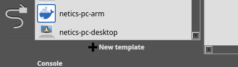

2. Pilih opsi **Import an appliance file**, lalu pilih file **mikrotik-chr-7.24.6.gns3a** yang sudah di downlaod sebelumnya. 

   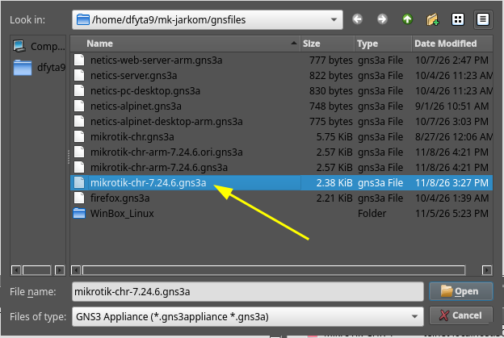

3. Pilih opsi **Install appliance on a remote server**.

    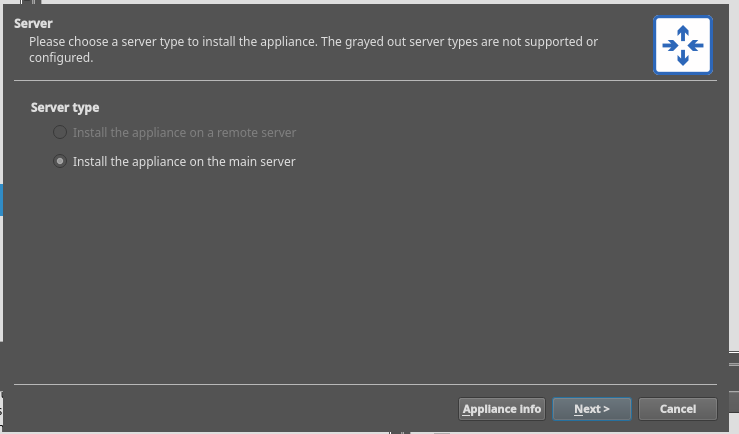

   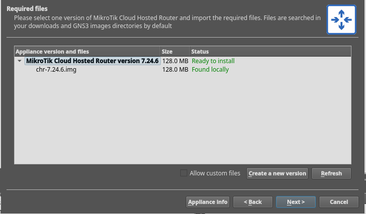
   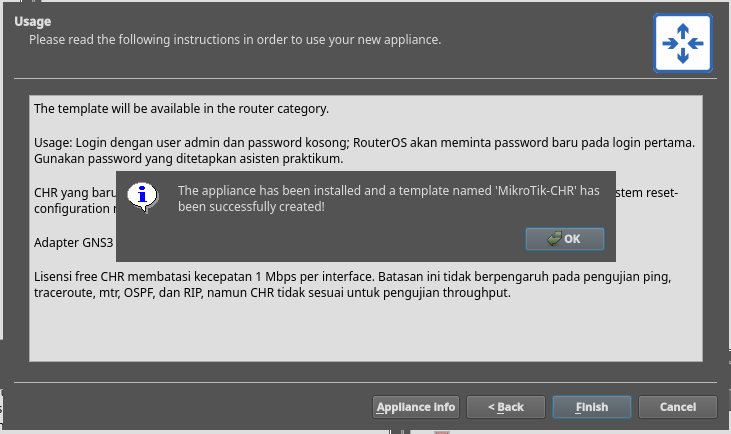

4. Pastikan sudah membuka project baru atau yang sudah ada, kemudian drag and drop appliance yang baru di install ke GNS
   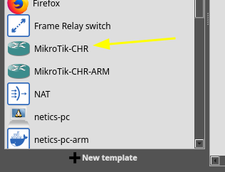
   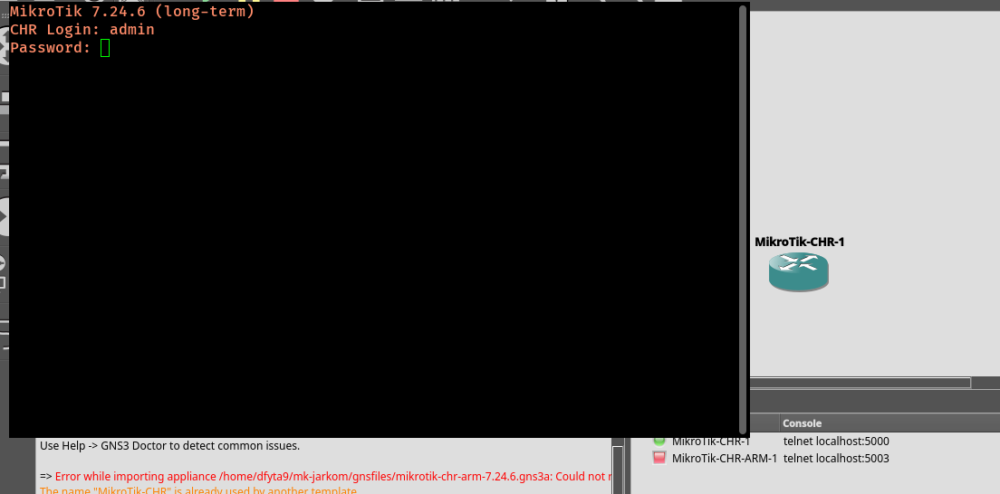

5. Untuk masuk ke RouterOS, bagi yang menggunakan Windows/Linux, Username nya adalah `admin` dan password diisi blank (tekan enter saat ada prompt password)
   
   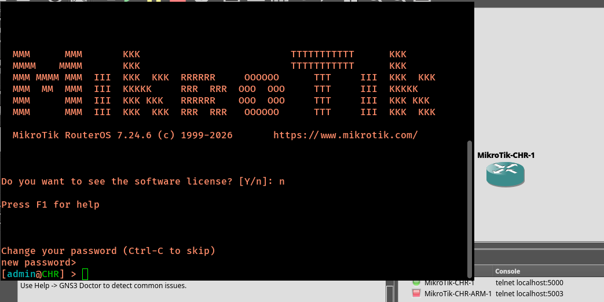

6. Untuk mematikan node MikroTik, perintah yang digunakan dan direkomendasikan adalah menjalankan `/system shutdown` di terminal RouterOS dan menekan tombol `y`
   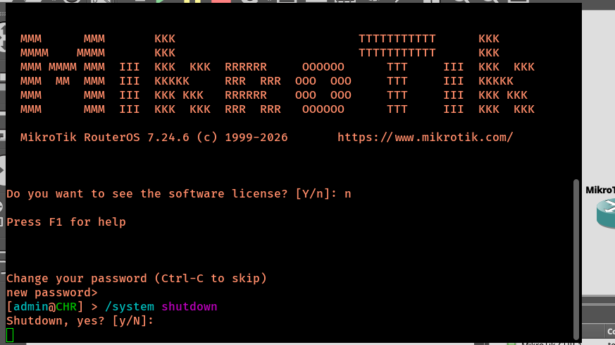

### 0.3 Instalasi di MacOS (GNS3 VM + GNS3 Web UI)

[Download file mikrotik arm .gns3a](https://drive.google.com/file/d/13Neck0VmdecpHNVOlwPO-wrVfcSjSaBB/view?usp=drive_link) 
    <br>
[Download file mikrotik arm .img](https://drive.google.com/file/d/1i1rPtBkvkZBEXD9euzd4deNHlh3z2S5M/view?usp=drive_link)

1. Download kedua file diatas dan pastikan keduanya berada di direktori yang sama

sek nunggu raynald

<video src="./images/mikrotik-mac-video-1.mp4" controls width="720"></video>

<!-- 2. Pilih menu **File → New Template**. -->
<!---->
<!--     -->
<!---->
<!-- 2. Pilih opsi **Import an appliance file**, lalu pilih file **mikrotik-chr-7.24.6.gns3a** yang sudah di downlaod sebelumnya.  -->
<!---->
<!--     -->
<!---->
<!-- 3. Pilih opsi **Install appliance on a remote server**. -->
<!---->
<!--      -->
<!---->
<!--     -->
<!--     -->
<!---->
<!-- 4. Pastikan sudah membuka project baru atau yang sudah ada, kemudian drag and drop appliance yang baru di install ke GNS -->
<!--     -->
<!--     -->
<!---->
<!-- 5. Untuk masuk ke RouterOS, bagi yang menggunakan Windows/Linux, Username nya adalah `admin` dan password diisi blank (tekan enter saat ada prompt password) -->
<!--     -->
<!--     -->
<!---->
<!-- 6. Untuk mematikan node MikroTik, perintah yang digunakan dan direkomendasikan adalah menjalankan `/system shutdown` di terminal RouterOS dan menekan tombol `y` -->
<!--     -->

### 0.4 Membuat Topologi Sederhana

1. Buatlah topologi seperti gambar dibawah dengan keterangan node `Kazdel` menggunakan `MikroTik-CHR` yang sudah diinstall sebelumnya, sedangkan selain `Kazdel` tetap menggunakan appliance `netics-pc`.

   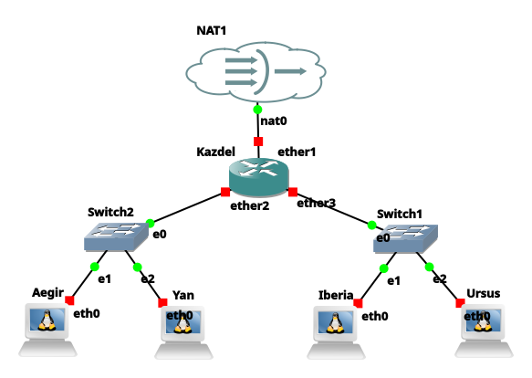   

2. Gunakan fitur change hostname untuk merubah nama-nama dari node.

3. Kemudian kita setting network pada node-node client terlebih dahulu (Aegir, Yan, Iberia dan Ursus), dapat menggunakan fitur `edit config` dengan klik kanan node nya dan mengganti network configuration defaultnya

   - Aegir
     ```
        auto eth0
        iface eth0 inet static
            address 10.254.1.2
            netmask 255.255.255.0
            gateway 10.254.1.1
     ```

   - Yan
     ```
        auto eth0
        iface eth0 inet static
            address 10.254.1.3
            netmask 255.255.255.0
            gateway 10.254.1.1
     ```

   - Iberia
     ```
        auto eth0
        iface eth0 inet static
            address 10.254.2.2
            netmask 255.255.255.0
            gateway 10.254.2.1
     ```

   - Ursus
     ```
        auto eth0
        iface eth0 inet static
            address 10.254.2.3
            netmask 255.255.255.0
            gateway 10.254.2.1
     ```

4. Restart atau jalankan semua node termasuk Router yang belum dikonfigurasi, karena konfigurasi router akan dilakukan melalui terminal RouterOS milik MikroTik.

5. Di `Kazdel`, masuk ke console, dan gunakan username `admin` serta password blank (tekan enter), **Note: untuk yang menggunakan image ARM/MAC, passwordnya adalah `admin`**

   Jika diminta mengganti password, cukup tekan Enter atau Ctrl+C agar password tidak berubah dan tetap defaulti
   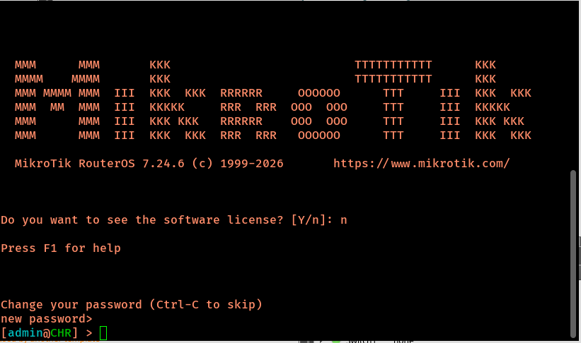  

   Kemudian ganti hostname dari Router menjadi `Kazdel` agar tidak plain `CHR` yang merupakan nilai default dan tidak dapat di set otomatis dari interface GNS3 menggunakan
   ```
    /system identity set name=Kazdel
   ``` 

   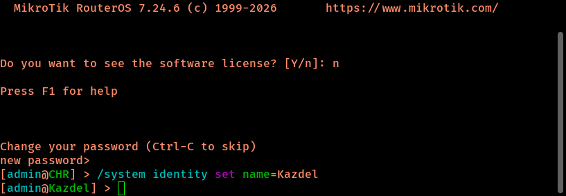 


6. Konfigurasi IP address di `Kazdel` dan koneksi ke NAT

   Lakukan konfigurasi koneksi ke NAT sebagai berikut :
   ```
    # Koneksi ke NAT sebagai WAN dengan setup dhcp-client pada ether1
    /ip dhcp-client add interface=ether1 add-default-route=yes use-peer-dns=no disabled=no

    # Ekuivalen dengan menggunakan iptables -t nat -j MASQUERADE -A POSTROUTING
    /ip firewall nat add chain=srcnat out-interface=ether1 action=masquerade  
   ```

   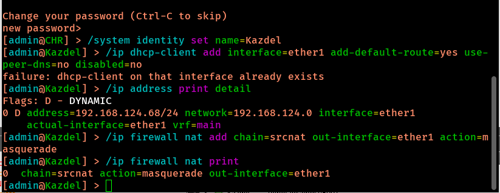 

   Kemudian set IP address untuk ether2 dan ether3 :
   ```
    # Konfigurasi ether2 dengan IP address subnet 10.254.1.0/24
    /ip address add address=10.254.1.1/24 interface=ether2

    # Konfigurasi ether3 dengan IP address subnet 10.254.2.0/24
    /ip address add address=10.10.2.1/24 interface=ether3

    # Konfigurasi DNS default untuk node Kazdel
    /ip dns set servers=1.1.1.1,8.8.8.8 allow-remote-requests=yes
   ``` 

   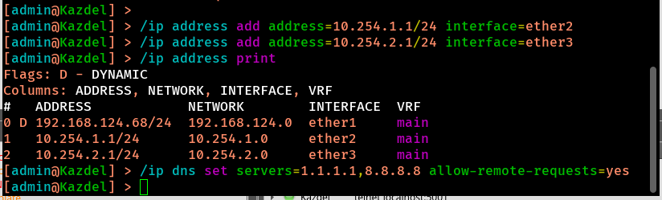 

7. Kemudian coba lakukan tes ping di `Kazdel` dan client PC (salah satu dari Aegir, Yan, Ursus ataupun Iberia)

   Untuk Kazdel, gunakan `/ping count=N [IP address]`, dengan N adalah banyaknya jumlah ping yang akan diujikan dan IP address adalah IP yang ingin dilakukan uji ping

   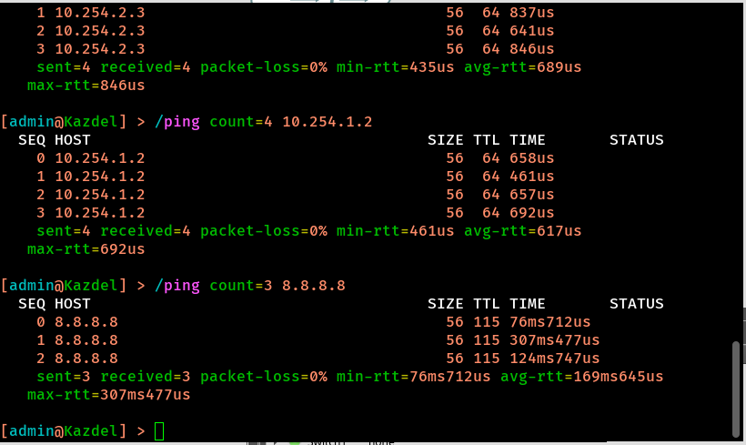 
   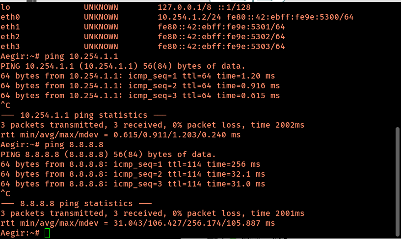
    
8. Untuk bisa ping google.com di client, tambahkan nameserver pada file `/etc/resolv.conf` seperti dibawah:
   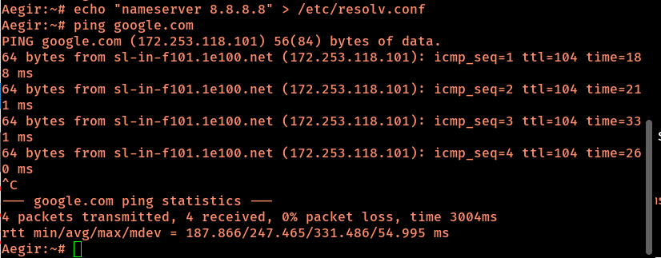 


**Note:** **Note:** Node `MikroTik-CHR` umumnya digunakan sebagai perangkat jaringan virtual untuk keperluan routing, firewall, NAT, dan layanan jaringan lainnya melalui RouterOS. Sementara itu, untuk kebutuhan general-purpose networking node, dapat digunakan `netics-pc` berbasis Linux dengan menambahkan berbagai package sesuai kebutuhan, seperti `frr` untuk dynamic routing, `kea-dhcp4/udhcpd` untuk layanan DHCP, `bind9/dnsmasq` untuk DNS, serta `nftables/iptables` untuk firewall.    

### 0.5 Menyimpan konfigurasi di MikroTik-CHR

> [!TIP]
> *Secara default, MikroTik-CHR akan menyimpan konfigurasi terakhir secara otomatis dan akan persistent ketika node dinyalakan kembali.*

#### 0.5.1 Export ke binary file

Untuk keperluan preserve, dapat menggunakan command berikut:
```
/system backup save name=[Nama Backup]

# untuk menampilkan file-file backup yang telah disimpan
/file print
```

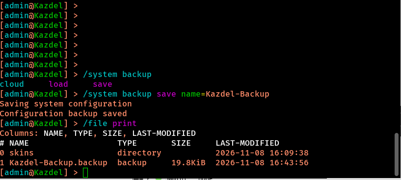 

Dan untuk me-restore, menggunakan
```
/system backup load name=[Nama Backup]
```

MikroTik-CHR akan memberikan prompt untuk me-restart node, tekan tombol `y` di keyboard, MikroTik-CHR akan melakukan restart dan konfigurasi akan ter-load
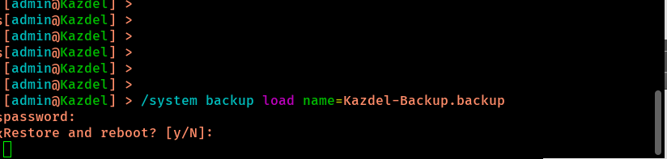 
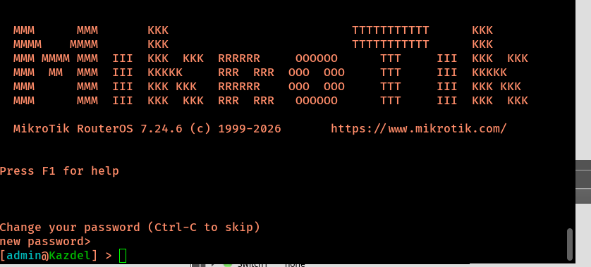

#### 0.5.2 Export ke raw text atau readable file

Selain export ke dalam bentuk binary, juga bisa export kedalam bentuk file yang dapat dibaca (readable format) menggunakan command:
```
/export file=[Name File]

# jika ingin menampilkan seluruh konfigurasi langsung di terminal
/export
```

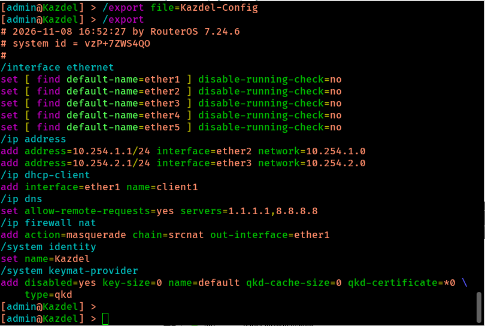 

command `/export file=` akan menghasilkan file dengan extension `.rsc`
    
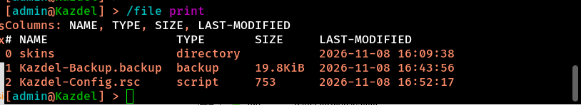 

Dan untuk me-restore konfigurasi dengan tipe file `.rsc`, menggunakan command:
```
/import file-name=[Nama File]
```

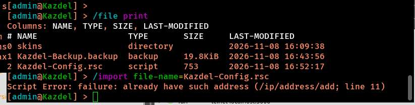 

**Note:** Diatas memang error, dikarenakan konfigurasi yang import sama persis dengan konfigurasi sekarang, yang menyebabkan konfigurasi bertumpuk dan menimbulkan error (perubahan dari import tidak ter-apply).

#### 0.5.3 Cara Export Konfigurasi Ke luar GNS3 menggunakan WinBox

[Download Winbox Official v4.5](https://mikrotik.com/download/winbox) 

File konfigurasi yang di export pada MikroTik-CHR akan tetap ada didalam node itu sendiri, untuk dapat mengexport file backup tersebut keluar node atau export ke luar GNS3, diperlukan aplikasi tambahan yakni `WinBox`

- Download WinBox menggunakan link diatas, kemudian buka WinBox saat node `MikroTik-CHR` masih menyala, di interface WinBox nantinya akan terdeteksi node `Kazdel` seperti gambar dibawah, kemudian klik pilihan Kazdel dan klik tombol Connect pada bagian kiri, atau cukup double-klik pada row `Kazdel`

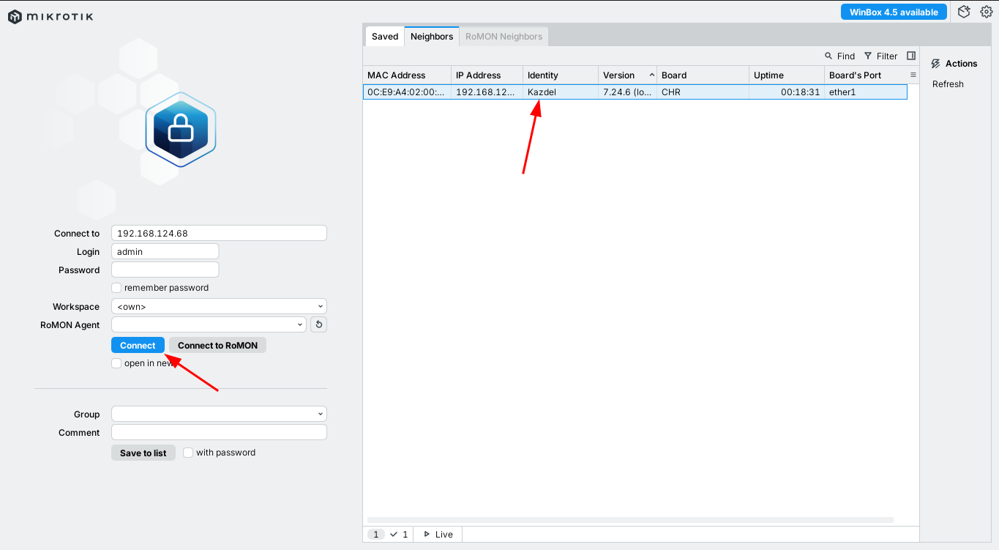 

- Jika ada notice untuk merubah password, klik `Cancel` saja

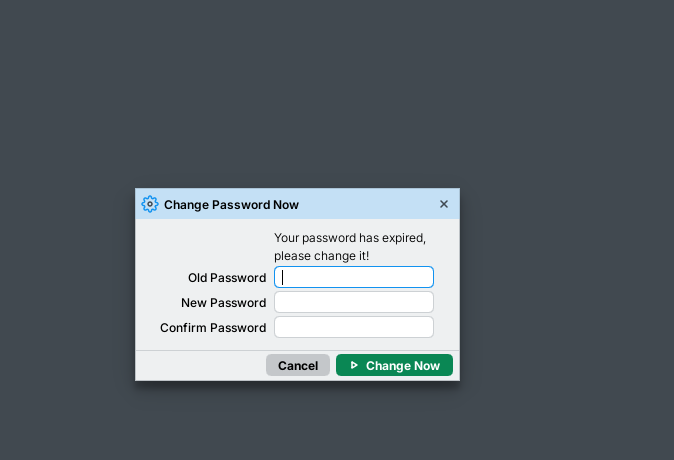

- Setelah masuk ke interface MikroTik-CHR versi Desktop atau Web UI, klik pada menu `Files` pada sidebar disamping

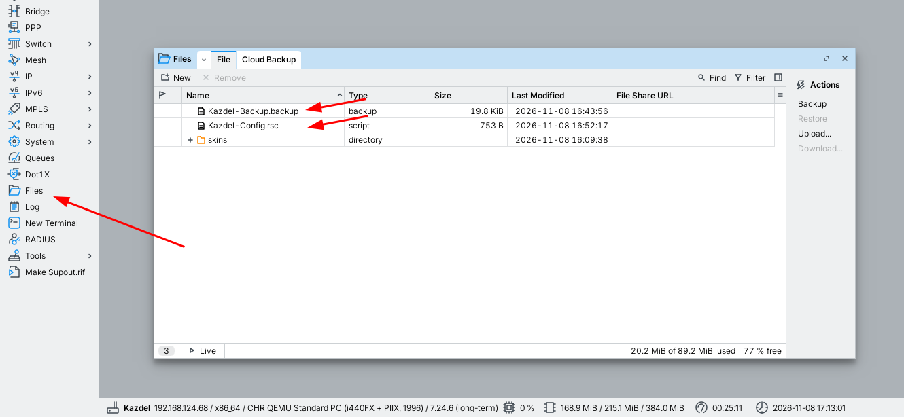

- Kemudian select file yang ingin di download dengan klik 1 kali dan klik tombol download di sisi kanan, dan file explorer akan terbuka untuk memilih tempat menyimpan file nya

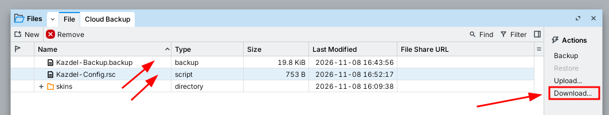
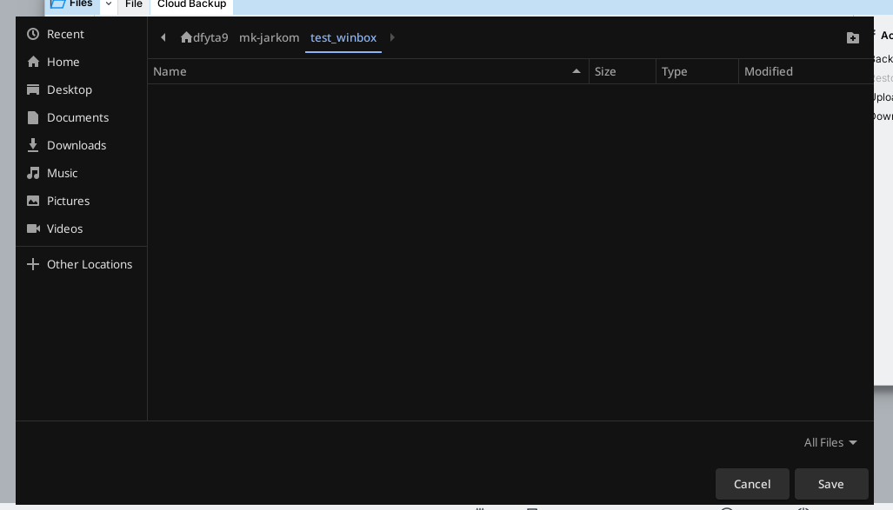

#### 0.5.4 Cara Export Konfigurasi Ke luar GNS3 menggunakan SFTP

Cara ini tidak membutuhkan WinBox, hanya perlu memverifikasi apakah layanan SSH berjalan di node `MikroTik`

```
/ip service print
```

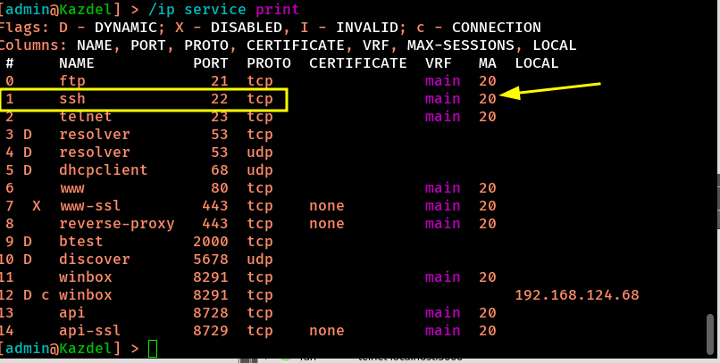 

Kemudian menggunakan client SFTP bebas, gunakan command `ls` untuk listing dan `get` untuk download file
```
ls
get <nama file>
```

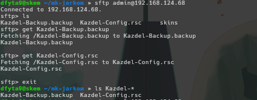 

Untuk mengetahui IP mana yang harus dipakai untuk terhubung ke node MikroTik, dalam hal ini `Kazdel`, adalah menggunakan command `/ip address print` dan menggunakan IP yang diberikan pada ether1 yang terhubung langsung ke NAT

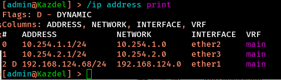

## 1. Subnetting

## 2. Static Routing (Lanjutan) - MikroTik

## 3. Dynamic Routing - MikroTik
<!-- 1. [Subnetting](Subnetting/README.md) -->
<!-- 2. [Dynamic Routing](Dynamic%20Routing/README.md) -->
<!-- 3. [Firewall](Firewall/README.md) -->
