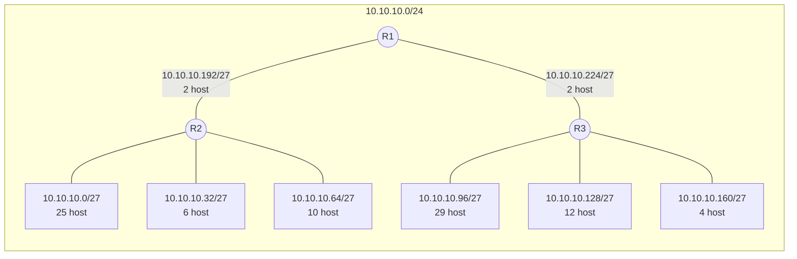
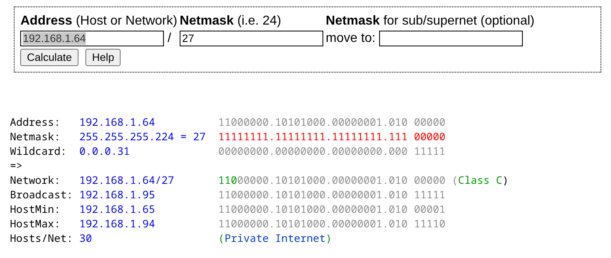

# Modul 4 Jaringan Komputer

## Daftar Isi

- [0. Instalasi MikroTik-CHR di GNS3](#0-instalasi-mikrotik-chr-di-gns3)
  - [0.1 Pengenalan MikroTik CHR RouterOS](#01-pengenalan-mikrotik-chr-routeros)
    - [0.1.1 RouterOS](#011-routeros)
    - [0.1.2 MikroTik-CHR](#012-mikrotik-chr)
    - [0.1.3 MikroTik Routerboard](#013-mikrotik-routerboard)
  - [0.2 Instalasi di Windows (GNS3 VM)](#02-instalasi-di-windows-gns3-vm)
  - [0.3 Instalasi di MacOS (GNS3 VM + GNS3 Web UI)](#03-instalasi-di-macos-gns3-vm--gns3-web-ui)
  - [0.4 Troubleshooting dan Cek Instalasi](#04-troubleshooting-dan-cek-instalasi)
- [1. Subnetting](#1-subnetting)
  - [1.1 Pengenalan Subnetting](#11-pengenalan-subnetting)
    - [1.1.1 Apa itu Subnetting?](#111-apa-itu-subnetting)
    - [1.1.2 Mengapa Perlu Subnetting?](#112-mengapa-perlu-subnetting)
  - [1.2 Mengenal IP Address](#12-mengenal-ip-address)
    - [1.2.1 Apa yang Bisa Diketahui?](#121-apa-yang-bisa-diketahui)
    - [1.2.2 IPv4](#122-ipv4)
    - [1.2.3 Netmask dan Prefix](#123-netmask-dan-prefix)
    - [1.2.4 Network ID, Broadcast Address, dan Available Hosts](#124-network-id-broadcast-address-dan-available-hosts)
    - [1.2.5 IP Publik dan IP Privat](#125-ip-publik-dan-ip-privat)
  - [1.3 Perhitungan Subnet](#13-perhitungan-subnet)
    - [1.3.1 Classful](#131-classful)
    - [1.3.2 Classless / CIDR](#132-classless--cidr)
    - [1.3.3 Subnet Calculator](#133-subnet-calculator)
  - [1.4 Supernetting](#14-supernetting)
  - [1.5 Implementasi](#15-implementasi)
    - [1.5.1 Topologi dan Perhitungan](#151-topologi-dan-perhitungan)
    - [1.5.2 Foosha](#152-foosha)
    - [1.5.3 Alabasta](#153-alabasta)
    - [1.5.4 Jipangu](#154-jipangu)
    - [1.5.5 Loguetown](#155-loguetown)
    - [1.5.6 Pengujian](#156-pengujian)

## 0. Instalasi MikroTik-CHR di GNS3

### 0.1 Pengenalan MikroTik CHR RouterOS

#### 0.1.1 RouterOS

**RouterOS** adalah sistem operasi berbasis Linux yang dikembangkan oleh **MikroTik**, sebuah perusahaan asal Latvia yang bergerak di bidang perangkat jaringan (networking). 
RouterOS dirancang khusus untuk mengubah sebuah komputer atau perangkat keras menjadi router, switch, firewall, bandwidth manager, hingga wireless access point yang handal. 
RouterOS menyediakan fitur-fitur jaringan tingkat lanjut seperti:

- Routing (static, dynamic (OSPF, BGP, RIP))
- Firewall dan NAT
- VPN (PPTP, L2TP, SSTP, OpenVPN, WireGuard)
- Bandwidth management (Queue, Simple Queue, Queue Tree)
- Hotspot dan User Manager
- Wireless networking
- VLAN dan bridging

RouterOS biasanya dijalankan pada perangkat keras fisik buatan MikroTik yang disebut **RouterBoard**. 
Namun, MikroTik juga menyediakan versi khusus yang dapat dijalankan secara virtual, yaitu **Cloud Hosted Router (CHR)**.

[MikroTik RouterOS](https://mikrotik.com/software) 

#### 0.1.2 MikroTik-CHR

**MikroTik CHR (Cloud Hosted Router)** adalah versi RouterOS khusus untuk diinstal pada platform virtualisasi atau cloud seperti:

- VMware
- VirtualBox
- Hyper-V
- KVM/QEMU
- **GNS3** (Graphical Network Simulator-3)
- Proxmox
- Layanan cloud seperti AWS, Google Cloud, Azure, DigitalOcean

CHR hadir dalam bentuk image virtual (format `.vmdk`, `.vhdx`, `.ova`, `.img`, `.qcow2`, dan lainnya) sehingga tidak memerlukan perangkat keras fisik RouterBoard untuk menjalankannya
Untuk GNS3, MikroTik-CHR dapat diinstall secara langsung menggunakan file `.gns3a` untuk user GNS3 dengan platform windows atau linux, sedangkan untuk MacOS atau mesin berarsitektur `arm` terdapat extra step untuk dapat menjalankan MikroTik-CHR di VM GNS3

[MikroTik CHR](https://mikrotik.com/download/chr)

MikroTik disini akan menggantikan peran `netics-pc` yang semula menjalankan static routing secara konvensional menggunakan package bawaan `iproute2`. Dan akan terpakai di Modul 4 dan Modul Final (5)

#### 0.1.3 MikroTik Routerboard

<gambar MikroTik routerboard>

### 0.2 Instalasi di Windows (GNS3 VM)

[Download file mikrotik .gns3a](https://drive.google.com/file/d/1kqDN8RMiHSxHr3uo3VvenUwJfmkuQgV-/view?usp=drive_link) 
    <br>
[Download file mikrotik .img](https://drive.google.com/file/d/1uztXyqvXNClr8QMizV5MJVc8uw3jUax3/view?usp=drive_link)

1. Download kedua file diatas dan pastikan keduanya berada di direktori yang sama

2. Pilih menu **File → New Template**.

   

2. Pilih opsi **Import an appliance file**, lalu pilih file **mikrotik-chr-7.24.6.gns3a** yang sudah di downlaod sebelumnya. 

   

3. Pilih opsi **Install appliance on a remote server**.

    

   
   

4. Pastikan sudah membuka project baru atau yang sudah ada, kemudian drag and drop appliance yang baru di install ke GNS
   
   

5. Untuk masuk ke RouterOS, bagi yang menggunakan Windows/Linux, Username nya adalah `admin` dan password diisi blank (tekan enter saat ada prompt password)
   
   

6. Untuk mematikan node MikroTik, perintah yang digunakan dan direkomendasikan adalah menjalankan `/system shutdown` di terminal RouterOS dan menekan tombol `y`
   

### 0.3 Instalasi di MacOS (GNS3 VM + GNS3 Web UI)

[Download file mikrotik arm .gns3a](https://drive.google.com/file/d/13Neck0VmdecpHNVOlwPO-wrVfcSjSaBB/view?usp=drive_link) 
    <br>
[Download file mikrotik arm .img](https://drive.google.com/file/d/1i1rPtBkvkZBEXD9euzd4deNHlh3z2S5M/view?usp=drive_link)

1. Download kedua file diatas dan pastikan keduanya berada di direktori yang sama

sek nunggu raynald

<!-- 2. Pilih menu **File → New Template**. -->
<!---->
<!--     -->
<!---->
<!-- 2. Pilih opsi **Import an appliance file**, lalu pilih file **mikrotik-chr-7.24.6.gns3a** yang sudah di downlaod sebelumnya.  -->
<!---->
<!--     -->
<!---->
<!-- 3. Pilih opsi **Install appliance on a remote server**. -->
<!---->
<!--      -->
<!---->
<!--     -->
<!--     -->
<!---->
<!-- 4. Pastikan sudah membuka project baru atau yang sudah ada, kemudian drag and drop appliance yang baru di install ke GNS -->
<!--     -->
<!--     -->
<!---->
<!-- 5. Untuk masuk ke RouterOS, bagi yang menggunakan Windows/Linux, Username nya adalah `admin` dan password diisi blank (tekan enter saat ada prompt password) -->
<!--     -->
<!--     -->
<!---->
<!-- 6. Untuk mematikan node MikroTik, perintah yang digunakan dan direkomendasikan adalah menjalankan `/system shutdown` di terminal RouterOS dan menekan tombol `y` -->
<!--     -->

### 0.4 Troubleshooting dan Cek Instalasi

## 1. Subnetting

### 1.1 Pengenalan Subnetting

#### 1.1.1 Apa itu Subnetting?

Bayangkan sebuah jaringan besar seperti lingkungan perumahan dengan banyak rumah di dalamnya. Agar lebih teratur, lingkungan itu dibagi menjadi beberapa blok kecil.

Dalam jaringan komputer, proses pembagian seperti ini disebut subnetting, yaitu cara membagi satu jaringan IP besar menjadi beberapa jaringan kecil dengan menambah panjang prefix (netmask). Misalnya, jaringan `192.168.1.0/24` dapat dibagi menjadi empat subnet:

1. `192.168.1.0/26`
2. `192.168.1.64/26`
3. `192.168.1.128/26`
4. `192.168.1.192/26`

**Subnet** adalah suatu sub jaringan dari jaringan yang lebih besar. Dengan adanya subnet, kita dapat melakukan manajemen suatu jaringan dengan lebih baik.

#### 1.1.2 Mengapa Perlu Subnetting?

Misalkan semua komputer di gedung Departemen Informatika berada dalam satu jaringan yang sama. Akibatnya:

- Paket broadcast dari satu komputer diterima oleh semua komputer di gedung, walaupun tidak berkepentingan.
- Akses antar laboratorium sulit dibatasi, karena semua komputer berada di jaringan yang sama.

Dengan subnetting, setiap laboratorium mendapatkan subnet sendiri, misalnya:

1. Laboratorium LP: `10.151.34.0/24`
2. Laboratorium AJK: `10.151.36.0/24`

Manfaat subnetting:

- Mengurangi ukuran broadcast domain: broadcast dari Lab LP hanya diterima komputer di Lab LP.
- Dapat mengatur kebijakan keamanan sendiri: misalnya router mengizinkan atau memblokir akses dari Lab AJK ke Lab LP.
- Meningkatkan efisiensi routing: router cukup mengenal satu subnet per laboratorium, bukan alamat setiap komputer.

**Broadcast domain** adalah area jaringan yang dijangkau oleh paket broadcast, yaitu paket yang dikirim ke semua host sekaligus. Paket broadcast tidak diteruskan oleh router, sehingga setiap subnet memiliki broadcast domain sendiri. Dengan membagi jaringan menjadi subnet yang lebih kecil, semakin sedikit host yang ikut menerima paket broadcast.

### 1.2 Mengenal IP Address

IP Address adalah suatu alamat unik yang diberikan untuk menandai sebuah host yang terhubung dalam suatu jaringan.

#### 1.2.1 Apa yang Bisa Diketahui?

Dari sebuah IP Address yang ditulis bersama prefix-nya, kita bisa mendapatkan 5 informasi berikut:

1. **IP Address**: alamat milik host itu sendiri.
2. **Netmask**: penentu bagian mana dari IP Address yang menunjukkan subnet dan bagian mana yang menunjukkan host.
3. **Network ID (NID)**: IP Address yang menjadi identitas suatu subnet.
4. **Broadcast Address**: IP Address yang digunakan untuk mengirim pesan broadcast ke semua host di dalam suatu subnet.
5. **Available Hosts**: rentang IP Address yang bisa digunakan oleh host di dalam suatu subnet.

Dua informasi pertama langsung terlihat dari penulisan alamatnya, sedangkan tiga sisanya perlu dihitung. Kita akan membahasnya satu per satu.

#### 1.2.2 IPv4

- IPv4 (_Internet Protocol version 4_) adalah versi IP Address yang dibahas pada modul ini.
- IPv4 Address terdiri dari 32 bit biner yang dalam penulisannya dikonversi menjadi bilangan desimal.
- 32 bit tersebut dibagi menjadi 4 oktet (masing-masing oktet berisi 8 bit) yang dipisahkan dengan tanda titik. Contoh: `10.151.36.5`.

```
desimal :     10    .    151    .     36    .      5
biner   : 0000 1010 . 1001 0111 . 0010 0100 . 0000 0101
          \_______/   \_______/   \_______/   \_______/
           oktet 1     oktet 2     oktet 3     oktet 4
```

##### Header IPv4

Setiap paket IPv4 yang dikirim melalui jaringan membawa sebuah **header**, yaitu bagian di awal paket yang berisi informasi untuk mengantarkan paket tersebut sampai ke tujuan. Ukuran header IPv4 minimal 20 byte. Struktur header IPv4 adalah sebagai berikut (setiap baris berisi 32 bit):

```
 0       4      8               16    19        24            31
┌───────┬───────┬───────────────┬───────────────────────────────┐
│Version│  IHL  │Type of Service│          Total Length         │
├───────┴───────┴───────────────┼─────┬─────────────────────────┤
│         Identification        │Flags│     Fragment Offset     │
├───────────────┬───────────────┼─────┴─────────────────────────┤
│  Time to Live │    Protocol   │        Header Checksum        │
├───────────────┴───────────────┴───────────────────────────────┤
│                         Source Address                        │
├───────────────────────────────────────────────────────────────┤
│                      Destination Address                      │
├───────────────────────────────────────────────┬───────────────┤
│                    Options                    │    Padding    │
└───────────────────────────────────────────────┴───────────────┘
```

| Field               | Ukuran   | Fungsi                                                                                                                      |
| ------------------- | -------- | --------------------------------------------------------------------------------------------------------------------------- |
| Version             | 4 bit    | Versi IP yang digunakan. Untuk IPv4 bernilai `4`                                                                            |
| IHL                 | 4 bit    | _Internet Header Length_, yaitu panjang header dalam satuan 32 bit (4 byte). Nilai minimumnya `5` (5 × 4 byte = 20 byte)    |
| Type of Service     | 8 bit    | Penanda prioritas paket. Saat ini dibagi menjadi DSCP (6 bit) untuk kualitas layanan dan ECN (2 bit) untuk notifikasi kemacetan |
| Total Length        | 16 bit   | Panjang seluruh paket (header + data) dalam byte, maksimal 65.535 byte                                                      |
| Identification      | 16 bit   | Nomor identitas paket, digunakan untuk menyatukan kembali paket yang dipecah (fragmentasi)                                  |
| Flags               | 3 bit    | Pengaturan fragmentasi, yaitu DF (_Don't Fragment_) dan MF (_More Fragments_)                                                |
| Fragment Offset     | 13 bit   | Posisi potongan paket (fragment) di dalam paket aslinya                                                                     |
| Time to Live (TTL)  | 8 bit    | Batas jumlah router yang boleh dilewati paket. Nilainya berkurang 1 setiap melewati router, dan paket dibuang jika mencapai `0` |
| Protocol            | 8 bit    | Protokol yang dibawa di dalam paket, misalnya `1` untuk ICMP, `6` untuk TCP, dan `17` untuk UDP                             |
| Header Checksum     | 16 bit   | Nilai untuk mengecek apakah header rusak selama pengiriman                                                                  |
| Source Address      | 32 bit   | IP Address pengirim paket                                                                                                    |
| Destination Address | 32 bit   | IP Address tujuan paket                                                                                                      |
| Options             | variabel | Opsi tambahan yang jarang digunakan. Jika ada, ditambah Padding agar panjang header tetap kelipatan 32 bit                  |


#### 1.2.3 Netmask dan Prefix

**Subnet mask (netmask)** adalah kombinasi angka sepanjang 32 bit yang berfungsi membagi IP ke dalam subnet-subnet dan menentukan rentang IP Address pada subnet yang bisa digunakan. Bit bernilai `1` pada netmask selalu berada di depan, diikuti bit bernilai `0` di belakangnya.

Netmask juga bisa ditulis secara singkat dalam bentuk **prefix**, yaitu jumlah bit bernilai `1` pada netmask yang ditulis di belakang IP. Contohnya, `10.151.36.5/24` berarti IP `10.151.36.5` dengan netmask `255.255.255.0`, karena 24 bit pertama netmask tersebut bernilai `1`.

Tabel berikut menunjukkan daftar prefix beserta netmask, wildcard, jumlah alamat (Addresses), dan jumlah Available Hosts-nya.

| Prefix | Netmask           | Wildcard        | Addresses  | Available Hosts |
| ------ | ----------------- | --------------- | ---------- | --------------- |
| /32    | `255.255.255.255` | `0.0.0.0`       | 1          | NA              |
| /31    | `255.255.255.254` | `0.0.0.1`       | 2          | NA              |
| /30    | `255.255.255.252` | `0.0.0.3`       | 4          | 2               |
| /29    | `255.255.255.248` | `0.0.0.7`       | 8          | 6               |
| /28    | `255.255.255.240` | `0.0.0.15`      | 16         | 14              |
| /27    | `255.255.255.224` | `0.0.0.31`      | 32         | 30              |
| /26    | `255.255.255.192` | `0.0.0.63`      | 64         | 62              |
| /25    | `255.255.255.128` | `0.0.0.127`     | 128        | 126             |
| /24    | `255.255.255.0`   | `0.0.0.255`     | 256        | 254             |
| /23    | `255.255.254.0`   | `0.0.1.255`     | 512        | 510             |
| /22    | `255.255.252.0`   | `0.0.3.255`     | 1.024      | 1.022           |
| /21    | `255.255.248.0`   | `0.0.7.255`     | 2.048      | 2.046           |
| /20    | `255.255.240.0`   | `0.0.15.255`    | 4.096      | 4.094           |
| /19    | `255.255.224.0`   | `0.0.31.255`    | 8.192      | 8.190           |
| /18    | `255.255.192.0`   | `0.0.63.255`    | 16.384     | 16.382          |
| /17    | `255.255.128.0`   | `0.0.127.255`   | 32.768     | 32.766          |
| /16    | `255.255.0.0`     | `0.0.255.255`   | 65.536     | 65.534          |
| /15    | `255.254.0.0`     | `0.1.255.255`   | 131.072    | 131.070         |
| /14    | `255.252.0.0`     | `0.3.255.255`   | 262.144    | 262.142         |
| /13    | `255.248.0.0`     | `0.7.255.255`   | 524.288    | 524.286         |
| /12    | `255.240.0.0`     | `0.15.255.255`  | 1.048.576  | 1.048.574       |
| /11    | `255.224.0.0`     | `0.31.255.255`  | 2.097.152  | 2.097.150       |
| /10    | `255.192.0.0`     | `0.63.255.255`  | 4.194.304  | 4.194.302       |
| /9     | `255.128.0.0`     | `0.127.255.255` | 8.388.608  | 8.388.606       |
| /8     | `255.0.0.0`       | `0.255.255.255` | 16.777.216 | 16.777.214      |

> **Available Hosts = Addresses - 2**, karena alamat pertama dipakai sebagai Network ID dan alamat terakhir sebagai Broadcast Address.


#### 1.2.4 Network ID, Broadcast Address, dan Available Hosts

Contoh skenario: Carilah Network ID (NID), Broadcast Address, dan rentang IP Address dari sebuah alamat `10.151.36.5/24`!

Penyelesaian: Informasi sementara yang didapat dari `10.151.36.5/24` adalah

```
    1. IP : 10.151.36.5
    2. Netmask : 255.255.255.0 (/24)
    3. Network ID?
    4. Broadcast Address?
    5. Available Hosts?
```

Berikut akan dijelaskan bagaimana mencari NID, Broadcast Address, dan Available Hosts:

##### Network ID

Network ID (NID) adalah alamat pertama dari suatu subnet. Cara mencarinya adalah dengan melakukan operasi **AND** antara IP dan netmask.

1. Ubah IP ke dalam bentuk biner (per oktet, masing-masing 8 bit).

   ```
   IP      :     10    .    151    .     36    .      5
   bit     : 0000 1010 . 1001 0111 . 0010 0100 . 0000 0101
   ```

2. Ubah netmask ke dalam bentuk biner. Netmask /24 berarti 24 bit pertama bernilai `1` dan sisanya bernilai `0`.

   ```
   netmask :    255    .    255    .    255    .      0
   bit     : 1111 1111 . 1111 1111 . 1111 1111 . 0000 0000
   ```

3. Lakukan operasi AND pada IP dan netmask, bit per bit. Pada operasi AND, hasilnya `1` hanya jika kedua bit bernilai `1`.

   ```
   Tabel AND:
   0 AND 0 = 0
   0 AND 1 = 0
   1 AND 0 = 0
   1 AND 1 = 1
   ```

   ```
   IP      : 0000 1010 . 1001 0111 . 0010 0100 . 0000 0101
   netmask : 1111 1111 . 1111 1111 . 1111 1111 . 0000 0000
   ------------------------------------------------------- AND
   NID     : 0000 1010 . 1001 0111 . 0010 0100 . 0000 0000
   NID     :     10    .    151    .     36    .      0
   ```

Jadi, Network ID dari `10.151.36.5/24` adalah **`10.151.36.0`**.

Bagian IP yang bertemu bit `1` pada netmask (bagian network) akan tetap sama, sedangkan bagian yang bertemu bit `0` (bagian host) akan menjadi `0` semua. Itulah mengapa NID selalu memiliki bit host yang bernilai `0` semua.

##### Broadcast Address

Broadcast Address adalah alamat terakhir dari suatu subnet. Cara mencarinya adalah dengan melakukan operasi **OR** antara IP dan wildcard.

1. Ubah IP ke dalam bentuk biner.

   ```
   IP      :     10    .    151    .     36    .      5
   bit     : 0000 1010 . 1001 0111 . 0010 0100 . 0000 0101
   ```

2. Ubah netmask ke dalam bentuk biner, lalu balik setiap bitnya (`1` menjadi `0` dan `0` menjadi `1`). Hasilnya disebut **wildcard** (inverted netmask). Nilai ini sama dengan kolom **Wildcard** pada tabel di bagian [Netmask dan Prefix](#123-netmask-dan-prefix).

   ```
   netmask  :    255    .    255    .    255    .      0
   bit      : 1111 1111 . 1111 1111 . 1111 1111 . 0000 0000
   wildcard : 0000 0000 . 0000 0000 . 0000 0000 . 1111 1111
   wildcard :      0    .      0    .      0    .    255
   ```

3. Lakukan operasi OR pada IP dan wildcard, bit per bit. Pada operasi OR, hasilnya `1` jika salah satu atau kedua bit bernilai `1`.

   ```
   Tabel OR:
   0 OR 0 = 0
   0 OR 1 = 1
   1 OR 0 = 1
   1 OR 1 = 1
   ```

   ```
   IP        : 0000 1010 . 1001 0111 . 0010 0100 . 0000 0101
   wildcard  : 0000 0000 . 0000 0000 . 0000 0000 . 1111 1111
   --------------------------------------------------------- OR
   broadcast : 0000 1010 . 1001 0111 . 0010 0100 . 1111 1111
   broadcast :     10    .    151    .     36    .    255
   ```

Jadi, Broadcast Address dari `10.151.36.5/24` adalah **`10.151.36.255`**.

Kebalikan dari NID, bagian network tetap sama, sedangkan bagian host akan menjadi `1` semua. Itulah mengapa Broadcast Address selalu memiliki bit host yang bernilai `1` semua.

##### Available Hosts

Available Hosts adalah rentang IP Address yang bisa diberikan kepada host (PC, server, router, dll) di dalam suatu subnet. Cara mencarinya adalah dengan melihat bit mana saja pada netmask yang bernilai `0`.

1. Ubah IP dan netmask ke dalam bentuk biner.

   ```
   IP      :     10    .    151    .     36    .      5
   bit     : 0000 1010 . 1001 0111 . 0010 0100 . 0000 0101

   netmask :    255    .    255    .    255    .      0
   bit     : 1111 1111 . 1111 1111 . 1111 1111 . 0000 0000
             \_____________________________/   \_______/
                   bagian network (24 bit)     bagian host
                                                 (8 bit)
   ```

2. Perhatikan setiap bit pada netmask:

   - Bit `1` menunjukkan bagian network, sehingga bit pada posisi yang sama di IP Address tidak boleh berubah.
   - Bit `0` menunjukkan bagian host, sehingga bit pada posisi yang sama di IP Address boleh bernilai `0` maupun `1`.

   Karena 8 bit terakhir netmask bernilai `0`, maka 8 bit terakhir IP Address boleh berubah, mulai dari `0000 0000` hingga `1111 1111`. Sehingga rentang IP pada subnet ini adalah:

   ```
   0000 1010 . 1001 0111 . 0010 0100 . 0000 0000   --> 10.151.36.0
                        hingga
   0000 1010 . 1001 0111 . 0010 0100 . 1111 1111   --> 10.151.36.255
   \_____________________________/   \_______/
           tidak boleh berubah        rentang IP
   ```

3. Dari rentang tersebut, IP pertama sudah digunakan sebagai Network ID dan IP terakhir sudah digunakan sebagai Broadcast Address, sehingga keduanya tidak bisa diberikan kepada host.

   ```
   10.151.36.0             --> Network ID (tidak bisa dipakai host)
   10.151.36.1   - .254    --> Available Hosts
   10.151.36.255           --> Broadcast Address (tidak bisa dipakai host)
   ```

   Jadi, Available Hosts dari `10.151.36.5/24` adalah **`10.151.36.1` hingga `10.151.36.254`**.

4. Jumlah host yang tersedia bisa dihitung dengan rumus berikut, dengan `n` adalah jumlah bit host (jumlah bit `0` pada netmask):

   ```
   Jumlah host = 2^n - 2
               = 2^8 - 2
               = 256 - 2
               = 254 host
   ```

   Angka `- 2` pada rumus di atas berasal dari Network ID dan Broadcast Address. Hasil ini sama dengan kolom **Available Hosts** pada tabel di bagian [Netmask dan Prefix](#123-netmask-dan-prefix) untuk /24.

#### 1.2.5 IP Publik dan IP Privat

IP Address dibagi menjadi 2 jenis, yaitu:

- **IP Publik**: IP Address yang digunakan dalam jaringan global internet, cirinya IP Address dapat diakses melalui internet secara langsung.
- **IP Privat**: IP Address yang digunakan (dikenali) dan hanya dapat diakses oleh jaringan lokal.

Rentang IP Privat:

- `10.0.0.0/8` (`10.0.0.0` - `10.255.255.255`)
- `172.16.0.0/12` (`172.16.0.0` - `172.31.255.255`)
- `192.168.0.0/16` (`192.168.0.0` - `192.168.255.255`)

Sebagian besar alamat di luar rentang IP Privat di atas adalah IP Publik, kecuali beberapa rentang khusus seperti `127.0.0.0/8` (loopback) dan `169.254.0.0/16` (link-local).

IP Privat tidak bisa langsung digunakan di internet. Agar host dengan IP Privat bisa mengakses internet, router perlu menerjemahkan IP Privat tersebut menjadi IP Publik menggunakan NAT (_Network Address Translation_).

### 1.3 Perhitungan Subnet

Ada dua metode pembagian/pengalokasian IP yang dikenal dalam jaringan, yaitu Classful dan Classless.

#### 1.3.1 Classful

Pembagian IP dengan menggunakan metode ini didasarkan pada pembagian Class pada IP Address. Tiap subnet akan diberikan ukuran atau netmask yang dapat menampung jumlah host yang terdapat dalam subnet tersebut. Tabel berikut menunjukkan Class yang terdapat pada metode Classful.

| Class         | Rentang IP Address              | Netmask               | Jumlah Blok | IP Address per Blok |
| ------------- | ------------------------------- | --------------------- | ----------- | ------------------- |
| A             | `0.0.0.0` - `127.255.255.255`   | `255.0.0.0` (/8)      | 128         | 16.777.216          |
| B             | `128.0.0.0` - `191.255.255.255` | `255.255.0.0` (/16)   | 16.384      | 65.536              |
| C             | `192.0.0.0` - `223.255.255.255` | `255.255.255.0` (/24) | 2.097.152   | 256                 |
| D (Multicast) | `224.0.0.0` - `239.255.255.255` | -                     | -           | -                   |
| E (Reserved)  | `240.0.0.0` - `255.255.255.255` | -                     | -           | -                   |

Sebagai contoh:

- Apabila kita memerlukan 250 IP Address, maka kita akan menggunakan blok alamat dari Class C.
- Apabila kita memerlukan lebih banyak IP Address, yaitu sebanyak 60.000, maka kita bisa menggunakan blok alamat dari Class B.
- Apabila masih kurang, bisa menggunakan blok alamat dari Class A.

Contoh penerapan pembagian IP Address dengan metode Classful sebagai berikut.


Anggap kita memiliki topologi jaringan seperti gambar di atas, dengan jumlah host yang dibutuhkan tertera di bawah setiap PC. Lalu, tentukan jumlah subnet yang ada di dalam topologi tersebut.


Terdapat 8 subnet di dalam topologi, yaitu 4 subnet yang terhubung ke switch (ditandai dengan kotak) dan 4 subnet antar router (ditandai dengan label di dekat garis link-nya).

Dengan teknik Classful, setiap subnet akan memiliki netmask /24 karena jumlah host setiap subnet tidak lebih dari 254 (Available Hosts dari /24). Pembagian IP yang memungkinkan untuk topologi di atas adalah sebagai berikut.

| Subnet | Network ID    | Netmask         | Broadcast Address |
| ------ | ------------- | --------------- | ----------------- |
| A1     | `192.168.1.0` | `255.255.255.0` | `192.168.1.255`   |
| A2     | `192.168.2.0` | `255.255.255.0` | `192.168.2.255`   |
| A3     | `192.168.3.0` | `255.255.255.0` | `192.168.3.255`   |
| A4     | `192.168.4.0` | `255.255.255.0` | `192.168.4.255`   |
| A5     | `192.168.5.0` | `255.255.255.0` | `192.168.5.255`   |
| A6     | `192.168.6.0` | `255.255.255.0` | `192.168.6.255`   |
| A7     | `192.168.7.0` | `255.255.255.0` | `192.168.7.255`   |
| A8     | `192.168.8.0` | `255.255.255.0` | `192.168.8.255`   |

Namun, bagaimana jika kita hanya perlu 300 alamat? Menggunakan Class C tidaklah cukup, namun menggunakan Class B akan membuang sangat banyak sekali alamat, yaitu sebanyak lebih dari 60.000 alamat akan terbuang sia-sia.

Bisa saja kita menggunakan dua blok Class C (sehingga cukup untuk 512 IP Address). Cara ini memang bisa dilakukan, dan pada umumnya memang dilakukan.

Namun, bagaimana jika kita perlu 25.000 IP Address? Dengan cara ini, kita perlu 99 blok Class C (25.000 ÷ 254 host per blok). Jika menggunakan blok Class B, masih lebih dari 40.000 IP Address akan terbuang.

Karena sangat tidak efisien, maka ditemukanlah teknik alokasi IP yang jauh lebih baik, yaitu Classless Inter-Domain Routing atau kerap dikenal dengan istilah **CIDR**.

#### 1.3.2 Classless / CIDR

Di dalam metode Classless, pembagian IP sudah tidak lagi terpaku pada 3 Class di atas. Dengan metode ini, IP bisa dialokasikan sesuai kebutuhan masing-masing subnet. Metode Classless diimplementasikan secara formal dengan CIDR dan diatur oleh RFC 4632 (sebelumnya RFC 1518/1519). Dengan metode ini, maka:

- Apabila kita perlu 250 IP, maka bisa menggunakan subnet dengan ukuran /24
- Apabila kita perlu 300 IP, maka bisa menggunakan subnet dengan ukuran /23
- Apabila kita perlu 500 IP, maka juga bisa menggunakan subnet dengan ukuran /23
- Apabila kita perlu 25.000 IP, maka bisa menggunakan subnet dengan ukuran /17
- Apabila kita perlu 250.000 IP, maka bisa menggunakan subnet dengan ukuran /14

Cara ini bisa membuat pembagian IP menjadi jauh lebih fleksibel dan jumlah IP Address yang terbuang sia-sia menjadi sangat sangat lebih sedikit.

Di dalam Classless sendiri, ada 2 cara untuk melakukan subnetting atau membuat subnet, yaitu FLSM dan VLSM.

##### FLSM (Fixed Length Subnet Masking)

**Fixed Length Subnet Masking (FLSM)** adalah teknik pembagian jaringan di mana setiap subnet memiliki ukuran atau jumlah host yang sama.

Misalnya, jika kalian memiliki alamat jaringan dengan prefix /24 dan ingin membaginya menjadi 4 subnet, maka setiap subnet akan mendapatkan bagian yang sama besar, yaitu dengan prefix /26.



Sebagai contoh, kalian diberi alamat `10.10.10.0/24` dan memiliki topologi seperti di atas, dengan jumlah host pada masing-masing subnet tertera di bawah alamatnya. Prefix untuk FLSM ditentukan dengan langkah berikut:

1. Hitung jumlah subnet. Topologi di atas memiliki 8 subnet, yaitu 6 LAN dan 2 link antar router.
2. Cari jumlah bit tambahan `n` agar 2<sup>n</sup> ≥ jumlah subnet. Karena 2<sup>3</sup> = 8, dibutuhkan 3 bit tambahan, sehingga prefix menjadi /24 + 3 = /27.
3. Pastikan prefix tersebut cukup untuk subnet dengan host terbanyak. Subnet terbesar membutuhkan 29 host + 1 router = 30 IP, dan /27 memiliki 30 Available Hosts, sehingga cukup. Jika tidak cukup, dibutuhkan blok root yang lebih besar.
4. Bagi alamat secara rata dengan ukuran blok 32 alamat: `10.10.10.0`, `.32`, `.64`, `.96`, `.128`, `.160`, `.192`, dan `.224`.

Subnet dengan prefix /27 berisi 32 IP namun hanya 30 yang bisa digunakan, karena IP pertama digunakan sebagai Network ID dan IP terakhir digunakan sebagai Broadcast Address.

Namun, bagaimana jika kamu memiliki 2 subnet, dengan subnet pertama membutuhkan 25.000 IP namun subnet kedua hanya perlu 500 IP? Jika menggunakan aturan FLSM, kedua subnet harus memiliki ukuran /17. Ukuran ini cukup untuk subnet pertama, tetapi terlalu besar dan boros untuk subnet kedua.

Masalah yang sama muncul setiap kali ada subnet ke-3, ke-4, dan seterusnya dengan kebutuhan yang berbeda-beda. Karena itu, digunakan teknik lain, yaitu VLSM.

##### VLSM (Variable Length Subnet Masking)

Berbeda dengan FLSM, **Variable Length Subnet Masking (VLSM)** adalah teknik subnetting yang mana semua subnet bisa memiliki ukuran yang berbeda-beda.

Inti utama dari penggunaan teknik VLSM adalah untuk mengefisienkan pembagian IP di dalam jaringan, karena besar netmask akan disesuaikan dengan banyaknya host yang membutuhkan IP Address di masing-masing subnet.

Jadi, pada teknik VLSM, netmask akan diberikan sesuai dengan kebutuhan jumlah IP Address dari subnet tersebut.

Contoh penerapannya, kita akan menggunakan topologi seperti contoh metode Classful.

1. Tentukan jumlah IP Address yang dibutuhkan oleh tiap subnet dan lakukan labelling netmask berdasarkan jumlah IP yang dibutuhkan.

   - Subnet yang terhubung ke switch (LAN): jumlah IP = jumlah host + 1 untuk interface router (gateway).
   - Subnet antar router: cukup 2 IP, yaitu satu untuk setiap interface router.

   | Subnet    | Jumlah IP (host + router) | Netmask |
   | --------- | ------------------------- | ------- |
   | A1        | 101                       | /25     |
   | A2        | 2                         | /30     |
   | A3        | 51                        | /26     |
   | A4        | 2                         | /30     |
   | A5        | 2                         | /30     |
   | A6        | 2                         | /30     |
   | A7        | 11                        | /28     |
   | A8        | 21                        | /27     |
   | **Total** | **192**                   | **/24** |

   Netmask root ditentukan dari jumlah ukuran blok semua subnet: 128 (/25) + 64 (/26) + 32 (/27) + 16 (/28) + 4 × 4 (/30) = 256 alamat. Jumlah ini pas dengan satu blok /24, sehingga pembagian IP dimulai dari netmask /24.

   > Jumlah IP yang dibutuhkan (192) belum cukup untuk menentukan root, karena setiap subnet memakai satu blok utuh sesuai netmask-nya. Misalnya, A1 yang butuh 101 IP tetap memakai blok /25 berisi 128 alamat.

2. Subnet besar yang dibentuk memiliki NID `192.168.1.0` dengan netmask /24. Hitung pembagian IP berdasarkan NID dan netmask tersebut menggunakan pohon seperti gambar di bawah.

   ```mermaid
   flowchart TD
       n0["192.168.1.0 / 24"]
       n1["192.168.1.0 / 25"]
       n0 --> n1
       n2["192.168.1.128 / 25"]
       n0 --> n2
       n3["192.168.1.0 / 26"]
       n1 --> n3
       n4["192.168.1.64 / 26"]
       n1 --> n4
       n5["192.168.1.0 / 27"]
       n3 --> n5
       n6["192.168.1.32 / 27"]
       n3 --> n6
       n7["192.168.1.0 / 28"]
       n5 --> n7
       n8["192.168.1.16 / 28"]
       n5 --> n8
       n9["192.168.1.0 / 29"]
       n7 --> n9
       n10["192.168.1.8 / 29"]
       n7 --> n10
       n11["192.168.1.0 / 30"]
       n9 --> n11
       n12["192.168.1.4 / 30"]
       n9 --> n12
       n13["192.168.1.8 / 30"]
       n10 --> n13
       n14["192.168.1.12 / 30"]
       n10 --> n14
   ```

3. Lakukan subnetting dengan menggunakan pohon tersebut untuk pembagian IP sesuai dengan kebutuhan masing-masing subnet yang ada.

   ```mermaid
   flowchart TD
       n0["192.168.1.0 / 24"]
       n1["192.168.1.0 / 25"]
       n0 --> n1
       n2["192.168.1.128 / 25<br/>A1 = 100 host"]
       n0 --> n2
       n3["192.168.1.0 / 26"]
       n1 --> n3
       n4["192.168.1.64 / 26<br/>A3 = 50 host"]
       n1 --> n4
       n5["192.168.1.0 / 27"]
       n3 --> n5
       n6["192.168.1.32 / 27<br/>A8 = 20 host"]
       n3 --> n6
       n7["192.168.1.0 / 28"]
       n5 --> n7
       n8["192.168.1.16 / 28<br/>A7 = 10 host"]
       n5 --> n8
       n9["192.168.1.0 / 29"]
       n7 --> n9
       n10["192.168.1.8 / 29"]
       n7 --> n10
       n11["192.168.1.0 / 30<br/>A2 = 2 host"]
       n9 --> n11
       n12["192.168.1.4 / 30<br/>A4 = 2 host"]
       n9 --> n12
       n13["192.168.1.8 / 30<br/>A5 = 2 host"]
       n10 --> n13
       n14["192.168.1.12 / 30<br/>A6 = 2 host"]
       n10 --> n14
       classDef dipakai fill:#d4edda,stroke:#28a745,color:#155724
       class n2,n4,n6,n8,n11,n12,n13,n14 dipakai
   ```

   Dari pohon tersebut akan mendapat pembagian IP sebagai berikut.

   | Subnet | Network ID      | Netmask           | Broadcast Address |
   | ------ | --------------- | ----------------- | ----------------- |
   | A1     | `192.168.1.128` | `255.255.255.128` | `192.168.1.255`   |
   | A2     | `192.168.1.0`   | `255.255.255.252` | `192.168.1.3`     |
   | A3     | `192.168.1.64`  | `255.255.255.192` | `192.168.1.127`   |
   | A4     | `192.168.1.4`   | `255.255.255.252` | `192.168.1.7`     |
   | A5     | `192.168.1.8`   | `255.255.255.252` | `192.168.1.11`    |
   | A6     | `192.168.1.12`  | `255.255.255.252` | `192.168.1.15`    |
   | A7     | `192.168.1.16`  | `255.255.255.240` | `192.168.1.31`    |
   | A8     | `192.168.1.32`  | `255.255.255.224` | `192.168.1.63`    |

#### 1.3.3 Subnet Calculator

Perhitungan subnet bisa dilakukan secara manual menggunakan pohon seperti pada contoh VLSM di atas. Hasil perhitungan manual tersebut bisa dicek menggunakan **subnet calculator** online, contohnya:

- https://www.calculator.net/ip-subnet-calculator.html
- https://jodies.de/ipcalc

Cara menggunakannya (contoh dengan calculator.net):

1. Masukkan IP Address dan netmask dari subnet yang ingin dicek, misalnya `192.168.1.64/27`. Pilih netmask pada kolom **Subnet**, isi kolom **IP Address**, lalu klik **Calculate**.

   

2. Bandingkan hasilnya dengan perhitungan manual.

   

   Istilah yang digunakan subnet calculator sedikit berbeda dengan istilah pada modul ini:

   | Modul ini         | calculator.net       | jodies.de           |
   | ----------------- | -------------------- | ------------------- |
   | Network ID        | Network Address      | Network             |
   | Broadcast Address | Broadcast Address    | Broadcast           |
   | Available Hosts   | Usable Host IP Range | HostMin - HostMax   |
   | Netmask           | Subnet Mask          | Netmask             |

Pada jodies.de, IP Address dan prefix diisi pada kolom **Address** dan **Netmask**. Hasilnya juga ditampilkan dalam bentuk biner. Spasi pada bilangan biner tersebut memisahkan bagian network (kiri) dan bagian host (kanan).



### 1.4 Supernetting

Supernetting adalah kebalikan dari subnetting, yaitu teknik menggabungkan beberapa jaringan kecil (subnet) menjadi satu jaringan yang lebih besar dengan cara mengurangi panjang prefix (menambah jumlah bit host) pada alamat jaringan.

Dengan kata lain, jika subnetting memecah satu jaringan besar menjadi beberapa jaringan kecil, maka supernetting menyatukan beberapa jaringan kecil yang berurutan menjadi satu blok jaringan yang lebih besar.

Supernetting memiliki beberapa tujuan dan manfaat, diantaranya sebagai berikut:

- Mengurangi ukuran tabel routing (lebih efisien di router).
- Menyederhanakan manajemen jaringan besar.
- Digunakan dalam teknik route aggregation di internet (menggabungkan banyak prefix menjadi satu entri routing).

Untuk bagaimana cara melakukannya bisa menggunakan route aggregation dari CIDR dengan mengikuti langkah-langkah berikut:

1. Tentukan subnet yang ada dalam topologi dan lakukan labelling netmask terhadap masing-masing subnet. Contohnya dapat dilihat pada gambar berikut.

   

2. Gabungkan subnet paling bawah di dalam topologi. Paling bawah berarti subnet yang paling jauh dari internet (node NAT1).

   Pada topologi ini, subnet yang dapat digabungkan adalah A1 dengan A2, serta A7 dengan A8. Subnet yang digabung tersebut akan membentuk sebuah subnet lebih besar dari subnet-subnet kecil yang ada di dalamnya.

   

   Subnet B1 merupakan hasil penggabungan dari subnet A1 dan A2, Subnet B2 merupakan hasil penggabungan dari subnet A7 dan A8. Subnet hasil penggabungan ditandai dengan kotak berwarna.

   Mengapa B1 memiliki netmask /24 dan B2 memiliki netmask /26? Pada supernetting, subnet gabungan memakai prefix terbesar yang masih cukup menampung semua subnet yang digabungkan:

   - B1 = A1 (/25, 128 alamat) + A2 (/30, 4 alamat) = 132 alamat. Jumlah ini tidak muat di /25 (128 alamat), tetapi muat di /24 (256 alamat).
   - B2 = A8 (/27, 32 alamat) + A7 (/28, 16 alamat) = 48 alamat, sehingga cukup /26 (64 alamat).

   Pada contoh ini, total subnet lain yang digabungkan tidak pernah lebih besar dari subnet terbesarnya, sehingga hasilnya cukup 1 tingkat di atas subnet terbesar. Jika totalnya lebih besar, misalnya /25 + /25 + /30 (260 alamat), hasilnya menjadi 2 tingkat di atas, yaitu /23.

   Lalu ulangi langkah tersebut sampai menjadi sebuah subnet besar yang mencakup 1 topologi yang kita miliki.

   Penggabungan berikutnya: C1 = B1 + A3 (/23) dan C2 = B2 + A6 (/25).

   

   Penggabungan berikutnya: D1 = C1 + A4 (/22) dan D2 = C2 + A5 (/24).

   

   Penggabungan terakhir: E1 = D1 + D2 (/21), yang mencakup seluruh subnet pada topologi.

   

3. Dari proses penggabungan yang telah dilakukan, didapatkan sebuah subnet besar dengan netmask /21. Kali ini dapat menggunakan NID `192.168.0.0`, netmask `255.255.248.0`.

4. Hitung pembagian IP dengan pohon berdasarkan penggabungan subnet yang telah dilakukan.

   ```mermaid
   flowchart TD
       n0["192.168.0.0 / 21"]
       n1["192.168.0.0 / 22"]
       n0 --> n1
       n2["192.168.4.0 / 24"]
       n0 --> n2
       n3["192.168.0.0 / 23"]
       n1 --> n3
       n4["192.168.2.0 / 30<br/>A4 = 2 host"]
       n1 --> n4
       n5["192.168.0.0 / 24"]
       n3 --> n5
       n6["192.168.1.0 / 26<br/>A3 = 50 host"]
       n3 --> n6
       n7["192.168.0.0 / 25<br/>A1 = 100 host"]
       n5 --> n7
       n8["192.168.0.128 / 30<br/>A2 = 2 host"]
       n5 --> n8
       n9["192.168.4.0 / 25"]
       n2 --> n9
       n10["192.168.4.128 / 30<br/>A5 = 2 host"]
       n2 --> n10
       n11["192.168.4.0 / 26"]
       n9 --> n11
       n12["192.168.4.64 / 30<br/>A6 = 2 host"]
       n9 --> n12
       n13["192.168.4.0 / 27<br/>A8 = 20 host"]
       n11 --> n13
       n14["192.168.4.32 / 28<br/>A7 = 10 host"]
       n11 --> n14
       classDef dipakai fill:#d4edda,stroke:#28a745,color:#155724
       class n7,n8,n6,n4,n10,n12,n14,n13 dipakai
   ```

   > Perbedaan antara pohon VLSM dengan pohon supernetting adalah ketika satu subnet diturunkan, netmask yang akan terbentuk disesuaikan dengan penggabungan subnet yang telah dilakukan sebelumnya.
   >
   > Sebagai contoh, dari netmask besar /21, pada teknik VLSM akan dibagi dua menjadi masing-masing /22. Namun pada penggabungan yang dilakukan sebelumnya, /21 dihasilkan dari penggabungan /22 dan /24 maka subnet yang terbentuk memiliki netmask /22 dan /24.

5. Berdasarkan penghitungan, maka didapatkan pembagian IP sebagai berikut.

   | Subnet | Network ID      | Netmask           | Broadcast Address |
   | ------ | --------------- | ----------------- | ----------------- |
   | A1     | `192.168.0.0`   | `255.255.255.128` | `192.168.0.127`   |
   | A2     | `192.168.0.128` | `255.255.255.252` | `192.168.0.131`   |
   | A3     | `192.168.1.0`   | `255.255.255.192` | `192.168.1.63`    |
   | A4     | `192.168.2.0`   | `255.255.255.252` | `192.168.2.3`     |
   | A5     | `192.168.4.128` | `255.255.255.252` | `192.168.4.131`   |
   | A6     | `192.168.4.64`  | `255.255.255.252` | `192.168.4.67`    |
   | A7     | `192.168.4.32`  | `255.255.255.240` | `192.168.4.47`    |
   | A8     | `192.168.4.0`   | `255.255.255.224` | `192.168.4.31`    |

Jika kalian menggunakan supernetting, blok IP yang dibutuhkan akan menjadi lebih besar dibandingkan dengan menggunakan VLSM (pada contoh ini /21, sedangkan VLSM cukup /24). Meski begitu, supernetting memiliki dua keunggulan:

- Ketika ada subnet baru yang ditambahkan dalam topologi, tidak perlu melakukan penghitungan kembali, karena kemungkinan besar masih ada interval (_range_) IP yang tidak terpakai.
- Routing lebih efisien, karena umumnya tabel routing yang dimiliki lebih sederhana dibandingkan VLSM biasa.

### 1.5 Implementasi

Pada bagian ini, hasil perhitungan subnet akan diterapkan di GNS3. MikroTik digunakan sebagai router, sedangkan netics-pc digunakan sebagai client.

#### 1.5.1 Topologi dan Perhitungan

Buat topologi berikut di GNS3:


Router Foosha terhubung ke NAT1 melalui `ether1` untuk mendapatkan akses internet. Interface `ether2`, `ether3`, dan `ether4` masing-masing terhubung ke satu LAN melalui sebuah switch.

Diberikan alamat `192.168.1.0/24` yang harus dibagi untuk 3 LAN dengan kebutuhan host sebagai berikut:

| Subnet | Jumlah Host |
| ------ | ----------- |
| LAN-A  | 50          |
| LAN-B  | 20          |
| LAN-C  | 10          |

Pembagian subnet dilakukan menggunakan VLSM:

1. Urutkan subnet dari kebutuhan host terbesar ke terkecil.
2. Untuk setiap subnet, pilih subnet terkecil (prefix paling besar) yang jumlah Available Hosts-nya cukup untuk semua host ditambah 1 alamat untuk router (gateway).
3. Bagikan alamat secara berurutan, dimulai dari `192.168.1.0`, menggunakan pohon VLSM berikut. Kotak berwarna hijau adalah subnet yang dipakai oleh LAN.

   ```mermaid
   flowchart TD
       n0["192.168.1.0 / 24"]
       n1["192.168.1.0 / 25"]
       n0 --> n1
       n2["192.168.1.128 / 25"]
       n0 --> n2
       n3["192.168.1.0 / 26<br/>LAN-A = 51 host"]
       n1 --> n3
       n4["192.168.1.64 / 26"]
       n1 --> n4
       n5["192.168.1.64 / 27<br/>LAN-B = 21 host"]
       n4 --> n5
       n6["192.168.1.96 / 27"]
       n4 --> n6
       n7["192.168.1.96 / 28<br/>LAN-C = 11 host"]
       n6 --> n7
       n8["192.168.1.112 / 28"]
       n6 --> n8
       classDef dipakai fill:#d4edda,stroke:#28a745,color:#155724
       class n3,n5,n7 dipakai
   ```

Hasil pembagiannya adalah sebagai berikut:

| Subnet | Kebutuhan (host + router) | Prefix | Netmask           | Network ID     | Available Hosts                 | Broadcast Address |
| ------ | ------------------------- | ------ | ----------------- | -------------- | ------------------------------- | ----------------- |
| LAN-A  | 50 + 1 = 51               | /26  | `255.255.255.192` | `192.168.1.0`  | `192.168.1.1` - `192.168.1.62`  | `192.168.1.63`    |
| LAN-B  | 20 + 1 = 21               | /27  | `255.255.255.224` | `192.168.1.64` | `192.168.1.65` - `192.168.1.94` | `192.168.1.95`    |
| LAN-C  | 10 + 1 = 11               | /28  | `255.255.255.240` | `192.168.1.96` | `192.168.1.97` - `192.168.1.110` | `192.168.1.111`  |

Dari tabel di atas, alamat pertama dari Available Hosts setiap subnet digunakan untuk router, dan alamat berikutnya digunakan untuk client:

| Node      | Interface | IP Address       | Netmask           | Gateway        |
| --------- | --------- | --------------- | ----------------- | -------------- |
| Foosha    | `ether2`  | `192.168.1.1`   | `255.255.255.192` | -              |
| Foosha    | `ether3`  | `192.168.1.65`  | `255.255.255.224` | -              |
| Foosha    | `ether4`  | `192.168.1.97`  | `255.255.255.240` | -              |
| Alabasta  | `eth0`    | `192.168.1.2`   | `255.255.255.192` | `192.168.1.1`  |
| Jipangu   | `eth0`    | `192.168.1.66`  | `255.255.255.224` | `192.168.1.65` |
| Loguetown | `eth0`    | `192.168.1.98`  | `255.255.255.240` | `192.168.1.97` |

#### 1.5.2 Foosha

Penulisan perintah di MikroTik bisa dilengkapi otomatis dengan menekan tombol `TAB`.

1. Ganti nama router (_identity_) menjadi Foosha agar tidak tertukar dengan router lain:

   ```
   /system identity set name=Foosha
   ```

   Prompt terminal akan berubah dari `[admin@CHR] >` menjadi `[admin@Foosha] >`.

2. Lihat daftar interface yang tersedia:

   ```
   /interface print
   ```

   

   Flag `R` (_running_) menandakan interface sudah terhubung. `ether1` sampai `ether4` sudah terhubung sesuai topologi, sedangkan `ether5` tidak dipakai.

3. Interface `ether1` terhubung ke NAT1. Agar Foosha mendapatkan IP Address dan akses internet dari NAT1, `ether1` harus menjalankan DHCP client. Pada MikroTik CHR, DHCP client di `ether1` sudah aktif secara bawaan. Cek statusnya dengan:

   ```
   /ip dhcp-client print
   ```

   

   Kolom `STATUS` bernilai `bound`, artinya Foosha sudah mendapatkan IP Address dari NAT1 (pada contoh ini `192.168.122.50/24`, hasilnya bisa berbeda).

   Jika daftarnya kosong, tambahkan DHCP client pada `ether1`:

   ```
   /ip dhcp-client add interface=ether1 disabled=no
   ```

4. Cek DNS server yang digunakan oleh Foosha:

   ```
   /ip dns print
   ```

   

   DNS server dari NAT1 didapatkan otomatis melalui DHCP client dan tampil pada baris `dynamic-servers`. Jika ingin menambahkan DNS server secara manual, gunakan:

   ```
   /ip dns set servers=8.8.8.8
   ```

5. Uji koneksi internet dari Foosha:

   ```
   /ping google.com count=4
   ```

   

   Nilai `received=4` dan `packet-loss=0%` berarti Foosha sudah terhubung ke internet.

6. Tambahkan IP Address untuk setiap interface LAN sesuai tabel pada [Topologi dan Perhitungan](#151-topologi-dan-perhitungan). IP Address ditulis bersama prefix-nya.

   ```
   /ip address add address=192.168.1.1/26 interface=ether2 comment=LAN-A
   /ip address add address=192.168.1.65/27 interface=ether3 comment=LAN-B
   /ip address add address=192.168.1.97/28 interface=ether4 comment=LAN-C
   ```

7. Cek hasilnya dengan:

   ```
   /ip address print
   ```

   

   Perhatikan kolom `NETWORK`. MikroTik menghitung Network ID secara otomatis dari IP Address dan prefix yang dimasukkan, sehingga nilainya harus sama dengan kolom Network ID pada tabel perhitungan. Baris `192.168.122.50/24` dengan flag `D` (_dynamic_) adalah IP Address dari DHCP client di `ether1`.

   Jika ada IP Address yang salah dimasukkan, hapus dengan perintah berikut, lalu tambahkan kembali IP Address yang benar:

   ```
   /ip address remove [find address="192.168.1.1/26"]
   ```

8. Setelah IP Address ditambahkan, MikroTik otomatis mengetahui cara meraih ketiga subnet tersebut karena terhubung langsung dengannya. Hal ini bisa dilihat pada routing table:

   ```
   /ip route print
   ```

   

   Route dengan flag `DAc` menunjukkan subnet yang terhubung langsung (_connected_) ke Foosha. Route `0.0.0.0/0` dengan flag `DAd` adalah default route yang didapat dari DHCP client, sehingga paket menuju internet diteruskan ke NAT1 (`192.168.122.1`).

#### 1.5.3 Alabasta

Atur IP Address melalui **Edit config**, lalu restart node agar konfigurasi diterapkan:

```
auto eth0
iface eth0 inet static
	address 192.168.1.2
	netmask 255.255.255.192
	gateway 192.168.1.1
```

Cek IP Address yang terpasang pada baris `inet`:

```
ip a show eth0
```


#### 1.5.4 Jipangu

Atur IP Address melalui **Edit config**, lalu restart node agar konfigurasi diterapkan:

```
auto eth0
iface eth0 inet static
	address 192.168.1.66
	netmask 255.255.255.224
	gateway 192.168.1.65
```

Cek IP Address yang terpasang pada baris `inet`:

```
ip a show eth0
```


#### 1.5.5 Loguetown

Atur IP Address melalui **Edit config**, lalu restart node agar konfigurasi diterapkan:

```
auto eth0
iface eth0 inet static
	address 192.168.1.98
	netmask 255.255.255.240
	gateway 192.168.1.97
```

Cek IP Address yang terpasang pada baris `inet`:

```
ip a show eth0
```


#### 1.5.6 Pengujian

1. Dari **Alabasta**, lakukan ping ke gateway-nya:

   ```
   ping -c 4 192.168.1.1
   ```

   

2. Dari **Alabasta**, lakukan ping ke client di subnet lain, yaitu Jipangu dan Loguetown:

   ```
   ping -c 4 192.168.1.66
   ping -c 4 192.168.1.98
   ```

   

   Ping berhasil karena paket dikirim ke gateway (Foosha), dan Foosha mengetahui cara meraih semua subnet yang terhubung langsung dengannya. Perhatikan nilai `ttl=63` pada balasannya. Nilai ini lebih kecil 1 dibanding ping ke gateway (`ttl=64`) karena paket balasan melewati satu router, yaitu Foosha.

3. Dari **Foosha**, lakukan ping ke semua client:

   ```
   /ping 192.168.1.2 count=4
   /ping 192.168.1.66 count=4
   /ping 192.168.1.98 count=4
   ```

   

4. Dari **Alabasta**, coba lakukan ping ke internet:

   ```
   ping -c 4 8.8.8.8
   ```

   

   Ping gagal (`100% packet loss`). Client belum bisa mengakses internet walaupun Foosha sudah terhubung ke NAT1. Agar client bisa mengakses internet, diperlukan konfigurasi NAT tambahan di Foosha.
