# Modul 4 Jaringan Komputer

## Daftar Isi

- [0. Instalasi MikroTik-CHR di GNS3](#0-instalasi-mikrotik-chr-di-gns3)
  - [0.1 Pengenalan MikroTik CHR RouterOS](#01-pengenalan-mikrotik-chr-routeros)
    - [0.1.1 RouterOS](#011-routeros)
    - [0.1.2 MikroTik-CHR](#012-mikrotik-chr)
    - [0.1.3 MikroTik Routerboard](#013-mikrotik-routerboard)
  - [0.2 Instalasi di Windows (GNS3 VM)](#02-instalasi-di-windows-gns3-vm)
  - [0.3 Instalasi di MacOS (GNS3 VM + GNS3 Web UI)](#03-instalasi-di-macos-gns3-vm--gns3-web-ui)
  - [0.4 Troubleshooting dan Cek Instalasi](#04-troubleshooting-dan-cek-instalasi)
- [1. Subnetting](#1-subnetting)
  - [1.1 Pengenalan Subnetting](#11-pengenalan-subnetting)
    - [1.1.1 Apa itu Subnetting?](#111-apa-itu-subnetting)
    - [1.1.2 Mengapa Perlu Subnetting?](#112-mengapa-perlu-subnetting)
  - [1.2 Mengenal IP Address](#12-mengenal-ip-address)
    - [1.2.1 Apa yang Bisa Diketahui?](#121-apa-yang-bisa-diketahui)
    - [1.2.2 IPv4](#122-ipv4)
    - [1.2.3 Netmask dan Prefix](#123-netmask-dan-prefix)
    - [1.2.4 Network ID, Broadcast Address, dan Available Hosts](#124-network-id-broadcast-address-dan-available-hosts)
    - [1.2.5 IP Publik dan IP Privat](#125-ip-publik-dan-ip-privat)
  - [1.3 Perhitungan Subnet](#13-perhitungan-subnet)
    - [1.3.1 Classful](#131-classful)
    - [1.3.2 Classless / CIDR](#132-classless--cidr)
    - [1.3.3 Subnet Calculator](#133-subnet-calculator)
  - [1.4 Supernetting](#14-supernetting)
  - [1.5 Implementasi](#15-implementasi)
    - [1.5.1 Topologi dan Perhitungan](#151-topologi-dan-perhitungan)
    - [1.5.2 Foosha](#152-foosha)
    - [1.5.3 Alabasta](#153-alabasta)
    - [1.5.4 Jipangu](#154-jipangu)
    - [1.5.5 Loguetown](#155-loguetown)
    - [1.5.6 Pengujian](#156-pengujian)
- [2. Static Routing (Lanjutan)](#2-static-routing-lanjutan)
  - [2.1 Multi-hop Routing](#21-multi-hop-routing)
  - [2.2 Route Summarization dan Longest Prefix Match](#22-route-summarization-dan-longest-prefix-match)
    - [2.2.1 Route Summarization](#221-route-summarization)
    - [2.2.2 Longest Prefix Match](#222-longest-prefix-match)
  - [2.3 Routing Loop dan TTL](#23-routing-loop-dan-ttl)
    - [2.3.1 Routing Loop](#231-routing-loop)
    - [2.3.2 TTL dan Traceroute](#232-ttl-dan-traceroute)
  - [2.4 Implementasi](#24-implementasi)
    - [2.4.1 Topologi dan Pembagian IP](#241-topologi-dan-pembagian-ip)
    - [2.4.2 Foosha](#242-foosha)
    - [2.4.3 Pucci](#243-pucci)
    - [2.4.4 Water7](#244-water7)
    - [2.4.5 Guanhao](#245-guanhao)
    - [2.4.6 Alabasta](#246-alabasta)
    - [2.4.7 PC1](#247-pc1)
    - [2.4.8 PC2](#248-pc2)
    - [2.4.9 PC3](#249-pc3)
    - [2.4.10 PC4](#2410-pc4)
    - [2.4.11 Pengujian Multi-hop](#2411-pengujian-multi-hop)
    - [2.4.12 Route Summarization](#2412-route-summarization)
    - [2.4.13 Routing Loop dan TTL](#2413-routing-loop-dan-ttl)
- [3. Dynamic Routing](#3-dynamic-routing)
  - [3.1 Pengenalan Dynamic Routing](#31-pengenalan-dynamic-routing)
    - [3.1.1 Definisi](#311-definisi)
    - [3.1.2 Tujuan](#312-tujuan)
  - [3.2 Pembagian Routing Protocol](#32-pembagian-routing-protocol)
    - [3.2.1 Berdasarkan Algoritma](#321-berdasarkan-algoritma)
    - [3.2.2 Berdasarkan Wilayah](#322-berdasarkan-wilayah)
  - [3.3 Protokol Dynamic Routing](#33-protokol-dynamic-routing)
    - [3.3.1 RIP](#331-rip)
    - [3.3.2 OSPF](#332-ospf)
  - [3.4 Redundancy dan Failover](#34-redundancy-dan-failover)
  - [3.5 Routing Convergence](#35-routing-convergence)
  - [3.6 Implementasi](#36-implementasi)
    - [3.6.1 Topologi dan Pembagian IP](#361-topologi-dan-pembagian-ip)
    - [3.6.2 Persiapan](#362-persiapan)
    - [3.6.3 Konfigurasi RIP](#363-konfigurasi-rip)
    - [3.6.4 Pengujian RIP](#364-pengujian-rip)
    - [3.6.5 Default Route pada RIP](#365-default-route-pada-rip)
    - [3.6.6 Redundancy dan Failover pada RIP](#366-redundancy-dan-failover-pada-rip)
    - [3.6.7 Konfigurasi OSPF](#367-konfigurasi-ospf)
    - [3.6.8 Pengujian OSPF](#368-pengujian-ospf)
    - [3.6.9 Failover pada OSPF](#369-failover-pada-ospf)

## 0. Instalasi MikroTik-CHR di GNS3

### 0.1 Pengenalan MikroTik CHR RouterOS

#### 0.1.1 RouterOS

**RouterOS** adalah sistem operasi berbasis Linux yang dikembangkan oleh **MikroTik**, sebuah perusahaan asal Latvia yang bergerak di bidang perangkat jaringan (networking). 
RouterOS dirancang khusus untuk mengubah sebuah komputer atau perangkat keras menjadi router, switch, firewall, bandwidth manager, hingga wireless access point yang handal. 
RouterOS menyediakan fitur-fitur jaringan tingkat lanjut seperti:

- Routing (static, dynamic (OSPF, BGP, RIP))
- Firewall dan NAT
- VPN (PPTP, L2TP, SSTP, OpenVPN, WireGuard)
- Bandwidth management (Queue, Simple Queue, Queue Tree)
- Hotspot dan User Manager
- Wireless networking
- VLAN dan bridging

RouterOS biasanya dijalankan pada perangkat keras fisik buatan MikroTik yang disebut **RouterBoard**. 
Namun, MikroTik juga menyediakan versi khusus yang dapat dijalankan secara virtual, yaitu **Cloud Hosted Router (CHR)**.

[MikroTik RouterOS](https://mikrotik.com/software) 

#### 0.1.2 MikroTik-CHR

**MikroTik CHR (Cloud Hosted Router)** adalah versi RouterOS khusus untuk diinstal pada platform virtualisasi atau cloud seperti:

- VMware
- VirtualBox
- Hyper-V
- KVM/QEMU
- **GNS3** (Graphical Network Simulator-3)
- Proxmox
- Layanan cloud seperti AWS, Google Cloud, Azure, DigitalOcean

CHR hadir dalam bentuk image virtual (format `.vmdk`, `.vhdx`, `.ova`, `.img`, `.qcow2`, dan lainnya) sehingga tidak memerlukan perangkat keras fisik RouterBoard untuk menjalankannya
Untuk GNS3, MikroTik-CHR dapat diinstall secara langsung menggunakan file `.gns3a` untuk user GNS3 dengan platform windows atau linux, sedangkan untuk MacOS atau mesin berarsitektur `arm` terdapat extra step untuk dapat menjalankan MikroTik-CHR di VM GNS3

[MikroTik CHR](https://mikrotik.com/download/chr)

MikroTik disini akan menggantikan peran `netics-pc` yang semula menjalankan static routing secara konvensional menggunakan package bawaan `iproute2`. Dan akan terpakai di Modul 4 dan Modul Final (5)

#### 0.1.3 MikroTik Routerboard

<gambar MikroTik routerboard>

### 0.2 Instalasi di Windows (GNS3 VM)

[Download file mikrotik .gns3a](https://drive.google.com/file/d/1kqDN8RMiHSxHr3uo3VvenUwJfmkuQgV-/view?usp=drive_link) 
    <br>
[Download file mikrotik .img](https://drive.google.com/file/d/1uztXyqvXNClr8QMizV5MJVc8uw3jUax3/view?usp=drive_link)

1. Download kedua file diatas dan pastikan keduanya berada di direktori yang sama

2. Pilih menu **File → New Template**.

   

2. Pilih opsi **Import an appliance file**, lalu pilih file **mikrotik-chr-7.24.6.gns3a** yang sudah di downlaod sebelumnya. 

   

3. Pilih opsi **Install appliance on a remote server**.

    

   
   

4. Pastikan sudah membuka project baru atau yang sudah ada, kemudian drag and drop appliance yang baru di install ke GNS
   
   

5. Untuk masuk ke RouterOS, bagi yang menggunakan Windows/Linux, Username nya adalah `admin` dan password diisi blank (tekan enter saat ada prompt password)
   
   

6. Untuk mematikan node MikroTik, perintah yang digunakan dan direkomendasikan adalah menjalankan `/system shutdown` di terminal RouterOS dan menekan tombol `y`
   

### 0.3 Instalasi di MacOS (GNS3 VM + GNS3 Web UI)

[Download file mikrotik arm .gns3a](https://drive.google.com/file/d/13Neck0VmdecpHNVOlwPO-wrVfcSjSaBB/view?usp=drive_link) 
    <br>
[Download file mikrotik arm .img](https://drive.google.com/file/d/1i1rPtBkvkZBEXD9euzd4deNHlh3z2S5M/view?usp=drive_link)

1. Download kedua file diatas dan pastikan keduanya berada di direktori yang sama

sek nunggu raynald

<!-- 2. Pilih menu **File → New Template**. -->
<!---->
<!--     -->
<!---->
<!-- 2. Pilih opsi **Import an appliance file**, lalu pilih file **mikrotik-chr-7.24.6.gns3a** yang sudah di downlaod sebelumnya.  -->
<!---->
<!--     -->
<!---->
<!-- 3. Pilih opsi **Install appliance on a remote server**. -->
<!---->
<!--      -->
<!---->
<!--     -->
<!--     -->
<!---->
<!-- 4. Pastikan sudah membuka project baru atau yang sudah ada, kemudian drag and drop appliance yang baru di install ke GNS -->
<!--     -->
<!--     -->
<!---->
<!-- 5. Untuk masuk ke RouterOS, bagi yang menggunakan Windows/Linux, Username nya adalah `admin` dan password diisi blank (tekan enter saat ada prompt password) -->
<!--     -->
<!--     -->
<!---->
<!-- 6. Untuk mematikan node MikroTik, perintah yang digunakan dan direkomendasikan adalah menjalankan `/system shutdown` di terminal RouterOS dan menekan tombol `y` -->
<!--     -->

### 0.4 Troubleshooting dan Cek Instalasi

## 1. Subnetting

### 1.1 Pengenalan Subnetting

#### 1.1.1 Apa itu Subnetting?

Bayangkan sebuah jaringan besar seperti lingkungan perumahan dengan banyak rumah di dalamnya. Agar lebih teratur, lingkungan itu dibagi menjadi beberapa blok kecil.

Dalam jaringan komputer, proses pembagian seperti ini disebut subnetting, yaitu cara membagi satu jaringan IP besar menjadi beberapa jaringan kecil dengan menambah panjang prefix (netmask). Misalnya, jaringan `192.168.1.0/24` dapat dibagi menjadi empat subnet:

1. `192.168.1.0/26`
2. `192.168.1.64/26`
3. `192.168.1.128/26`
4. `192.168.1.192/26`

**Subnet** adalah suatu sub jaringan dari jaringan yang lebih besar. Dengan adanya subnet, kita dapat melakukan manajemen suatu jaringan dengan lebih baik.

#### 1.1.2 Mengapa Perlu Subnetting?

Misalkan semua komputer di gedung Departemen Informatika berada dalam satu jaringan yang sama. Akibatnya:

- Setiap paket broadcast (paket yang dikirim ke semua host sekaligus) diterima oleh semua komputer di gedung, walaupun tidak berkepentingan.
- Akses antar laboratorium sulit dibatasi, karena semua komputer berada di jaringan yang sama.

Dengan subnetting, setiap laboratorium mendapatkan subnet sendiri, misalnya:

1. Laboratorium LP: `10.151.34.0/24`
2. Laboratorium AJK: `10.151.36.0/24`

Manfaat subnetting:

- Mengurangi ukuran broadcast domain: broadcast dari Lab LP hanya diterima komputer di Lab LP.
- Dapat mengatur kebijakan keamanan sendiri: misalnya router mengizinkan atau memblokir akses dari Lab AJK ke Lab LP.
- Meningkatkan efisiensi routing: router cukup mengenal satu subnet per laboratorium, bukan alamat setiap komputer.

**Broadcast domain** adalah area jaringan yang dijangkau oleh paket broadcast. Paket broadcast tidak diteruskan oleh router, sehingga setiap subnet memiliki broadcast domain sendiri.

### 1.2 Mengenal IP Address

IP Address adalah suatu alamat unik yang diberikan untuk menandai sebuah host yang terhubung dalam suatu jaringan.

#### 1.2.1 Apa yang Bisa Diketahui?

Dari sebuah IP Address yang ditulis bersama prefix-nya, kita bisa mendapatkan 5 informasi berikut:

1. **IP Address**: alamat milik host itu sendiri.
2. **Netmask**: penentu bagian mana dari IP Address yang menunjukkan subnet dan bagian mana yang menunjukkan host.
3. **Network ID (NID)**: IP Address yang menjadi identitas suatu subnet.
4. **Broadcast Address**: IP Address yang digunakan untuk mengirim pesan broadcast ke semua host di dalam suatu subnet.
5. **Available Hosts**: rentang IP Address yang bisa digunakan oleh host di dalam suatu subnet.

Dua informasi pertama langsung terlihat dari penulisan alamatnya, sedangkan tiga sisanya perlu dihitung. Kita akan membahasnya satu per satu.

#### 1.2.2 IPv4

- IPv4 (_Internet Protocol version 4_) adalah versi IP Address yang dibahas pada modul ini.
- IPv4 Address terdiri dari 32 bit biner yang dalam penulisannya dikonversi menjadi bilangan desimal.
- 32 bit tersebut dibagi menjadi 4 oktet (masing-masing oktet berisi 8 bit) yang dipisahkan dengan tanda titik. Contoh: `10.151.36.5`.

```
desimal :     10    .    151    .     36    .      5
biner   : 0000 1010 . 1001 0111 . 0010 0100 . 0000 0101
          \_______/   \_______/   \_______/   \_______/
           oktet 1     oktet 2     oktet 3     oktet 4
```

##### Header IPv4

Setiap paket IPv4 yang dikirim melalui jaringan membawa sebuah **header**, yaitu bagian di awal paket yang berisi informasi untuk mengantarkan paket tersebut sampai ke tujuan. Ukuran header IPv4 minimal 20 byte. Struktur header IPv4 adalah sebagai berikut (setiap baris berisi 32 bit):

```
 0       4      8               16    19        24            31
┌───────┬───────┬───────────────┬───────────────────────────────┐
│Version│  IHL  │Type of Service│          Total Length         │
├───────┴───────┴───────────────┼─────┬─────────────────────────┤
│         Identification        │Flags│     Fragment Offset     │
├───────────────┬───────────────┼─────┴─────────────────────────┤
│  Time to Live │    Protocol   │        Header Checksum        │
├───────────────┴───────────────┴───────────────────────────────┤
│                         Source Address                        │
├───────────────────────────────────────────────────────────────┤
│                      Destination Address                      │
├───────────────────────────────────────────────┬───────────────┤
│                    Options                    │    Padding    │
└───────────────────────────────────────────────┴───────────────┘
```

| Field               | Ukuran   | Fungsi                                                                                                                      |
| ------------------- | -------- | --------------------------------------------------------------------------------------------------------------------------- |
| Version             | 4 bit    | Versi IP yang digunakan. Untuk IPv4 bernilai `4`                                                                            |
| IHL                 | 4 bit    | _Internet Header Length_, yaitu panjang header dalam satuan 32 bit (4 byte). Nilai minimumnya `5` (5 × 4 byte = 20 byte)    |
| Type of Service     | 8 bit    | Penanda prioritas paket. Saat ini dibagi menjadi DSCP (6 bit) untuk kualitas layanan dan ECN (2 bit) untuk notifikasi kemacetan |
| Total Length        | 16 bit   | Panjang seluruh paket (header + data) dalam byte, maksimal 65.535 byte                                                      |
| Identification      | 16 bit   | Nomor identitas paket, digunakan untuk menyatukan kembali paket yang dipecah (fragmentasi)                                  |
| Flags               | 3 bit    | Pengaturan fragmentasi, yaitu DF (_Don't Fragment_) dan MF (_More Fragments_)                                                |
| Fragment Offset     | 13 bit   | Posisi potongan paket (fragment) di dalam paket aslinya                                                                     |
| Time to Live (TTL)  | 8 bit    | Batas jumlah router yang boleh dilewati paket. Nilainya berkurang 1 setiap melewati router, dan paket dibuang jika mencapai `0` |
| Protocol            | 8 bit    | Protokol yang dibawa di dalam paket, misalnya `1` untuk ICMP, `6` untuk TCP, dan `17` untuk UDP                             |
| Header Checksum     | 16 bit   | Nilai untuk mengecek apakah header rusak selama pengiriman                                                                  |
| Source Address      | 32 bit   | IP Address pengirim paket                                                                                                    |
| Destination Address | 32 bit   | IP Address tujuan paket                                                                                                      |
| Options             | variabel | Opsi tambahan yang jarang digunakan. Jika ada, ditambah Padding agar panjang header tetap kelipatan 32 bit                  |


#### 1.2.3 Netmask dan Prefix

**Subnet mask (netmask)** adalah kombinasi angka sepanjang 32 bit yang berfungsi membagi IP ke dalam subnet-subnet dan menentukan rentang IP Address pada subnet yang bisa digunakan. Bit bernilai `1` pada netmask selalu berada di depan, diikuti bit bernilai `0` di belakangnya.

Netmask juga bisa ditulis secara singkat dalam bentuk **prefix**, yaitu jumlah bit bernilai `1` pada netmask yang ditulis di belakang IP. Contohnya, `10.151.36.5/24` berarti IP `10.151.36.5` dengan netmask `255.255.255.0`, karena 24 bit pertama netmask tersebut bernilai `1`.

**Wildcard** adalah kebalikan dari netmask, yaitu bit `1` pada netmask diubah menjadi `0` dan bit `0` diubah menjadi `1`.

Tabel berikut menunjukkan daftar prefix beserta netmask, wildcard, jumlah alamat (Addresses), dan jumlah Available Hosts-nya.

| Prefix | Netmask           | Wildcard        | Addresses  | Available Hosts |
| ------ | ----------------- | --------------- | ---------- | --------------- |
| /32    | `255.255.255.255` | `0.0.0.0`       | 1          | NA              |
| /31    | `255.255.255.254` | `0.0.0.1`       | 2          | NA              |
| /30    | `255.255.255.252` | `0.0.0.3`       | 4          | 2               |
| /29    | `255.255.255.248` | `0.0.0.7`       | 8          | 6               |
| /28    | `255.255.255.240` | `0.0.0.15`      | 16         | 14              |
| /27    | `255.255.255.224` | `0.0.0.31`      | 32         | 30              |
| /26    | `255.255.255.192` | `0.0.0.63`      | 64         | 62              |
| /25    | `255.255.255.128` | `0.0.0.127`     | 128        | 126             |
| /24    | `255.255.255.0`   | `0.0.0.255`     | 256        | 254             |
| /23    | `255.255.254.0`   | `0.0.1.255`     | 512        | 510             |
| /22    | `255.255.252.0`   | `0.0.3.255`     | 1.024      | 1.022           |
| /21    | `255.255.248.0`   | `0.0.7.255`     | 2.048      | 2.046           |
| /20    | `255.255.240.0`   | `0.0.15.255`    | 4.096      | 4.094           |
| /19    | `255.255.224.0`   | `0.0.31.255`    | 8.192      | 8.190           |
| /18    | `255.255.192.0`   | `0.0.63.255`    | 16.384     | 16.382          |
| /17    | `255.255.128.0`   | `0.0.127.255`   | 32.768     | 32.766          |
| /16    | `255.255.0.0`     | `0.0.255.255`   | 65.536     | 65.534          |
| /15    | `255.254.0.0`     | `0.1.255.255`   | 131.072    | 131.070         |
| /14    | `255.252.0.0`     | `0.3.255.255`   | 262.144    | 262.142         |
| /13    | `255.248.0.0`     | `0.7.255.255`   | 524.288    | 524.286         |
| /12    | `255.240.0.0`     | `0.15.255.255`  | 1.048.576  | 1.048.574       |
| /11    | `255.224.0.0`     | `0.31.255.255`  | 2.097.152  | 2.097.150       |
| /10    | `255.192.0.0`     | `0.63.255.255`  | 4.194.304  | 4.194.302       |
| /9     | `255.128.0.0`     | `0.127.255.255` | 8.388.608  | 8.388.606       |
| /8     | `255.0.0.0`       | `0.255.255.255` | 16.777.216 | 16.777.214      |

> **Available Hosts = Addresses - 2**, karena alamat pertama dipakai sebagai Network ID dan alamat terakhir sebagai Broadcast Address.


#### 1.2.4 Network ID, Broadcast Address, dan Available Hosts

Contoh skenario: Carilah Network ID (NID), Broadcast Address, dan rentang IP Address dari sebuah alamat `10.151.36.5/24`!

Penyelesaian: Informasi sementara yang didapat dari `10.151.36.5/24` adalah

```
    1. IP : 10.151.36.5
    2. Netmask : 255.255.255.0 (/24)
    3. Network ID?
    4. Broadcast Address?
    5. Available Hosts?
```

Berikut akan dijelaskan bagaimana mencari NID, Broadcast Address, dan Available Hosts:

##### Network ID

Network ID (NID) adalah alamat pertama dari suatu subnet. Cara mencarinya adalah dengan melakukan operasi **AND** antara IP dan netmask.

1. Ubah IP ke dalam bentuk biner (per oktet, masing-masing 8 bit).

   ```
   IP      :     10    .    151    .     36    .      5
   bit     : 0000 1010 . 1001 0111 . 0010 0100 . 0000 0101
   ```

2. Ubah netmask ke dalam bentuk biner. Netmask /24 berarti 24 bit pertama bernilai `1` dan sisanya bernilai `0`.

   ```
   netmask :    255    .    255    .    255    .      0
   bit     : 1111 1111 . 1111 1111 . 1111 1111 . 0000 0000
   ```

3. Lakukan operasi AND pada IP dan netmask, bit per bit. Pada operasi AND, hasilnya `1` hanya jika kedua bit bernilai `1`.

   ```
   Tabel AND:
   0 AND 0 = 0
   0 AND 1 = 0
   1 AND 0 = 0
   1 AND 1 = 1
   ```

   ```
   IP      : 0000 1010 . 1001 0111 . 0010 0100 . 0000 0101
   netmask : 1111 1111 . 1111 1111 . 1111 1111 . 0000 0000
   ------------------------------------------------------- AND
   NID     : 0000 1010 . 1001 0111 . 0010 0100 . 0000 0000
   NID     :     10    .    151    .     36    .      0
   ```

Jadi, Network ID dari `10.151.36.5/24` adalah **`10.151.36.0`**.

Bagian IP yang bertemu bit `1` pada netmask (bagian network) akan tetap sama, sedangkan bagian yang bertemu bit `0` (bagian host) akan menjadi `0` semua. Itulah mengapa NID selalu memiliki bit host yang bernilai `0` semua.

##### Broadcast Address

Broadcast Address adalah alamat terakhir dari suatu subnet. Cara mencarinya adalah dengan melakukan operasi **OR** antara IP dan wildcard.

1. Ubah IP ke dalam bentuk biner.

   ```
   IP      :     10    .    151    .     36    .      5
   bit     : 0000 1010 . 1001 0111 . 0010 0100 . 0000 0101
   ```

2. Ubah netmask ke dalam bentuk biner, lalu balik setiap bitnya (`1` menjadi `0` dan `0` menjadi `1`). Hasilnya adalah wildcard. Nilai ini sama dengan kolom **Wildcard** pada tabel di bagian [Netmask dan Prefix](#123-netmask-dan-prefix).

   ```
   netmask  :    255    .    255    .    255    .      0
   bit      : 1111 1111 . 1111 1111 . 1111 1111 . 0000 0000
   wildcard : 0000 0000 . 0000 0000 . 0000 0000 . 1111 1111
   wildcard :      0    .      0    .      0    .    255
   ```

3. Lakukan operasi OR pada IP dan wildcard, bit per bit. Pada operasi OR, hasilnya `1` jika salah satu atau kedua bit bernilai `1`.

   ```
   Tabel OR:
   0 OR 0 = 0
   0 OR 1 = 1
   1 OR 0 = 1
   1 OR 1 = 1
   ```

   ```
   IP        : 0000 1010 . 1001 0111 . 0010 0100 . 0000 0101
   wildcard  : 0000 0000 . 0000 0000 . 0000 0000 . 1111 1111
   --------------------------------------------------------- OR
   broadcast : 0000 1010 . 1001 0111 . 0010 0100 . 1111 1111
   broadcast :     10    .    151    .     36    .    255
   ```

Jadi, Broadcast Address dari `10.151.36.5/24` adalah **`10.151.36.255`**.

Kebalikan dari NID, bagian network tetap sama, sedangkan bagian host akan menjadi `1` semua. Itulah mengapa Broadcast Address selalu memiliki bit host yang bernilai `1` semua.

##### Available Hosts

Available Hosts adalah rentang IP Address yang bisa diberikan kepada host (PC, server, router, dll) di dalam suatu subnet. Cara mencarinya adalah dengan melihat bit mana saja pada netmask yang bernilai `0`.

1. Ubah IP dan netmask ke dalam bentuk biner.

   ```
   IP      :     10    .    151    .     36    .      5
   bit     : 0000 1010 . 1001 0111 . 0010 0100 . 0000 0101

   netmask :    255    .    255    .    255    .      0
   bit     : 1111 1111 . 1111 1111 . 1111 1111 . 0000 0000
             \_____________________________/   \_______/
                   bagian network (24 bit)     bagian host
                                                 (8 bit)
   ```

2. Perhatikan setiap bit pada netmask:

   - Bit `1` menunjukkan bagian network, sehingga bit pada posisi yang sama di IP Address tidak boleh berubah.
   - Bit `0` menunjukkan bagian host, sehingga bit pada posisi yang sama di IP Address boleh bernilai `0` maupun `1`.

   Karena 8 bit terakhir netmask bernilai `0`, maka 8 bit terakhir IP Address boleh berubah, mulai dari `0000 0000` hingga `1111 1111`. Sehingga rentang IP pada subnet ini adalah:

   ```
   0000 1010 . 1001 0111 . 0010 0100 . 0000 0000   --> 10.151.36.0
                        hingga
   0000 1010 . 1001 0111 . 0010 0100 . 1111 1111   --> 10.151.36.255
   \_____________________________/   \_______/
           tidak boleh berubah        rentang IP
   ```

3. Dari rentang tersebut, IP pertama sudah digunakan sebagai Network ID dan IP terakhir sudah digunakan sebagai Broadcast Address, sehingga keduanya tidak bisa diberikan kepada host.

   ```
   10.151.36.0             --> Network ID (tidak bisa dipakai host)
   10.151.36.1   - .254    --> Available Hosts
   10.151.36.255           --> Broadcast Address (tidak bisa dipakai host)
   ```

   Jadi, Available Hosts dari `10.151.36.5/24` adalah **`10.151.36.1` hingga `10.151.36.254`**.

4. Jumlah host yang tersedia bisa dihitung dengan rumus berikut, dengan `n` adalah jumlah bit host (jumlah bit `0` pada netmask):

   ```
   Jumlah host = 2^n - 2
               = 2^8 - 2
               = 256 - 2
               = 254 host
   ```

   Angka `- 2` pada rumus di atas berasal dari Network ID dan Broadcast Address. Hasil ini sama dengan kolom **Available Hosts** pada tabel di bagian [Netmask dan Prefix](#123-netmask-dan-prefix) untuk /24.

#### 1.2.5 IP Publik dan IP Privat

IP Address dibagi menjadi 2 jenis, yaitu:

- **IP Publik**: IP Address yang digunakan dalam jaringan global internet, cirinya IP Address dapat diakses melalui internet secara langsung.
- **IP Privat**: IP Address yang digunakan (dikenali) dan hanya dapat diakses oleh jaringan lokal.

Rentang IP Privat:

- `10.0.0.0/8` (`10.0.0.0` - `10.255.255.255`)
- `172.16.0.0/12` (`172.16.0.0` - `172.31.255.255`)
- `192.168.0.0/16` (`192.168.0.0` - `192.168.255.255`)

Sebagian besar alamat di luar rentang IP Privat di atas adalah IP Publik, kecuali beberapa rentang khusus seperti `127.0.0.0/8` (loopback) dan `169.254.0.0/16` (link-local).

IP Privat tidak bisa langsung digunakan di internet. Agar host dengan IP Privat bisa mengakses internet, router perlu menerjemahkan IP Privat tersebut menjadi IP Publik menggunakan NAT (_Network Address Translation_).

### 1.3 Perhitungan Subnet

Ada dua metode pembagian/pengalokasian IP yang dikenal dalam jaringan, yaitu Classful dan Classless.

#### 1.3.1 Classful

Pembagian IP dengan menggunakan metode ini didasarkan pada pembagian Class pada IP Address. Tiap subnet akan diberikan ukuran atau netmask yang dapat menampung jumlah host yang terdapat dalam subnet tersebut. Tabel berikut menunjukkan Class yang terdapat pada metode Classful.

| Class         | Rentang IP Address              | Netmask               | Jumlah Blok | IP Address per Blok |
| ------------- | ------------------------------- | --------------------- | ----------- | ------------------- |
| A             | `0.0.0.0` - `127.255.255.255`   | `255.0.0.0` (/8)      | 128         | 16.777.216          |
| B             | `128.0.0.0` - `191.255.255.255` | `255.255.0.0` (/16)   | 16.384      | 65.536              |
| C             | `192.0.0.0` - `223.255.255.255` | `255.255.255.0` (/24) | 2.097.152   | 256                 |
| D (Multicast) | `224.0.0.0` - `239.255.255.255` | -                     | -           | -                   |
| E (Reserved)  | `240.0.0.0` - `255.255.255.255` | -                     | -           | -                   |

Sebagai contoh:

- Apabila kita memerlukan 250 IP Address, maka kita akan menggunakan blok alamat dari Class C.
- Apabila kita memerlukan lebih banyak IP Address, yaitu sebanyak 60.000, maka kita bisa menggunakan blok alamat dari Class B.
- Apabila masih kurang, bisa menggunakan blok alamat dari Class A.

Contoh penerapan pembagian IP Address dengan metode Classful sebagai berikut.

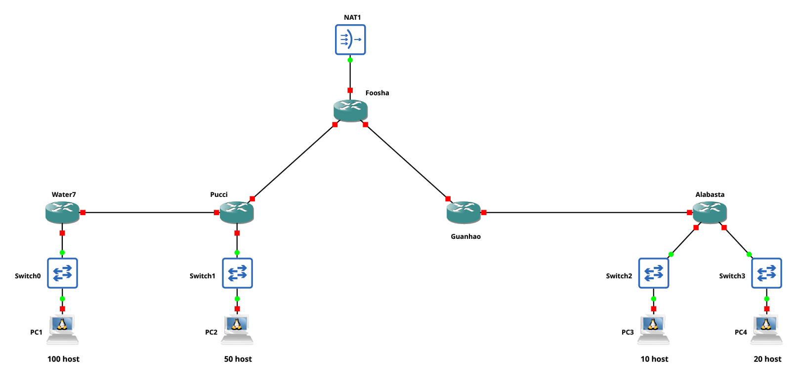

Anggap kita memiliki topologi jaringan seperti gambar di atas, dengan jumlah host yang dibutuhkan tertera di bawah setiap PC. Lalu, tentukan jumlah subnet yang ada di dalam topologi tersebut.

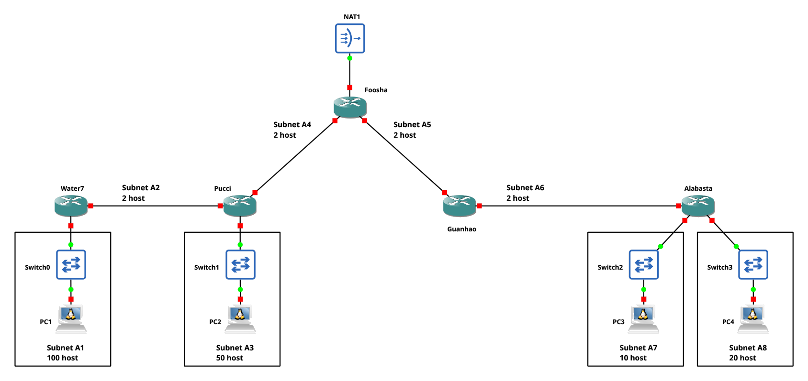

Terdapat 8 subnet di dalam topologi, yaitu 4 subnet yang terhubung ke switch (ditandai dengan kotak) dan 4 subnet antar router (ditandai dengan label di dekat garis link-nya).

Dengan teknik Classful, setiap subnet akan memiliki netmask /24 karena jumlah host setiap subnet tidak lebih dari 254 (Available Hosts dari /24). Pembagian IP yang memungkinkan untuk topologi di atas adalah sebagai berikut.

| Subnet | Network ID    | Netmask         | Broadcast Address |
| ------ | ------------- | --------------- | ----------------- |
| A1     | `192.168.1.0` | `255.255.255.0` | `192.168.1.255`   |
| A2     | `192.168.2.0` | `255.255.255.0` | `192.168.2.255`   |
| A3     | `192.168.3.0` | `255.255.255.0` | `192.168.3.255`   |
| A4     | `192.168.4.0` | `255.255.255.0` | `192.168.4.255`   |
| A5     | `192.168.5.0` | `255.255.255.0` | `192.168.5.255`   |
| A6     | `192.168.6.0` | `255.255.255.0` | `192.168.6.255`   |
| A7     | `192.168.7.0` | `255.255.255.0` | `192.168.7.255`   |
| A8     | `192.168.8.0` | `255.255.255.0` | `192.168.8.255`   |

Namun, bagaimana jika kita hanya perlu 300 alamat? Menggunakan Class C tidaklah cukup, namun menggunakan Class B akan membuang sangat banyak sekali alamat, yaitu sebanyak lebih dari 60.000 alamat akan terbuang sia-sia.

Bisa saja kita menggunakan dua blok Class C (sehingga cukup untuk 512 IP Address). Cara ini memang bisa dilakukan, dan pada umumnya memang dilakukan.

Namun, bagaimana jika kita perlu 25.000 IP Address? Dengan cara ini, kita perlu 99 blok Class C (25.000 ÷ 254 host per blok). Jika menggunakan blok Class B, masih lebih dari 40.000 IP Address akan terbuang.

Karena sangat tidak efisien, maka ditemukanlah teknik alokasi IP yang jauh lebih baik, yaitu Classless Inter-Domain Routing atau kerap dikenal dengan istilah **CIDR**.

#### 1.3.2 Classless / CIDR

Di dalam metode Classless, pembagian IP sudah tidak lagi terpaku pada 3 Class di atas. Dengan metode ini, IP bisa dialokasikan sesuai kebutuhan masing-masing subnet. Metode Classless diimplementasikan secara formal dengan CIDR dan diatur oleh RFC 4632 (sebelumnya RFC 1518/1519). Dengan metode ini, maka:

- Apabila kita perlu 250 IP, maka bisa menggunakan subnet dengan ukuran /24
- Apabila kita perlu 300 IP, maka bisa menggunakan subnet dengan ukuran /23
- Apabila kita perlu 500 IP, maka juga bisa menggunakan subnet dengan ukuran /23
- Apabila kita perlu 25.000 IP, maka bisa menggunakan subnet dengan ukuran /17
- Apabila kita perlu 250.000 IP, maka bisa menggunakan subnet dengan ukuran /14

Cara ini bisa membuat pembagian IP menjadi jauh lebih fleksibel dan jumlah IP Address yang terbuang sia-sia menjadi sangat sangat lebih sedikit.

Di dalam Classless sendiri, ada 2 cara untuk melakukan subnetting atau membuat subnet, yaitu FLSM dan VLSM.

##### FLSM (Fixed Length Subnet Masking)

**Fixed Length Subnet Masking (FLSM)** adalah teknik pembagian jaringan di mana setiap subnet memiliki ukuran atau jumlah host yang sama.

Misalnya, jika kalian memiliki alamat jaringan dengan prefix /24 dan ingin membaginya menjadi 4 subnet, maka setiap subnet akan mendapatkan bagian yang sama besar, yaitu dengan prefix /26.

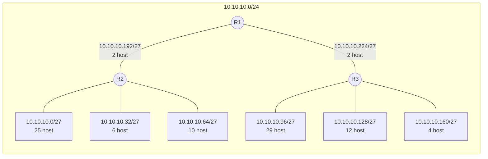

Sebagai contoh, kalian diberi alamat `10.10.10.0/24` dan memiliki topologi seperti di atas, dengan jumlah host pada masing-masing subnet tertera di bawah alamatnya. Prefix untuk FLSM ditentukan dengan langkah berikut:

1. Hitung jumlah subnet. Topologi di atas memiliki 8 subnet, yaitu 6 LAN dan 2 link antar router.
2. Cari jumlah bit tambahan `n` agar 2<sup>n</sup> ≥ jumlah subnet. Karena 2<sup>3</sup> = 8, dibutuhkan 3 bit tambahan, sehingga prefix menjadi /24 + 3 = /27.
3. Pastikan prefix tersebut cukup untuk subnet dengan host terbanyak. Subnet terbesar membutuhkan 29 host + 1 router = 30 IP, dan /27 memiliki 30 Available Hosts, sehingga cukup. Jika tidak cukup, dibutuhkan blok root yang lebih besar.
4. Bagi alamat secara rata dengan ukuran blok 32 alamat: `10.10.10.0`, `.32`, `.64`, `.96`, `.128`, `.160`, `.192`, dan `.224`.

Subnet dengan prefix /27 berisi 32 IP namun hanya 30 yang bisa digunakan, karena IP pertama digunakan sebagai Network ID dan IP terakhir digunakan sebagai Broadcast Address.

Namun, bagaimana jika kamu memiliki 2 subnet, dengan subnet pertama membutuhkan 25.000 IP namun subnet kedua hanya perlu 500 IP? Jika menggunakan aturan FLSM, kedua subnet harus memiliki ukuran /17. Ukuran ini cukup untuk subnet pertama, tetapi terlalu besar dan boros untuk subnet kedua.

Masalah yang sama muncul setiap kali ada subnet ke-3, ke-4, dan seterusnya dengan kebutuhan yang berbeda-beda. Karena itu, digunakan teknik lain, yaitu VLSM.

##### VLSM (Variable Length Subnet Masking)

Berbeda dengan FLSM, **Variable Length Subnet Masking (VLSM)** adalah teknik subnetting yang mana semua subnet bisa memiliki ukuran yang berbeda-beda.

Inti utama dari penggunaan teknik VLSM adalah untuk mengefisienkan pembagian IP di dalam jaringan, karena besar netmask akan disesuaikan dengan banyaknya host yang membutuhkan IP Address di masing-masing subnet.

Jadi, pada teknik VLSM, netmask akan diberikan sesuai dengan kebutuhan jumlah IP Address dari subnet tersebut.

Contoh penerapannya, kita akan menggunakan topologi seperti contoh metode Classful.

1. Tentukan jumlah IP Address yang dibutuhkan oleh tiap subnet dan lakukan labelling netmask berdasarkan jumlah IP yang dibutuhkan.

   - Subnet yang terhubung ke switch (LAN): jumlah IP = jumlah host + 1 untuk interface router (gateway).
   - Subnet antar router: cukup 2 IP, yaitu satu untuk setiap interface router.

   | Subnet    | Jumlah IP (host + router) | Netmask |
   | --------- | ------------------------- | ------- |
   | A1        | 101                       | /25     |
   | A2        | 2                         | /30     |
   | A3        | 51                        | /26     |
   | A4        | 2                         | /30     |
   | A5        | 2                         | /30     |
   | A6        | 2                         | /30     |
   | A7        | 11                        | /28     |
   | A8        | 21                        | /27     |
   | **Total** | **192**                   | **/24** |

   Netmask root ditentukan dari jumlah ukuran blok semua subnet: 128 (/25) + 64 (/26) + 32 (/27) + 16 (/28) + 4 × 4 (/30) = 256 alamat. Jumlah ini pas dengan satu blok /24, sehingga pembagian IP dimulai dari netmask /24.

   > Jumlah IP yang dibutuhkan (192) belum cukup untuk menentukan root, karena setiap subnet memakai satu blok utuh sesuai netmask-nya. Misalnya, A1 yang butuh 101 IP tetap memakai blok /25 berisi 128 alamat.

2. Subnet besar yang dibentuk memiliki NID `192.168.1.0` dengan netmask /24. Hitung pembagian IP berdasarkan NID dan netmask tersebut menggunakan pohon seperti gambar di bawah.

   ```mermaid
   flowchart TD
       n0["192.168.1.0 / 24"]
       n1["192.168.1.0 / 25"]
       n0 --> n1
       n2["192.168.1.128 / 25"]
       n0 --> n2
       n3["192.168.1.0 / 26"]
       n1 --> n3
       n4["192.168.1.64 / 26"]
       n1 --> n4
       n5["192.168.1.0 / 27"]
       n3 --> n5
       n6["192.168.1.32 / 27"]
       n3 --> n6
       n7["192.168.1.0 / 28"]
       n5 --> n7
       n8["192.168.1.16 / 28"]
       n5 --> n8
       n9["192.168.1.0 / 29"]
       n7 --> n9
       n10["192.168.1.8 / 29"]
       n7 --> n10
       n11["192.168.1.0 / 30"]
       n9 --> n11
       n12["192.168.1.4 / 30"]
       n9 --> n12
       n13["192.168.1.8 / 30"]
       n10 --> n13
       n14["192.168.1.12 / 30"]
       n10 --> n14
   ```

3. Lakukan subnetting dengan menggunakan pohon tersebut untuk pembagian IP sesuai dengan kebutuhan masing-masing subnet yang ada.

   ```mermaid
   flowchart TD
       n0["192.168.1.0 / 24"]
       n1["192.168.1.0 / 25"]
       n0 --> n1
       n2["192.168.1.128 / 25<br/>A1 = 100 host"]
       n0 --> n2
       n3["192.168.1.0 / 26"]
       n1 --> n3
       n4["192.168.1.64 / 26<br/>A3 = 50 host"]
       n1 --> n4
       n5["192.168.1.0 / 27"]
       n3 --> n5
       n6["192.168.1.32 / 27<br/>A8 = 20 host"]
       n3 --> n6
       n7["192.168.1.0 / 28"]
       n5 --> n7
       n8["192.168.1.16 / 28<br/>A7 = 10 host"]
       n5 --> n8
       n9["192.168.1.0 / 29"]
       n7 --> n9
       n10["192.168.1.8 / 29"]
       n7 --> n10
       n11["192.168.1.0 / 30<br/>A2 = 2 host"]
       n9 --> n11
       n12["192.168.1.4 / 30<br/>A4 = 2 host"]
       n9 --> n12
       n13["192.168.1.8 / 30<br/>A5 = 2 host"]
       n10 --> n13
       n14["192.168.1.12 / 30<br/>A6 = 2 host"]
       n10 --> n14
       classDef dipakai fill:#d4edda,stroke:#28a745,color:#155724
       class n2,n4,n6,n8,n11,n12,n13,n14 dipakai
   ```

   Dari pohon tersebut akan mendapat pembagian IP sebagai berikut.

   | Subnet | Network ID      | Netmask           | Broadcast Address |
   | ------ | --------------- | ----------------- | ----------------- |
   | A1     | `192.168.1.128` | `255.255.255.128` | `192.168.1.255`   |
   | A2     | `192.168.1.0`   | `255.255.255.252` | `192.168.1.3`     |
   | A3     | `192.168.1.64`  | `255.255.255.192` | `192.168.1.127`   |
   | A4     | `192.168.1.4`   | `255.255.255.252` | `192.168.1.7`     |
   | A5     | `192.168.1.8`   | `255.255.255.252` | `192.168.1.11`    |
   | A6     | `192.168.1.12`  | `255.255.255.252` | `192.168.1.15`    |
   | A7     | `192.168.1.16`  | `255.255.255.240` | `192.168.1.31`    |
   | A8     | `192.168.1.32`  | `255.255.255.224` | `192.168.1.63`    |

#### 1.3.3 Subnet Calculator

Perhitungan subnet bisa dilakukan secara manual menggunakan pohon seperti pada contoh VLSM di atas. Hasil perhitungan manual tersebut bisa dicek menggunakan **subnet calculator** online.

Contoh berikut mengecek subnet `192.168.1.64/27` menggunakan dua subnet calculator.

##### calculator.net

Situs: https://www.calculator.net/ip-subnet-calculator.html

1. Pilih netmask pada kolom **Subnet**, isi IP Address pada kolom **IP Address**, lalu klik **Calculate**.

   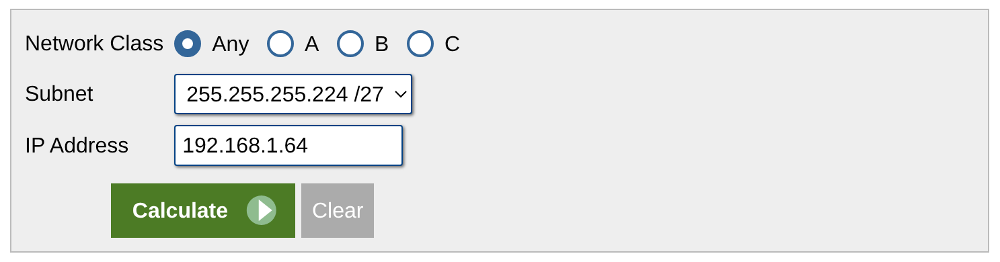

2. Bandingkan hasilnya dengan perhitungan manual.

   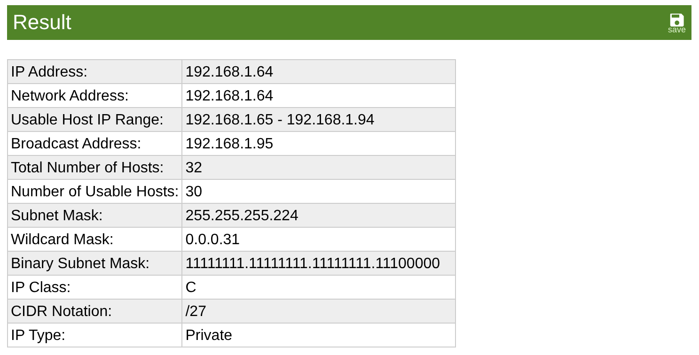

##### jodies.de

Situs: https://jodies.de/ipcalc

1. Isi IP Address pada kolom **Address** dan prefix pada kolom **Netmask**, lalu klik **Calculate**.

   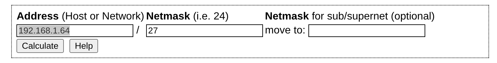

2. Bandingkan hasilnya dengan perhitungan manual.

   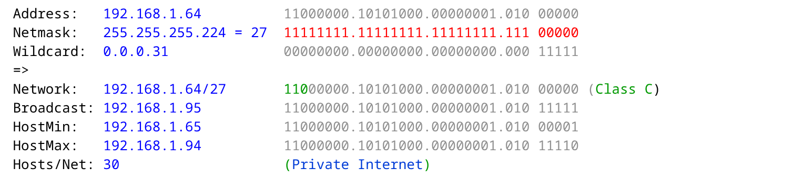

   Selain dalam bentuk desimal, hasilnya juga ditampilkan dalam bentuk biner. Spasi pada bilangan biner tersebut memisahkan bagian network (kiri) dan bagian host (kanan).

Istilah yang digunakan kedua subnet calculator sedikit berbeda dengan istilah pada modul ini:

| Modul ini         | calculator.net       | jodies.de         |
| ----------------- | -------------------- | ----------------- |
| Network ID        | Network Address      | Network           |
| Broadcast Address | Broadcast Address    | Broadcast         |
| Available Hosts   | Usable Host IP Range | HostMin - HostMax |
| Netmask           | Subnet Mask          | Netmask           |

### 1.4 Supernetting

Supernetting adalah kebalikan dari subnetting, yaitu teknik menggabungkan beberapa jaringan kecil (subnet) menjadi satu jaringan yang lebih besar dengan cara mengurangi panjang prefix (menambah jumlah bit host) pada alamat jaringan.

Dengan kata lain, jika subnetting memecah satu jaringan besar menjadi beberapa jaringan kecil, maka supernetting menyatukan beberapa jaringan kecil yang berurutan menjadi satu blok jaringan yang lebih besar.

Supernetting memiliki beberapa tujuan dan manfaat, diantaranya sebagai berikut:

- Mengurangi ukuran tabel routing (lebih efisien di router).
- Menyederhanakan manajemen jaringan besar.
- Digunakan dalam teknik route aggregation di internet (menggabungkan banyak prefix menjadi satu entri routing).

Untuk bagaimana cara melakukannya bisa menggunakan route aggregation dari CIDR dengan mengikuti langkah-langkah berikut:

1. Tentukan subnet yang ada dalam topologi dan lakukan labelling netmask terhadap masing-masing subnet. Contohnya dapat dilihat pada gambar berikut.

   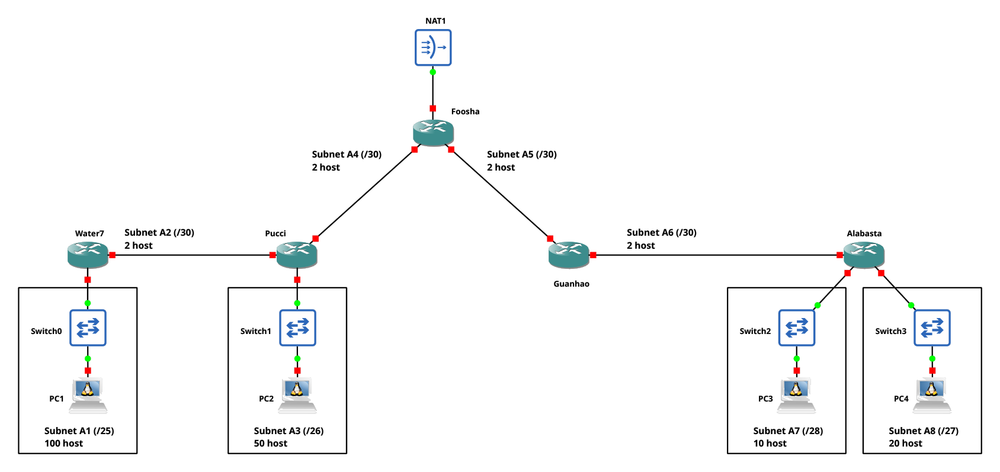

2. Gabungkan subnet paling bawah di dalam topologi. Paling bawah berarti subnet yang paling jauh dari internet (node NAT1).

   Pada topologi ini, subnet yang dapat digabungkan adalah A1 dengan A2, serta A7 dengan A8. Subnet yang digabung tersebut akan membentuk sebuah subnet lebih besar dari subnet-subnet kecil yang ada di dalamnya.

   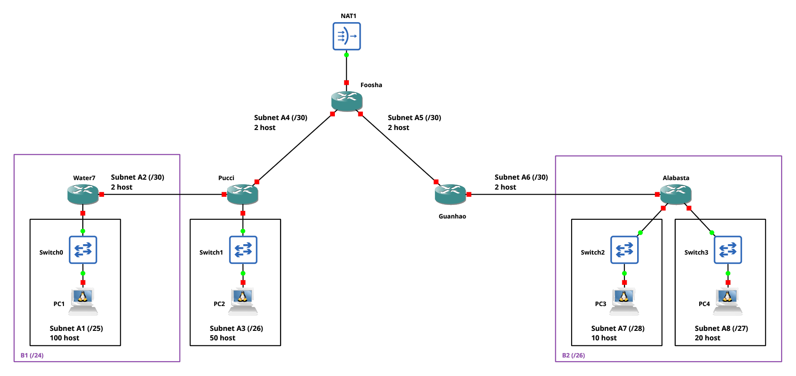

   Subnet B1 merupakan hasil penggabungan dari subnet A1 dan A2, Subnet B2 merupakan hasil penggabungan dari subnet A7 dan A8. Subnet hasil penggabungan ditandai dengan kotak berwarna.

   Mengapa B1 memiliki netmask /24 dan B2 memiliki netmask /26? Pada supernetting, subnet gabungan memakai prefix terbesar yang masih cukup menampung semua subnet yang digabungkan:

   - B1 = A1 (/25, 128 alamat) + A2 (/30, 4 alamat) = 132 alamat. Jumlah ini tidak muat di /25 (128 alamat), tetapi muat di /24 (256 alamat).
   - B2 = A8 (/27, 32 alamat) + A7 (/28, 16 alamat) = 48 alamat, sehingga cukup /26 (64 alamat).

   Pada contoh ini, total subnet lain yang digabungkan tidak pernah lebih besar dari subnet terbesarnya, sehingga hasilnya cukup 1 tingkat di atas subnet terbesar. Jika totalnya lebih besar, misalnya /25 + /25 + /30 (260 alamat), hasilnya menjadi 2 tingkat di atas, yaitu /23.

   Lalu ulangi langkah tersebut sampai menjadi sebuah subnet besar yang mencakup 1 topologi yang kita miliki.

   Penggabungan berikutnya: C1 = B1 + A3 (/23) dan C2 = B2 + A6 (/25).

   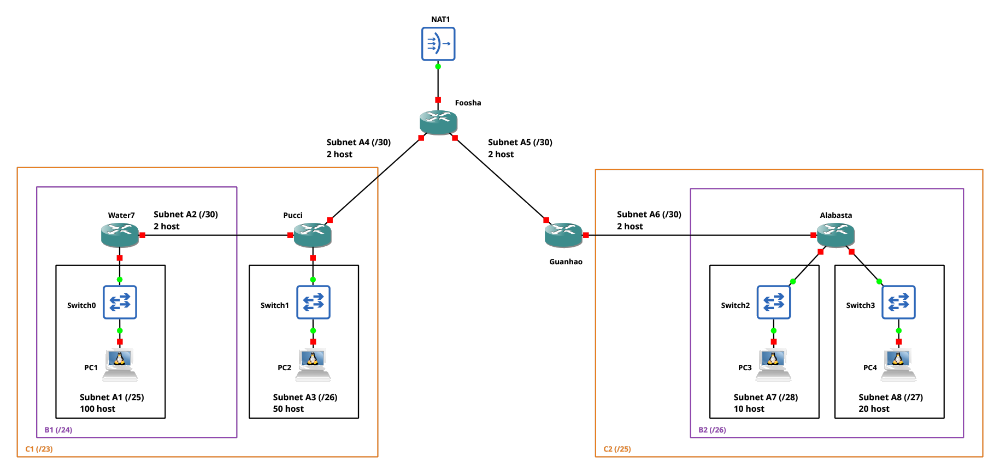

   Penggabungan berikutnya: D1 = C1 + A4 (/22) dan D2 = C2 + A5 (/24).

   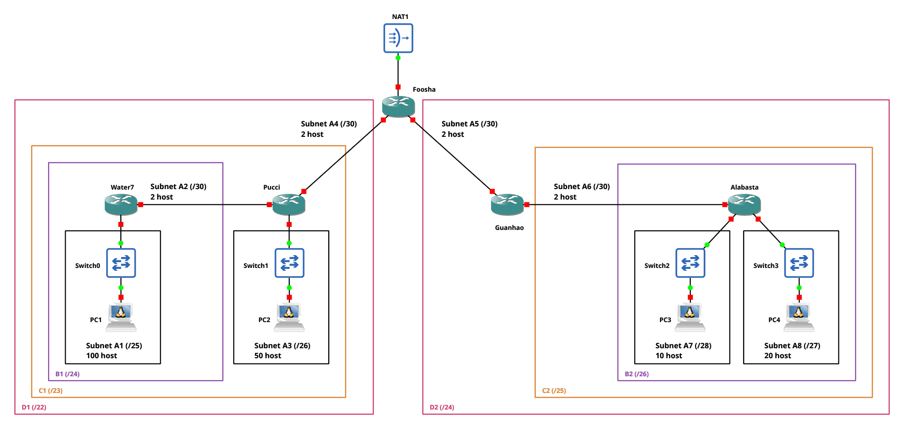

   Penggabungan terakhir: E1 = D1 + D2 (/21), yang mencakup seluruh subnet pada topologi.

   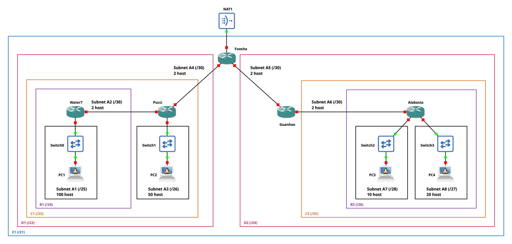

3. Dari proses penggabungan yang telah dilakukan, didapatkan sebuah subnet besar dengan netmask /21. Kali ini dapat menggunakan NID `192.168.0.0`, netmask `255.255.248.0`.

4. Hitung pembagian IP dengan pohon berdasarkan penggabungan subnet yang telah dilakukan.

   ```mermaid
   flowchart TD
       n0["192.168.0.0 / 21"]
       n1["192.168.0.0 / 22"]
       n0 --> n1
       n2["192.168.4.0 / 24"]
       n0 --> n2
       n3["192.168.0.0 / 23"]
       n1 --> n3
       n4["192.168.2.0 / 30<br/>A4 = 2 host"]
       n1 --> n4
       n5["192.168.0.0 / 24"]
       n3 --> n5
       n6["192.168.1.0 / 26<br/>A3 = 50 host"]
       n3 --> n6
       n7["192.168.0.0 / 25<br/>A1 = 100 host"]
       n5 --> n7
       n8["192.168.0.128 / 30<br/>A2 = 2 host"]
       n5 --> n8
       n9["192.168.4.0 / 25"]
       n2 --> n9
       n10["192.168.4.128 / 30<br/>A5 = 2 host"]
       n2 --> n10
       n11["192.168.4.0 / 26"]
       n9 --> n11
       n12["192.168.4.64 / 30<br/>A6 = 2 host"]
       n9 --> n12
       n13["192.168.4.0 / 27<br/>A8 = 20 host"]
       n11 --> n13
       n14["192.168.4.32 / 28<br/>A7 = 10 host"]
       n11 --> n14
       classDef dipakai fill:#d4edda,stroke:#28a745,color:#155724
       class n7,n8,n6,n4,n10,n12,n14,n13 dipakai
   ```

   > Perbedaan antara pohon VLSM dengan pohon supernetting adalah ketika satu subnet diturunkan, netmask yang akan terbentuk disesuaikan dengan penggabungan subnet yang telah dilakukan sebelumnya.
   >
   > Sebagai contoh, dari netmask besar /21, pada teknik VLSM akan dibagi dua menjadi masing-masing /22. Namun pada penggabungan yang dilakukan sebelumnya, /21 dihasilkan dari penggabungan /22 dan /24 maka subnet yang terbentuk memiliki netmask /22 dan /24.

5. Berdasarkan penghitungan, maka didapatkan pembagian IP sebagai berikut.

   | Subnet | Network ID      | Netmask           | Broadcast Address |
   | ------ | --------------- | ----------------- | ----------------- |
   | A1     | `192.168.0.0`   | `255.255.255.128` | `192.168.0.127`   |
   | A2     | `192.168.0.128` | `255.255.255.252` | `192.168.0.131`   |
   | A3     | `192.168.1.0`   | `255.255.255.192` | `192.168.1.63`    |
   | A4     | `192.168.2.0`   | `255.255.255.252` | `192.168.2.3`     |
   | A5     | `192.168.4.128` | `255.255.255.252` | `192.168.4.131`   |
   | A6     | `192.168.4.64`  | `255.255.255.252` | `192.168.4.67`    |
   | A7     | `192.168.4.32`  | `255.255.255.240` | `192.168.4.47`    |
   | A8     | `192.168.4.0`   | `255.255.255.224` | `192.168.4.31`    |

Jika kalian menggunakan supernetting, blok IP yang dibutuhkan akan menjadi lebih besar dibandingkan dengan menggunakan VLSM (pada contoh ini /21, sedangkan VLSM cukup /24). Meski begitu, supernetting memiliki dua keunggulan:

- Ketika ada subnet baru yang ditambahkan dalam topologi, tidak perlu melakukan penghitungan kembali, karena kemungkinan besar masih ada interval (_range_) IP yang tidak terpakai.
- Routing lebih efisien, karena umumnya tabel routing yang dimiliki lebih sederhana dibandingkan VLSM biasa.

### 1.5 Implementasi

Pada bagian ini, hasil perhitungan subnet akan diterapkan di GNS3. MikroTik digunakan sebagai router, sedangkan netics-pc digunakan sebagai client.

#### 1.5.1 Topologi dan Perhitungan

Buat topologi berikut di GNS3:

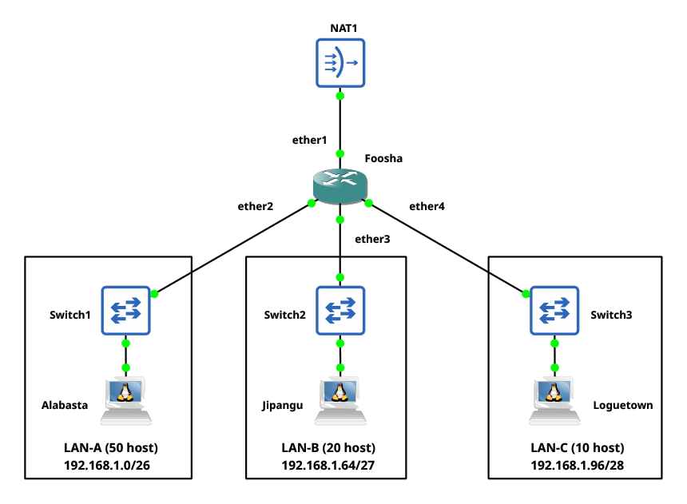

Router Foosha terhubung ke NAT1 melalui `ether1` untuk mendapatkan akses internet. Interface `ether2`, `ether3`, dan `ether4` masing-masing terhubung ke satu LAN melalui sebuah switch.

Diberikan alamat `192.168.1.0/24` yang harus dibagi untuk 3 LAN dengan kebutuhan host sebagai berikut:

| Subnet | Jumlah Host |
| ------ | ----------- |
| LAN-A  | 50          |
| LAN-B  | 20          |
| LAN-C  | 10          |

Pembagian subnet dilakukan menggunakan VLSM:

1. Urutkan subnet dari kebutuhan host terbesar ke terkecil.
2. Untuk setiap subnet, pilih subnet terkecil (prefix paling besar) yang jumlah Available Hosts-nya cukup untuk semua host ditambah 1 alamat untuk router (gateway).
3. Bagikan alamat secara berurutan, dimulai dari `192.168.1.0`, menggunakan pohon VLSM berikut. Kotak berwarna hijau adalah subnet yang dipakai oleh LAN.

   ```mermaid
   flowchart TD
       n0["192.168.1.0 / 24"]
       n1["192.168.1.0 / 25"]
       n0 --> n1
       n2["192.168.1.128 / 25"]
       n0 --> n2
       n3["192.168.1.0 / 26<br/>LAN-A = 51 host"]
       n1 --> n3
       n4["192.168.1.64 / 26"]
       n1 --> n4
       n5["192.168.1.64 / 27<br/>LAN-B = 21 host"]
       n4 --> n5
       n6["192.168.1.96 / 27"]
       n4 --> n6
       n7["192.168.1.96 / 28<br/>LAN-C = 11 host"]
       n6 --> n7
       n8["192.168.1.112 / 28"]
       n6 --> n8
       classDef dipakai fill:#d4edda,stroke:#28a745,color:#155724
       class n3,n5,n7 dipakai
   ```

Hasil pembagiannya adalah sebagai berikut:

| Subnet | Kebutuhan (host + router) | Prefix | Netmask           | Network ID     | Available Hosts                 | Broadcast Address |
| ------ | ------------------------- | ------ | ----------------- | -------------- | ------------------------------- | ----------------- |
| LAN-A  | 50 + 1 = 51               | /26  | `255.255.255.192` | `192.168.1.0`  | `192.168.1.1` - `192.168.1.62`  | `192.168.1.63`    |
| LAN-B  | 20 + 1 = 21               | /27  | `255.255.255.224` | `192.168.1.64` | `192.168.1.65` - `192.168.1.94` | `192.168.1.95`    |
| LAN-C  | 10 + 1 = 11               | /28  | `255.255.255.240` | `192.168.1.96` | `192.168.1.97` - `192.168.1.110` | `192.168.1.111`  |

Dari tabel di atas, alamat pertama dari Available Hosts setiap subnet digunakan untuk router, dan alamat berikutnya digunakan untuk client:

| Node      | Interface | IP Address       | Netmask           | Gateway        |
| --------- | --------- | --------------- | ----------------- | -------------- |
| Foosha    | `ether2`  | `192.168.1.1`   | `255.255.255.192` | -              |
| Foosha    | `ether3`  | `192.168.1.65`  | `255.255.255.224` | -              |
| Foosha    | `ether4`  | `192.168.1.97`  | `255.255.255.240` | -              |
| Alabasta  | `eth0`    | `192.168.1.2`   | `255.255.255.192` | `192.168.1.1`  |
| Jipangu   | `eth0`    | `192.168.1.66`  | `255.255.255.224` | `192.168.1.65` |
| Loguetown | `eth0`    | `192.168.1.98`  | `255.255.255.240` | `192.168.1.97` |

#### 1.5.2 Foosha

Penulisan perintah di MikroTik bisa dilengkapi otomatis dengan menekan tombol `TAB`.

1. Ganti nama router (_identity_) menjadi Foosha agar tidak tertukar dengan router lain:

   ```
   /system identity set name=Foosha
   ```

   Prompt terminal akan berubah dari `[admin@CHR] >` menjadi `[admin@Foosha] >`.

2. Lihat daftar interface yang tersedia:

   ```
   /interface print
   ```

   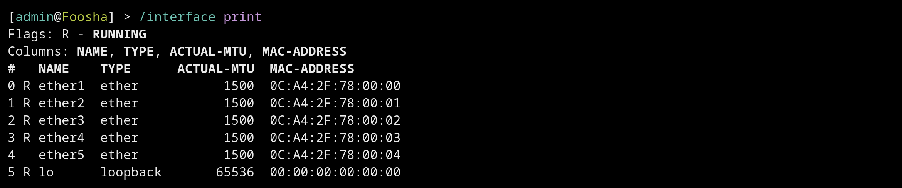

   Flag `R` (_running_) menandakan interface sudah terhubung. `ether1` sampai `ether4` sudah terhubung sesuai topologi, sedangkan `ether5` tidak dipakai.

3. Interface `ether1` terhubung ke NAT1. Agar Foosha mendapatkan IP Address dan akses internet dari NAT1, `ether1` harus menjalankan DHCP client. Pada MikroTik CHR, DHCP client di `ether1` sudah aktif secara bawaan. Cek statusnya dengan:

   ```
   /ip dhcp-client print
   ```

   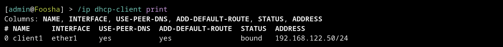

   Kolom `STATUS` bernilai `bound`, artinya Foosha sudah mendapatkan IP Address dari NAT1 (pada contoh ini `192.168.122.50/24`, hasilnya bisa berbeda).

   Jika daftarnya kosong, tambahkan DHCP client pada `ether1`:

   ```
   /ip dhcp-client add interface=ether1 disabled=no
   ```

4. Cek DNS server yang digunakan oleh Foosha:

   ```
   /ip dns print
   ```

   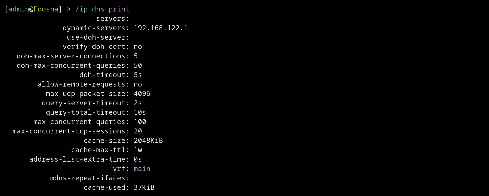

   DNS server dari NAT1 didapatkan otomatis melalui DHCP client dan tampil pada baris `dynamic-servers`. Jika ingin menambahkan DNS server secara manual, gunakan:

   ```
   /ip dns set servers=8.8.8.8
   ```

5. Uji koneksi internet dari Foosha:

   ```
   /ping google.com count=4
   ```

   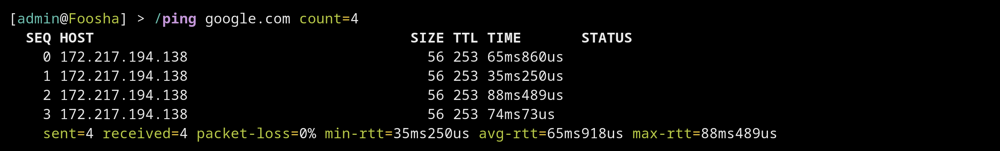

   Nilai `received=4` dan `packet-loss=0%` berarti Foosha sudah terhubung ke internet.

6. Tambahkan IP Address untuk setiap interface LAN sesuai tabel pada [Topologi dan Perhitungan](#151-topologi-dan-perhitungan). IP Address ditulis bersama prefix-nya.

   ```
   /ip address add address=192.168.1.1/26 interface=ether2 comment=LAN-A
   /ip address add address=192.168.1.65/27 interface=ether3 comment=LAN-B
   /ip address add address=192.168.1.97/28 interface=ether4 comment=LAN-C
   ```

7. Cek hasilnya dengan:

   ```
   /ip address print
   ```

   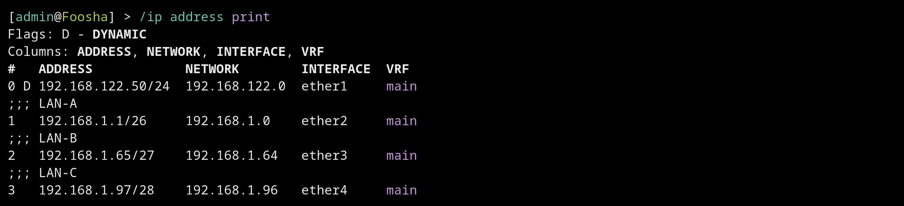

   Perhatikan kolom `NETWORK`. MikroTik menghitung Network ID secara otomatis dari IP Address dan prefix yang dimasukkan, sehingga nilainya harus sama dengan kolom Network ID pada tabel perhitungan. Baris `192.168.122.50/24` dengan flag `D` (_dynamic_) adalah IP Address dari DHCP client di `ether1`.

   Jika ada IP Address yang salah dimasukkan, hapus dengan perintah berikut, lalu tambahkan kembali IP Address yang benar:

   ```
   /ip address remove [find address="192.168.1.1/26"]
   ```

8. Setelah IP Address ditambahkan, MikroTik otomatis mengetahui cara meraih ketiga subnet tersebut karena terhubung langsung dengannya. Hal ini bisa dilihat pada routing table:

   ```
   /ip route print
   ```

   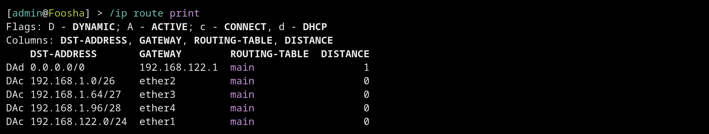

   Route dengan flag `DAc` menunjukkan subnet yang terhubung langsung (_connected_) ke Foosha.

   Route `0.0.0.0/0` dengan flag `DAd` adalah **default route**, yaitu route yang dipakai untuk semua IP tujuan yang tidak cocok dengan route lain, sama seperti default gateway pada Modul 3. Route ini didapat dari DHCP client, sehingga paket menuju internet diteruskan ke NAT1 (`192.168.122.1`).

#### 1.5.3 Alabasta

Atur IP Address melalui **Edit config**, lalu restart node agar konfigurasi diterapkan:

```
auto eth0
iface eth0 inet static
	address 192.168.1.2
	netmask 255.255.255.192
	gateway 192.168.1.1
```

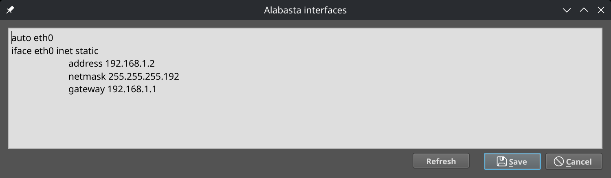

Cek IP Address yang terpasang pada baris `inet`:

```
ip a show eth0
```

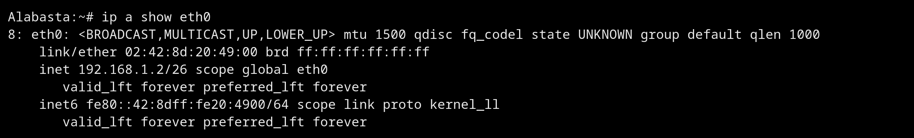

#### 1.5.4 Jipangu

Atur IP Address melalui **Edit config**, lalu restart node agar konfigurasi diterapkan:

```
auto eth0
iface eth0 inet static
	address 192.168.1.66
	netmask 255.255.255.224
	gateway 192.168.1.65
```


Cek IP Address yang terpasang pada baris `inet`:

```
ip a show eth0
```


#### 1.5.5 Loguetown

Atur IP Address melalui **Edit config**, lalu restart node agar konfigurasi diterapkan:

```
auto eth0
iface eth0 inet static
	address 192.168.1.98
	netmask 255.255.255.240
	gateway 192.168.1.97
```


Cek IP Address yang terpasang pada baris `inet`:

```
ip a show eth0
```

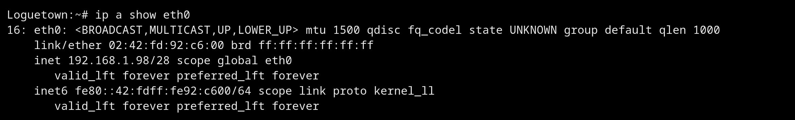

#### 1.5.6 Pengujian

1. Dari **Alabasta**, lakukan ping ke gateway-nya:

   ```
   ping -c 4 192.168.1.1
   ```

   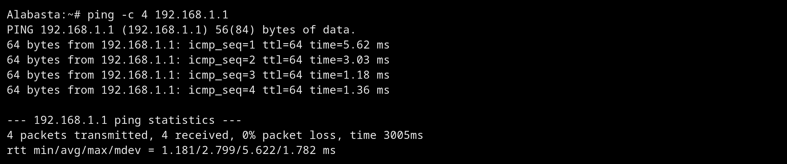

2. Dari **Alabasta**, lakukan ping ke client di subnet lain, yaitu Jipangu dan Loguetown:

   ```
   ping -c 4 192.168.1.66
   ping -c 4 192.168.1.98
   ```

   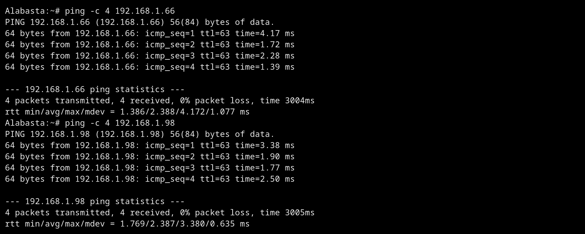

   Ping berhasil karena paket dikirim ke gateway (Foosha), dan Foosha mengetahui cara meraih semua subnet yang terhubung langsung dengannya.

3. Dari **Foosha**, lakukan ping ke semua client:

   ```
   /ping 192.168.1.2 count=4
   /ping 192.168.1.66 count=4
   /ping 192.168.1.98 count=4
   ```

   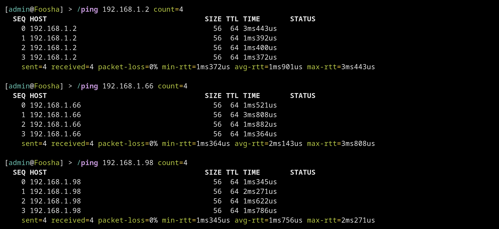

4. Dari **Alabasta**, coba lakukan ping ke internet:

   ```
   ping -c 4 8.8.8.8
   ```

   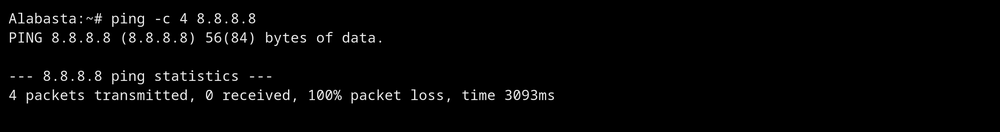

   Ping gagal (`100% packet loss`). Client belum bisa mengakses internet walaupun Foosha sudah terhubung ke NAT1. Agar client bisa mengakses internet, diperlukan konfigurasi NAT tambahan di Foosha.

## 2. Static Routing (Lanjutan)

Pada Modul 3, static routing sudah dikonfigurasi di Linux menggunakan `ip route add` pada topologi dengan sedikit router. Pada bab ini, static routing diterapkan di MikroTik pada topologi yang lebih besar, sehingga paket harus melewati beberapa router sebelum sampai ke tujuan.

### 2.1 Multi-hop Routing

**Multi-hop routing** adalah pengiriman paket yang melewati lebih dari satu router sebelum sampai ke tujuan.

Setiap router tidak mengetahui seluruh jalur menuju tujuan. Router hanya mencocokkan IP tujuan paket dengan routing table, lalu meneruskan paket ke router berikutnya (_next hop_). Langkah ini diulang oleh setiap router yang dilewati (_hop-by-hop_).

Contohnya, paket dari PC1 (LAN Water7) menuju PC4 (LAN Alabasta) melewati lima router:

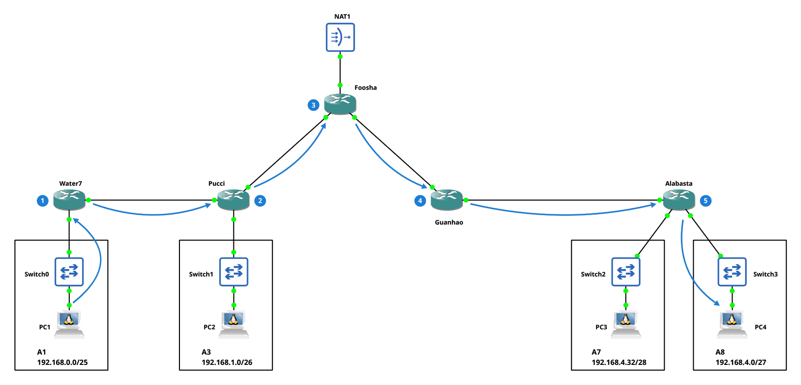

Angka 1 sampai 5 menunjukkan urutan router yang dilewati paket. Switch tidak dihitung sebagai hop karena switch hanya meneruskan paket di dalam LAN, bukan melakukan routing.

Ada dua hal yang perlu diperhatikan agar komunikasi berhasil:

- **Rute pergi dan rute pulang**: router di jalur pergi harus tahu cara meraih subnet tujuan, dan router di jalur pulang harus tahu cara meraih subnet asal. Jika salah satunya tidak ada, ping tetap gagal walaupun paket sudah sampai ke tujuan.
- **Default route**: router di ujung topologi, seperti Water7 dan Alabasta, hanya memiliki satu jalan keluar. Router seperti ini cukup diberi satu default route (`0.0.0.0/0`) ke router di atasnya.

Dengan aturan tersebut, route yang dibutuhkan setiap router adalah sebagai berikut:

| Router   | Subnet tujuan        | Next hop |
| -------- | -------------------- | -------- |
| Foosha   | A1, A2, A3           | Pucci    |
| Foosha   | A6, A7, A8           | Guanhao  |
| Foosha   | Default (internet)   | NAT1     |
| Pucci    | A1                   | Water7   |
| Pucci    | Default              | Foosha   |
| Water7   | Default              | Pucci    |
| Guanhao  | A7, A8               | Alabasta |
| Guanhao  | Default              | Foosha   |
| Alabasta | Default              | Guanhao  |

Subnet yang terhubung langsung ke sebuah router tidak perlu ditambahkan, karena router sudah mengetahuinya secara otomatis.

### 2.2 Route Summarization dan Longest Prefix Match

#### 2.2.1 Route Summarization

**Route summarization** adalah teknik menggabungkan beberapa route menjadi satu route yang mencakup semua subnet tersebut. Caranya sama dengan supernetting: subnet yang berurutan digabung menjadi satu blok dengan prefix yang lebih pendek.

Pada tabel di atas, Foosha membutuhkan 6 route. Padahal, subnet di belakang Pucci (A1, A2, A3) sudah tergabung dalam D1, dan subnet di belakang Guanhao (A6, A7, A8) sudah tergabung dalam D2.


Routing table Foosha sebelum summarization:

| Subnet tujuan             | Next hop |
| ------------------------- | -------- |
| `192.168.0.0/25` (A1)     | Pucci    |
| `192.168.0.128/30` (A2)   | Pucci    |
| `192.168.1.0/26` (A3)     | Pucci    |
| `192.168.4.64/30` (A6)    | Guanhao  |
| `192.168.4.32/28` (A7)    | Guanhao  |
| `192.168.4.0/27` (A8)     | Guanhao  |

Routing table Foosha sesudah summarization:

| Subnet tujuan           | Next hop |
| ----------------------- | -------- |
| `192.168.0.0/22` (D1)   | Pucci    |
| `192.168.4.0/24` (D2)   | Guanhao  |

Manfaat route summarization:

- Routing table lebih kecil, sehingga lebih mudah dibaca dan diperiksa.
- Subnet baru di dalam blok yang sama tidak perlu ditambahkan satu per satu ke router lain.

Syarat route summarization:

- Subnet yang digabung harus berurutan dan berada dalam satu blok, seperti hasil supernetting.
- Semua subnet tersebut harus bisa diraih melalui next hop yang sama.

> Blok hasil summarization bisa mencakup alamat yang belum dipakai. Misalnya, D1 (`192.168.0.0/22`) juga mencakup `192.168.3.0` hingga `192.168.3.255`, padahal tidak ada subnet yang memakai alamat tersebut. Paket menuju alamat ini tetap diteruskan Foosha ke Pucci.

#### 2.2.2 Longest Prefix Match

Sebuah IP tujuan bisa cocok dengan lebih dari satu route. Contohnya, setelah summarization Foosha memiliki route berikut:

| Route              | Keterangan                          |
| ------------------ | ----------------------------------- |
| `0.0.0.0/0`        | Default route ke NAT1               |
| `192.168.4.0/24`   | D2, melalui Guanhao                 |
| `192.168.4.128/30` | A5, terhubung langsung ke Foosha    |

Untuk memilih route, router menggunakan aturan **longest prefix match**: dari semua route yang cocok, router memilih route dengan prefix paling panjang (paling spesifik).

| IP tujuan                | Route yang cocok | Route yang dipilih                          |
| ------------------------ | ---------------- | ------------------------------------------- |
| `192.168.4.130` (Guanhao) | /0, /24, /30     | `192.168.4.128/30`, terhubung langsung      |
| `192.168.4.34` (PC3)     | /0, /24          | `192.168.4.0/24`, melalui Guanhao           |
| `8.8.8.8`                | /0               | `0.0.0.0/0`, melalui NAT1                   |

Default route (/0) cocok dengan semua IP tujuan, tetapi selalu kalah dari route lain yang lebih spesifik. Karena itu, default route hanya dipakai jika tidak ada route lain yang cocok.

Jika ada dua route dengan prefix yang sama, MikroTik memilih route dengan nilai `distance` paling kecil.

### 2.3 Routing Loop dan TTL

#### 2.3.1 Routing Loop

**Routing loop** terjadi ketika paket berputar di antara dua router atau lebih tanpa pernah sampai ke tujuan. Setiap router mengira router lainnya adalah jalan menuju tujuan.

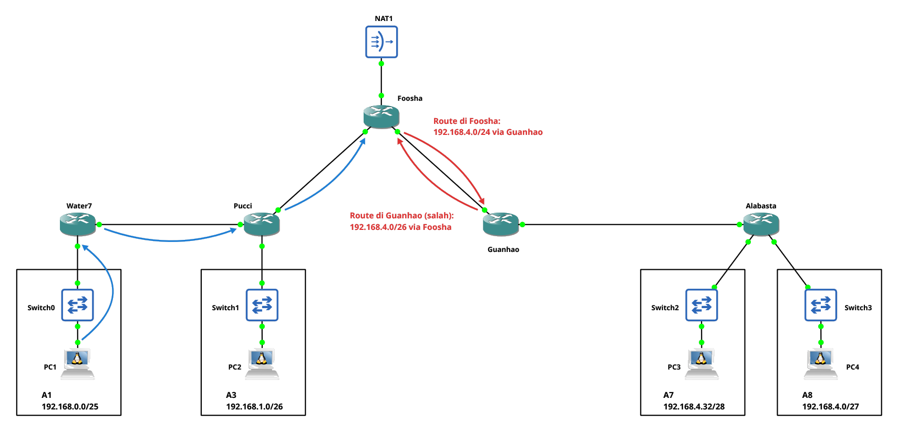

Pada gambar di atas, paket dari PC1 menuju PC4 diteruskan Foosha ke Guanhao. Route di Guanhao salah mengarah kembali ke Foosha, sehingga paket berputar di antara keduanya.

Penyebab yang sering terjadi:

- **Gateway yang salah**: Foosha meneruskan paket ke Guanhao, tetapi route di Guanhao justru mengarah kembali ke Foosha.
- **Summarization dan default route**: Foosha meneruskan paket menuju `192.168.3.10` ke Pucci karena alamat tersebut termasuk D1. Pucci tidak memiliki subnet tersebut, sehingga paket dikembalikan ke Foosha melalui default route.

Paket yang berputar memenuhi link di antara router tersebut. Agar paket tidak berputar selamanya, IPv4 memiliki batas berupa TTL.

#### 2.3.2 TTL dan Traceroute

Field TTL pada [Header IPv4](#header-ipv4) membatasi jumlah router yang boleh dilewati sebuah paket:

1. Pengirim mengisi TTL dengan nilai awal, misalnya `64` pada Linux dan MikroTik.
2. Setiap router yang meneruskan paket mengurangi TTL sebesar 1.
3. Jika TTL mencapai `0`, router membuang paket dan mengirim pesan ICMP Time Exceeded ke pengirim.

Contohnya, saat PC1 melakukan ping ke Water7 (gateway-nya), balasan dari Water7 memiliki `ttl=64` karena tidak melewati router lain. Saat PC1 melakukan ping ke PC4, balasan dari PC4 memiliki `ttl=59` karena melewati lima router, yaitu Alabasta, Guanhao, Foosha, Pucci, dan Water7.

Pada routing loop, TTL terus berkurang hingga `0`, sehingga ping menampilkan pesan `Time to live exceeded`.

Traceroute memanfaatkan TTL untuk mengetahui router yang dilewati paket:

1. Traceroute mengirim paket dengan TTL `1`. Router pertama membuang paket dan membalas Time Exceeded, sehingga alamat router pertama diketahui.
2. Traceroute mengirim paket dengan TTL `2`, `3`, dan seterusnya. Setiap balasan Time Exceeded menunjukkan router berikutnya.
3. Proses berhenti ketika paket sampai ke tujuan.

Jika terjadi routing loop, hasil traceroute menampilkan alamat router yang sama secara bergantian dan berulang.

### 2.4 Implementasi

Pada bagian ini, topologi pada [Supernetting](#14-supernetting) dikonfigurasi di GNS3. MikroTik digunakan sebagai router, sedangkan netics-pc digunakan sebagai client.

#### 2.4.1 Topologi dan Pembagian IP

Buat topologi berikut di GNS3:

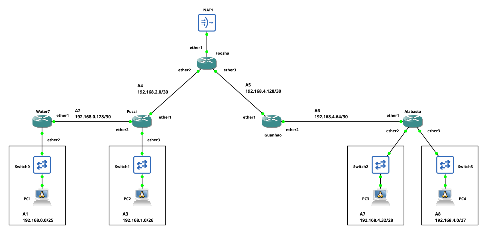

Pembagian IP mengikuti tabel hasil [Supernetting](#14-supernetting). Interface `ether1` setiap router selalu mengarah ke NAT1.

| Node     | Interface | Terhubung ke  | Subnet | IP Address         |
| -------- | --------- | ------------- | ------ | ------------------ |
| Foosha   | `ether1`  | NAT1          | -      | DHCP               |
| Foosha   | `ether2`  | Pucci         | A4     | `192.168.2.1/30`   |
| Foosha   | `ether3`  | Guanhao       | A5     | `192.168.4.129/30` |
| Pucci    | `ether1`  | Foosha        | A4     | `192.168.2.2/30`   |
| Pucci    | `ether2`  | Water7        | A2     | `192.168.0.129/30` |
| Pucci    | `ether3`  | Switch1 (PC2) | A3     | `192.168.1.1/26`   |
| Water7   | `ether1`  | Pucci         | A2     | `192.168.0.130/30` |
| Water7   | `ether2`  | Switch0 (PC1) | A1     | `192.168.0.1/25`   |
| Guanhao  | `ether1`  | Foosha        | A5     | `192.168.4.130/30` |
| Guanhao  | `ether2`  | Alabasta      | A6     | `192.168.4.65/30`  |
| Alabasta | `ether1`  | Guanhao       | A6     | `192.168.4.66/30`  |
| Alabasta | `ether2`  | Switch2 (PC3) | A7     | `192.168.4.33/28`  |
| Alabasta | `ether3`  | Switch3 (PC4) | A8     | `192.168.4.1/27`   |

| Node | Subnet | IP Address     | Netmask           | Gateway        |
| ---- | ------ | -------------- | ----------------- | -------------- |
| PC1  | A1     | `192.168.0.2`  | `255.255.255.128` | `192.168.0.1`  |
| PC2  | A3     | `192.168.1.2`  | `255.255.255.192` | `192.168.1.1`  |
| PC3  | A7     | `192.168.4.34` | `255.255.255.240` | `192.168.4.33` |
| PC4  | A8     | `192.168.4.2`  | `255.255.255.224` | `192.168.4.1`  |

Konfigurasi setiap router dilakukan melalui console, setelah login seperti pada [Instalasi MikroTik-CHR di GNS3](#0-instalasi-mikrotik-chr-di-gns3).

> Pada Pucci, Water7, Guanhao, dan Alabasta, DHCP client bawaan di `ether1` tidak dipakai karena `ether1` terhubung ke router lain, bukan ke NAT1. Hapus dengan `/ip dhcp-client remove [find interface=ether1]`.

#### 2.4.2 Foosha

Foosha sudah mendapatkan IP dan default route dari NAT1 melalui DHCP client di `ether1`, seperti pada [Foosha](#152-foosha) bab 1.

1. Ganti identity dan tambahkan IP Address:

   ```
   /system identity set name=Foosha
   /ip address add address=192.168.2.1/30 interface=ether2 comment=A4
   /ip address add address=192.168.4.129/30 interface=ether3 comment=A5
   ```

2. Tambahkan route ke subnet di belakang Pucci dan Guanhao:

   ```
   /ip route add dst-address=192.168.0.0/25 gateway=192.168.2.2 comment=A1
   /ip route add dst-address=192.168.0.128/30 gateway=192.168.2.2 comment=A2
   /ip route add dst-address=192.168.1.0/26 gateway=192.168.2.2 comment=A3
   /ip route add dst-address=192.168.4.64/30 gateway=192.168.4.130 comment=A6
   /ip route add dst-address=192.168.4.32/28 gateway=192.168.4.130 comment=A7
   /ip route add dst-address=192.168.4.0/27 gateway=192.168.4.130 comment=A8
   ```

   `dst-address` adalah subnet tujuan, sedangkan `gateway` adalah IP next hop, yaitu IP router tetangga pada subnet yang terhubung langsung dengan Foosha.

3. Tambahkan NAT agar subnet di belakang Foosha bisa mengakses internet:

   ```
   /ip firewall nat add chain=srcnat out-interface=ether1 action=masquerade
   ```

   Aturan ini mengganti IP pengirim dengan IP `ether1` Foosha setiap kali paket keluar menuju NAT1, sehingga balasan dari internet bisa kembali. Ini adalah konfigurasi NAT tambahan yang disebut pada [Pengujian](#156-pengujian) bab 1.

4. Cek routing table:

   ```
   /ip route print
   ```

   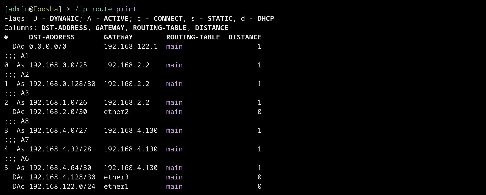

   Route yang ditambahkan secara manual memiliki flag `s` (_static_). Flag `A` (_active_) menandakan route tersebut sedang digunakan.

#### 2.4.3 Pucci

1. Ganti identity dan tambahkan IP Address:

   ```
   /system identity set name=Pucci
   /ip address add address=192.168.2.2/30 interface=ether1 comment=A4
   /ip address add address=192.168.0.129/30 interface=ether2 comment=A2
   /ip address add address=192.168.1.1/26 interface=ether3 comment=A3
   ```

2. Tambahkan default route ke Foosha dan route ke A1 melalui Water7:

   ```
   /ip route add dst-address=0.0.0.0/0 gateway=192.168.2.1
   /ip route add dst-address=192.168.0.0/25 gateway=192.168.0.130 comment=A1
   ```

3. Pucci tidak mendapatkan DNS server dari DHCP. Atur DNS server secara manual, lalu cek hasilnya:

   ```
   /ip dns set servers=8.8.8.8
   /ip dns print
   ```

   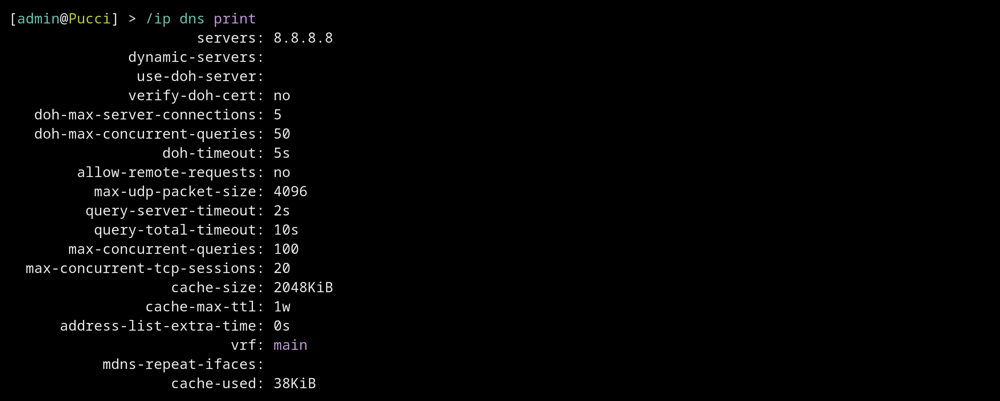

   Baris `servers` menampilkan DNS server yang baru diatur.

#### 2.4.4 Water7

1. Ganti identity dan tambahkan IP Address:

   ```
   /system identity set name=Water7
   /ip address add address=192.168.0.130/30 interface=ether1 comment=A2
   /ip address add address=192.168.0.1/25 interface=ether2 comment=A1
   ```

2. Water7 hanya memiliki satu jalan keluar, yaitu Pucci, sehingga cukup satu default route:

   ```
   /ip route add dst-address=0.0.0.0/0 gateway=192.168.0.129
   ```

3. Atur DNS server:

   ```
   /ip dns set servers=8.8.8.8
   ```

#### 2.4.5 Guanhao

1. Ganti identity dan tambahkan IP Address:

   ```
   /system identity set name=Guanhao
   /ip address add address=192.168.4.130/30 interface=ether1 comment=A5
   /ip address add address=192.168.4.65/30 interface=ether2 comment=A6
   ```

2. Tambahkan default route ke Foosha dan route ke A7 dan A8 melalui Alabasta:

   ```
   /ip route add dst-address=0.0.0.0/0 gateway=192.168.4.129
   /ip route add dst-address=192.168.4.32/28 gateway=192.168.4.66 comment=A7
   /ip route add dst-address=192.168.4.0/27 gateway=192.168.4.66 comment=A8
   ```

3. Atur DNS server:

   ```
   /ip dns set servers=8.8.8.8
   ```

#### 2.4.6 Alabasta

1. Ganti identity dan tambahkan IP Address:

   ```
   /system identity set name=Alabasta
   /ip address add address=192.168.4.66/30 interface=ether1 comment=A6
   /ip address add address=192.168.4.33/28 interface=ether2 comment=A7
   /ip address add address=192.168.4.1/27 interface=ether3 comment=A8
   ```

2. Alabasta hanya memiliki satu jalan keluar, yaitu Guanhao, sehingga cukup satu default route:

   ```
   /ip route add dst-address=0.0.0.0/0 gateway=192.168.4.65
   ```

3. Atur DNS server:

   ```
   /ip dns set servers=8.8.8.8
   ```

#### 2.4.7 PC1

Atur IP Address melalui **Edit config**, lalu restart node agar konfigurasi diterapkan:

```
auto eth0
iface eth0 inet static
	address 192.168.0.2
	netmask 255.255.255.128
	gateway 192.168.0.1
	up echo nameserver 8.8.8.8 > /etc/resolv.conf
```

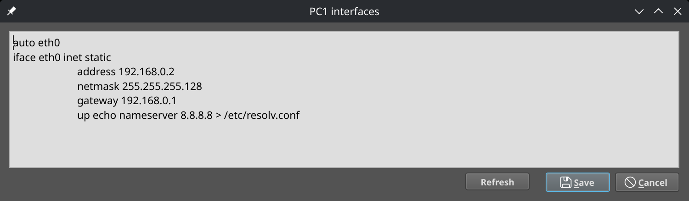

#### 2.4.8 PC2

Atur IP Address melalui **Edit config**, lalu restart node agar konfigurasi diterapkan:

```
auto eth0
iface eth0 inet static
	address 192.168.1.2
	netmask 255.255.255.192
	gateway 192.168.1.1
	up echo nameserver 8.8.8.8 > /etc/resolv.conf
```


#### 2.4.9 PC3

Atur IP Address melalui **Edit config**, lalu restart node agar konfigurasi diterapkan:

```
auto eth0
iface eth0 inet static
	address 192.168.4.34
	netmask 255.255.255.240
	gateway 192.168.4.33
	up echo nameserver 8.8.8.8 > /etc/resolv.conf
```


#### 2.4.10 PC4

Atur IP Address melalui **Edit config**, lalu restart node agar konfigurasi diterapkan:

```
auto eth0
iface eth0 inet static
	address 192.168.4.2
	netmask 255.255.255.224
	gateway 192.168.4.1
	up echo nameserver 8.8.8.8 > /etc/resolv.conf
```


#### 2.4.11 Pengujian Multi-hop

1. Dari **PC1**, lakukan ping ke gateway-nya (Water7):

   ```
   ping -c 4 192.168.0.1
   ```

   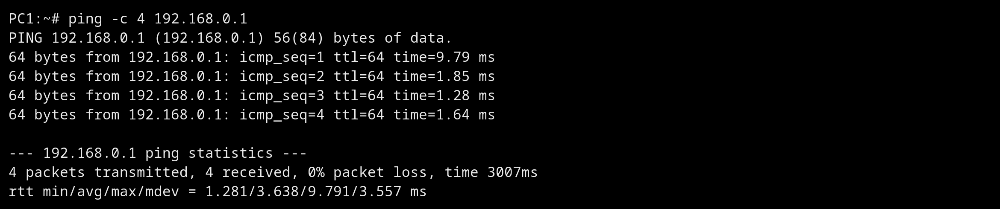

   Balasan dari Water7 memiliki `ttl=64` karena tidak melewati router lain.

2. Dari **PC1**, lakukan ping ke PC4:

   ```
   ping -c 4 192.168.4.2
   ```

   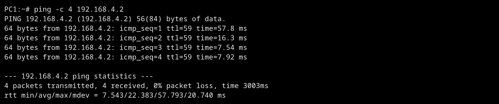

   Balasan dari PC4 melewati lima router, sehingga TTL-nya berkurang dari `64` menjadi `ttl=59`.

3. Dari **PC1**, lihat jalur yang dilewati paket:

   ```
   traceroute 192.168.4.2
   ```

   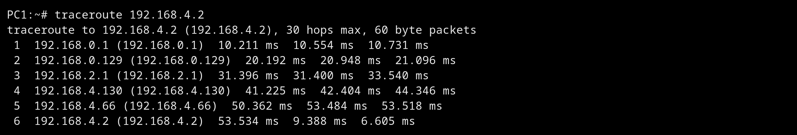

   Hasilnya menampilkan lima router sebelum sampai ke PC4, yaitu Water7 (`192.168.0.1`), Pucci (`192.168.0.129`), Foosha (`192.168.2.1`), Guanhao (`192.168.4.130`), dan Alabasta (`192.168.4.66`).

4. Dari **Water7**, lakukan hal yang sama menggunakan perintah MikroTik:

   ```
   /ping 192.168.4.2 count=4
   ```

   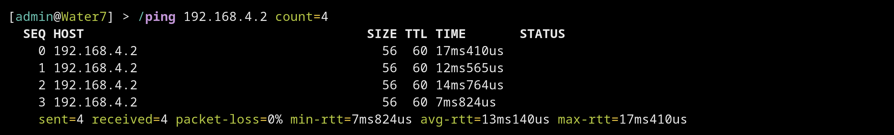

   ```
   /tool traceroute 192.168.4.2
   ```

   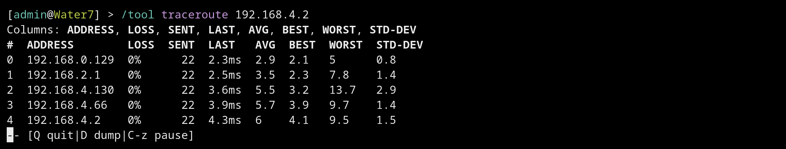

   Traceroute di MikroTik terus berjalan dan memperbarui hasilnya. Tekan `Q` untuk menghentikannya.

5. Uji koneksi internet dari router dan client yang paling jauh dari NAT1:

   - Dari **Alabasta**:

     ```
     /ping google.com count=4
     ```

     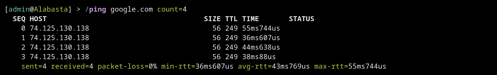

   - Dari **PC4**:

     ```
     ping -c 4 google.com
     ```

     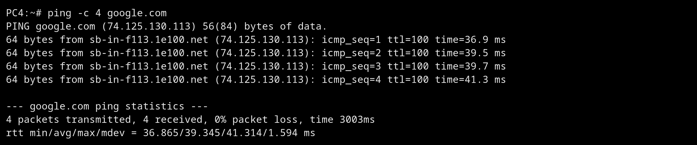

#### 2.4.12 Route Summarization

1. Di **Foosha**, hapus semua route yang melalui Pucci dan Guanhao:

   ```
   /ip route remove [find gateway=192.168.2.2]
   /ip route remove [find gateway=192.168.4.130]
   ```

   `[find ...]` mencari route yang sesuai dengan kriteria, lalu hasilnya diberikan ke perintah `remove`.

2. Di **Foosha**, tambahkan dua route hasil summarization:

   ```
   /ip route add dst-address=192.168.0.0/22 gateway=192.168.2.2 comment=D1
   /ip route add dst-address=192.168.4.0/24 gateway=192.168.4.130 comment=D2
   ```

3. Di **Guanhao**, gabungkan route A7 dan A8 menjadi B2 (`192.168.4.0/26`):

   ```
   /ip route remove [find gateway=192.168.4.66]
   /ip route add dst-address=192.168.4.0/26 gateway=192.168.4.66 comment=B2
   ```

4. Di **Foosha**, cek kembali routing table:

   ```
   /ip route print
   ```

   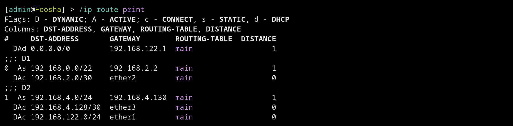

   Route static di Foosha kini hanya dua, yaitu D1 dan D2. Ulangi ping dari PC1 ke PC4 untuk memastikan semua subnet tetap bisa diraih.

5. Di **Foosha**, tampilkan semua route yang cocok dengan IP Guanhao:

   ```
   /ip route print where 192.168.4.130 in dst-address
   ```

   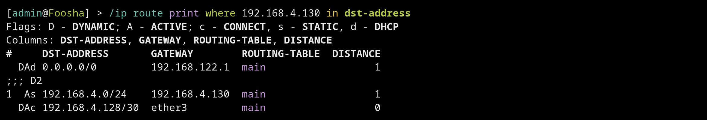

   Hasilnya menampilkan tiga route: `0.0.0.0/0`, `192.168.4.0/24`, dan `192.168.4.128/30`. Berdasarkan longest prefix match, Foosha memakai `192.168.4.128/30` karena prefix-nya paling panjang.

#### 2.4.13 Routing Loop dan TTL

Skenario pertama: gateway yang salah.

1. Di **Guanhao**, ubah gateway route B2 ke Foosha untuk menyimulasikan kesalahan konfigurasi:

   ```
   /ip route set [find comment=B2] gateway=192.168.4.129
   ```

2. Dari **PC1**, lakukan ping ke PC4:

   ```
   ping -c 4 192.168.4.2
   ```

   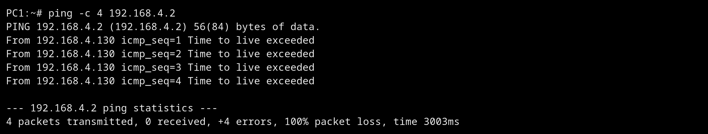

   Ping gagal dengan pesan `Time to live exceeded`. Paket dari PC1 berputar di antara Foosha dan Guanhao hingga TTL-nya habis di Guanhao (`192.168.4.130`), sehingga Guanhao yang mengirim pesan tersebut.

3. Dari **PC1**, lihat jalur paket:

   ```
   traceroute 192.168.4.2
   ```

   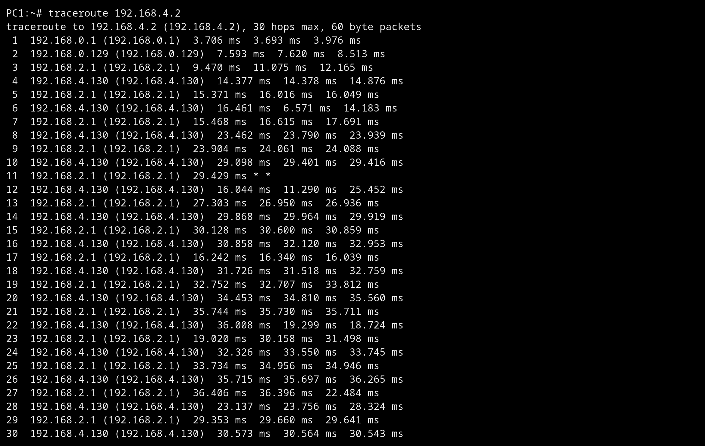

   Mulai hop ke-4, alamat Guanhao (`192.168.4.130`) dan Foosha (`192.168.2.1`) muncul bergantian sampai batas maksimal hop traceroute. Foosha muncul sebagai `192.168.2.1` karena router membalas menggunakan IP interface yang mengarah kembali ke pengirim, yaitu `ether2`.

4. Di **Guanhao**, lihat log yang berkaitan dengan route:

   ```
   /log print where message~"^route "
   ```

   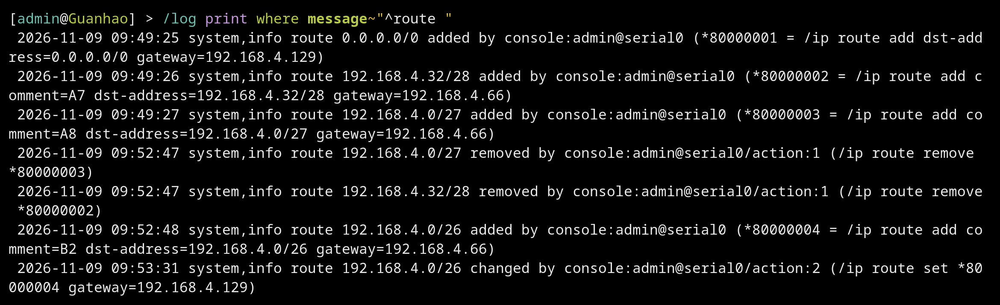

   Log mencatat setiap perubahan konfigurasi beserta perintahnya. Bagian `where message~"^route "` menyaring log yang diawali kata `route`. Baris terakhir menunjukkan perintah `set` yang mengubah gateway route B2 dan menyebabkan loop.

5. Di **Guanhao**, kembalikan gateway route B2 ke Alabasta, lalu ulangi ping dari PC1:

   ```
   /ip route set [find comment=B2] gateway=192.168.4.66
   ```

Skenario kedua: summarization dan default route.

1. Dari **PC1**, lakukan ping ke alamat yang termasuk D1 tetapi tidak dipakai subnet mana pun:

   ```
   ping -c 4 192.168.3.10
   ```

   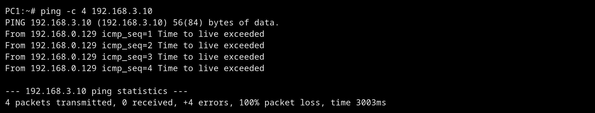

   Ping gagal dengan pesan `Time to live exceeded`. Foosha meneruskan paket ke Pucci karena `192.168.3.10` termasuk D1, lalu Pucci mengembalikannya ke Foosha melalui default route.

2. Di **Pucci**, tambahkan route blackhole untuk seluruh blok D1:

   ```
   /ip route add dst-address=192.168.0.0/22 blackhole comment=D1-blackhole
   ```

   Route **blackhole** adalah route yang membuang semua paket yang cocok dengannya. Subnet A1, A2, A3, dan A4 tetap bisa diraih karena route-nya lebih spesifik dari /22. Hanya alamat yang tidak dipakai yang dibuang.

3. Di **Pucci**, cek routing table:

   ```
   /ip route print
   ```

   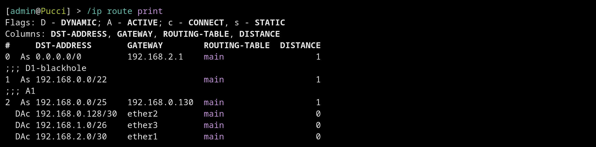

   Route `D1-blackhole` tampil tanpa gateway, karena paket yang cocok dengannya tidak diteruskan ke mana pun.

4. Dari **PC1**, ulangi ping ke `192.168.3.10`:

   ```
   ping -c 4 192.168.3.10
   ```

   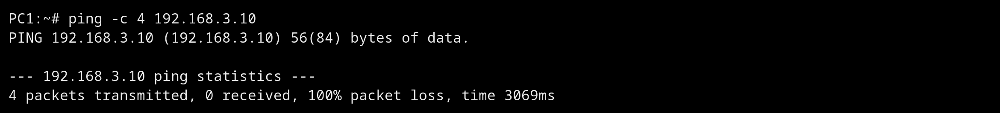

   Ping tetap gagal, tetapi tidak ada lagi pesan `Time to live exceeded`. Paket langsung dibuang di Pucci tanpa berputar.

Masalah yang sama bisa terjadi pada D2. Solusinya sama, yaitu menambahkan route blackhole `192.168.4.0/24` di Guanhao.

## 3. Dynamic Routing

Pada bab 2, setiap route ditambahkan secara manual. Foosha saja membutuhkan enam route sebelum summarization, dan setiap perubahan topologi mengharuskan route di beberapa router diubah satu per satu. Pada bab ini, routing table diisi secara otomatis oleh router menggunakan dynamic routing.

### 3.1 Pengenalan Dynamic Routing

#### 3.1.1 Definisi

**Dynamic routing** adalah cara mengisi routing table secara otomatis. Router bertukar informasi route dengan router lain yang terhubung langsung dengannya, yang disebut **neighbor** (tetangga). Aturan pertukaran informasi tersebut disebut **routing protocol**.

Bayangkan sekelompok orang yang saling bertanya arah. Setiap orang hanya tahu jalan di sekitar rumahnya, lalu menceritakannya ke tetangga. Tetangga meneruskan cerita itu ke tetangga berikutnya, sehingga lama-kelamaan semua orang tahu cara menuju rumah siapa pun.

Dynamic routing bekerja dengan urutan berikut:

1. Setiap router mengumumkan subnet yang terhubung langsung dengannya ke neighbor.
2. Neighbor meneruskan informasi tersebut ke neighbor lainnya, sampai semua router mengetahui semua subnet.
3. Jika ada lebih dari satu jalur menuju subnet yang sama, router memilih jalur terbaik berdasarkan **metric**, yaitu nilai yang menyatakan jarak atau biaya sebuah jalur. Semakin kecil metric, semakin baik jalurnya.
4. Jika topologi berubah, misalnya ada link yang putus, router memperbarui routing table-nya sendiri tanpa perlu dikonfigurasi ulang.

#### 3.1.2 Tujuan

Perbandingan static routing dan dynamic routing:

| Aspek                   | Static Routing                                       | Dynamic Routing                                         |
| ----------------------- | ---------------------------------------------------- | ------------------------------------------------------- |
| Pengisian routing table | Manual oleh admin                                    | Otomatis oleh routing protocol                          |
| Yang dikonfigurasi      | Route ke setiap subnet yang tidak terhubung langsung | Interface yang menjalankan routing protocol             |
| Saat ada subnet baru    | Route ditambahkan di setiap router yang membutuhkan  | Cukup dikonfigurasi di router yang terhubung ke subnet  |
| Saat link putus         | Route tetap mengarah ke link yang putus              | Router mencari jalur lain, jika ada                     |
| Penggunaan resource     | Ringan                                               | Lebih berat, karena router terus bertukar informasi     |
| Cocok untuk             | Jaringan kecil yang jarang berubah                   | Jaringan besar atau yang sering berubah                 |

Dynamic routing tidak harus menggantikan static routing sepenuhnya. Keduanya bisa dipakai bersamaan, misalnya default route menuju internet diatur secara manual di satu router, lalu disebarkan ke router lain menggunakan routing protocol.

### 3.2 Pembagian Routing Protocol

Routing protocol dikelompokkan berdasarkan algoritma yang digunakan dan wilayah tempat protokol tersebut bekerja.

#### 3.2.1 Berdasarkan Algoritma

**Distance vector** adalah kelompok routing protocol yang membuat router hanya mengetahui jarak (_distance_) dan arah (_vector_), yaitu neighbor yang harus dilewati, menuju setiap subnet. Router tidak mengetahui bentuk topologi secara keseluruhan, hanya mempercayai informasi dari neighbor. Algoritma yang digunakan adalah Bellman-Ford.

Distance vector mirip dengan papan petunjuk jalan bertuliskan "Alabasta 4 km →". Papan tersebut memberi tahu jarak dan arah, tetapi tidak menunjukkan peta jalannya.

**Link state** adalah kelompok routing protocol yang membuat setiap router mengetahui bentuk seluruh topologi, yaitu router apa saja yang ada dan link apa yang menghubungkannya. Dari informasi tersebut, setiap router menghitung sendiri jalur terpendek ke setiap subnet menggunakan algoritma Dijkstra. Link state mirip dengan memegang peta lengkap, lalu menentukan rute sendiri.

| Aspek                                | Distance Vector                                    | Link State                                             |
| ------------------------------------ | -------------------------------------------------- | ------------------------------------------------------ |
| Informasi yang dimiliki router       | Jarak dan arah ke setiap subnet                    | Peta seluruh topologi                                  |
| Informasi yang dikirim               | Seluruh routing table, secara berkala ke neighbor  | Informasi link, saat terjadi perubahan ke semua router |
| Penggunaan CPU dan memori            | Rendah                                             | Lebih tinggi                                           |
| Kecepatan menyesuaikan perubahan     | Lambat                                             | Cepat                                                  |
| Contoh protokol                      | RIP                                                | OSPF, IS-IS                                            |

#### 3.2.2 Berdasarkan Wilayah

**Autonomous System (AS)** adalah kumpulan jaringan yang dikelola oleh satu pihak dengan kebijakan routing yang sama, misalnya jaringan sebuah ISP, kampus, atau perusahaan. Seluruh topologi pada modul ini dapat dianggap sebagai satu AS.

Berdasarkan wilayahnya, routing protocol dibagi menjadi dua:

- **IGP** (_Interior Gateway Protocol_): routing protocol untuk bertukar route di dalam satu AS. Contohnya RIP, OSPF, dan IS-IS.
- **EGP** (_Exterior Gateway Protocol_): routing protocol untuk bertukar route antar-AS, misalnya antar-ISP di internet. Protokol EGP yang dipakai saat ini adalah BGP (_Border Gateway Protocol_).

RIP dan OSPF yang dibahas pada bab ini termasuk IGP.

### 3.3 Protokol Dynamic Routing

#### 3.3.1 RIP

**RIP** (_Routing Information Protocol_) adalah routing protocol distance vector yang memakai **hop count** sebagai metric. Hop count menyatakan jumlah router yang harus dilewati untuk sampai ke sebuah subnet. RIP selalu memilih jalur dengan hop count paling kecil, tanpa memperhatikan kecepatan link.

RIPv1 tidak mengirimkan netmask, sehingga hanya mendukung pembagian [Classful](#131-classful). RIPv2 mengirimkan netmask bersama setiap route, sehingga mendukung VLSM dan CIDR seperti pada [Classless / CIDR](#132-classless--cidr). MikroTik menggunakan RIPv2.

##### Cara Kerja RIP

1. Setiap router mengirim routing table-nya ke semua neighbor setiap 30 detik. Pengiriman ini disebut **update**.
2. Subnet yang terhubung langsung diumumkan dengan metric 1.
3. Router yang menerima update menambahkan 1 pada metric setiap route, lalu menyimpannya jika route tersebut belum ada atau metric-nya lebih kecil dari route yang sudah ada.
4. Pada update berikutnya, route tersebut diteruskan ke neighbor lain dengan metric yang baru.

Selain update berkala, router juga langsung mengirim update saat routing table-nya berubah (_triggered update_), sehingga perubahan tidak harus menunggu 30 detik.

Contohnya, subnet A8 (`192.168.4.0/27`) terhubung langsung ke Alabasta. Informasi tentang A8 menyebar ke Water7 melalui jalur Alabasta, Guanhao, Foosha, dan Pucci:

| Urutan | Router   | Update yang diterima       | Metric A8 di router tersebut |
| ------ | -------- | -------------------------- | ---------------------------- |
| 1      | Alabasta | - (terhubung langsung)     | 1                            |
| 2      | Guanhao  | Dari Alabasta, metric 1    | 2                            |
| 3      | Foosha   | Dari Guanhao, metric 2     | 3                            |
| 4      | Pucci    | Dari Foosha, metric 3      | 4                            |
| 5      | Water7   | Dari Pucci, metric 4       | 5                            |

Metric maksimal RIP adalah 15. Route dengan metric 16 dianggap tidak bisa dijangkau (_unreachable_). Batas ini mencegah route berputar tanpa akhir, tetapi juga membuat RIP tidak cocok untuk jaringan besar.

RIP menggunakan tiga timer untuk mengatur update dan menghapus route yang sudah tidak valid:

| Timer              | Nilai default | Fungsi                                                                     |
| ------------------ | ------------- | -------------------------------------------------------------------------- |
| Update             | 30 detik      | Interval pengiriman routing table ke neighbor                              |
| Timeout            | 180 detik     | Jika route tidak diperbarui selama waktu ini, route dianggap tidak valid   |
| Garbage collection | 120 detik     | Waktu tunggu sebelum route yang tidak valid dihapus dari routing table     |

##### Count to Infinity

Karena router hanya mempercayai informasi dari neighbor, RIP rentan terhadap masalah **count to infinity**, yaitu metric sebuah route terus naik sampai 16 karena dua router saling memberi informasi yang sudah tidak benar.

Contohnya, interface Water7 yang terhubung ke A1 (`192.168.0.0/25`) mati:

| Langkah                    | Route A1 di Water7          | Route A1 di Pucci           |
| -------------------------- | --------------------------- | --------------------------- |
| Awal                       | Metric 1, terhubung langsung | Metric 2, melalui Water7    |
| Interface Water7 ke A1 mati | Tidak bisa dijangkau        | Metric 2, melalui Water7    |
| Pucci mengirim update      | Metric 3, melalui Pucci     | Metric 2, melalui Water7    |
| Water7 mengirim update     | Metric 3, melalui Pucci     | Metric 4, melalui Water7    |
| Dan seterusnya             | ...                         | ...                         |
| Akhir                      | Metric 16, tidak bisa dijangkau | Metric 16, tidak bisa dijangkau |

Sebelum Water7 sempat mengumumkan bahwa A1 mati, Pucci mengirim update bahwa A1 bisa dijangkau dengan metric 2. Water7 mempercayainya, padahal jalur Pucci menuju A1 justru melewati Water7. Selama metric belum mencapai 16, paket menuju A1 berputar di antara Water7 dan Pucci, seperti [Routing Loop](#231-routing-loop) pada bab 2.

RIP memiliki tiga mekanisme untuk mencegah masalah ini:

- **Split horizon**: router tidak mengumumkan sebuah route kembali ke neighbor tempat route tersebut dipelajari. Pucci mempelajari A1 dari Water7, sehingga Pucci tidak mengumumkan A1 ke Water7.
- **Route poisoning**: ketika sebuah subnet tidak bisa dijangkau, router langsung mengumumkan subnet tersebut dengan metric 16, tanpa menunggu timeout. Water7 langsung memberi tahu Pucci bahwa A1 bermetric 16.
- **Poison reverse**: router tetap mengumumkan route kembali ke neighbor asalnya, tetapi dengan metric 16. Pucci mengumumkan A1 ke Water7 dengan metric 16, sehingga Water7 tahu bahwa A1 tidak bisa dijangkau melalui Pucci. Cara ini lebih tegas daripada split horizon yang hanya diam.

#### 3.3.2 OSPF

**OSPF** (_Open Shortest Path First_) adalah routing protocol link state. Setiap router OSPF mengumpulkan informasi tentang seluruh link di jaringan, lalu menghitung sendiri jalur terpendek ke setiap subnet menggunakan algoritma Dijkstra.

Setiap router OSPF memiliki **router ID**, yaitu identitas unik yang ditulis dalam format IPv4, misalnya `1.1.1.1`. Router ID tidak harus sama dengan IP Address yang dipasang di interface.

##### Cara Kerja OSPF

1. **Mencari neighbor**: router mengirim paket **Hello** setiap 10 detik melalui interface yang menjalankan OSPF. Dua router yang saling menerima Hello menjadi neighbor. Jika tidak ada Hello dari sebuah neighbor selama 40 detik (**dead interval**), neighbor tersebut dianggap mati.
2. **Bertukar informasi link**: setiap router membuat **LSA** (_Link State Advertisement_), yaitu informasi tentang link miliknya, seperti subnet, neighbor, dan cost. LSA disebarkan ke semua router, tidak hanya ke neighbor.
3. **Menyusun LSDB**: semua LSA yang diterima disimpan di **LSDB** (_Link State Database_). Setelah pertukaran selesai, semua router memiliki LSDB yang sama, seperti memegang peta yang sama.
4. **Menghitung jalur**: setiap router menjalankan algoritma Dijkstra pada LSDB untuk mencari jalur dengan total cost terkecil ke setiap subnet. Hasilnya dimasukkan ke routing table.
5. **Memperbarui saat ada perubahan**: jika sebuah link berubah, router yang mengetahuinya langsung menyebarkan LSA baru. Router lain memperbarui LSDB dan menghitung ulang jalurnya.

**Cost** adalah metric OSPF. Setiap interface memiliki nilai cost, dan cost sebuah jalur adalah jumlah cost semua interface yang dilewati. Berbeda dengan hop count, cost bisa diatur sesuai kecepatan link, sehingga OSPF bisa memilih jalur yang melewati lebih banyak router jika jalur tersebut lebih cepat.

OSPF menyimpan informasi dalam tiga tabel:

| Tabel          | Isi                                        |
| -------------- | ------------------------------------------ |
| Neighbor table | Daftar neighbor OSPF beserta statusnya     |
| LSDB           | Kumpulan LSA, yaitu peta topologi          |
| Routing table  | Jalur terbaik hasil perhitungan Dijkstra   |

##### Area

Semakin banyak router, semakin besar LSDB dan semakin sering setiap router menghitung ulang jalur. Karena itu, OSPF membagi jaringan menjadi beberapa **area**. LSDB hanya perlu sama di dalam satu area, sedangkan subnet dari area lain cukup diterima dalam bentuk ringkasan, bukan peta lengkap.

Area dibedakan menjadi dua:

- **Backbone area**: area pusat dengan ID `0.0.0.0` (area 0). Semua area lain harus terhubung ke backbone area, dan traffic antar-area selalu melewati backbone area.
- **Standard area**: area selain backbone area, dengan ID selain 0, misalnya `0.0.0.1` (area 1).

Topologi pada modul ini dapat dibagi menjadi tiga area:

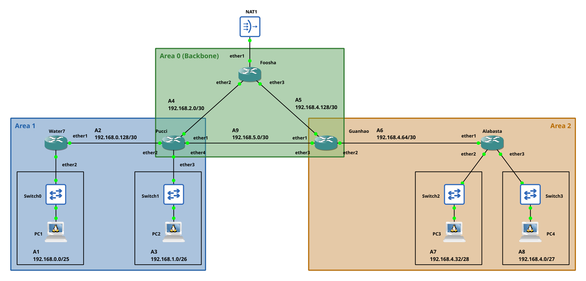

Berdasarkan letaknya terhadap area, router OSPF memiliki peran berikut:

| Peran | Definisi | Contoh |
| ----- | -------- | ------ |
| **Internal router** | Semua interface OSPF berada di satu area | Water7 (area 1), Alabasta (area 2), Foosha (area 0) |
| **Backbone router** | Memiliki minimal satu interface di area 0 | Foosha, Pucci, Guanhao |
| **ABR** (_Area Border Router_) | Terhubung ke lebih dari satu area, salah satunya area 0 | Pucci, Guanhao |
| **ASBR** (_Autonomous System Boundary Router_) | Memasukkan route dari luar OSPF, misalnya default route ke internet | Foosha |

Satu router bisa memiliki lebih dari satu peran. Foosha adalah internal router di area 0, sekaligus backbone router dan ASBR.

### 3.4 Redundancy dan Failover

**Redundancy** adalah penyediaan lebih dari satu jalur menuju tujuan yang sama. Jika satu jalur putus, masih ada jalur lain yang bisa dipakai.

Topologi bab 2 tidak memiliki redundancy, karena setiap router hanya memiliki satu jalur ke router lain. Pada bab ini, ditambahkan link A9 antara Pucci dan Guanhao:

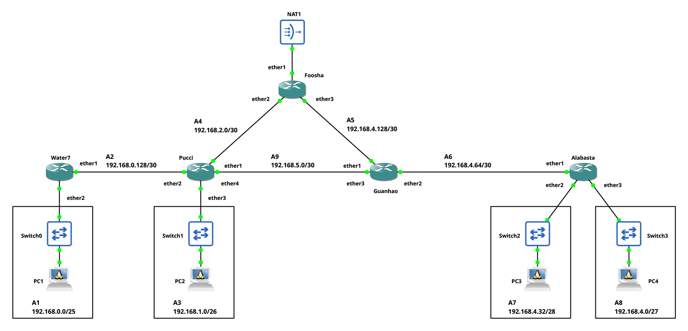

A9 hanya menghubungkan dua router, sehingga cukup memakai /30. Alamatnya diambil dari bagian E1 (`192.168.0.0/21`) hasil [Supernetting](#14-supernetting) yang belum terpakai, yaitu `192.168.5.0/30`. Dengan begitu, pembagian IP bab 2 tidak perlu dihitung ulang.

Kotak hijau pada pohon berikut adalah subnet dari bab 2, sedangkan kotak kuning adalah A9:

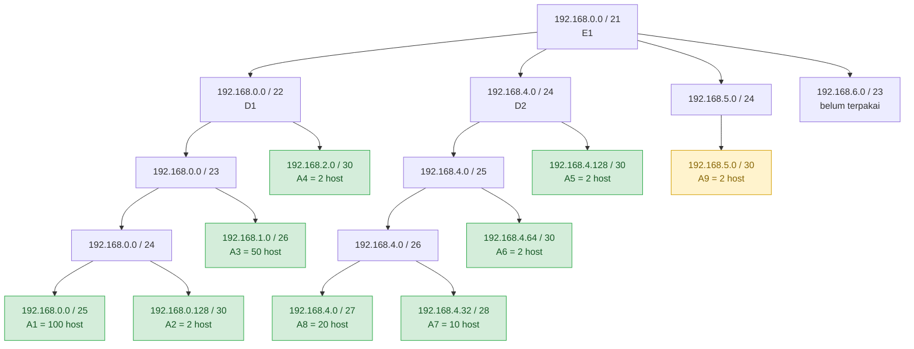

Dengan adanya A9, ada dua jalur dari PC1 ke PC4:

| Jalur    | Router yang dilewati                      | Hop count |
| -------- | ----------------------------------------- | --------- |
| Utama    | Water7, Pucci, Guanhao, Alabasta          | 4         |
| Cadangan | Water7, Pucci, Foosha, Guanhao, Alabasta  | 5         |

Jalur utama adalah jalur dengan metric terbaik. Jalur cadangan baru dipakai ketika jalur utama gagal.

**Failover** adalah proses berpindahnya traffic dari jalur utama ke jalur cadangan ketika jalur utama gagal. Pada static routing, failover tidak terjadi dengan sendirinya, karena route tetap mengarah ke jalur yang putus sampai admin mengubahnya. Pada dynamic routing, failover terjadi otomatis.

Router mengetahui sebuah jalur gagal dengan dua cara:

- **Interface mati**: router langsung tahu ketika interface-nya sendiri mati, misalnya kabel dicabut.
- **Neighbor tidak terdengar**: router tidak menerima update atau Hello dari neighbor dalam batas waktu tertentu, yaitu timeout 180 detik pada RIP dan dead interval 40 detik pada OSPF. Cara ini diperlukan jika kegagalan terjadi di sisi neighbor, sementara interface router sendiri tetap menyala.

### 3.5 Routing Convergence

**Konvergensi** (_convergence_) adalah kondisi ketika semua router sudah memiliki routing table yang benar dan konsisten setelah terjadi perubahan topologi. Waktu dari terjadinya perubahan sampai konvergensi tercapai disebut **waktu konvergensi**.

Selama belum konvergen, sebagian router masih memakai informasi lama. Akibatnya, paket bisa hilang atau berputar di antara router.

Waktu konvergensi dipengaruhi oleh tiga tahap:

| Tahap                  | RIP                                                      | OSPF                                                     |
| ---------------------- | -------------------------------------------------------- | -------------------------------------------------------- |
| Mendeteksi kegagalan   | Timeout 180 detik jika neighbor tidak terdengar          | Dead interval 40 detik jika neighbor tidak terdengar     |
| Menyebarkan perubahan  | Diteruskan router demi router melalui update             | LSA baru langsung disebarkan ke semua router             |
| Menghitung jalur baru  | Memilih metric terkecil dari update yang diterima        | Menjalankan Dijkstra pada LSDB                           |

Karena itu, OSPF umumnya konvergen jauh lebih cepat daripada RIP.

### 3.6 Implementasi

Pada bagian ini, static route dari bab 2 diganti dengan RIP, lalu dengan OSPF. Kedua protokol diuji pada topologi yang sama, termasuk saat link A9 putus.

#### 3.6.1 Topologi dan Pembagian IP

Topologi melanjutkan [Implementasi](#24-implementasi) bab 2, ditambah link A9 antara Pucci dan Guanhao seperti pada [Redundancy dan Failover](#34-redundancy-dan-failover):


Pembagian IP sama dengan [Topologi dan Pembagian IP](#241-topologi-dan-pembagian-ip) bab 2, termasuk konfigurasi PC1 sampai PC4, ditambah IP Address untuk A9 berikut:

| Node    | Interface | Terhubung ke | Subnet | IP Address       |
| ------- | --------- | ------------ | ------ | ---------------- |
| Pucci   | `ether4`  | Guanhao      | A9     | `192.168.5.1/30` |
| Guanhao | `ether3`  | Pucci        | A9     | `192.168.5.2/30` |

#### 3.6.2 Persiapan

1. Di GNS3, tambahkan link antara `ether4` Pucci dan `ether3` Guanhao. Link bisa ditambahkan saat node sedang menyala.

2. Di **Foosha**, **Pucci**, **Water7**, **Guanhao**, dan **Alabasta**, hapus semua static route dari bab 2:

   ```
   /ip route remove [find static]
   ```

   `[find static]` memilih semua route dengan flag `s`, termasuk default route dan route blackhole. Default route Foosha dari DHCP tidak ikut terhapus karena bukan static route.

3. Di **Pucci**, tambahkan IP Address untuk A9:

   ```
   /ip address add address=192.168.5.1/30 interface=ether4 comment=A9
   ```

4. Di **Guanhao**, tambahkan IP Address untuk A9:

   ```
   /ip address add address=192.168.5.2/30 interface=ether3 comment=A9
   ```

5. Di **Pucci**, cek routing table:

   ```
   /ip route print
   ```

   

   Routing table hanya berisi route dengan flag `c` (_connected_), yaitu subnet yang terhubung langsung. Pada tahap ini, router belum mengetahui subnet di belakang router lain, sehingga PC1 tidak bisa menjangkau PC4.

#### 3.6.3 Konfigurasi RIP

Konfigurasi RIP di MikroTik terdiri dari dua bagian. Keduanya harus dibuat berurutan, karena interface-template merujuk ke nama instance:


1. **Instance**: proses RIP di router beserta jenis route yang diumumkan.
2. **Interface-template**: daftar interface tempat RIP mengirim dan menerima update.

Parameter yang dipakai:

| Parameter                    | Fungsi                                                                                                     |
| ---------------------------- | ---------------------------------------------------------------------------------------------------------- |
| `name=rip1`                  | Nama instance yang dirujuk oleh interface-template                                                         |
| `redistribute=connected,rip` | Route yang diumumkan: `connected` untuk subnet yang terhubung langsung, `rip` untuk route dari neighbor RIP |
| `instance=rip1`              | Instance yang memakai interface-template tersebut                                                          |
| `interfaces`                 | Interface yang terhubung ke router lain                                                                    |

> Jika `rip` tidak dimasukkan ke `redistribute`, router hanya mengumumkan subnet miliknya sendiri. Route yang dipelajari dari neighbor tidak diteruskan, sehingga router yang jauh tidak pernah mengetahuinya.

Interface yang terhubung ke client tidak dimasukkan ke interface-template, karena tidak ada router lain di sana. Subnet client tetap diumumkan melalui `redistribute=connected`.

Link A9 juga belum dimasukkan, sehingga hasilnya bisa dibandingkan dengan static routing bab 2.

##### Foosha

1. Buat instance RIP:

   ```
   /routing rip instance add name=rip1 redistribute=connected,rip
   ```

2. Tambahkan interface-template untuk `ether2` (A4, ke Pucci) dan `ether3` (A5, ke Guanhao):

   ```
   /routing rip interface-template add instance=rip1 interfaces=ether2,ether3
   ```

   `ether1` tidak dimasukkan karena terhubung ke NAT1, bukan ke router RIP.

3. Cek konfigurasi:

   ```
   /routing rip instance print
   /routing rip interface-template print
   ```

   

##### Pucci

1. Buat instance RIP:

   ```
   /routing rip instance add name=rip1 redistribute=connected,rip
   ```

2. Tambahkan interface-template untuk `ether1` (A4, ke Foosha) dan `ether2` (A2, ke Water7):

   ```
   /routing rip interface-template add instance=rip1 interfaces=ether1,ether2
   ```

3. Cek konfigurasi:

   ```
   /routing rip instance print
   /routing rip interface-template print
   ```

   

##### Water7

1. Buat instance RIP:

   ```
   /routing rip instance add name=rip1 redistribute=connected,rip
   ```

2. Tambahkan interface-template untuk `ether1` (A2, ke Pucci):

   ```
   /routing rip interface-template add instance=rip1 interfaces=ether1
   ```

3. Cek konfigurasi:

   ```
   /routing rip instance print
   /routing rip interface-template print
   ```

   

##### Guanhao

1. Buat instance RIP:

   ```
   /routing rip instance add name=rip1 redistribute=connected,rip
   ```

2. Tambahkan interface-template untuk `ether1` (A5, ke Foosha) dan `ether2` (A6, ke Alabasta):

   ```
   /routing rip interface-template add instance=rip1 interfaces=ether1,ether2
   ```

3. Cek konfigurasi:

   ```
   /routing rip instance print
   /routing rip interface-template print
   ```

   

##### Alabasta

1. Buat instance RIP:

   ```
   /routing rip instance add name=rip1 redistribute=connected,rip
   ```

2. Tambahkan interface-template untuk `ether1` (A6, ke Guanhao):

   ```
   /routing rip interface-template add instance=rip1 interfaces=ether1
   ```

3. Cek konfigurasi:

   ```
   /routing rip instance print
   /routing rip interface-template print
   ```

   

#### 3.6.4 Pengujian RIP

1. Di **Foosha**, cek interface yang menjalankan RIP:

   ```
   /routing rip interface print
   ```

   

   Setiap interface pada interface-template muncul beserta IP Address yang dipakai untuk mengirim update.

2. Di **Foosha**, cek neighbor RIP:

   ```
   /routing rip neighbor print
   ```

   

   Foosha menerima update dari Pucci (`192.168.2.2`) dan Guanhao (`192.168.4.130`). Kolom `routes` adalah jumlah route yang diterima dari neighbor tersebut, sedangkan `last-update` adalah waktu sejak update terakhir.

3. Di **Water7**, cek routing table:

   ```
   /ip route print
   ```

   

   Route hasil RIP memiliki flag `r`. Water7 mempelajari semua subnet melalui Pucci (`192.168.0.129`), termasuk `192.168.122.0/24` milik NAT1 yang diumumkan Foosha karena terhubung langsung dengannya.

   Kolom `DISTANCE` menunjukkan prioritas sumber route di MikroTik. Semakin kecil nilainya, semakin dipercaya. Route connected bernilai 0, static 1, dan RIP 120.

4. Di **Water7**, lihat metric route menuju A8:

   ```
   /routing route print detail where dst-address=192.168.4.0/27
   ```

   

   Nilai `.metric=5` sesuai dengan contoh pada [Cara Kerja RIP](#cara-kerja-rip). A8 diumumkan Alabasta dengan metric 1, lalu bertambah 1 di Guanhao, Foosha, Pucci, dan Water7.

5. Dari **PC1**, lakukan ping ke PC4:

   ```
   ping -c 4 192.168.4.2
   ```

   

6. Dari **PC1**, lihat jalur yang dilewati paket:

   ```
   traceroute 192.168.4.2
   ```

   

   Jalurnya sama dengan static routing bab 2, yaitu Water7, Pucci, Foosha, Guanhao, dan Alabasta. Bedanya, tidak ada satu pun route yang ditambahkan secara manual.

#### 3.6.5 Default Route pada RIP

1. Dari **Alabasta**, lakukan ping ke internet:

   ```
   /ping google.com count=4
   ```

   

   Ping gagal dengan pesan `resolve failed`. Alabasta tidak memiliki default route, sehingga DNS server `8.8.8.8` tidak bisa dijangkau.

2. Di **Foosha**, ubah instance RIP agar default route ikut diumumkan:

   ```
   /routing rip instance set [find name=rip1] redistribute=connected,rip,dhcp originate-default=if-installed
   ```

   - `dhcp` ditambahkan ke `redistribute` karena default route Foosha berasal dari DHCP client di `ether1`, seperti pada [Foosha](#152-foosha) bab 1.
   - `originate-default=if-installed` mengizinkan default route diumumkan selama Foosha memiliki default route. Nilai bawaannya `never`, yang membuat default route tidak pernah diumumkan.

   > Pada RouterOS 7.24.6 yang dipakai di modul ini, kedua parameter tersebut harus diatur bersamaan. Mengatur `originate-default` saja tanpa `dhcp` pada `redistribute` tidak membuat default route diumumkan.

3. Di **Foosha**, cek instance RIP:

   ```
   /routing rip instance print
   ```

   

4. Di **Alabasta**, cek routing table:

   ```
   /ip route print
   ```

   

   Default route `0.0.0.0/0` kini muncul dengan flag `r`, melalui Guanhao (`192.168.4.65`).

5. Dari **Alabasta**, ulangi ping ke internet:

   ```
   /ping google.com count=4
   ```

   

6. Dari **PC4**, lakukan ping ke internet:

   ```
   ping -c 4 google.com
   ```

   

#### 3.6.6 Redundancy dan Failover pada RIP

Sejauh ini link A9 belum menjalankan RIP, sehingga hanya ada satu jalur dari PC1 ke PC4. Langkah berikut mengaktifkan RIP di A9, lalu menguji failover saat A9 putus.

1. Di **Pucci**, tambahkan `ether4` ke interface-template, lalu cek hasilnya:

   ```
   /routing rip interface-template set [find instance=rip1] interfaces=ether1,ether2,ether4
   /routing rip interface-template print
   ```

   

   `set` mengganti seluruh isi parameter `interfaces`, sehingga interface lama tetap harus ditulis.

2. Di **Guanhao**, tambahkan `ether3` ke interface-template, lalu cek hasilnya:

   ```
   /routing rip interface-template set [find instance=rip1] interfaces=ether1,ether2,ether3
   /routing rip interface-template print
   ```

   

3. Di **Pucci**, cek neighbor RIP:

   ```
   /routing rip neighbor print
   ```

   

   Pucci kini memiliki tiga neighbor. Neighbor baru `192.168.5.2` adalah Guanhao melalui A9.

4. Di **Water7**, cek kembali metric route menuju A8:

   ```
   /routing route print detail where dst-address=192.168.4.0/27
   ```

   

   Metric turun dari 5 menjadi 4, karena jalur melalui A9 melewati satu router lebih sedikit.

5. Dari **PC1**, lihat jalur menuju PC4:

   ```
   traceroute 192.168.4.2
   ```

   

   Paket kini melewati Water7, Pucci, Guanhao (`192.168.5.2`), dan Alabasta tanpa melalui Foosha. Jalur ini menjadi jalur utama, sedangkan jalur melalui Foosha menjadi jalur cadangan.

6. Dari **PC1**, jalankan ping tanpa batas jumlah paket:

   ```
   ping 192.168.4.2
   ```

7. Saat ping masih berjalan, di **Pucci** matikan `ether4` untuk menyimulasikan link A9 putus:

   ```
   /interface disable ether4
   ```

8. Beberapa detik kemudian, di **Guanhao** cek route menuju A1:

   ```
   /ip route print where dst-address=192.168.0.0/25
   ```

   

   Guanhao masih mengarahkan A1 ke Pucci melalui A9 (`192.168.5.1`). Di GNS3, mematikan interface di satu sisi tidak membuat interface di sisi lain ikut mati, sehingga Guanhao tidak tahu bahwa A9 putus. Guanhao baru menghapus route ini setelah tidak menerima update dari Pucci selama timeout 180 detik.

9. Tunggu sampai ping di **PC1** kembali mendapat balasan, lalu hentikan dengan `Ctrl+C`:

   

   Balasan berhenti setelah `icmp_seq=7` dan muncul lagi pada `icmp_seq=167`. Ping mengirim satu paket per detik, sehingga failover membutuhkan sekitar 160 detik.

   Selama waktu tersebut, paket dari PC1 sebenarnya sudah sampai ke PC4 melalui Foosha, karena Pucci langsung tahu `ether4`-nya mati. Namun, balasan dari PC4 masih dikirim Guanhao ke A9, sehingga hilang. Waktunya sedikit di bawah 180 detik karena update terakhir dari Pucci diterima beberapa detik sebelum `ether4` dimatikan.

   Nilai `ttl` berubah dari `60` menjadi `59` karena jalur baru melewati satu router lebih banyak.

10. Di **Guanhao**, cek kembali route menuju A1:

    ```
    /ip route print where dst-address=192.168.0.0/25
    ```

    

    Route A1 kini melalui Foosha (`192.168.4.129`).

11. Dari **PC1**, lihat jalur menuju PC4:

    ```
    traceroute 192.168.4.2
    ```

    

    Paket kembali melewati Foosha (`192.168.2.1`), yaitu jalur cadangan.

12. Di **Pucci**, nyalakan kembali `ether4`:

    ```
    /interface enable ether4
    ```

#### 3.6.7 Konfigurasi OSPF

Sebelum OSPF dikonfigurasi, hapus konfigurasi RIP di **Foosha**, **Pucci**, **Water7**, **Guanhao**, dan **Alabasta**. Urutan penghapusan adalah kebalikan dari urutan pembuatan:

```
/routing rip interface-template remove [find]
/routing rip instance remove [find]
```

Konfigurasi OSPF di MikroTik terdiri dari tiga bagian. Ketiganya harus dibuat berurutan, karena setiap bagian merujuk ke bagian sebelumnya:


1. **Instance**: proses OSPF di router beserta router ID-nya.
2. **Area**: area yang diikuti router.
3. **Interface-template**: interface yang menjalankan OSPF beserta area-nya.

Pembagian area mengikuti gambar pada [Area](#area):

| Router   | Router ID | Area       | Interface                                           |
| -------- | --------- | ---------- | --------------------------------------------------- |
| Foosha   | `1.1.1.1` | `backbone` | `ether2`, `ether3`                                  |
| Pucci    | `2.2.2.2` | `backbone` | `ether1`, `ether4`                                  |
| Pucci    | `2.2.2.2` | `area1`    | `ether2`, `ether3` (passive)                        |
| Water7   | `3.3.3.3` | `area1`    | `ether1`, `ether2` (passive)                        |
| Guanhao  | `4.4.4.4` | `backbone` | `ether1`, `ether3`                                  |
| Guanhao  | `4.4.4.4` | `area2`    | `ether2`                                            |
| Alabasta | `5.5.5.5` | `area2`    | `ether1`, `ether2` (passive), `ether3` (passive)    |

Parameter yang dipakai:

| Parameter       | Fungsi                                                                                  |
| --------------- | --------------------------------------------------------------------------------------- |
| `router-id`     | Router ID, ditulis dalam format IPv4                                                    |
| `name`          | Nama instance atau area, dirujuk oleh bagian berikutnya                                 |
| `area-id`       | ID area dalam format IPv4. Backbone area ditulis `0.0.0.0`                              |
| `area`          | Area tempat interface pada interface-template berada                                    |
| `passive`       | Subnet interface tetap diumumkan, tetapi Hello tidak dikirim melalui interface tersebut |

Berbeda dengan RIP, OSPF otomatis mengumumkan subnet setiap interface pada interface-template, sehingga `redistribute=connected` tidak diperlukan. Karena itu, interface yang terhubung ke client tetap dimasukkan, tetapi sebagai `passive`, karena tidak ada router OSPF di sana.

##### Foosha

1. Buat instance OSPF:

   ```
   /routing ospf instance add name=ospf1 router-id=1.1.1.1 originate-default=if-installed
   ```

   `originate-default=if-installed` membuat Foosha mengumumkan default route dari NAT1 ke router OSPF lain, sehingga Foosha berperan sebagai ASBR. Berbeda dengan RIP, OSPF tidak memerlukan `dhcp` pada `redistribute`.

2. Buat backbone area:

   ```
   /routing ospf area add name=backbone area-id=0.0.0.0 instance=ospf1
   ```

3. Tambahkan interface-template untuk `ether2` (A4) dan `ether3` (A5):

   ```
   /routing ospf interface-template add area=backbone interfaces=ether2,ether3
   ```

4. Cek konfigurasi:

   ```
   /routing ospf instance print
   /routing ospf area print
   /routing ospf interface-template print
   ```

   

   Nilai `hello-interval=10s`, `dead-interval=40s`, dan `cost=1` adalah nilai bawaan yang dibahas pada [OSPF](#332-ospf).

##### Pucci

Pucci terhubung ke backbone area dan area1, sehingga Pucci berperan sebagai ABR.

1. Buat instance OSPF:

   ```
   /routing ospf instance add name=ospf1 router-id=2.2.2.2
   ```

2. Buat backbone area dan area1:

   ```
   /routing ospf area add name=backbone area-id=0.0.0.0 instance=ospf1
   /routing ospf area add name=area1 area-id=0.0.0.1 instance=ospf1
   ```

3. Tambahkan interface-template untuk setiap area:

   ```
   /routing ospf interface-template add area=backbone interfaces=ether1,ether4
   /routing ospf interface-template add area=area1 interfaces=ether2
   /routing ospf interface-template add area=area1 interfaces=ether3 passive
   ```

   `ether1` (A4) dan `ether4` (A9) masuk backbone area. `ether2` (A2) masuk area1, sedangkan `ether3` (A3, ke PC2) masuk area1 sebagai `passive`.

4. Cek konfigurasi:

   ```
   /routing ospf instance print
   /routing ospf area print
   /routing ospf interface-template print
   ```

   

##### Water7

1. Buat instance OSPF:

   ```
   /routing ospf instance add name=ospf1 router-id=3.3.3.3
   ```

2. Buat area1:

   ```
   /routing ospf area add name=area1 area-id=0.0.0.1 instance=ospf1
   ```

3. Tambahkan interface-template untuk `ether1` (A2) dan `ether2` (A1, ke PC1):

   ```
   /routing ospf interface-template add area=area1 interfaces=ether1
   /routing ospf interface-template add area=area1 interfaces=ether2 passive
   ```

4. Cek konfigurasi:

   ```
   /routing ospf instance print
   /routing ospf area print
   /routing ospf interface-template print
   ```

   

##### Guanhao

Guanhao terhubung ke backbone area dan area2, sehingga Guanhao juga berperan sebagai ABR.

1. Buat instance OSPF:

   ```
   /routing ospf instance add name=ospf1 router-id=4.4.4.4
   ```

2. Buat backbone area dan area2:

   ```
   /routing ospf area add name=backbone area-id=0.0.0.0 instance=ospf1
   /routing ospf area add name=area2 area-id=0.0.0.2 instance=ospf1
   ```

3. Tambahkan interface-template untuk setiap area:

   ```
   /routing ospf interface-template add area=backbone interfaces=ether1,ether3
   /routing ospf interface-template add area=area2 interfaces=ether2
   ```

   `ether1` (A5) dan `ether3` (A9) masuk backbone area, sedangkan `ether2` (A6) masuk area2.

4. Cek konfigurasi:

   ```
   /routing ospf instance print
   /routing ospf area print
   /routing ospf interface-template print
   ```

   

##### Alabasta

1. Buat instance OSPF:

   ```
   /routing ospf instance add name=ospf1 router-id=5.5.5.5
   ```

2. Buat area2:

   ```
   /routing ospf area add name=area2 area-id=0.0.0.2 instance=ospf1
   ```

3. Tambahkan interface-template untuk `ether1` (A6), serta `ether2` (A7) dan `ether3` (A8) sebagai `passive`:

   ```
   /routing ospf interface-template add area=area2 interfaces=ether1
   /routing ospf interface-template add area=area2 interfaces=ether2,ether3 passive
   ```

4. Cek konfigurasi:

   ```
   /routing ospf instance print
   /routing ospf area print
   /routing ospf interface-template print
   ```

   

#### 3.6.8 Pengujian OSPF

Tunggu sekitar 40 detik setelah semua router dikonfigurasi, sampai semua router selesai bertukar LSA.

1. Di **Pucci**, cek interface yang menjalankan OSPF:

   ```
   /routing ospf interface print
   ```

   

   Setiap interface menampilkan area dan cost-nya, dan `ether3` berstatus `passive`. Status `dr` dan `bdr` muncul karena pada link Ethernet, OSPF memilih satu **DR** (_Designated Router_) dan satu **BDR** (_Backup Designated Router_) sebagai pusat pertukaran LSA di link tersebut.

2. Di **Pucci**, cek neighbor OSPF:

   ```
   /routing ospf neighbor print
   ```

   

   Pucci memiliki tiga neighbor dengan `state="Full"`, yang berarti LSDB-nya sudah sama. Guanhao (`4.4.4.4`) dan Foosha (`1.1.1.1`) berada di backbone area, sedangkan Water7 (`3.3.3.3`) berada di area1.

3. Di **Water7**, cek LSDB:

   ```
   /routing ospf lsa print terse proplist=area,type,originator,id
   ```

   `terse` menampilkan setiap LSA dalam satu baris, sedangkan `proplist` membatasi kolom yang ditampilkan.

   

   - LSA `router` hanya berasal dari Pucci (`2.2.2.2`) dan Water7 (`3.3.3.3`), karena hanya keduanya yang berada di area1. Water7 tidak menyimpan peta area lain.
   - Subnet dari area lain diterima sebagai LSA `inter-area-prefix` yang dibuat oleh Pucci sebagai ABR.
   - LSA `external` dengan `id=0.0.0.0` adalah default route dari Foosha sebagai ASBR.

4. Di **Water7**, cek routing table:

   ```
   /ip route print
   ```

   

   Route hasil OSPF memiliki flag `o` dan distance 110, termasuk default route dari Foosha.

5. Dari **PC1**, lihat jalur menuju PC4:

   ```
   traceroute 192.168.4.2
   ```

   

   OSPF memilih jalur melalui A9, karena total cost-nya paling kecil. Setiap interface ber-cost 1, sehingga jalur dengan router paling sedikit memiliki cost paling kecil.

6. Dari **PC4**, lakukan ping ke internet:

   ```
   ping -c 4 google.com
   ```

   

#### 3.6.9 Failover pada OSPF

1. Dari **PC1**, lakukan ping 12 kali ke PC4:

   ```
   ping -c 12 192.168.4.2
   ```

2. Saat ping masih berjalan, di **Pucci** matikan `ether4`:

   ```
   /interface disable ether4
   ```

3. Lihat hasil ping di **PC1**:

   

   Hanya `icmp_seq=7` yang hilang, sehingga failover OSPF membutuhkan sekitar 1 detik.

   Guanhao tidak perlu menunggu dead interval 40 detik. Pucci langsung menyebarkan LSA baru tanpa link A9 melalui Foosha. Saat menghitung jalur, OSPF hanya memakai link yang diumumkan oleh kedua router di ujungnya, sehingga Guanhao langsung berhenti memakai A9.

4. Di **Guanhao**, cek route menuju A1:

   ```
   /ip route print where dst-address=192.168.0.0/25
   ```

   

   Route A1 sudah melalui Foosha (`192.168.4.129`).

5. Dari **PC1**, lihat jalur menuju PC4:

   ```
   traceroute 192.168.4.2
   ```

   

6. Di **Pucci**, nyalakan kembali `ether4`:

   ```
   /interface enable ether4
   ```

Perbandingan failover RIP dan OSPF pada topologi ini:

| Aspek                         | RIP                                           | OSPF                                     |
| ----------------------------- | --------------------------------------------- | ---------------------------------------- |
| Paket hilang saat A9 putus    | Sekitar 160 paket                             | 1 paket                                  |
| Waktu failover                | Sekitar 160 detik                             | Sekitar 1 detik                          |
| Penyebab                      | Guanhao menunggu timeout update dari Pucci    | Pucci langsung menyebarkan LSA baru      |

Hasil ini sesuai dengan [Routing Convergence](#35-routing-convergence): OSPF konvergen jauh lebih cepat karena perubahan link langsung disebarkan ke semua router, sedangkan RIP bergantung pada timer.
